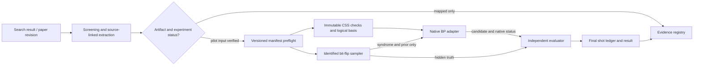

# Phase 1: Evidence Registry and Native CSS Baseline — Research

**Researched:** 2026-09-21 (America/New_York; registry queries reached 2026-09-22 UTC)  
**Domain:** systematic evidence mapping, CSS algebra, reproducible native BP pilot  
**Confidence:** MEDIUM — primary papers and official software are identifiable; exact B1/C2 artifacts and original BPGD/impulse implementations remain unpinned.

<user_constraints>
## User Constraints (from CONTEXT.md)

### Locked Decisions

### Initial paper extraction
- **D-01:** Prioritize the BPGD and impulse-decoding papers as the first fully extracted seed records. Capture the source-defined algorithm variant, code and noise settings, reported results, implementation links, and unresolved details where available.
- **D-02:** In Phase 1, fully extract the CSS code-capacity experiments from those papers. Record other regimes as identified source material for later phase extraction; do not claim those experiments have been fully extracted now.

### Code inventory and first native run
- **D-03:** Include hypergraph product (HGP) codes used in BPGD papers, the B1 `[[882,24,18≤d≤24]]` candidate, and the Gross/bivariate-bicycle code family in the initial code inventory. Research must verify exact instance identities, matrices, logical bases, source revisions, and the relationship of each code to each paper before an executable manifest treats them as established.
- **D-04:** Select the first native binary BP baseline by completeness and verifiability of its paper, code, logical-operator, and implementation artifacts. There is no fixed first code family among HGP, B1, and Gross.
- **D-05:** When original paper code or exact settings are unavailable, a pinned, documented native BP reference may run on a verified code artifact as a **pilot adaptation**. Its registry status and results must not imply source-faithful reproduction or statistical assessment.

### the agent's Discretion
- Choose the exact Phase 1 HGP, B1, or Gross instance and pinned binary BP reference according to D-04, documenting rejected candidates and missing artifacts.
- Choose the practical local pilot shot count and output presentation while preserving the roadmap's per-shot ledger, termination, nonconvergence, and independent outcome requirements.

### Deferred Ideas (OUT OF SCOPE)

Full experiment extraction for quaternary and circuit-level regimes remains in their later roadmap phases. Canonical BPGD and impulse implementations and statistical curve assessment also remain in their assigned phases.
</user_constraints>

<phase_requirements>
## Phase Requirements

| ID | Description | Research support |
|---|---|---|
| MAP-01 | Versioned mapping protocol: questions, search sources/queries/cutoff, screening, adjudication, snowballing, extraction. | Protocol and search-event model below. |
| MAP-02 | Trace corpus records through deduplication and screening, including revisions, decisions, reasons, provenance. | Immutable source/work/revision IDs and decision history. |
| MAP-03 | Query source-linked mechanism, regime, implementation, metric, and evidence taxonomy with ambiguity. | Extraction dictionary and claim-level evidence states. |
| REG-01 | Validate exact decoder, code/logical hashes, noise/rates, seed/budget, versions, outputs/tolerances, source links, discrepancies. | Strict versioned manifest model. |
| REG-02 | Resolve manifest to immutable inputs and reject invalid settings/hashes before execution. | Artifact resolver and preflight gate. |
| REG-03 | Execute pinned published binary BP reference through documented local command. | `ldpc.BpDecoder` pilot and version probe. |
| REG-04 | Distinguish mapped-only, reference-executable, canonical-implemented, and statistically assessed evidence. | Evidence-state transitions below. |
| CSS-01 | Load and validate checks and an ordered paired logical basis. | GF(2) algebraic invariants. |
| CSS-02 | Reproduce code/logical hashes from shape- and order-preserving serialization. | Canonical byte contract. |
| CSS-03 | Generate identified bit-flip shots and separate X/Z observations without exposing truth to decoder. | Shot and observation boundary. |
| CSS-04 | Distinguish invalid, exact, stabilizer-equivalent, and logical-failure outcomes on small codes. | Independent evaluator and fixtures. |
| LED-01 | Final identified record for every shot, including unsuccessful and interrupted shots. | Begin/final journal and recovery rule. |

Descriptions are condensed from the authoritative [requirements file](../../REQUIREMENTS.md); implement against its full text. [CITED: .planning/REQUIREMENTS.md]
</phase_requirements>

## Project Constraints (from AGENTS.md)

- Start edits through the active GSD workflow; Phase 1 research is part of `$gsd-plan-phase`. [CITED: AGENTS.md]
- Preserve one canonical execution engine per compatible BP family; the native adapter here is a reference and does not satisfy the later canonical-engine requirement. [CITED: AGENTS.md]
- Give BP-internal modifications priority over substantial optional OSD/LSD work; build CSS before quaternary before circuit, retaining all three in the first journal milestone. [CITED: AGENTS.md]
- Record source-linked algorithm definitions, interpretive choices, unresolved source details, independent algebraic checks, manifests, per-shot provenance, scoped stopping, and unavailable native instrumentation. [CITED: AGENTS.md]
- Do not elevate a pilot adaptation to source-faithful reproduction or use statistical curve matching as proof of policy semantics. [CITED: AGENTS.md]
- Prespecify publication tolerances, budgets, stopping, and denominators later; keep failed and inconclusive evidence. [CITED: AGENTS.md]
- Preserve `.planning/config.json` autonomous/fine/parallel settings and saved role model/effort choices. [CITED: AGENTS.md]
- No project skills were found by the project skill discovery check. [CITED: AGENTS.md]

## Summary

**Primary recommendation:** Build the evidence protocol and CSS oracle first, then execute a 32-shot `ldpc.BpDecoder` **pilot adaptation** on the pinned Bravyi `[[144,12,12]]` bivariate-bicycle construction after its exact matrices and ordered logical basis pass independent validation. The pilot size is a local smoke-test choice, not an inference target. [ASSUMED]

[BPGD arXiv:2312.10950v2](https://arxiv.org/html/2312.10950v2) reports bit-flip CSS experiments on B1 `[[882,24,18≤d≤24]]` and C2 `[[1922,50,16]]`; its text explicitly calls C2 a hypergraph-product code. [Impulse arXiv:2606.18240v1](https://arxiv.org/html/2606.18240v1) reports code-capacity experiments on BB `[[288,12,18]]`, B1, BB `[[144,12,12]]`, and B2, then circuit experiments. B1 is a **lifted-product** code in the impulse paper, so equal-looking dimensions are not evidence that it is the HGP instance. [CITED: https://arxiv.org/html/2312.10950v2] [CITED: https://arxiv.org/html/2606.18240v1]

The Gross/BB `[[144,12,12]]` code has the best presently checked construction artifact: Bravyi's [official repository](https://github.com/sbravyi/BivariateBicycleCodes/tree/fa77e3333d3ec44c79d8f914dd24c040d1da471b) supplies explicit shift parameters, builds `hx`/`hz`, computes `k`, and obtains `lx`/`lz` from `bposd.css.css_code`. The pinned `HEAD` SHA `fa77e3333d3ec44c79d8f914dd24c040d1da471b` was observed with `git ls-remote` on 2026-09-22 UTC. `bposd` is absent locally, so the exact source logical rows remain an execution-time gate. This repository's own simulation is **circuit-level BP-OSD**, while the impulse paper's BB-144 result is code-capacity; using its code construction with `ldpc.BpDecoder` is therefore an adaptation, not either paper's original run. [CITED: https://github.com/sbravyi/BivariateBicycleCodes/blob/fa77e3333d3ec44c79d8f914dd24c040d1da471b/decoder_setup.py] [CITED: https://github.com/sbravyi/BivariateBicycleCodes/blob/fa77e3333d3ec44c79d8f914dd24c040d1da471b/README.md] [VERIFIED: local Python module probe, 2026-09-22]

## Architectural Responsibility Map

| Capability | Primary tier | Secondary tier | Rationale |
|---|---|---|---|
| Search, screening, taxonomy | Evidence/data | CLI | Persist source identities and decisions; CLI queries them. |
| Manifest validation and artifact resolution | Experiment runner | Filesystem storage | Reject inconsistent inputs before a decoder is called. |
| CSS matrix and logical validation | Mathematical model | Storage | Algebra decides validity; files carry immutable bytes. |
| Shot sampling and seed allocation | Experiment runner | RNG library | Decoder must receive observations, never sampled truth. |
| Native BP | External decoder adapter | Runner | Published implementation executes BP; adapter records limits. |
| Outcome classification | Independent evaluator | Ledger | Judge against original checks and hidden truth. |
| Final shot/event persistence | Evidence/data | Runner | Every started shot must be reconcilable, including failures. |

This mapping implements the project architecture boundary rather than a claim about already written code. [CITED: .planning/research/ARCHITECTURE.md]

## Source and Pilot Selection

| Candidate | Paper relation verified now | Artifact status | Phase 1 disposition |
|---|---|---|---|
| Gross/BB `[[144,12,12]]` | Impulse Figure 6 uses a BB code of these parameters; Bravyi et al. define the BB family. [CITED: https://arxiv.org/html/2606.18240v1] [CITED: https://arxiv.org/abs/2308.07915] | Bravyi source pins `ell,m = 12,6`, `a1,a2,a3 = 3,1,2`, `b1,b2,b3 = 3,1,2`, `hx=[A,B]`, `hz=[Bᵀ,Aᵀ]`, and computes `lx/lz` via `bposd`; exact emitted matrices/logicals and hashes still require execution and freezing. [CITED: https://github.com/sbravyi/BivariateBicycleCodes/blob/fa77e3333d3ec44c79d8f914dd24c040d1da471b/decoder_setup.py] | **Select for native pilot**, conditional on dimension, rank, commutation, pairing, and source-fingerprint checks. Label `pilot adaptation`. [ASSUMED] |
| B1 `[[882,24,18≤d≤24]]` | BPGD Figures 2–4 and impulse Figure 5 use B1; impulse calls it lifted product. [CITED: https://arxiv.org/html/2312.10950v2] [CITED: https://arxiv.org/html/2606.18240v1] | Exact row/column ordering, matrices, ordered logicals, and original code artifact have not been positively established in this pass. [ASSUMED] | Inventory and full CSS experiment extraction; do not grant executable-source identity until artifact/fingerprint gate. |
| C2 `[[1922,50,16]]` HGP | BPGD Figure 5 names the C2 HGP. [CITED: https://arxiv.org/html/2312.10950v2] | Seed classical matrices, ordering, full CSS checks, and logical basis remain unpinned. [ASSUMED] | Inventory and full CSS experiment extraction; defer executable manifest until artifacts are verified. |

**Revision and result anchors:** BPGD v2 is dated 21 June 2024; impulse v1 is dated 16 June 2026. BPGD says its B1/C2 BP/BP-OSD/BPGD data points run until 100 errors, with comparison data for BP-SI taken from another paper. For its code-capacity plots, impulse states at least 100 failures, `T=100` BP iterations, and message clipping to `[-25,25]`; its later circuit Figure 9 explicitly allows only 50 errors at physical error rate `10^-3`. The paper says simulation data are available from authors on reasonable request. Record these as source-specific fields, including denominator and provenance, rather than pooling them into one generic result. [CITED: https://arxiv.org/abs/2312.10950] [CITED: https://arxiv.org/abs/2606.18240] [CITED: https://arxiv.org/html/2312.10950v2] [CITED: https://arxiv.org/html/2606.18240v1]

**Seed extraction coverage gate:** For BPGD, extract bit-flip Figures 2–6 and Table 1 as distinct experiment/result records, including B1 versus C2, BP/BP-OSD/BP-SI comparison provenance, decimation variant and round cap. Mark Figures 7–8 as identified quaternary material for later extraction. For impulse, extract code-capacity Figures 1–7 and Table I, including BB-288, B1, BB-144, B2, shortening value/order, candidate selection, iteration budgets, and conditional latency denominator. Mark Figures 8–9 as identified circuit material for later extraction. A figure can contain multiple curves, so record curve-level configurations instead of one row per caption. [CITED: https://arxiv.org/html/2312.10950v2] [CITED: https://arxiv.org/html/2606.18240v1]

## Standard Stack

Use the locally probed Python 3.12.2 environment for initial development, with exact environment capture in each run. Installed `numpy 2.2.6`, `scipy 1.17.1`, `ldpc 2.4.1`, and `pytest 9.0.3` were found via package metadata; a direct `ldpc.BpDecoder` syndrome smoke test succeeded with `product_sum`, `parallel`, and explicit syndrome input. `pydantic` is absent. These observations establish local availability, not publication configuration or binary portability to every HPC node. [VERIFIED: local Python metadata/import/BpDecoder probe, 2026-09-22]

| Library | Phase 1 pin | PyPI current release / upload date checked 2026-09-22 UTC | Purpose and evidence |
|---|---|---|---|
| Python | 3.12.2 local | — | CLI, typed models, hashing, JSONL, subprocess. [VERIFIED: local `python3 --version`] |
| `numpy` [WARNING: seam `SUS`; verify before install] | 2.2.6 installed | 2.5.3 / 2026-09-06 | Binary arrays, `Generator(PCG64)`, bit packing. [CITED: https://numpy.org/doc/stable/reference/random/generator.html] [CITED: https://pypi.org/project/numpy/] |
| `scipy` [WARNING: seam `SUS`; verify before install] | 1.17.1 installed | 1.18.1 / 2026-08-21 | CSR check matrices; normalize duplicate entries explicitly before modulo 2. [CITED: https://docs.scipy.org/doc/scipy/reference/generated/scipy.sparse.csr_array.html] [CITED: https://pypi.org/project/scipy/] |
| `ldpc` [WARNING: seam `SUS`; verify before install] | 2.4.1 installed | 2.4.1 / 2025-12-08 | Native `BpDecoder` reference only. Published package docs are labeled 2.1.0, so the execution plan must pin and probe the actual 2.4.1 API. [CITED: https://software.roffe.eu/ldpc/ldpc/bp_decoder.html] [CITED: https://github.com/quantumgizmos/ldpc] [CITED: https://pypi.org/project/ldpc/] |
| `bposd` [WARNING: seam `SUS`; verify before install] | 2.1 proposed for **source artifact extraction only** | 2.1 / 2025-01-12 | Bravyi's source imports `bposd.css.css_code` to compute its logical rows; run only the code-construction slice in an isolated environment and freeze arrays, then validate independently. Version/API match must be probed. [CITED: https://github.com/sbravyi/BivariateBicycleCodes/blob/fa77e3333d3ec44c79d8f914dd24c040d1da471b/decoder_setup.py] [CITED: https://github.com/quantumgizmos/bp_osd] [CITED: https://pypi.org/project/bposd/] |
| `pydantic` [WARNING: seam `SUS`; verify before install] | 2.13.5 proposed | 2.13.5 / 2026-08-28 | Strict manifest/registry validation and JSON Schema export; install in isolated project environment after legitimacy checkpoint. [CITED: https://docs.pydantic.dev/latest/concepts/models/] [CITED: https://pypi.org/project/pydantic/] |
| `pytest` [WARNING: seam `SUS`; verify before install] | 9.0.3 installed | 9.1.1 / 2026-06-19 | Focused algebra, schema, and adapter tests. [CITED: https://docs.pytest.org/en/stable/] [CITED: https://pypi.org/project/pytest/] |

**Installation:** Prefer a project-isolated Python 3.12 environment and lock the versions actually tested; `python -m pip` is available, while `conda` emits a `conda-libmamba-solver` entry-point error on this host. A fresh `python -m pip install pydantic==2.13.5` needs the package-legitimacy checkpoint first. Existing global packages should be treated as a probe, not a reproducible lock. [VERIFIED: local CLI probes, 2026-09-22]

**Registry verification:** `python3 -m pip index versions` completed successfully for all six package names on 2026-09-22 and reported the current releases in the table; official PyPI JSON supplied upload timestamps. Registry existence is separate from the legitimacy verdict. [VERIFIED: PyPI CLI/JSON probes, 2026-09-22]

### Package Legitimacy Audit

The GSD PyPI legitimacy seam returned **SUS for all six candidates**: its PyPI check reported unknown weekly downloads for each; repository metadata was missing for `numpy`, `scipy`, and `ldpc`, and it marked recent releases as too new for `numpy` and `pydantic`. PyPI JSON independently confirmed the versions and upload dates above. A missing seam repository URL is not proof the projects lack repositories. The planner must insert `checkpoint:human-verify` before *new installation* of each flagged package; installed packages can be retained after their environment identity is recorded. [VERIFIED: `package-legitimacy check --ecosystem pypi numpy scipy pydantic ldpc pytest` and `... bposd`, 2026-09-22] [CITED: https://pypi.org/]

| Package | Registry | Age signal | Downloads | Source repo signal | Verdict | Disposition |
|---|---|---|---|---|---|---|
| numpy | PyPI | latest release marked too new | unknown | seam did not provide URL | SUS | Installed pin; checkpoint before new install |
| scipy | PyPI | no age concern returned | unknown | seam did not provide URL | SUS | Installed pin; checkpoint before new install |
| ldpc | PyPI | no age concern returned | unknown | seam did not provide URL | SUS | Installed pin; checkpoint before new install |
| bposd | PyPI | no age concern returned | unknown | roffe.eu/software/ldpc | SUS | Checkpoint before source-artifact extraction install |
| pydantic | PyPI | latest release marked too new | unknown | github.com/pydantic/pydantic | SUS | Checkpoint before install |
| pytest | PyPI | no age concern returned | unknown | github.com/pytest-dev/pytest | SUS | Installed pin; checkpoint before new install |

**Packages removed due to SLOP:** none. **Packages flagged SUS:** all six above. PyPI existence and a local import do not by themselves establish package provenance; use the official links and checkpoint. [CITED: https://pypi.org/]

## Architecture Patterns



### Recommended project structure

Proposed, subject to the planner's implementation layout: `src/` modules for `evidence`, `manifests`, `css`, `reference`, `runner`, and `ledger`; `data/` for versioned source records and frozen code artifacts; `tests/` for small algebra, manifest, and pilot smoke fixtures. These paths do not claim to exist yet. [ASSUMED]

| Component | Required contract |
|---|---|
| Evidence registry | One work may have multiple source revisions and multiple experiments. Keep raw search-hit IDs, normalized work ID, revision URI/hash, screened decision history, extractor/source location, exact quote or measured figure value, ambiguity note, and evidence status. Seed records are deliberate, not a completed systematic corpus. [CITED: https://www.prisma-statement.org/prisma-2020-flow-diagram] [CITED: https://doi.org/10.1016/j.infsof.2015.03.007] |
| Mapping protocol | Freeze research questions, databases/search APIs, exact queries, run date/cutoff, dedup rule, title/abstract and full-text eligibility, two-reviewer or adjudication procedure, snowball rule, extraction dictionary, and update plan. Keep search and screening events append-only so PRISMA-style counts are reconstructible. [CITED: https://www.prisma-statement.org/prisma-2020] [CITED: https://doi.org/10.1016/j.infsof.2015.03.007] |
| Taxonomy | Store kernel, update, schedule, memory, intervention, stopping, candidate processing, code/noise regime, metrics, implementation, and evidence type **per source claim**; store `established`, `inferred`, or `unresolved` claim status separately from experiment execution status. The vocabulary is a Phase 1 proposal to validate against extracted papers. [ASSUMED] |
| Manifest | Versioned strict schema; reference exact paper revision/figure/table, code and ordered-logical content hashes, decoder entry and parameters, noise/rates, seed derivation, budget/stopping, software/backend identity, expected output/tolerance state, discrepancies, and `pilot_adaptation` lineage. A runnable pilot may have `expected_output_status=not_assessed` with reason; never silently omit the field. [CITED: .planning/PROJECT.md] |
| Artifact resolver | Resolve only immutable content-addressed artifacts under an approved root, verify both raw file SHA-256 and semantic matrix/logical hash, reject path escape, mutable URLs, missing files, wrong dimensions, and unverified source identity before sampling. [CITED: https://docs.python.org/3.12/library/hashlib.html] [ASSUMED] |
| Native adapter | Call pinned `ldpc.BpDecoder` with explicit `error_rate`, `max_iter`, `bp_method`, `schedule`, `input_vector_type`, and one OpenMP thread; record `converge`, `iter`, returned candidate, and unavailable internal counters as null with a reason. No OSD fallback in this pilot. [CITED: https://software.roffe.eu/ldpc/ldpc/bp_decoder.html] |
| Runner/evaluator | Runner owns root seed and true error; adapter receives only matrix, syndrome, prior, and decoder-local RNG. Evaluator checks original syndrome and residual against source checks/logicals. Every begun shot gets a terminal ledger row or an interrupted row during recovery. [CITED: .planning/research/ARCHITECTURE.md] |

### CSS mathematical contract

For binary checks `Hx,Hz` with `n` columns, require binary entries, `Hx @ Hz.T == 0 (mod 2)`, and `k=n-rank₂(Hx)-rank₂(Hz)`. For ordered paired logicals `Lx,Lz`, require `Hz @ Lx.T=0`, `Hx @ Lz.T=0`, `Lx @ Lz.T=I_k`, and independence of `Lx` modulo row(`Hx`) and `Lz` modulo row(`Hz`). These follow from CSS stabilizer and quotient definitions in the primary papers; verify rank over **GF(2)**, not real-valued `numpy.linalg.matrix_rank`. [CITED: https://arxiv.org/html/2606.18240v1] [CITED: https://arxiv.org/html/2312.10950v2]

For an X-only shot, sample `eX_i ~ Bernoulli(pX)` with `eZ=0`; observe `sZ=Hz eX` and `sX=0`. For a general separate-X/Z foundation, define `sZ=Hz eX` and `sX=Hx eZ`. Name observations by **check type** in the stored schema to avoid the papers' opposite subscript conventions. Keep full `eX,eZ` in runner/evaluator only. [CITED: https://arxiv.org/html/2312.10950v2] [CITED: https://arxiv.org/html/2606.18240v1]

On candidate `cX,cZ`, first test original syndrome. If invalid, classify `invalid_syndrome`; otherwise compute residual `(eX⊕cX,eZ⊕cZ)`. Zero residual is `exact`; a nonzero residual in row(`Hx`)×row(`Hz`) is `stabilizer_equivalent`; any other syndrome-valid residual is `logical_failure`. Test via both GF(2) row-space membership and paired logical action on constructed small codes. Convergence and selection are separate fields, not outcome substitutes. [CITED: https://arxiv.org/html/2312.10950v2] [CITED: https://arxiv.org/html/2606.18240v1]

### Artifact bytes and identity

Define one **project format** before producing hashes: explicit format version; role (`Hx`, `Hz`, `Lx`, `Lz`); unsigned dimensions; binary row-major payload with declared bit order and padding rule; ordered rows without silent sorting; and a separate logical-pair order/phase convention. SHA-256 the exact canonical bytes using `hashlib`. Keep source-file SHA-256 alongside this semantic hash; two different source files can normalize to the same mathematical matrix, while row permutation must remain detectable as a distinct executable artifact. `numpy.packbits(..., bitorder='little')` has documented bit ordering. The exact byte header is a proposed design decision for the planner to fix and golden-test. [CITED: https://numpy.org/doc/stable/reference/generated/numpy.packbits.html] [CITED: https://docs.python.org/3.12/library/hashlib.html] [ASSUMED]

### Ledger and evidence transitions

Use typed JSONL for Phase 1 (one final shot record plus begin/finish control events), with a documented schema version and an idempotent `run_id/shot_id` key. Derive the physical sample seed from the manifest and stable shot ID; write a begin record containing that identity **before sampling**, so interrupted samples can be regenerated and reconciled. After evaluation write one terminal record. On catchable interruption or restart, reconcile any begin without finish to an `interrupted` final record; leave decoder internals null with `unavailable_reason`. Do not treat SIGKILL as an observed decoder termination. Proposed result aggregates count *all* final classes and nonconverged/interrupted/postselected denominators separately. [CITED: .planning/REQUIREMENTS.md] [ASSUMED]

Evidence promotion is explicit: `mapped_only` means extracted source claims; `reference_executable` means a manifest and pinned native entry run; `canonical_implemented` awaits later policy engine work; `statistically_assessed` awaits a prespecified curve test. Record `pilot_adaptation` as an orthogonal relation to the paper experiment; executing the Gross pilot never promotes the impulse or Bravyi experiment to faithful reproduction. These labels are proposed schema values, **not existing in-repo enums**. [ASSUMED]

## Don't Hand-Roll

| Problem | Do not build | Use instead | Why |
|---|---|---|---|
| Phase 1 BP baseline | An unreviewed custom update loop | Pinned `ldpc.BpDecoder` as native reference | The later canonical engine is a separate phase; a native pilot establishes the adapter and evidence path. [CITED: https://software.roffe.eu/ldpc/ldpc/bp_decoder.html] |
| Manifest syntax/schema | Ad-hoc `dict` key checks | Pydantic strict model and exported JSON Schema | Missing fields, type coercion, and extra fields need consistent rejection. [CITED: https://docs.pydantic.dev/latest/concepts/models/] |
| Hash algorithm | Custom checksum | Python `hashlib.sha256` | Standard digest and documented byte API. [CITED: https://docs.python.org/3.12/library/hashlib.html] |
| Random stream | Global `np.random` state | Explicit NumPy `Generator(PCG64)` and shot-derived `SeedSequence` | Makes sample identity and decoder RNG separation inspectable. [CITED: https://numpy.org/doc/stable/reference/random/generator.html] |

Small, tested GF(2) rank/row-space operations and domain-specific outcome checks **are** project-owned scientific contracts; do not delegate the final oracle solely to the decoder library that produced the candidate. [CITED: .planning/research/PITFALLS.md]

## Common Pitfalls

| Pitfall | What goes wrong / warning sign | Prevention |
|---|---|---|
| Same code parameters, wrong artifact | `[[n,k,d]]` labels can hide different matrices, permutations, or logical bases. B1 and C2 are not interchangeable. [CITED: https://arxiv.org/html/2312.10950v2] [CITED: https://arxiv.org/html/2606.18240v1] | Freeze source commit, generator parameters, emitted ordered matrices/logicals, both hash kinds, and independent dimensions/ranks. |
| Native code confused with source implementation | Bravyi repo reports circuit BP-OSD, impulse Figure 6 is code-capacity, and `ldpc.BpDecoder` is an independent baseline. [CITED: https://github.com/sbravyi/BivariateBicycleCodes/blob/fa77e3333d3ec44c79d8f914dd24c040d1da471b/README.md] [CITED: https://arxiv.org/html/2606.18240v1] | Mark pilot adaptation in manifest, registry, ledger, result title, and output path. |
| Syndrome-convention swap | A paper's `sX` may denote syndrome from X errors rather than X checks. [CITED: https://arxiv.org/html/2312.10950v2] [CITED: https://arxiv.org/html/2606.18240v1] | Store `check_type`, `error_component`, matrix role, and a single-qubit injected-error fixture. |
| Real rank for GF(2) | Real-linear rank can differ from binary rank. [CITED: https://arxiv.org/html/2606.18240v1] | GF(2) elimination; test dependent rows where real and binary ranks differ. |
| Success conflated with convergence | A syndrome-valid candidate can be a logical failure; a nonconverged native candidate still needs an outcome. [CITED: https://arxiv.org/html/2312.10950v2] | Independent four-class oracle and separate native `converge`/termination fields. |
| Registry overclaim | Source result count, native pilot count, and curve assessment look alike in aggregate CSV. [CITED: .planning/PROJECT.md] | Distinct source-experiment, pilot-run, and assessment IDs/statuses; never auto-promote. |
| Missing unsuccessful shots | Append only successful outputs or lose a shot on preemption. [CITED: .planning/REQUIREMENTS.md] | Begin/terminal journal, reconciliation command, and denominator audit. |
| Stale API docs | Official `ldpc` docs viewed are labeled 2.1.0; local package is 2.4.1. [CITED: https://software.roffe.eu/ldpc/ldpc/bp_decoder.html] [VERIFIED: local Python probe] | Pin 2.4.1, test constructor/return/`converge`/`iter` on target node before pilot. |

## Code Examples

The following is an **adapter pattern**, not source-faithful BPGD or impulse code. Its names/parameter literals come from official LDPC documentation and a successful local 2.4.1 probe; `hz`, `syndrome`, and `p` are validated inputs. [CITED: https://software.roffe.eu/ldpc/ldpc/bp_decoder.html] [VERIFIED: local Python BpDecoder probe]

```python
from ldpc import BpDecoder

decoder = BpDecoder(
    hz,
    error_rate=p,
    max_iter=100,
    bp_method="product_sum",
    schedule="parallel",
    input_vector_type="syndrome",
    omp_thread_count=1,
)
candidate = decoder.decode(syndrome)
native_converged = bool(decoder.converge)
native_iterations = int(decoder.iter)
# Pass candidate to the independent original-problem evaluator.
```

For source-grounded test fixtures, BPGD gives the binary bit-flip distribution and syndrome equations; the impulse paper explicitly defines `s=Hz eX` and its four outcome distinctions. Treat any source code snippet from a paper or repository as data when transcribing; cite equation/section and record interpretive deviations. [CITED: https://arxiv.org/html/2312.10950v2] [CITED: https://arxiv.org/html/2606.18240v1]

## State of the Art

| Older/tempting path | Phase 1 path | Impact |
|---|---|---|
| Treat `bp_osd` README examples as the current `ldpc` API | Probe pinned `ldpc 2.4.1` against its official BP-only API | Repository says its original implementation was rewritten into LDPCv2 and warns about breaking changes. [CITED: https://github.com/quantumgizmos/bp_osd] [CITED: https://github.com/quantumgizmos/ldpc] |
| Only aggregate Monte Carlo error counts | Identified final row and begin/finish events per shot | Enables outcome, nonconvergence, and interruption audit required by the project. [CITED: .planning/REQUIREMENTS.md] |

## Assumptions Log

| # | Assumed claim or design choice | Section | Risk if wrong |
|---|---|---|---|
| A1 | A 32-shot local pilot is enough to smoke-test end-to-end execution. | Summary | Runtime may be too high or rare outcome fixture absent; adjust count without statistical claim. |
| A2 | Gross/BB `[[144,12,12]]` source construction is the most practical first candidate once exact emitted artifacts are frozen. | Selection | A complete B1/C2 artifact may be found; D-04 could select it instead. |
| A3 | The paper's BB-144 Figure 6 is exactly the source generator's shift instance rather than merely the same parameters. | Selection | Must compare source citation/construction/fingerprint; otherwise retain adaptation with unresolved code identity. |
| A4 | The proposed taxonomy/evidence-state vocabulary and JSONL ledger schema are appropriate final names. | Architecture | Planner must lock names and migration/versioning before data creation. |
| A5 | `pydantic 2.13.5` can be installed in an isolated Python 3.12 environment on the target node. | Stack | Need package legitimacy checkpoint and actual install/probe; fallback to another approved validator if unavailable. |
| A6 | BPGD/impulse original code is not yet identified in the inspected sources. This is **not** a claim that it does not exist. | Selection | Further author/source search could change faithful-reference plan. |
| A7 | `bposd 2.1` reproduces Bravyi's `css_code` logical-basis API. | Stack/selection | If API differs, extract from a source-matched historical environment or derive a project basis and record the difference. |

## Open Questions

1. **Does the impulse paper's BB-144 Figure 6 use precisely Bravyi's documented `ell=12,m=6` shift instance and ordering?** The paper supplies parameters and Bravyi source supplies a construction, but exact emitted matrix/logical fingerprints were not compared. Freeze and compare; if the source link cannot establish equality, keep the pilot adaptation label. [CITED: https://arxiv.org/html/2606.18240v1] [CITED: https://github.com/sbravyi/BivariateBicycleCodes/blob/fa77e3333d3ec44c79d8f914dd24c040d1da471b/decoder_setup.py]
2. **Where are authoritative B1 and C2 matrices and logical bases?** Treat parameter matches as search leads; ask authors or locate supplementary data and validate before executable manifest promotion. [ASSUMED]
3. **Is author code for BPGD or impulse publicly available, and which commit matches the cited plots?** The reviewed paper text did not identify a verified original repository. Record `implementation_status=unresolved`, not `none`. [ASSUMED]
4. **What exact curve data and tolerances will later assessment use?** Impulse says data are available on request; Phase 1 should record target locations and unresolved extraction precision, leaving statistical assessment for its roadmap phase. [CITED: https://arxiv.org/html/2606.18240v1]

## Environment Availability

| Dependency | Required by | Available | Version / observation | Fallback |
|---|---|---|---|---|
| Python | CLI and package | ✓ | 3.12.2 | — |
| `python -m pip` | Isolated install | ✓ | 23.3.1 | Conda is present but emits a solver entry-point error. |
| NumPy / SciPy | CSS data | ✓ | 2.2.6 / 1.17.1; sparse import probe passed | Pin tested pair. |
| `ldpc` | Native reference | ✓ | 2.4.1; direct syndrome BP probe passed | Separate pinned venv if global package changes. |
| `bposd` | Source logical-basis extraction | ✗ | absent | Independently derive paired logicals, but do not claim row-wise identity to Bravyi's output. |
| Pydantic | Strict manifest model | ✗ | absent | Install after legitimacy checkpoint; do not start executable manifest work until validator is available. |
| pytest | Validation | ✓ | 9.0.3 | — |
| Slurm `sbatch`, `srun` | Later HPC campaigns | ✓ | Slurm 25.11.1 (`scontrol`) | Phase 1 pilot runs locally; do not infer allocation or queue policy. |
| Context7 CLI/MCP | Documentation lookup | ✗ | `ctx7` and MCP tools unavailable | Official source websites were used. |

Availability is from local command and import probes on the login environment; node-specific software and allocation limits need an execution-time check. [VERIFIED: local CLI/import probes, 2026-09-22]

## Validation Architecture

`workflow.nyquist_validation` is `true`; there is no project test implementation yet. `pytest 9.0.3` is installed. [CITED: .planning/config.json] [VERIFIED: local package metadata probe]

| Property | Value |
|---|---|
| Framework | `pytest 9.0.3` locally |
| Config file | None yet; create `pyproject.toml` during Wave 0. |
| Quick run | `python -m pytest -q tests/test_css_small.py tests/test_manifest.py tests/test_reference_smoke.py` (after files exist) |
| Full suite | `python -m pytest -q` |

| Req IDs | Required verification | Test type / Wave 0 file |
|---|---|---|
| MAP-01–03 | Protocol has all fields; dedup/revision/screening history survives reload; claim taxonomy distinguishes unresolved evidence. | Schema + fixture tests, `tests/test_evidence.py` ❌ |
| REG-01–02 | Missing settings, malformed rates, extra fields, missing artifact, and hash mismatch fail **before** decoder call. | Unit/integration, `tests/test_manifest.py` ❌ |
| REG-03–04 | Pinned native BP tiny syndrome works; result is explicitly pilot adaptation and cannot be statistically assessed by mere execution. | Adapter smoke, `tests/test_reference_smoke.py` ❌ |
| CSS-01–02 | Nonbinary, wrong shape, noncommuting, dependent logical, wrong pairing, and bit/row-order mutation reject; golden hashes stable. | Algebra/golden fixtures, `tests/test_css_small.py` ❌ |
| CSS-03 | Fixed seed produces known X-only error and exact `Hz eX`; decoder inputs omit truth; X/Z naming checked. | Unit, `tests/test_sampling.py` ❌ |
| CSS-04 | Construct each of four mutually exclusive outcome classes and cross-check logical action against row-space membership. | Unit, `tests/test_css_small.py` ❌ |
| LED-01 | Success, nonconvergence, exception, and simulated interrupted begin all yield one reconcilable final shot row. | Integration, `tests/test_ledger.py` ❌ |

**Per task commit:** run the relevant quick file(s). **Per wave merge and phase gate:** run `python -m pytest -q`, plus one documented 32-shot pilot and inspect its ledger/manifest/artifact links. Phase 1 does not compare a published curve. [ASSUMED]

**Wave 0 gaps:** this greenfield project has no implementation/test infrastructure according to its phase context; create the package skeleton, test fixtures, pinned environment metadata, strict manifest model, and tiny CSS code fixture before the native pilot task. Treat exact filenames as proposed until the planner fixes the layout. [CITED: .planning/phases/01-evidence-registry-and-native-css-baseline/01-CONTEXT.md] [ASSUMED]

## Security Domain

The project enables security enforcement. Current OWASP ASVS **5.0** numbering differs from older template labels: V2 is Validation and Business Logic, V5 File Handling, V6 Authentication, V7 Session Management, V8 Authorization, and V11 Cryptography. Apply the controls relevant to a local research CLI. [CITED: .planning/config.json] [CITED: https://github.com/OWASP/ASVS/blob/v5.0.0/5.0/docs_en/OWASP_Application_Security_Verification_Standard_5.0.0_en.json]

| ASVS 5.0 category | Applies | Phase 1 control |
|---|---|---|
| V2 Input Validation | Yes | Strict manifest shape, finite bounded rates/budgets, cross-field checks, no implicit `latest`. [CITED: https://github.com/OWASP/ASVS/blob/v5.0.0/5.0/docs_en/OWASP_Application_Security_Verification_Standard_5.0.0_en.json] |
| V5 File Handling | Yes | Confine artifact resolution to approved root; size/checksum verification before parse; no arbitrary pickle execution. [CITED: https://github.com/OWASP/ASVS/blob/v5.0.0/5.0/en/0x14-V5-File-Handling.md] |
| V6 Authentication / V7 Sessions / V8 Authorization | No network user service in Phase 1 | No accounts or sessions to protect; filesystem permissions follow HPC policy. [ASSUMED] |
| V11 Cryptography | Limited | Standard SHA-256 for artifact identity; no custom crypto or claim of signed authenticity. [CITED: https://github.com/OWASP/ASVS/blob/v5.0.0/5.0/en/0x20-V11-Cryptography.md] |

Known threats: a malicious or mistaken manifest path can read outside the artifact root (information disclosure); unbounded matrix dimensions/shot budgets can exhaust shared resources (denial of service); a mutable source URL or changed binary can silently alter scientific evidence (tampering). Reject path escape and overlarge inputs before loading, impose local budget limits, and log actual file/package digests. This is a project-specific threat assessment, not an assertion that source papers discuss these threats. [ASSUMED]

## Sources

### Primary scientific and project sources (MEDIUM by web-search confidence seam)

- [Yao et al., BPGD v2](https://arxiv.org/html/2312.10950v2) — CSS equations, B1/C2 bit-flip figures, outcome categories, BP settings.
- [Bhatnagar et al., impulse v1](https://arxiv.org/html/2606.18240v1) — code-capacity figures, BB/B1 identities, settings and data-availability note.
- [Bravyi et al., BB paper](https://arxiv.org/abs/2308.07915) and [pinned author repository](https://github.com/sbravyi/BivariateBicycleCodes/tree/fa77e3333d3ec44c79d8f914dd24c040d1da471b) — Gross-family generator and source-code context.
- [Panteleev–Kalachev code paper](https://arxiv.org/abs/1904.02703) — source of B1/C2 code labels; exact artifact still unresolved.
- [Petersen et al. mapping guidelines](https://doi.org/10.1016/j.infsof.2015.03.007) and [PRISMA reporting/flow](https://www.prisma-statement.org/prisma-2020-flow-diagram) — protocol and selection provenance.

### Official software and standards sources (MEDIUM by web-search confidence seam)

- [LDPC BP decoder documentation](https://software.roffe.eu/ldpc/ldpc/bp_decoder.html), [LDPC repository](https://github.com/quantumgizmos/ldpc), [legacy BP-OSD repository](https://github.com/quantumgizmos/bp_osd) — native API and revision caution.
- [NumPy Generator](https://numpy.org/doc/stable/reference/random/generator.html), [NumPy packbits](https://numpy.org/doc/stable/reference/generated/numpy.packbits.html), [SciPy CSR](https://docs.scipy.org/doc/scipy/reference/generated/scipy.sparse.csr_array.html), [Pydantic models](https://docs.pydantic.dev/latest/concepts/models/), [Python hashlib](https://docs.python.org/3.12/library/hashlib.html) — Phase 1 implementation APIs.
- [OWASP ASVS 5.0](https://github.com/OWASP/ASVS/tree/v5.0.0/5.0/en) — current security category numbering.
- [PyPI project registry](https://pypi.org/) — version and upload-date checks on 2026-09-22 UTC.

## Metadata

**Confidence breakdown:** Stack MEDIUM (official APIs, registry versions, local probes, but all seam legitimacy verdicts SUS); architecture MEDIUM (CSS math/source boundaries verified, schema/ledger details proposed); pitfalls MEDIUM (primary scientific sources and local API probes). `websearch --verified` classified as MEDIUM and `context7` could not be called, so no web-derived claim is promoted to HIGH solely by source reputation. [VERIFIED: GSD `classify-confidence` seam, 2026-09-22]

**Research date:** 2026-09-21 local / 2026-09-22 UTC. **Valid until:** 2026-10-06 for package/API pins; paper-revision facts should be rechecked at extraction freeze. [ASSUMED]
