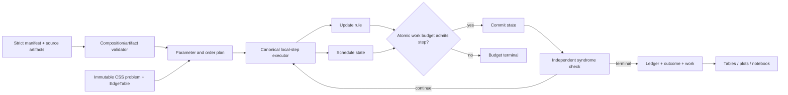

# Phase 3: Update Rules and Scheduling - Research

**Researched:** 2026-09-23
**Domain:** Binary CSS BP update rules, asynchronous scheduling, source artifacts, and scientific work accounting
**Confidence:** HIGH for in-repo seams and published procedures; MEDIUM for the runnable cluster baseline pending an author artifact

<user_constraints>
## User Constraints (from CONTEXT.md)

### Locked Decisions

### Update-rule parameters and diversity
- **D-01:** Support fixed scalar, iteration-dependent, and check-/edge-specific normalization and offset parameters. The user's motivation is decoder diversity. Effective assignments and their application semantics must be explicit and recorded.
- **D-02:** Accept both explicit parameter assignments and seeded generation from declared distributions. Preserve generator specification, seed identity, graph association, and resolved assignments with sufficient evidence for replay.
- **D-03:** Parameter refresh is configurable: fixed per decoder configuration across shots, fresh per attempt, or fresh per iteration. Define the iteration boundary for each schedule rather than assuming flooding semantics apply universally.
- **D-04:** Keep parameter-generation randomness, schedule-order randomness, and physical-error sampling independently identified. Changing decoder policies must not change matched physical-error samples.
- **D-05:** Allow exploratory parameter ranges and assignment rules beyond published variants, subject to mathematical and numerical validity checks. Keep source-defined presets and exploratory configurations separately labeled; exploratory flexibility does not establish source-faithful reproduction.

### Schedule order and convergence
- **D-06:** Implement both check-node serial and variable-node serial as distinct declared schedules. Each specifies its update unit, traversal order, and fresh/stale-message visibility. Individual-message serial was not selected for this phase.
- **D-07:** Layered scheduling accepts source-defined or user-supplied explicit partitions and a deterministic graph-based automatic construction. Record construction rules, actual layer membership, and order; validate compatibility with the declared update semantics. Generic layer construction must not be mislabeled as a published cluster-sequential algorithm.
- **D-08:** Randomized traversal supports an order fixed per configuration, redrawn per attempt, or reshuffled per sweep. Persist the refresh rule and independently replayable randomness identity.
- **D-09:** Check convergence after every completed local update unit: each layer, serial node update, or residual-selected update. Flooding retains its complete-sweep boundary. Research must define the selected cluster schedule's local unit and resulting stopping boundary explicitly. This is the selected behavior, not an optional sweep-only default.
- **D-10:** Count every convergence check and enforce hard work budgets independently of convergence-check cadence. Preserve schedule-qualified iteration counts, local progress, and actual work so stopping partway through a traversal is interpretable. If source stopping differs from the selected cadence, disclose the adaptation rather than claiming unchanged source semantics.

### Residual and cluster-sequential source choices
- **D-11:** Research primary sources and select one well-specified, source-linked baseline for residual scheduling and one for cluster-sequential scheduling. Document why each was chosen, its exact procedure, and unresolved source details. The user delegated these source selections to research.
- **D-12:** Residual scheduling implements only the pinned baseline and its source-defined parameters in Phase 3. Do not add exploratory priority scoring, tie-breaking, or selection-rule variants. Explicitly define residuals, cache/priority invalidation, selection, and their work costs.
- **D-13:** If the selected cluster source uses learned or optimized parameters, load pinned parameter artifacts only. Reproducing the training or optimization procedure is deferred. This does not assume that every cluster schedule requires learning, nor does it waive the source-defined construction/order requirement. Research must establish artifact availability and compatibility with the intended code before claiming support.
- **D-14:** Report schedule setup costs and decoding costs separately, without assumed amortization across shots. Costs of producing imported parameter artifacts remain explicitly unknown if unavailable; they are not zero.

### Pilot comparison design and outputs
- **D-15:** Use focused comparisons: vary update rules under flooding, vary schedules under sum-product, then exercise selected compatible combinations and parameter-diversity examples. The full Cartesian product is not required. Maintain explicit rejection of undefined combinations and matched physical-error samples.
- **D-16:** Provide both budget views: common check-to-variable message-update caps, and schedule-qualified iteration limits. Retain the full atomic work vector and measured runtime in both views; separately expose scheduling, residual evaluation/priority maintenance, and convergence-check work. Neither equal iteration limits nor equal message-update caps imply equal total cost.
- **D-17:** Beyond small deterministic correctness fixtures, pilot coverage includes the existing pinned BB-144 artifact, an HGP example from the user's requested classical LDPC construction family, and B1. The user specified HGP constituents with degree (3,4) or constructed using PEG, pointed to the BPGD paper, and explicitly added B1. Research must trace the construction, exact instances, ordering, and logical operators; matching dimensions or a family label does not establish artifact identity.
- **D-18:** Deliver tables, diagnostic plots, and a runnable analysis notebook. Cover evaluated outcomes, convergence, schedule-qualified iterations, raw work, setup/decoding runtime, and selected convergence traces. Preserve underlying evidence and use bounded representative traces under the inherited tracing contract.
- **D-19:** Keep Phase 3 results labeled as pilots/adaptations as appropriate, with assessment status explicit. Small pilots do not establish statistical curve reproduction or justify decoder rankings beyond the observed evidence. Independent algebraic and policy-semantics checks remain required.

### the agent's Discretion
- Select and justify the residual and cluster source baselines under D-11–13.
- Resolve exact equations, parameter-validity domains, graph-parameter application points, iteration/refresh boundaries for irregular schedules, residual invalidation semantics, and cluster compatibility from primary sources. These technical details remain research tasks rather than user-specified formulas.
- Choose concrete module/schema extensions, bounded pilot sample counts and error-rate points, parameter-diversity examples, and presentation details consistent with the decisions above. No large campaign or compute allocation was authorized by this discussion.
- Resolve and validate the requested HGP and B1 artifacts. C2 is a source lead, not a confirmed match to the user's (3,4)-regular/PEG construction preference. Record any unresolved artifact gap explicitly; do not silently replace a requested code or claim exact paper identity for a generated substitute.

### Deferred Ideas (OUT OF SCOPE)
- Ensemble execution remains in Phase 6; Phase 3 supplies replayable parameter diversity and comparison examples.
- Reproducing learning or optimization for imported cluster parameters is deferred; Phase 3 loads pinned artifacts only.
- Exploratory residual selection rules and individual-message serial scheduling were not selected for Phase 3.
- BPGD intervention execution remains in Phase 5; using its code examples here does not implement BPGD.
- Statistical campaigns and paper-curve reproduction remain in Phases 8–9 for CSS experiments.
</user_constraints>

<phase_requirements>
## Phase Requirements

| ID | Description | Research Support |
|---|---|---|
| UPD-01 | Select min-sum with an explicit equation and validated small-graph behavior. | Equation, saturation/tie integration point, and oracle tests below. |
| UPD-02 | Select normalized min-sum with explicit normalization. | Parameter resolver, validity domain, provenance, refresh, and oracle tests below. |
| UPD-03 | Select offset min-sum with explicit offset and sign behavior. | Magnitude clamp equation, validity domain, edge cases, and oracle tests below. |
| SCH-02 | Layered schedule records membership/order and fresh-message semantics. | Du Crest construction plus explicit/user/automatic layer contracts below. |
| SCH-03 | Serial schedules define update unit, ordering, and tie rules. | SCNS/SVNS Algorithm 1/2 semantics and local stopping adaptation below. |
| SCH-04 | Residual schedule records definition, invalidation, selection cost, stopping, and work. | One pinned conventional sRBP baseline from Huang–Ueng below. |
| SCH-05 | Random traversal is replayable and independent of physical sampling. | Order-plan lifecycle and purpose-separated RNG evidence below. |
| SCH-06 | Cluster schedule uses a source-defined construction/order and learned artifacts where required. | One pinned Moradi et al. baseline, strict artifact acquisition gate, and no-substitute rule below. |
</phase_requirements>

## Summary

Extend the current binary CSS engine by separating a check-update policy from a stateful schedule executor. The current closed registry quotes update kinds `"identity", "binary_spa"` and schedule kinds `"identity", "flooding"`; the executor constructs `BinarySpaKernel()` and `FloodingSchedule(...)` directly. Those are the exact seams to generalize while retaining the historical flooding profile unchanged. [VERIFIED: `src/bp_registry/canonical/contracts.py:60-67`; `src/bp_registry/canonical/execution.py:449-475`]

Use the min-sum family as three explicit C2V rules over the same signed LLR convention: raw min-sum magnitude, scaled magnitude, and nonnegative offset magnitude. Resolve every effective parameter before its refresh scope begins, bind it to the canonical graph hash and edge identities, record both the generator declaration and resolved array, and never let decoder RNG consume the physical-error stream. [VERIFIED: `.planning/phases/03-update-rules-and-scheduling/03-CONTEXT.md:18-23` quotes D-01–D-05 above]

Select conventional syndrome-based residual BP (sRBP) from Huang and Ueng as the **only** residual baseline. Select Moradi et al.'s clustered RL-S inference as the **only** cluster-sequential baseline, but gate runnable support on acquisition of the exact learned Q-table and fixed partition for an intended code. A bounded inspection of the arXiv v1 source bundle found TeX, bibliography, and figures but no Q-table or cluster-partition artifact; therefore schema/loader work may proceed, but SCH-06 cannot be marked complete from a fabricated table, regenerated training output, or generic clusters. [CITED: https://arxiv.org/html/2410.01197v2] [CITED: https://arxiv.org/html/2607.20130]

**Primary recommendation:** Build one local-step execution protocol with atomic reserve/compute/commit/check boundaries, implement the deterministic schedules and update rules around it, and put the learned cluster baseline behind an explicit author-artifact acquisition and compatibility checkpoint. [ASSUMED]

## Architectural Responsibility Map

| Capability | Primary Tier | Secondary Tier | Rationale |
|---|---|---|---|
| Update equations and parameter resolution | API / Backend | Storage | Canonical execution computes messages; manifests persist definitions and resolved assignments. [ASSUMED] |
| Stateful traversal and local stopping | API / Backend | Storage | The executor owns mutation, budget reservation, and event evidence. [ASSUMED] |
| Source artifacts and learned schedules | Database / Storage | API / Backend | Immutable artifacts are validated before the schedule consumes them. [ASSUMED] |
| Pilot tables, plots, notebook | Browser / Client | Database / Storage | Analysis reads retained ledgers and produces views without redefining outcomes. [ASSUMED] |

## Project Constraints (from AGENTS.md)

- Use one canonical execution engine per mathematically compatible BP family; native decoders are executable references. [VERIFIED: `AGENTS.md:8-22`]
- Keep original problems immutable, hide simulation truth from policies, and evaluate independently. [VERIFIED: `AGENTS.md:47-54`]
- Record policy equations/order, numerical conventions, scoped stopping, lineage, and work; preserve manifests and per-shot control-flow provenance. [VERIFIED: `AGENTS.md:47-54`]
- Cite primary mathematical sources, retain failed or inconclusive evidence, and prespecify budgets/stopping/denominators before campaigns. [VERIFIED: `AGENTS.md:35-43`]
- Preserve autonomous mode, fine phases, parallel independent work, and saved role model/effort settings; do not introduce automatic Astra selection. [VERIFIED: `AGENTS.md:1-6`; `AGENTS.md:35-43`]
- Start edits through the active GSD workflow; this research is running under `$gsd-plan-phase 3`. [VERIFIED: `AGENTS.md:60-71`]

## Standard Stack

No new runtime package is needed. The project pins `numpy==2.2.6`, `scipy==1.17.1`, `ldpc==2.4.1`, and `pydantic==2.13.5`, with Python `>=3.12`; keep source-defined policy execution in project code and use `ldpc` only as a native reference. [VERIFIED: `pyproject.toml:1-17`, exact quote: `requires-python = ">=3.12"` and `dependencies = ["numpy==2.2.6", "scipy==1.17.1", "ldpc==2.4.1", "pydantic==2.13.5"]`]

| Component | Version | Purpose | Use |
|---|---:|---|---|
| Python | >=3.12; environment 3.12.2 | Canonical engine and tests | Existing project runtime. [VERIFIED: `pyproject.toml:10-17`; environment probe] |
| NumPy | 2.2.6 | Dense fixture arithmetic, resolved parameter arrays, independent RNG generators | Existing pin and environment match. [VERIFIED: `pyproject.toml:10-17`; environment probe] |
| SciPy | 1.17.1 | Sparse artifact construction and bounded pilot matrices | Existing pin and environment match. [VERIFIED: `pyproject.toml:10-17`; environment probe] |
| Pydantic | 2.13.5 | Strict manifest/artifact models | Existing pin and environment match. [VERIFIED: `pyproject.toml:10-17`; environment probe] |
| pytest | 9.0.3 | Unit, property, integration, and evidence tests | Existing suite and installed environment. [VERIFIED: `pyproject.toml:19-21`; environment probe] |

No additional decoder-runtime dependency is proposed. The notebook and plotting deliverable needs the optional analysis dependencies audited below.

## Package Legitimacy Audit

Planning-time audit on 2026-09-23: official project documentation identifies each package; exact-version PyPI JSON confirms the named release and declared Python constraint. Installation and notebook execution remain execution-time checks, not completed validation.

| Optional analysis dependency | Official identity | Exact release metadata | Declared Python |
|---|---|---|---|
| `matplotlib==3.10.9` | [Matplotlib installation](https://matplotlib.org/stable/install/index.html) | [PyPI release JSON](https://pypi.org/pypi/matplotlib/3.10.9/json) | `>=3.10` |
| `nbformat==5.10.4` | [Jupyter nbformat documentation](https://nbformat.readthedocs.io/en/latest/) | [PyPI release JSON](https://pypi.org/pypi/nbformat/5.10.4/json) | `>=3.8` |
| `nbclient==0.10.2` | [Jupyter notebook execution API](https://nbclient.readthedocs.io/en/latest/client.html) | [PyPI release JSON](https://pypi.org/pypi/nbclient/0.10.2/json) | `>=3.9.0` |
| `ipykernel==6.29.5` | [IPython kernel installation](https://ipython.readthedocs.io/en/stable/install/kernel_install.html) | [PyPI release JSON](https://pypi.org/pypi/ipykernel/6.29.5/json) | `>=3.8` |

[CITED: official project documentation and exact-version PyPI endpoints above, read during this planning run]

The GSD `package-legitimacy check --ecosystem pypi matplotlib nbformat nbclient ipykernel` diagnostic returned `SUS` for all four because its PyPI adapter has no download-count observation; it additionally flagged the latest Matplotlib release age, not the selected `3.10.9` pin. These diagnostic results are retained rather than relabeled `OK`. Missing telemetry is not an observed identity failure: the direct authoritative package identities and exact releases above support planning these routine dependencies. No package installation was performed during planning, and no extra permission checkpoint is inferred from missing download telemetry.

`nbclient` supplies execution orchestration, not the Python kernel. Include `ipykernel` explicitly, bind the runner to the project's interpreter through a controlled kernelspec/kernel manager, set finite cell timeouts and `allow_errors=False`, and smoke-test notebook execution after dependency installation. Use Matplotlib's noninteractive Agg backend on HPC. Keep these packages in an optional `analysis` extra and preserve existing decoder pins. [CITED: https://nbclient.readthedocs.io/en/latest/client.html] [CITED: https://ipython.readthedocs.io/en/stable/install/kernel_install.html] [CITED: https://matplotlib.org/stable/install/index.html]

## Selected Source Baselines

### Residual: conventional syndrome-based RBP (sRBP)

Pin Huang–Ueng, *Informed Dynamic Scheduling for QLDPC Codes*, Algorithm 1 / Section 3.2, rather than PRE-sRBP, NW-sRBP, LMD-sRBP, or an exploratory score. It is binary syndrome-domain, matches this phase's kernel, defines the full all-edge pool, and separately reports C2V commits, V2C propagation, precomputed C2V evaluations, and residual comparisons. [CITED: https://arxiv.org/html/2410.01197v2#S3.SS2] [CITED: https://quantum-journal.org/papers/q-2026-01-16-1967/]

The source residual at initialization or a dependency-triggered refresh is
`r[c,v] = abs(m_pre[c,v] - m_current[c,v])`.
Initialize all residuals, select a maximum over every C2V edge, commit that one C2V message, set its residual to zero, refresh V2C messages from the destination variable to its other checks, and recompute only C2V residuals whose inputs changed. The source calls `E` selected C2V commits one iteration. [CITED: https://arxiv.org/html/2410.01197v2#S3.SS1]

The residual cache is therefore **stateful**, not the stateless function `abs(MS_prediction-current_SPA_message)` evaluated globally after every step. Because the source predicts with MS, commits with SPA, and explicitly resets the selected cache entry to zero, that selected entry remains zero even when a fresh stateless MS-versus-SPA difference would be nonzero. It is recomputed only if a later committed update changes one of its incoming V2C dependencies under S.2. The independent oracle must execute this reset/invalidation lifecycle from a full state representation; it must not recalculate every edge magnitude after each commit. [CITED: https://arxiv.org/html/2410.01197v2#S3.SS1] [CITED: https://arxiv.org/html/2410.01197v2#S3.SS2]

Huang–Ueng use the min-sum expression to reduce **precomputation** cost while their S.1 text commits the SPA C2V update. Implement that asymmetry literally in the named source preset; do not silently use SPA residual predictions or commit min-sum values. [CITED: https://arxiv.org/html/2410.01197v2#S3.SS1]

The paper does not specify a max-residual tie rule, although it identifies equal residuals as common and consequential for QLDPC codes. Pin one canonical adaptation: lowest canonical `EdgeTable` position among equal floating values; record `tie_rule="canonical_edge_order"` and do not expose alternatives in Phase 3. The edge order is already quoted as `"canonical check-major, variable-minor edge identity"` and constructed with `tuple(sorted(canonical))`. [VERIFIED: `src/bp_registry/canonical/schedules.py:17-60`] [CITED: https://arxiv.org/html/2410.01197v2#S4]

D-09 changes stopping: after each selected C2V commit and all dependent state updates form one atomic local unit, assemble the current affected/full candidate, check the original syndrome, and count that check. The source groups `E` commits as an iteration and does not prescribe this per-selection cadence, so every result must say `stopping_adaptation="D-09 after residual-selected local unit"`. [VERIFIED: `.planning/phases/03-update-rules-and-scheduling/03-CONTEXT.md:29-35`, D-09–D-12 quoted above] [CITED: https://arxiv.org/html/2410.01197v2#S3.SS2]

Count initial and dependency C2V precomputations, absolute-difference evaluations, priority comparisons/heap operations, one committed C2V update, each propagated V2C update, belief/candidate work, and every convergence check. Report priority setup separately from decode work. The source's regular-graph totals are `E` C2V commits, `E(d_v-1)` V2C updates, `E(d_c-1)(d_v-1)` precomputations, and `E(E-1)` comparisons per source iteration; retain actual irregular-graph counts rather than substituting averages. [CITED: https://arxiv.org/html/2410.01197v2#S6.SS3]

### Cluster-sequential: clustered RL-S greedy inference

Pin Moradi–Kim–Chou–Mitchell, *Learning to Decode Quantum LDPC Codes via Cluster-Based Sequential Belief Propagation*, Algorithm 2. Fix cluster size `B`; create once a disjoint VN partition by uniform sampling without replacement, with the final cluster taking the remainder; preserve the exact ordered membership. Within each source iteration, maintain a remaining set, evaluate learned `Q(state, cluster)` for each remaining cluster, choose an argmax with the artifact's deterministic tie metadata, update all VNs in that cluster in parallel from the same pre-update inputs, then remove the cluster. [CITED: https://arxiv.org/html/2607.20130#S3] [CITED: https://arxiv.org/html/2607.20130#S3.SS4]

One completed parallel update of one selected cluster is the local unit. D-09 requires the syndrome check immediately after commit; the paper checks the residual mismatch before the next selection, which observes the same committed state except at the final cluster, where the canonical engine must add the immediate check. Record this cadence as an adaptation. [CITED: https://arxiv.org/html/2607.20130#S3.SS4] [VERIFIED: `.planning/phases/03-update-rules-and-scheduling/03-CONTEXT.md:29-30`, D-09–D-10 quoted above]

**Mandatory acquisition gate:** obtain from the authors or an authoritative release the Q-table, exact cluster partition/order, code matrix identity, channel/kernel identity, quantization resolution/state definition, training metadata, and tie behavior; hash every file and validate dimensions and finite values. The arXiv v1 source archive inspected on 2026-09-23 contained manuscript sources and figures but no Q-table or partition file. That bounded finding does not prove no artifact exists elsewhere. Until acquisition succeeds, expose the policy as unavailable with a structured compatibility reason; do not train, synthesize a table, fall back to random clusters, or count a loader fixture as SCH-06 completion. [VERIFIED: bounded archive listing of `https://export.arxiv.org/e-print/2607.20130v1`] [VERIFIED: `.planning/phases/03-update-rules-and-scheduling/03-CONTEXT.md:33-36`, D-11–D-14 quoted above]

Bounded alternatives reviewed did not remove the gate: the 2026 color-cluster QLDPC method still selects clusters through learned VN Q-values, while classical clustered-RL work targets different codes/channels and also imports learned Q-values. Moradi et al. remains the closest source match to binary QLDPC/B1 and the prior project source inventory. [CITED: https://arxiv.org/abs/2609.20236] [CITED: https://arxiv.org/html/2607.20130] [VERIFIED: `.planning/research/FEATURES.md:21,69`]

## Exact Update Semantics

For incoming extrinsic LLRs `q[u->c]`, syndrome bit `s[c]`, and target edge `(c,v)`, define

```text
sign = (-1)^s[c] * product(sign_nonzero(q[u->c]))
mu   = min(abs(q[u->c])) over u != v
MS   = sign * mu
NMS  = sign * (alpha[c,v,t,attempt] * mu)
OMS  = sign * max(mu - beta[c,v,t,attempt], 0)
```

This is the source min-sum sign/minimum equation; NMS applies a scaling factor to the check message, and OMS subtracts a nonnegative offset from the magnitude with a zero floor. [CITED: https://arxiv.org/html/2410.01197v2#S3.SS1] [CITED: https://doi.org/10.1109/GLOCOM.2001.965575]

Use finite `alpha >= 0` and finite `beta >= 0` as the mathematical validity domains. Label `0 < alpha <= 1` as the conventional correction region, but accept larger finite exploratory scales under D-05 with explicit `exploratory` provenance. Negative scale or offset is invalid because it reverses the declared sign correction or increases rather than offsets the magnitude. [ASSUMED]

Resolve parameters by a strict tagged schema: scalar; per-source-iteration vector; per-check vector; per-edge vector; or seeded declared distribution producing one of those arrays. Precedence must be represented by exactly one declared shape, not hidden broadcasting. Apply the resolved value to the outgoing C2V magnitude before final finite saturation; keep syndrome sign and the existing hard-decision tie rule unchanged. [ASSUMED]

Refresh `fixed_configuration` before shots, `per_attempt` at attempt start, and `per_iteration` at the start of the schedule-qualified source iteration: flooding sweep; one complete layer traversal; one complete CN/VN traversal; `E` residual selections; or one complete cluster traversal. Stopping partway through a traversal does not trigger another refresh. Preserve generator algorithm/version, distribution and parameters, purpose tag, root identity, graph hash, shape, and resolved values. [ASSUMED]

Degree-one checks need an explicit oracle: the empty incoming product uses the inherited numerical profile's degree-one convention and then applies NMS/OMS before saturation. Do not infer this from a generic `min(empty)` implementation. [VERIFIED: `src/bp_registry/canonical/numerics.py:19-29,125-153`]

## Architecture Patterns

### System architecture



The immutable problem enters through the existing evaluator boundary; policies see priors, syndrome, graph, messages, budgets, and independent RNG identities, never the sampled physical error. [VERIFIED: `AGENTS.md:47-54`]

### Recommended project structure

```text
src/bp_registry/canonical/
├── updates.py              # MS/NMS/OMS and parameter resolver
├── schedules.py            # shared EdgeTable plus flooding/layer/serial/random order plans
├── residual.py             # pinned sRBP cache and dependency invalidation
├── cluster_schedule.py     # strict imported-artifact model and greedy inference
├── execution.py            # generic atomic local-step loop
└── budgets.py              # extended schedule/convergence work dimensions
tests/canonical/
├── test_update_rules.py
├── test_schedule_semantics.py
├── test_residual_schedule.py
└── test_cluster_schedule.py
```

These are proposed ownership boundaries, not existing files except where already present. [ASSUMED]

### Pattern 1: propose, reserve, compute, commit, check

Each schedule must produce the exact next local unit and a proposed `WorkVector` that already includes the mandatory convergence check. Reserve the **whole local-unit-plus-check bundle** before mutation, compute into temporary state, commit once, immediately run the guaranteed check, and then commit the reservation. Separate work fields (and, if the budget API grows transaction support, separate evidence leaves) may expose local and convergence costs, but one admission decision must guarantee both; budget exhaustion can never commit a local update without its D-09 check. A rejected reservation leaves messages, order cursor, residual cache, RNG state, and parameter refresh state unchanged. The current budget contract already quotes `"Exact, nonnegative atomic work categories"` and reservations that `"either commits a complete leaf vector or rolls back"`. [VERIFIED: `src/bp_registry/canonical/budgets.py:18-67,193-219`]

### Pattern 2: explicit fresh/stale read sets

- **Layer:** checks inside a conflict-free layer read one layer-entry snapshot and commit in parallel; later layers read committed earlier-layer results. Explicit source partitions may be `t`-covers and therefore repeat checks; membership multiplicity is work. Du Crest et al. explicitly check syndrome after each applied layer. [CITED: https://arxiv.org/html/2308.13377#S4.SS3]
- **CN serial (SCNS):** one check is the unit; compute all its C2V outputs together, then refresh affected VN state so subsequent checks see fresh information. [CITED: https://arxiv.org/html/2602.13420#S3.SS1]
- **VN serial (SVNS):** one variable is the unit; gather fresh incident C2V messages, update its belief, then all incident V2C messages together. [CITED: https://arxiv.org/html/2602.13420#S3.SS2]
- **Randomized:** randomize only the declared base schedule's traversal plan. Du Crest et al. define a new permutation of layers at each decoding step and generalize it to serial by singleton check layers; the phase also supports fixed-per-config and per-attempt refresh as explicit adaptations. [CITED: https://arxiv.org/html/2308.13377#S4.SS2]

The SCNS/SVNS paper checks after a full sweep; D-09 deliberately changes this to after every node unit. Preserve the paper order semantics and record `stopping_adaptation`. [CITED: https://arxiv.org/html/2602.13420#S3] [VERIFIED: `.planning/phases/03-update-rules-and-scheduling/03-CONTEXT.md:25-30`]

### Pattern 3: purpose-separated replay identities

Derive decoder substreams from stable purpose labels such as `parameter_assignment`, `schedule_order`, and `cluster_partition`; store the derivation and realized order/assignments. Never draw them from the physical sample generator. Random order replay should compare realized permutations, not merely root seeds. [VERIFIED: `.planning/phases/03-update-rules-and-scheduling/03-CONTEXT.md:19-23,28`, D-02–D-04/D-08 quoted above]

### Anti-patterns to avoid

- Reusing flooding's old/new snapshots for local schedules without declared read visibility. [ASSUMED]
- Calling a graph coloring, random partition, layer, or synthetic Q-table the Moradi cluster algorithm. [CITED: https://arxiv.org/html/2607.20130]
- Recomputing the entire residual heap after every commit while reporting only source dependency work, or updating too little and leaving stale priorities. [CITED: https://arxiv.org/html/2410.01197v2#S3.SS2]
- Treating an interrupted traversal as a complete iteration, or hiding its local cursor and repeated-check multiplicity. [VERIFIED: `.planning/phases/03-update-rules-and-scheduling/03-CONTEXT.md:29-30`]
- Letting schedule or parameter RNG consumption alter matched physical-error shots. [VERIFIED: `.planning/phases/03-update-rules-and-scheduling/03-CONTEXT.md:22`]

## Artifact Resolution for Pilots

### B1 exact matrix

The authoritative construction is Panteleev–Kalachev Appendix B/source, not BPGD Section 4.5 alone. It defines the GHP code by `H_X=[A,b I_m]` and `H_Z=[b^T I_n,A*]`; for B1, `ell=63`, the 7-by-7 polynomial `A` has cyclic diagonal pattern with monomials `x^27`, `1`, and `x^54`, and `B=(1+x+x^6)I_7`. The source labels the result `[[882,24,d]]`, `18 <= d <= 24`, with `(3,6)`-regular `H_X,H_Z`. [CITED: https://arxiv.org/html/1904.02703#A1] [VERIFIED: bounded primary-source archive probe, `matrices/ghpc_3_3_N882_K24.tex:2-10`, SHA-256 `91be6649c066b88d46e1b232ac16c3e7cb94f8a928fd9f82834663b16e9d8e83`]

Freeze the primary source version/hash, circulant convention, block expansion, row/column order, and resulting matrix hashes. Validate binary shape, ranks, `H_X H_Z^T=0`, row/column degrees, `n=882`, and `k=24`. The paper archive does not provide an ordered paired logical basis; derive it deterministically with the project's GF(2) convention, freeze/hash it, and label it `project-derived`, not author-supplied. [VERIFIED: bounded archive probe] [ASSUMED]

### Requested HGP family

Do **not** use BPGD's C2 as the requested HGP: Panteleev–Kalachev specify C2 as `ell=31`, `h(x)=1+x^2+x^5`, with `(3,6)`-regular quantum check matrices, so it does not establish the requested `(3,4)` classical constituent identity. [VERIFIED: Panteleev–Kalachev v3 source archive `matrices/hpc_N1922_K50_D16v2.tex`; `main.tex:1603-1606`]

Use Kovalev–Prabhakar–Dumer–Pryadko's random `(3,4)`-regular Gallager construction as the family source: an `r x n` classical matrix is divided into three row blocks, the first comprises four identity matrices of size `r/3`, and subsequent blocks apply random column permutations; self-product HGP construction follows from the pinned classical matrix. [CITED: https://arxiv.org/html/1804.01950#S2]

For a bounded pilot, generate and freeze one `9 x 12` constituent with exactly three ones per column and four per row, preserving the realized permutations, generator implementation/version, seed identity, classical matrix hash, HGP block convention, quantum matrix hashes, and project-derived ordered logical basis. Do **not** require full row rank: in this three-block Gallager construction, each block's row sum is the all-ones vector, so the block sums create at least two row dependencies. Compute the actual binary rank `r` independently and validate the self-product dimension as `k=(12-r)^2+(9-r)^2`; never search for an impossible full-rank seed. Treat the result as a **canonical pilot adaptation in the published family**, not a paper experiment or author instance; do not claim a distance until independently computed or sourced. [ASSUMED]

BB-144 remains the existing pinned baseline; reuse its exact artifact instead of reconstructing it. [VERIFIED: `.planning/phases/03-update-rules-and-scheduling/03-CONTEXT.md:88-94`]

## Work and Evidence Extensions

The current `WorkVector` quotes fields `"check_to_variable_updates"`, `"variable_to_check_updates"`, `"belief_assemblies"`, `"residual_priority_evaluations"`, `"bp_calls"`, `"candidate_checks"`, `"intervention_actions"`, `"branch_expansions"`, `"branch_prunes"`, `"relay_transfers"`, and `"fallback_calls"`. Extend it with separate convergence checks, order-generation/selection operations, residual C2V precomputations, and priority-maintenance operations; migrate fixtures/schema explicitly rather than folding all work into `residual_priority_evaluations`. [VERIFIED: `src/bp_registry/canonical/budgets.py:18-33`]

Every terminal must include schedule name, source iteration count, atomic local-unit name, completed traversal count, local cursor at stop, C2V-cap consumption, the full work vector, setup/decode runtimes, source/adaptation label, artifact hashes, and all RNG identities. The current terminal is hard-coded to quote `"schedule": "flooding"` and `"atomic_unit": "complete_double_buffered_sweep"`; generalize that emitter. [VERIFIED: `src/bp_registry/canonical/execution.py:417-434`]

## Don't Hand-Roll

| Problem | Don't Build | Use Instead | Why |
|---|---|---|---|
| Learned cluster policy | Training loop or invented Q-table | Strict loader for pinned author artifact | Training is deferred and identity is part of the algorithm. [VERIFIED: D-13 quoted above] |
| Randomness | Shared mutable global RNG | NumPy generator from purpose-separated persisted identities | Replay and matched sampling require independent streams. [ASSUMED] |
| Artifact identity | Dimension/name matching | Content hashes plus construction/order/logical metadata | B1, C2, and generated HGPs can share broad family labels without identity. [VERIFIED: D-17 quoted above] |
| Source residual variants | Pluggable scoring/tie menu | One conventional sRBP policy with one disclosed deterministic tie adaptation | Phase 3 explicitly excludes exploratory residual choices. [VERIFIED: D-12 quoted above] |

## Common Pitfalls

### Source iteration versus local progress
**What goes wrong:** A run stopping after three layers/nodes/selections is recorded as one iteration or zero work. **Avoid:** store completed source iterations and `{traversal, local_index, unit_id}` separately; commit the local leaf and convergence check before terminal evidence. [VERIFIED: D-09–D-10 quoted above]

### Parameter refresh at the wrong boundary
**What goes wrong:** per-iteration parameters redraw after each local unit. **Avoid:** define one source iteration per schedule as above and persist the realized parameter array for it. [VERIFIED: D-03 quoted above]

### Residual cache incoherence
**What goes wrong:** an implementation either leaves dependency-invalidated entries stale or incorrectly replaces the source cache with a global stateless `abs(MS_prediction-current_SPA_message)` recomputation. **Avoid:** compare the optimized cache after every step with an independent full-state reference that applies the same source lifecycle: preserve unaffected entries, reset the selected entry to zero, and recompute exactly the entries whose V2C inputs changed. Add a regression where MS prediction and the committed SPA value differ: immediately after selection the source cache must still hold zero for that edge; only a later dependency invalidation may make it nonzero again. [CITED: https://arxiv.org/html/2410.01197v2#S3.SS1] [CITED: https://arxiv.org/html/2410.01197v2#S3.SS2]

### Cluster overclaim
**What goes wrong:** a random partition or zero table is reported as clustered RL-S. **Avoid:** fail closed until exact partition and learned table pass graph/channel/state compatibility checks. Introduce a typed reason such as proposed `not_assessed_missing_source_artifact` only through the normal schema-version process; this string is a recommendation, not an existing project enum. [VERIFIED: D-13/D-19 quoted above] [ASSUMED]

### B1/C2 identity conflation
**What goes wrong:** C2 is used as the requested `(3,4)` HGP or B1 is inferred from dimensions. **Avoid:** B1 comes from the exact Appendix B GHP polynomials; the requested HGP gets its own pinned `(3,4)` constituent and adaptation label. [VERIFIED: primary archive probes above]

## Code Examples

Illustrative executor contract; names are proposed and therefore `[ASSUMED]`:

```python
proposal = schedule.propose_local_step(state, iteration=source_iteration)
# proposal.work includes local mutation work and one convergence check.
reservation = budgets.reserve("attempt", proposal.work, leaf_id=proposal.leaf_id)
if reservation is None:
    return budget_terminal(state, schedule.progress())
next_state = proposal.compute_without_mutation(state, update_rule)
proposal.commit(next_state)
converged = evaluator.syndrome_matches(problem, next_state.candidate)
reservation.commit_once()  # separate vector fields, one admitted atomic leaf
if converged:
    return converged_terminal(next_state, schedule.progress())
```

Residual invalidation oracle, based on Huang–Ueng S.2: after selecting `(c_max,v_max)`, only V2C edges `(v_max,c_a)` for `c_a != c_max` change; therefore recompute C2V residuals `(c_a,v_b)` for `v_b != v_max`, plus set the selected entry to zero. [CITED: https://arxiv.org/html/2410.01197v2#S3.SS2]

## State of the Art

| Older/general baseline | Phase choice | Impact |
|---|---|---|
| Flooding-only binary SPA | Explicit MS/NMS/OMS and local schedules | Separates equation effects from order effects. [VERIFIED: current source seams above] |
| Classical RBP source | 2026 published QLDPC sRBP baseline | Supplies syndrome-domain procedure and QLDPC-specific equal-residual warning. [CITED: https://quantum-journal.org/papers/q-2026-01-16-1967/] |
| Generic clusters | 2026 clustered RL-S with pinned learned artifact | Prevents false equivalence between arbitrary partitions and the published algorithm. [CITED: https://arxiv.org/html/2607.20130] |
| Sweep-only convergence | D-09 local-unit checks | Makes partial traversal behavior visible, with disclosed source adaptations. [VERIFIED: D-09–D-10 quoted above] |

## Assumptions Log

| # | Claim | Section | Risk if Wrong |
|---|---|---|---|
| A1 | Finite `alpha >= 0`, `beta >= 0` are the accepted exploratory validity domains. | Exact Update Semantics | Schema could admit a mathematically unintended corner; confirm during plan review. |
| A2 | A project-generated pinned `9 x 12` Gallager constituent is acceptable as the requested HGP pilot adaptation. | Artifact Resolution | User may require an author-published exact matrix instead. |
| A3 | Proposed module boundaries and new work fields are the least disruptive decomposition. | Architecture / Work | Planner may choose equivalent names while preserving contracts. |

## Open Questions and Required Checkpoints

1. **Cluster artifact acquisition — blocking SCH-06 completion.** Obtain the exact Q-table and partition for B1 or another approved intended code from an authoritative author release; validate graph hash, cluster membership, Q dimensions/state encoding, finite values, channel, update kernel, and deterministic tie metadata. If unavailable, report SCH-06 blocked rather than substituting. [VERIFIED: bounded source archive probe]
2. **Residual tie semantics — disclosed source gap.** The paper does not state a tie rule. Use the single lowest-`EdgeTable` adaptation above and prohibit variants unless the authors/source code establish another exact rule. [CITED: https://arxiv.org/html/2410.01197v2]
3. **Requested HGP identity.** The proposed generated family member is an adaptation. If the user instead requires the exact matrix behind a published `(3,4)` result, acquire that matrix before pilots and retain the generated artifact only as a correctness fixture. [ASSUMED]
4. **B1 ordered logicals.** Derive and freeze them with project GF(2) conventions; do not attribute them to Panteleev–Kalachev. [VERIFIED: bounded primary archive probe]

## Environment Availability

| Dependency | Required By | Available | Version | Fallback |
|---|---|---:|---:|---|
| Python | engine/tests | yes | 3.12.2 | — [VERIFIED: environment probe] |
| NumPy | kernels/RNG | yes | 2.2.6 | — [VERIFIED: environment probe] |
| SciPy | sparse artifacts | yes | 1.17.1 | — [VERIFIED: environment probe] |
| pytest | validation | yes | 9.0.3 | — [VERIFIED: environment probe] |
| Notebook analysis environment | runnable notebook command | not yet installed/validated for Phase 3 | audited pins above | Plan the optional analysis extra and project-interpreter notebook runner; validate installation and execution in the owning implementation task. The `jupyter` umbrella package is not required. [CITED: notebook execution API above] |
| Cluster Q-table/partition | SCH-06 | no artifact found in bounded source archive | — | None; acquisition checkpoint blocks claim. [VERIFIED: bounded archive probe] |

## Validation Architecture

### Test Framework

| Property | Value |
|---|---|
| Framework | pytest 9.0.3 [VERIFIED: environment probe] |
| Config file | `pyproject.toml`, exact quotes: `testpaths = ["tests"]`, `pythonpath = ["src"]` [VERIFIED: `pyproject.toml:19-21`] |
| Quick run | `.venv/bin/python -m pytest tests/canonical -q -x` [ASSUMED] |
| Full suite | `.venv/bin/python -m pytest -q` [ASSUMED] |

### Phase Requirements → Test Map

| Req | Behavior | Test type | Automated command | File exists? |
|---|---|---|---|---|
| UPD-01 | MS sign/syndrome/minimum, degree-one, saturation, irregular graph | unit/oracle | `.venv/bin/python -m pytest tests/canonical/test_update_rules.py -q -x` | ❌ Wave 0 |
| UPD-02 | NMS scalar/vector/generated assignments, refresh, replay, provenance | unit/property | `.venv/bin/python -m pytest tests/canonical/test_update_rules.py -q -x` | ❌ Wave 0 |
| UPD-03 | OMS zero floor, sign, invalid offset rejection, refresh | unit/property | `.venv/bin/python -m pytest tests/canonical/test_update_rules.py -q -x` | ❌ Wave 0 |
| SCH-02 | membership validation, fresh later layers, repeated `t`-cover work, local stop | unit | `.venv/bin/python -m pytest tests/canonical/test_schedule_semantics.py -q -x` | ❌ Wave 0 |
| SCH-03 | SCNS/SVNS differ, atomic node updates, deterministic order, D-09 stop | unit | same command | ❌ Wave 0 |
| SCH-04 | sRBP cache equals a full-state lifecycle oracle; selected MS-prediction/SPA-commit residual stays zero until dependency invalidation; deterministic max tie, exact work, rollback | unit/property | `.venv/bin/python -m pytest tests/canonical/test_residual_schedule.py -q -x` | ❌ Wave 0 |
| SCH-05 | three refresh scopes replay and do not change sample identity | integration | `.venv/bin/python -m pytest tests/canonical/test_schedule_semantics.py tests/test_sampling.py -q -x` | partial; new file Wave 0 |
| SCH-06 | strict artifact validation, exact greedy choice/local unit, missing artifact fail-closed | unit/integration | `.venv/bin/python -m pytest tests/canonical/test_cluster_schedule.py -q -x` | ❌ Wave 0 |

Add metamorphic tests: flooding remains byte-for-byte/evidence-compatible; equal scalar parameter arrays equal scalar execution; schedule RNG changes order evidence but not sampled syndrome; budget rejection causes no state/RNG mutation; incremental residual priorities equal the independent full-state **source-lifecycle** oracle rather than stateless all-edge magnitude recomputation; each local stop has exactly one committed work leaf and convergence-check leaf. [ASSUMED]

### Sampling Rate

- **Per task commit:** `.venv/bin/python -m pytest tests/canonical -q -x` [ASSUMED]
- **Per wave merge:** `.venv/bin/python -m pytest -q` [ASSUMED]
- **Phase gate:** full suite green, B1/HGP algebraic validation green, notebook executes from retained evidence, and cluster support is either artifact-validated or explicitly blocked—not silently downgraded. [ASSUMED]

### Wave 0 Gaps

- [ ] `tests/canonical/test_update_rules.py`
- [ ] `tests/canonical/test_schedule_semantics.py`
- [ ] `tests/canonical/test_residual_schedule.py`
- [ ] `tests/canonical/test_cluster_schedule.py`
- [ ] Small irregular-graph oracle fixtures and source artifact fixtures with hashes

## Security Domain

This is an offline scientific decoder, so ASVS authentication, session, access-control, and cryptography categories do not apply to Phase 3. Input validation does apply to untrusted manifests, NumPy artifacts, Q-tables, and notebook/ledger paths. [ASSUMED]

| ASVS Category | Applies | Standard control |
|---|---|---|
| V2 Authentication | no | No service/auth surface in phase. [ASSUMED] |
| V3 Session Management | no | No sessions. [ASSUMED] |
| V4 Access Control | no | Local process and repository permissions. [ASSUMED] |
| V5 Input Validation | yes | Frozen strict Pydantic models, shape/dtype/range/hash checks, finite-value rejection, no pickle execution. [ASSUMED] |
| V6 Cryptography | no | SHA-256 is artifact identity, not a security protocol. [ASSUMED] |

Threats are malformed/oversized arrays causing resource exhaustion, object-dtype/pickle code execution, path traversal, NaN/Inf priority corruption, and artifact/graph substitution. Load only non-executable formats with explicit size limits, canonical paths, hashes, strict dtypes/shapes, and finite checks before allocation/use. [ASSUMED]

## Sources

### Primary (HIGH confidence)

- [Huang & Ueng, published Quantum / arXiv v2](https://arxiv.org/html/2410.01197v2) — selected conventional sRBP procedure, residual, invalidation, iterations, work.
- [Moradi et al., clustered RL-S](https://arxiv.org/html/2607.20130) — selected cluster construction, state/action, parallel cluster local unit, greedy inference.
- [Moradi et al., SCNS/SVNS](https://arxiv.org/html/2602.13420) — distinct CN and VN serial semantics.
- [Du Crest et al., layered QLDPC decoding](https://arxiv.org/html/2308.13377) — HGP layers, `t`-covers, random ordering, layer-level checks, B1 source layers.
- [Panteleev & Kalachev](https://arxiv.org/html/1904.02703) — exact B1 construction and C2 identity.
- [Kovalev et al.](https://arxiv.org/html/1804.01950) — `(3,4)`-regular Gallager HGP family construction.
- [Maan et al., Nature Communications](https://www.nature.com/articles/s41467-026-70556-3) — current NMS and schedule terminology/pilots.

### Secondary / source leads (MEDIUM confidence)

- [Chen/Fossorier reduced-complexity LLR-SPA](https://doi.org/10.1109/GLOCOM.2001.965575) — min-sum family historical anchor.
- [Conflict-free color-clustered RL-S](https://arxiv.org/abs/2609.20236) — bounded alternative check; still learned.

## Metadata

**Confidence breakdown:**
- Standard stack: HIGH — repository pins and live environment opened.
- Architecture: HIGH for current seams; MEDIUM for proposed module split.
- Update and deterministic schedule equations: HIGH — primary sources and current numerical code.
- Residual baseline: HIGH — published primary algorithm and work table; tie/stopping adaptations explicit.
- Cluster baseline: MEDIUM — algorithm is explicit, but the required learned artifact remains unavailable in the bounded primary archive probe.
- B1: HIGH for matrix construction; MEDIUM for future project-derived logical ordering.
- Requested HGP: HIGH for family mismatch/source; MEDIUM for the proposed generated pilot instance pending user acceptance and construction validation.

**Research date:** 2026-09-23
**Valid until:** 2026-10-23, or earlier if the cluster authors publish artifacts
