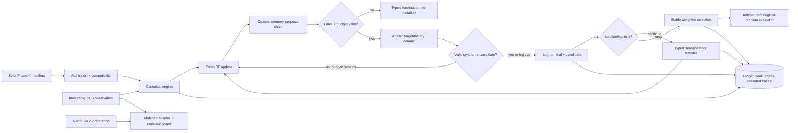

# Phase 4: Memory Policies and Relay-BP - Research

**Researched:** 2026-09-24  
**Domain:** Stateful binary BP policies, Relay-BP, and source-linked CSS code-capacity pilots  
**Confidence:** MEDIUM — equations and repository behavior are source-pinned; the paper does not specify every numerical convention, the native instrumentation patch does not yet exist, the compute allocation is not declared, and one Phase 3 artifact inventory digest is inconsistent.

<user_constraints>
## User Constraints (from CONTEXT.md)

### Locked Decisions

### Memory-policy composition and state
- **D-01:** Support all mathematically defined and compatibility-admitted combinations of the implemented Phase 4 memory variants with eligible Phase 3 update rules and schedules. Do not restrict execution to standalone policies or source pairings. An undefined combination is rejected with a reason rather than silently approximated. Pilot coverage is a focused subset, not a full Cartesian run. — **Reversibility:** costly — persisted compatibility and policy-graph semantics will govern later experiments.
- **D-02:** Every persisted composition explicitly declares the application order of memory bindings, including source presets. A source preset resolves to its published order; no hidden global ordering default changes what a saved manifest means. — **Reversibility:** costly — changing persisted order semantics would reinterpret existing manifests and evidence.
- **D-03:** An exploratory binding may target check-to-variable messages, variable-to-check messages, or beliefs when its equation is defined and independently verified at that target. Published presets retain their source target. Different targets or orderings are labeled adaptations, not source-equivalent runs.
- **D-04:** Each policy may expose fixed values and declared seeded assignments or refresh rules where mathematically valid. Persist the generator/distribution, decoder-local seed identity, resolved values, graph association, and refresh boundary for replay. Keep decoder randomness independent of physical-error sampling, as in Phase 3.
- **D-05:** Permit multiple instances of the same memory-policy kind in one composition. Each instance has a distinct binding ID, target, parameters, place in the order, owned history, lifetime, and event attribution. Existing private-state and typed-decision boundaries still apply. — **Reversibility:** costly — binding identity and ownership become part of the manifest and ledger contract.
- **D-06:** Explicitly validate compatibility with implemented Phase 3 updates and schedules. The range includes local-step schedules where semantics can be established; unsupported combinations remain visibly rejected.
- **D-07:** Each binding declares when its history advances, including local-update versus completed source-iteration boundaries for non-flooding schedules. Published presets use their source-defined boundary. This is distinct from convergence-check cadence and parameter-refresh cadence.
- **D-08:** For any parameter refresh during a shot, the manifest declares whether the binding retains or resets its history; source presets use the source procedure. Initial values, reset scope, and state lifetime must be explicit and verifiable.

### Source-defined variants and qualifications
- **D-09:** Implement several **genuinely distinct update or history rules** as separately named source-linked variants when well specified. Apply this principle to damping, mixing, momentum, iteration memory, and disordered memory; a changed coefficient or range alone is a configuration of one rule, not a new variant. This is not a request to implement every named paper uncritically.
- **D-10:** A classical-BP memory rule may be translated to binary CSS when the translation is mathematically justified and verified. Mark the CSS execution as an adaptation and never transfer a classical performance claim to quantum outcomes by implication.
- **D-11:** If a paper's equation and released code differ materially, preserve both as separate named behaviors or configurations, identify which each run used, and document the discrepancy. Do not silently prefer one as the other.
- **D-12:** If source details remain unresolved after checking primary paper, supplements, and code, a runnable **labeled interpretation** is permitted only with explicit assumptions and independent fixtures. Source fidelity remains unresolved; the interpretation cannot be presented as a faithful source implementation.
- **D-13:** Select variants first by clear, verifiable procedure and mechanistic diversity; use quantum-decoding relevance as a tie-breaker. Research must document the selected source set, rejected candidates, and unresolved details.
- **D-14:** Where an original implementation is available, pin it and run bounded **sanity checks** against the canonical rule. Missing original code is an explicit evidence limit, not a reason to invent a reference or expand these checks into a reproduction campaign.

### Relay-BP source, reference, and CSS adaptation
- **D-15:** Run the pinned original implementation and canonical Relay-BP on the **same eligible CSS code-capacity observations**. Label these as matched code-capacity pilots/adaptations of a circuit-focused paper; published circuit curves remain for Phase 13. Original and canonical runs retain separate identity and configuration translations.
- **D-16:** Offer two first-class, easy-to-run canonical Relay-BP presets: one following the paper's internal BP procedure and one using the canonical engine's default BP procedure. Both are visible presets, but their procedure labels and fidelity status remain distinct. A source-procedure CSS run is still a code-capacity adaptation, not a reproduction of circuit experiments.
- **D-17:** Expose source Relay controls and run component ablations that isolate one leg, posterior transfer on/off, uniform versus disordered memory, and selected source parameter sweeps. Preserve the source procedure as a named preset; changed components are labeled adaptations.
- **D-18:** Give BB-144, B1, and the Phase 3 HGP example **comparable** matched native/canonical CSS pilot coverage, plus small deterministic fixtures. Verify exact artifact and logical-operator identities before using a case; do not treat a generated family example as a paper-exact matrix.
- **D-19:** A small, pinned instrumentation patch to the original Relay-BP implementation is allowed when it can expose per-leg evidence without changing behavior. Check output equivalence on fixtures against the unmodified pinned reference. Record remaining inaccessible native fields as missing with reasons.
- **D-20:** Retain the existing canonical numerical profile and add a separately named source-matched precision/clipping profile if differences materially affect the native comparison. Numerical profiles and effective overrides are recorded; bit-for-bit agreement is not the project reproduction standard.
- **D-21:** Show both a controlled view with matched Relay settings and a view using each preset's separately declared settings. In the controlled view, leg/iteration/solution limits, transfer, and memory settings are matched to isolate the internal BP-procedure effect.
- **D-22:** Perform **broad per-code optimization** of first-leg memory strength and subsequent-leg disordered-memory distribution for BB-144, B1, and HGP. Choose settings using estimated logical failure on calibration samples under a declared decoder-work cap; retain uncertainty and every tested range. Hold leg count, iteration limits, and solution stopping fixed during that selection. Tune source-procedure and canonical-engine presets separately, then also compare them at shared memory settings.
- **D-23:** The planner must first benchmark representative work and identify the compute actually available, then **prespecify finite** per-code configuration, shot, and compute caps that make strong use of that allocation. Calibration and evaluation samples are separate. Retain insufficient-precision and inconclusive outcomes; do not extend a run silently until a preferred rank appears. Formal publication-curve assessment remains in later phases.

### Pilot ablations, evidence, and notebook
- **D-24:** Use a focused factorial subset on each code: a common baseline, each memory family alone, selected two-policy interactions, and Relay-BP component ablations. Research chooses the informative pairings after defining the variants; implementation support under D-01 is broader than pilot coverage.
- **D-25:** Use a small, prespecified informative noise grid per code spanning easy decoding, visible BP failures, and a harder region. Decoder arms at each point use the same identified physical samples. Keep source-specific and controlled configurations separate.
- **D-26:** Produce bounded representative traces linked to the shot/event ledger: beliefs and history changes, memory draws, relay leg transitions, candidates, and per-leg work. Routine full edge traces are not required for every shot; truncation and unavailable native instrumentation remain explicit.
- **D-27:** Provide **one step-by-step notebook** covering all three codes, tuning, ablations, diagnostics, and cross-code comparison. When a stage is run, it loads existing artifacts only if manifest, source/policy, code/environment, sample, and stage identities match; if missing or mismatched, it preserves old evidence and generates a new identified result under the declared budget. The notebook can generate the data it analyzes; it is not merely a static report.
- **D-28:** Show the full tuning search in the notebook: tested ranges, estimates and uncertainty, work, failed/inconclusive configurations, selection rule, and separate evaluation results. Show paired original/canonical outcome and termination disagreements with representative linked leg/memory traces when observable.
- **D-29:** Report raw work by leg and total, runtime and resource distributions including upper tails, and tuning/setup costs separately. Preserve outcome classes, denominators, candidate origins, and source/adaptation labels; pilot plots do not establish statistical reproduction or universal decoder rankings.

### the agent's Discretion
- Find and justify the precise primary-source variant set, equations, parameter domains, initialization, reset/advance order, and compatibility proofs. Determine whether apparently different named methods are mathematically the same rule under reparameterization.
- Resolve the Relay-BP paper/repository revision and original-reference identity, including whether the locally frozen `mg551-duke/relay` fork is source-equivalent. Pin exact code and configuration; document paper/code drift and native instrumentation limits.
- Choose representative two-policy interactions, exact noise points, trace budgets, notebook sections, and plotting conventions consistent with D-24–29.
- Benchmark available compute and set finite tuning/sample budgets before the broad search. Specify uncertainty, selection, and stop rules before collecting assessment results; preserve search and failed-run evidence.
- Choose concrete schema/module extensions while preserving existing manifest versions, original-problem evaluation, policy state ownership, typed relay transfer, leaf work accounting, and ledger lineage.

### Deferred Ideas (OUT OF SCOPE)
- Derive mathematically compatible memory and relay policies for a **joint four-state Pauli BP kernel** in Phase 10, then compare their effects with separate binary inference on matched physical samples and budgets in Phase 11. Track the closest precedents and any absent faithful counterpart; do not assume a scalar memory equation ports unchanged.
- Relay-BP's original circuit-noise XYZ/DEM setting, detector/observable semantics, and published circuit-curve assessment belong in Phases 12–13. The source's binary error-mode circuit graph and code-capacity quaternary Pauli kernel answer different questions.
- Full generic search/ensemble controller behavior remains in Phase 6; the Phase 4 relay ablations are source-linked or clearly labeled component adaptations.
- Formal statistical reproduction campaigns and publication-level precision remain in Phases 8–9 and 11/13 as appropriate. Phase 4's broad parameter search and pilots are retained and transparent but are not promoted to paper-curve reproduction by themselves.
</user_constraints>

<phase_requirements>
## Phase Requirements

| ID | Description | Research Support |
|---|---|---|
| MEM-01 | A researcher can enable damping with an explicit equation, parameter, application point, and reset behavior. | Implement the Gökduman–Yao–Pfister V2C affine damping rule, with old V2C state and exact commit/reset semantics. |
| MEM-02 | A researcher can enable a precisely specified mixing policy with explicit operands, weights, and application order. | Implement Pretti PDBP field mixing and PD′BP delta mixing as separate source-linked belief rules. |
| MEM-03 | A researcher can enable a source-defined momentum policy with explicit history state and initialization/reset semantics. | Implement Chen et al. Momentum-BP over binary LLR posterior state as a labeled CSS adaptation, preserving velocity initialization and the original-C2V subtraction rule. |
| MEM-04 | A researcher can enable a source-defined iteration-memory policy with explicit retained state, lifetime, and update equation. | Implement EWAInit/Relay affine prior memory once, with aliases/presets rather than duplicate algorithms. |
| MEM-05 | A researcher can enable disordered memory with a declared sampling distribution, seed stream, update equation, and inheritance/reset behavior. | Add fixed/vector/seeded per-variable assignments to the affine prior-memory rule and Relay's per-leg refresh semantics. |
| MOD-01 | A researcher can execute a source-linked canonical Relay-BP composition with explicit memory, ensemble/relay legs, transferred state, stopping, and candidate selection, and run the pinned original implementation as a reference in eligible regimes. | Pin arXiv v2 and author release v0.2.2; implement real-valued posterior transfer, leg lifecycle, stopping, weighted stable selection, native adapter, and bounded instrumentation. |
</phase_requirements>

## Summary

Phase 4 should implement four genuinely distinct state mechanisms: V2C damping, belief-field/delta mixing, posterior momentum, and affine prior memory. Disordered memory is an assignment mode of affine prior memory rather than a new equation. EWAInit-BP and Relay Mem-BP are also one rule under `gamma_relay = 1 - alpha_ewa`; expose source-named presets without duplicating execution semantics. [CITED: https://arxiv.org/abs/2411.08177; CITED: https://arxiv.org/abs/1407.0521; CITED: https://arxiv.org/abs/2407.11523; CITED: https://arxiv.org/abs/2506.01779]

Relay-BP must be a sequential leg composition around the canonical binary CSS kernel. Each later leg resets C2V, V2C, and iteration-local state, refreshes its per-variable memory strengths, and inherits only the predecessor's final real-valued posterior LLR vector. It records every valid syndrome candidate, stops at the declared solution/leg limits, and selects the minimum prior-weighted candidate with stable first-on-tie behavior. Hidden physical truth remains available only to the post-selection evaluator. [CITED: https://arxiv.org/abs/2506.01779; CITED: https://github.com/trmue/relay/blob/14cb31a18f9b9d7d099791b793e35b8a2951f8f3/crates/relay_bp/src/bp/relay.rs#L281-L386; VERIFIED: src/bp_registry/canonical/lineage.py:226-249]

The executable reference should be the author's release tag `v0.2.2`, commit `14cb31a18f9b9d7d099791b793e35b8a2951f8f3`. The frozen editable installation is `mg551-duke/relay@8216aca3153642044e2cdccbaa41547d15551bb0`; it diverges 41 commits after merge-base `b68115d062941fb0f11d8e04e2007dec73266be8` and contains unpublished training/message-mix work, so it is not source-equivalent and cannot serve as the original reference. [VERIFIED: docs/environment-freeze.txt:53-56; VERIFIED: local git history/merge-base probe, 2026-09-24; CITED: https://github.com/trmue/relay/releases/tag/v0.2.2]

**Primary recommendation:** Build a versioned ordered `MemoryCompositionSpec`, extend the typed relay payload to finite float64 posterior LLRs, implement the four selected rule families as pure proposal/commit state machines, and then add Relay as a sequential controller with source and canonical presets plus an isolated author-v0.2.2 reference environment. [ASSUMED]

## Architectural Responsibility Map

| Capability | Primary Tier | Secondary Tier | Rationale |
|---|---|---|---|
| Memory equation and history transition | API / Backend | — | Canonical kernel state must own deterministic proposal/commit/reset semantics. [ASSUMED] |
| Persisted binding order, target, refresh, and compatibility | API / Backend | Storage | Strict manifests admit the composition; ledgers retain resolved evidence. [ASSUMED] |
| Relay leg orchestration and typed posterior transfer | API / Backend | Storage | The executor owns sequential lineage, budgets, transfer validation, and candidates. [ASSUMED] |
| Artifact, manifest, ledger, trace, and notebook outputs | Database / Storage | API / Backend | Portable files retain scientific identity and bounded evidence. [VERIFIED: AGENTS.md:59-64] |
| Native v0.2.2 adapter and instrumentation fork | API / Backend | External dependency | Native code is an executable reference with a separate environment and identity. [VERIFIED: AGENTS.md:31-35,59-64] |
| Analysis notebook | Browser / Client | API / Backend | The notebook displays and triggers identified stages; engine and runner produce authoritative data. [ASSUMED] |

## Project Constraints (from AGENTS.md)

- Own one canonical execution engine per compatible BP family; native adapters are executable references. [VERIFIED: AGENTS.md:13,59]
- Keep original problems immutable; policies cannot inspect hidden truth, and independent evaluators judge original-problem outputs. [VERIFIED: AGENTS.md:60]
- Record policy equations/order, compatibility, numerical conventions, scoped stopping, candidate lineage, relay work, manifests, and per-shot/control-flow provenance. [VERIFIED: AGENTS.md:61-64]
- Keep CSS recovery semantics separate from circuit detector/logical-observable semantics and distinguish reproduction, adaptation, controlled comparison, and mapped-only evidence. [VERIFIED: AGENTS.md:62-64]
- Cite primary mathematical sources, independently verify algebra/policy semantics, prespecify tolerances/budgets/stopping/denominators, and retain failed/inconclusive evidence. [VERIFIED: AGENTS.md:43-49]
- Use inspectable Python/NumPy/SciPy first, keep native dependencies isolated, and add compiled kernels only after profiling without changing the behavioral contract. [VERIFIED: AGENTS.md:27-35]
- Do not automatically select GPT-6 Astra; preserve configured role models and effort settings. [VERIFIED: user-supplied AGENTS.md instructions, 2026-09-24]

## Source Resolution and Selected Variant Set

| Registered rule/preset | Exact state equation | Source target and boundary | Initial/reset semantics | Fidelity label |
|---|---|---|---|---|
| `gy-pfister-v2c-damping-v1` | `v2c_out = (1-gamma) v2c_old + gamma v2c_fresh`, `gamma in [0,1]` | V2C, after fresh V2C calculation, before commit | `v2c_old` is the initialized channel-prior V2C vector; reset at attempt/leg unless explicitly adapted | Source equation; binary CSS use without BPGD is a component adaptation. [CITED: https://arxiv.org/abs/2411.08177] |
| `pretti-pdbp-field-mix-v1` | `h_out = (1-gamma) h_fresh + gamma h_old`, `gamma in [0,1)` | Belief/effective field after fresh incoming C2V aggregation | initialize `h_old` from channel field; advance after field commit | Classical source rule, binary CSS adaptation. [CITED: https://arxiv.org/abs/1407.0521] |
| `pretti-pdprime-delta-mix-v1` | `Delta = sum(c2v_fresh-c2v_old)`; `h_out=h_old+(1-gamma)Delta` | Belief/effective field, with matched old/fresh C2V edge vectors | initialize C2V old state and `h_old`; advance both atomically | Distinct classical source rule, binary CSS adaptation. [CITED: https://arxiv.org/abs/1407.0521] |
| `chen-posterior-momentum-v1` | `g_t=gamma*g_(t-1)+(1-gamma)*(Q_(t-1)-Q_fresh)`; `Q_t=Q_(t-1)-alpha*g_t` | Posterior belief after fresh C2V aggregation; V2C subtracts the original current C2V contribution | `g_0=0`, `Q_0=prior`; reset at attempt/leg | GF(4) source; scalar binary-LLR execution is an explicitly verified CSS adaptation. [CITED: https://arxiv.org/abs/2407.11523] |
| `ewa-prior-memory-v1` | `prior_t=alpha*prior_0+(1-alpha)*posterior_(t-1)` for `t>1` | Prior/bias before horizontal/C2V then vertical/V2C update; advance at source iteration | `prior_1=prior_0`; retained posterior is attempt state | Source EWAInit equation; binary CSS adaptation. [CITED: https://arxiv.org/abs/2407.11523] |
| `relay-affine-prior-memory-v1` | `bias_t=(1-gamma_j)*prior_0+gamma_j*posterior_(t-1)` | Prior/bias before min-sum C2V/V2C update; advance at each leg-local source iteration | first posterior is prior or transferred predecessor posterior; per-leg history described below | Source Relay equation; canonical code-capacity use is an adaptation. [CITED: https://arxiv.org/abs/2506.01779] |
| `relay-disordered-assignment-v1` | Same affine rule, with per-variable real `gamma_j` | Assignment refresh at leg start; fixed within a source leg | later legs draw a new vector; retain transferred posterior, reset messages | Configuration/generator of the preceding rule, not a distinct equation. [CITED: https://arxiv.org/abs/2506.01779] |

**Identity result:** `ewa-prior-memory-v1` and `relay-affine-prior-memory-v1` are algebraically identical under `gamma_j = 1-alpha` when gamma is uniform and both use the same previous posterior. Use one implementation primitive with source aliases/presets; differences in allowed assignments, negative values, leg transfer, and schedule are configuration/controller semantics. [CITED: https://arxiv.org/abs/2407.11523; CITED: https://arxiv.org/abs/2506.01779]

**Selected pilot interactions:** run V2C damping + EWA prior memory because they act at distinct points; PDBP field mix + V2C damping because it exposes order across message and belief targets; posterior momentum + EWA prior memory because the Chen source explicitly distinguishes posterior smoothing from prior adaptation. Do not run all pairwise interactions in the pilot. [ASSUMED]

**Rejected or deferred candidates:** AdaGrad-BP is mechanistically distinct but outside MEM-01–05; the local fork's signed, second-order, static, and learned message-mix variants lack a pinned primary publication and remain labeled interpretations rather than selected source variants; PDBP coefficient changes are configurations; and EWAInit versus uniform Relay Mem-BP is a reparameterization, not two implementations. [CITED: https://arxiv.org/abs/2407.11523; VERIFIED: local `mg551-duke/relay` history at 8216aca3153642044e2cdccbaa41547d15551bb0, 2026-09-24]

## Exact Update and State Semantics

### Common ordered composition rule

At each declared target/boundary, start with the engine's fresh value `x_0`. Apply bindings in persisted order: `x_(k+1), state_(k+1) = P_k(x_k, state_k, resolved_parameters_k)`. Validate every proposal and reserve all work before mutation; commit the target and every participating binding's history atomically. Parameter refresh happens before proposal and declares `retain_history` or `reset_history`. A rejected budget reservation or numerical validation failure advances neither state nor RNG. [ASSUMED]

Repeated instances are safe only because each owns a distinct binding ID and private state. The current schema has exactly one `state_memory: PolicySpec` in its seven-role composition and state-memory kinds only `"identity"` and `"stateless"`; preserve the seven roles but replace the role payload in a new manifest version with an ordered `MemoryCompositionSpec(bindings=...)`. [VERIFIED: src/bp_registry/canonical/contracts.py:62-73,101-118]

### Boundary vocabulary and compatibility

Persist history advance as `"local_update"` or `"source_iteration"`, and parameter refresh as `"attempt_start"`, `"leg_start"`, `"local_update"`, or `"source_iteration"`; these are proposed Phase 4 schema values and therefore `[ASSUMED]` until implemented. The inherited lifetime vocabulary is exactly `"shot", "search", "member", "leg", "branch", "attempt", "iteration", "message"`. [VERIFIED: src/bp_registry/canonical/contracts.py:31-50]

| Rule | Flooding | Layered/CN serial | VN serial | Residual/random/group schedules |
|---|---|---|---|---|
| V2C damping | Source-order compatible at completed source iteration | Compatible when old V2C advances per committed local unit; label adaptation | Compatible at each VN unit; label adaptation | Admit only where the local proposal exposes old/fresh V2C and atomic commit |
| PDBP field mix | Source compatible for SPA/min-sum | Compatible if affected field is recomputed and committed per local unit | Compatible | Reject if old/fresh complete field operands are not reconstructible |
| PD′BP delta mix | Source compatible for SPA/min-sum | Compatible only with stable edge-aligned old/fresh C2V vectors | Compatible under the same condition | Reject when the schedule cannot provide exact changed-edge delta |
| Momentum | Source supplies serial and says parallel is possible; binary version remains adaptation | Advance per source serial variable unit | Natural source-style boundary | Reject until exact posterior and original-C2V operands are exposed |
| EWA/Relay prior memory | Source EWA/Relay flooding order | Allow completed source-iteration adaptation first | Allow completed source-iteration adaptation first | Local-update mode requires a separate explicit adaptation fixture |

The table is an implementation recommendation derived from source operand requirements and the existing local-step contract. [ASSUMED]

### Parameter domains

- V2C damping uses `gamma in [0,1]`; `gamma=1` is ordinary fresh BP and `gamma=0` freezes the initialized V2C value. [CITED: https://arxiv.org/abs/2411.08177]
- PDBP/PD′BP use `gamma in [0,1)`; `gamma=0` is ordinary BP. [CITED: https://arxiv.org/abs/1407.0521]
- Chen's generic EWA decay has `0<gamma<1`; Momentum Algorithm 1 states `alpha=1, gamma>=0`, initializes `g_0=0, Q_0=prior`, and recommends fixing either `alpha=1` or `gamma=0` to avoid two-dimensional tuning. Phase 4 should validate `alpha in (0,1]` and `gamma in [0,1)` for finite convex smoothing unless a separately labeled interpretation justifies extrapolation. [CITED: https://arxiv.org/abs/2407.11523; ASSUMED]
- EWAInit should validate `alpha in [0,1]`. Relay declares real-valued `gamma_j`; uniform Mem-BP is the `[0,1]` case, while DMem/Relay may include negative values. Every finite range must satisfy `low < high`; no silent clipping to `[0,1]`. [CITED: https://arxiv.org/abs/2407.11523; CITED: https://arxiv.org/abs/2506.01779]

## Relay-BP Source Contract

### Paper procedure

The source min-sum order is: compute memory-adjusted bias from the original prior and previous posterior; compute C2V; compute V2C; compute posterior and hard decision; check `H e_hat = syndrome`; stop the leg on the first valid candidate or its iteration cap. Later legs take the predecessor's final posterior as only their initial marginal. Across legs, stop at the declared leg or solution count and minimize `sum_j e_hat_j log((1-p_j)/p_j)`. [CITED: https://arxiv.org/abs/2506.01779]

The paper's first leg uses 80 iterations; later legs use 60. The published circuit experiments use first-leg gamma `0.125` for gross/two-gross and `0.35` for surface; later `gamma_j` are independent uniform draws. Reported later-leg intervals are `[-0.24,0.66]`, `[-0.161,0.815]`, and `[-0.254,0.985]` for the three paper problems. These are source-circuit presets, not assumed optima for the Phase 4 CSS problems. [CITED: https://arxiv.org/abs/2506.01779]

### Author code behavior at the pin

The v0.2.2 Rust reference defaults to `pre_iter=80`, `num_sets=300`, `set_max_iter=60`, interval `(-0.24,0.66)`, `NConv{stop_after:1}`, and seed `0`. The Python constructor additionally defaults `gamma0=0.1`; the README example instead supplies `gamma0=0.65`, `num_sets=100`, and `stop_nconv=5`. Preserve these as separately named code-default and README-example configurations; neither substitutes for the paper's gross value `0.125`. [CITED: https://github.com/trmue/relay/blob/14cb31a18f9b9d7d099791b793e35b8a2951f8f3/crates/relay_bp/src/bp/relay.rs#L28-L65; CITED: https://github.com/trmue/relay/blob/14cb31a18f9b9d7d099791b793e35b8a2951f8f3/crates/relay_bp_py/src/bp/relay.rs#L26-L85; CITED: https://github.com/trmue/relay/blob/14cb31a18f9b9d7d099791b793e35b8a2951f8f3/README.md#L65-L81]

The code runs one pre-leg plus `num_sets` later legs, resets C2V/V2C/current iteration between later legs, retains the posterior vector, redraws per-variable gammas from its decoder-local RNG, stops each leg at first syndrome solution or cap, counts valid solutions, and replaces the best only on a strictly smaller score. Equal-score candidates therefore retain the earlier candidate. [CITED: https://github.com/trmue/relay/blob/14cb31a18f9b9d7d099791b793e35b8a2951f8f3/crates/relay_bp/src/bp/relay.rs#L175-L202; CITED: https://github.com/trmue/relay/blob/14cb31a18f9b9d7d099791b793e35b8a2951f8f3/crates/relay_bp/src/bp/relay.rs#L281-L386]

The paper prose says maximum legs `R`, but its pseudocode initializes `r=0` and loops while `r<=R`; the code makes this unambiguous as one pre-leg plus `num_sets` later legs. Persist `total_leg_limit` in canonical manifests and translate author `num_sets = total_leg_limit - 1`; never reuse ambiguous `R` without a definition. [CITED: https://arxiv.org/abs/2506.01779; CITED: https://github.com/trmue/relay/blob/14cb31a18f9b7d099791b793e35b8a2951f8f3/crates/relay_bp/src/bp/relay.rs#L291-L345]

### Transfer payload and candidate contract

The current `RelayPayload` is exactly kind `"canonical-relay-v1"` with binary integer values, so it cannot represent the paper's real-valued final marginals. Add a new payload kind whose exact persisted fields include representation ID `"llr_log_p0_over_p1"`, finite float64 values, vector length, producer leg lineage ID, numerical profile ID, saturation/clipping evidence, and content SHA-256. The quoted representation name is a proposed schema value `[ASSUMED]`; the incompatibility is verified. [VERIFIED: src/bp_registry/canonical/contracts.py:256-272; CITED: https://arxiv.org/abs/2506.01779]

Only posterior LLR values transfer. C2V, V2C, memory-policy history other than that posterior, RNG state, gamma vector, current iteration, and convergence state reset or remain controller-owned. Emit a `relay_transfer` event with payload digest and shape, and count exactly one `relay_transfers` leaf operation for each committed leg-to-leg handoff. [CITED: https://github.com/trmue/relay/blob/14cb31a18f9b7d099791b793e35b8a2951f8f3/crates/relay_bp/src/bp/relay.rs#L333-L345; VERIFIED: src/bp_registry/ledger.py:386-392; VERIFIED: src/bp_registry/canonical/budgets.py:18-39]

Every valid syndrome candidate gets a leg/candidate lineage node and decoder-visible prior-weight score. Stable first-on-tie selection freezes before independent original-problem evaluation. The lineage kinds currently quote `"original", "working", "transformation", "member", "leg", "branch", "attempt", "candidate", "lift", "validation", "selection", "evaluation"`. [VERIFIED: src/bp_registry/canonical/lineage.py:19-40,226-249]

## Original Reference, Fork Status, and Instrumentation

| Identity | Status | Use |
|---|---|---|
| `trmue/relay` tag `v0.2.2`, commit `14cb31a18f9b9d7d099791b793e35b8a2951f8f3` | Released author code; Rust crate compiled successfully offline in this session. One BB unit test completed before the bounded test run was stopped; the full native suite was not observed complete. [VERIFIED: local detached worktree/build probe, 2026-09-24] | Original executable reference and base for the instrumentation patch. |
| Author `main` `d185194ba0cb4101ced4340d82b2ee6d42f225f0` | Later unreleased head observed on 2026-09-24, including changes after v0.2.2. [VERIFIED: `git ls-remote https://github.com/trmue/relay.git refs/heads/main`, 2026-09-24] | Track upstream only; do not let a moving head define saved evidence. |
| Installed `mg551-duke/relay` `8216aca3153642044e2cdccbaa41547d15551bb0` | Editable `relay-bp 0.2.1`, experimental branch, 41 commits after merge-base `b68115d...`; working tree also has untracked result directories. [VERIFIED: docs/environment-freeze.txt:53-56; VERIFIED: local git/status probe, 2026-09-24] | Exploratory evidence only, separately identified; never original-reference identity. |

The public native result exposes final decoding, decoded checks, posterior ratios, success, score, aggregate iterations, max iterations, and `extra=None`; optional logging exposes per-leg index, iteration count, convergence, and unique-best marker. It does not expose gamma draws, posterior transfers, each candidate payload, per-leg message work, or full per-leg state. [CITED: https://github.com/trmue/relay/blob/14cb31a18f9b9d7d099791b793e35b8a2951f8f3/crates/relay_bp/src/decoder.rs#L206-L220; CITED: https://github.com/trmue/relay/blob/14cb31a18f9b9d7d099791b793e35b8a2951f8f3/crates/relay_bp/src/bp/relay.rs#L114-L142]

Create an instrumentation branch from the exact v0.2.2 commit that adds an observer/serialization seam only. First compare unmodified versus patched final decoding, success, score, aggregate iterations, final posterior, and log output on deterministic tiny fixtures and one bounded BB-144 case; only then use patched per-leg evidence. Missing native edge counts and resource facts remain typed unavailable facts rather than reconstructed guesses. [ASSUMED]

## Artifact Identity Gate

The loaded BB-144 and HGP artifact digests agree with their Phase 3 manifests: BB-144 raw `2c02a3b99bf7267acf35efe28e0a2ef0d3827e5a22b948d53da14ae8df68ceb0`, semantic `e175e67c0f9ae6f4e0968461ad2f87ba38ad5344166b793c53dd038976d4f427`; HGP raw `b31c99a754fb377acfb5e2cb2edc2cb7e55c4d1e78feb4aa84c171c051a78c44`, semantic `272c9498396167424bc4279d96b5ad2d6e11cebc7f01de597716a1cd2c01d668`. [VERIFIED: data/manifests/phase3-pilot-bb144.json:18-21; VERIFIED: data/manifests/phase3-pilot-hgp-gallager.json:5-8; VERIFIED: `load_artifact` probe, 2026-09-24]

The B1 frozen artifact and executable Phase 3 manifest agree on raw `3b3fb669daf18cb294049c2c20a457a2da997ad1a7da9f0667171d3b48eb38a6` and semantic `ea1200028ace4a446dc04fe40c9eb9607903b31e3772c2921835ed6e20430548`, but `data/evidence/code-inventory.json` instead records semantic `ea120ce6e5277e9eb090c419d14c1d4a587b8d52db9f34bb99c4262617be3048`. Reconcile and version this conflict before Phase 4 pilot manifests are admitted; do not choose the inventory value by convention. [VERIFIED: data/manifests/phase3-pilot-b1.json:13-16; VERIFIED: data/evidence/code-inventory.json:31-42; VERIFIED: `load_artifact` probe, 2026-09-24]

BB-144 has author-supplied logical identity; B1 and HGP use project-derived logical bases, and HGP is a generated-family example with `author_instance=false`. Preserve these qualifications in every Phase 4 result. [VERIFIED: data/evidence/code-inventory.json:9-56]

## Standard Stack

### Core

| Library/tool | Version | Purpose | Why Standard |
|---|---|---|---|
| Python | 3.12.2 | Canonical engine, runner, analysis | Existing project runtime. [VERIFIED: local `.venv/bin/python --version`, 2026-09-24] |
| NumPy | 2.2.6 | Float64 state vectors, finite checks, fixtures | Existing canonical numerical substrate. [VERIFIED: local package probe, 2026-09-24] |
| SciPy | 1.17.1 | Sparse matrices and interval/statistical helpers already available | Existing dependency; no new scientific package is needed. [VERIFIED: local package probe, 2026-09-24] |
| Pydantic | 2.13.5 | Closed versioned manifests and policy contracts | Existing strict schema framework. [VERIFIED: local package probe, 2026-09-24; VERIFIED: src/bp_registry/canonical/contracts.py:18-18] |
| pytest | 9.0.3 | Unit, differential, integration, and evidence tests | Existing configured test framework. [VERIFIED: local package probe, 2026-09-24] |

### Supporting

| Library/tool | Version | Purpose | When to Use |
|---|---|---|---|
| `relay-bp` | author reference 0.2.2; installed fork 0.2.1 | Native Relay reference | Isolated reference environment only; package is flagged below. [CITED: https://github.com/trmue/relay/releases/tag/v0.2.2; VERIFIED: local package probe, 2026-09-24] |
| Rust/Cargo | 1.93.0 toolchain | Build exact author pin and instrumentation fork | Native reference checks only. [VERIFIED: local CLI probe, 2026-09-24] |
| matplotlib / nbformat | 3.10.9 / 5.10.4 | One executable evidence notebook and plots | Phase 4 analysis artifact. [VERIFIED: local package probe, 2026-09-24] |

### Alternatives Considered

| Instead of | Could Use | Tradeoff |
|---|---|---|
| One affine prior-memory primitive | Separate EWAInit and Relay Mem-BP implementations | Duplicates algebra and risks drift; source names should be presets. [CITED: https://arxiv.org/abs/2407.11523; CITED: https://arxiv.org/abs/2506.01779] |
| Project-owned canonical Python policies | Wrap native implementations behind one API | Violates the canonical-engine interpretability constraint. [VERIFIED: AGENTS.md:13,59] |
| Portable JSON/NPZ sidecars | Pickle | Existing loaders use bounded, pickle-free artifacts; executable deserialization is unnecessary. [VERIFIED: src/bp_registry/artifacts.py:94-152] |

**Installation:** add no dependency to the canonical environment. Build author v0.2.2 in an isolated native-reference environment from its exact git commit. [ASSUMED]

## Package Legitimacy Audit

| Package | Registry | Version / publish observation | Source Repo | Verdict | Disposition |
|---|---|---|---|---|---|
| `relay-bp` [WARNING: flagged as suspicious — verify before using.] | PyPI | latest `0.2.2`; installed `0.2.1` | Official paper links `https://github.com/trmue/relay`, but registry metadata did not expose a repository | SUS (`unknown-downloads`, `no-repository`) | Planner must add `checkpoint:human-verify` before any install; prefer exact git pin in isolation. [VERIFIED: package-legitimacy seam and `pip index versions`, 2026-09-24; CITED: https://arxiv.org/abs/2506.01779] |

**Packages removed due to SLOP verdict:** none.  
**Packages flagged as suspicious [SUS]:** `relay-bp`.

## Architecture Patterns

### System Architecture Diagram



The diagram preserves engine-owned lifecycle, atomic state mutation, typed transfer, truth-blind selection, and independent evaluation. [VERIFIED: AGENTS.md:59-64; VERIFIED: src/bp_registry/canonical/budgets.py:356-422]

### Recommended Project Structure

```text
src/bp_registry/canonical/
├── memory.py              # equations, state records, ordered proposal/commit chain
├── relay.py               # source-linked sequential leg controller and transfers
├── contracts.py           # new manifest version, memory composition, float payload
├── compatibility.py       # target/update/schedule/boundary admission matrix
├── execution.py           # lifecycle integration only
├── budgets.py             # memory operations and existing relay work accounting
└── verification.py        # deterministic reconstruction and invariants
src/bp_registry/native/
└── relay_v022.py          # isolated reference adapter and translation evidence
tests/canonical/
├── test_memory_policies.py
├── test_memory_composition.py
├── test_relay.py
├── test_relay_differential.py
└── test_phase4_evidence.py
notebooks/
└── phase4-memory-relay-analysis.ipynb
```

This is a proposed file map `[ASSUMED]`; preserve old manifest readers rather than editing prior schema meanings. [VERIFIED: src/bp_registry/canonical/contracts.py:370-404]

### Pattern 1: Pure proposal, validated atomic commit

Compute `(output, next_history, evidence, work)` without mutating current state. Reserve the complete work leaf, validate finite shape/graph identity, then commit output, history, RNG transition, and cursor together. This extends the Phase 3 local-step transaction rule to stateful policies. [ASSUMED]

### Pattern 2: One semantic primitive, source-named presets

Keep `AffinePriorMemory` as the implementation primitive. `EWAInitPreset` binds `alpha`; `RelayMemPreset` binds `gamma=1-alpha`; `RelayDMemPreset` adds per-variable assignments and leg refresh. Each preset retains its source anchor, procedure order, and fidelity/adaptation label. [CITED: https://arxiv.org/abs/2407.11523; CITED: https://arxiv.org/abs/2506.01779]

### Pattern 3: Native translation envelope

Before every native call, persist source revision, matrix/syndrome/prior digest, type/precision, Relay parameters, sample identity, and field translations. Afterward retain observed outputs and explicit unavailable fields. Never merge native and canonical event identities. [ASSUMED]

### Anti-Patterns to Avoid

- One untyped `memory_strength` switch that changes equations by target or context. [ASSUMED]
- Advancing history or RNG when a budget reservation fails. [ASSUMED]
- Copying all predecessor leg internals as a warm start. [CITED: https://github.com/trmue/relay/blob/14cb31a18f9b7d099791b793e35b8a2951f8f3/crates/relay_bp/src/bp/relay.rs#L333-L345]
- Treating EWAInit, Mem-BP, and DMem-BP as three distinct equations. [CITED: https://arxiv.org/abs/2407.11523; CITED: https://arxiv.org/abs/2506.01779]
- Calling code-capacity CSS pilots reproductions of Relay's circuit curves or calling its binary XYZ error-mode graph a quaternary Pauli kernel. [VERIFIED: 04-CONTEXT.md Phase Boundary and Deferred Ideas]

## Don't Hand-Roll

| Problem | Don't Build | Use Instead | Why |
|---|---|---|---|
| Sparse BP kernel/update math | A second Relay-only graph engine | Existing canonical SPA/min-sum kernels and stable EdgeTable | Keeps internal BP procedure the controlled factor. [VERIFIED: 04-CONTEXT.md Existing Code Insights] |
| RNG | A shared global generator | Existing identity-derived decoder-local stream pattern | Physical sample and decoder assignment streams must be independent/replayable. [VERIFIED: 04-CONTEXT.md D-04] |
| Work accounting | A total “Relay iterations” scalar | Existing hierarchical `WorkVector` plus per-leg leaves | Schedules and legs have non-equivalent operations. [VERIFIED: src/bp_registry/canonical/budgets.py:18-45,356-422] |
| Candidate/evaluation model | Truth-aware in-controller ranking | Existing lineage + frozen selection + independent evaluator | Prevents hidden-truth leakage. [VERIFIED: src/bp_registry/canonical/lineage.py:226-249; VERIFIED: AGENTS.md:60] |
| Native Relay implementation | A Python imitation called “original” | Exact author v0.2.2 and bounded patch | Reference behavior and drift remain attributable. [CITED: https://github.com/trmue/relay/releases/tag/v0.2.2] |
| Statistical intervals | Custom normal approximations | Existing SciPy binomial/Beta helpers and explicit Wilson/exact formulas | Handles low counts and zero failures more honestly. [CITED: https://docs.scipy.org/doc/scipy/reference/stats.html] |

## Common Pitfalls

### Pitfall 1: Coefficient orientation reverses the method
**What goes wrong:** “gamma” weights the old value in Pretti but the fresh value in Gökduman V2C damping; Relay gamma weights the previous posterior.  
**How to avoid:** persisted evidence records operand names and coefficients, and endpoint fixtures prove each limit. [CITED: https://arxiv.org/abs/2411.08177; CITED: https://arxiv.org/abs/1407.0521; CITED: https://arxiv.org/abs/2506.01779]

### Pitfall 2: Momentum uses the smoothed posterior as an extrinsic subtraction
**What goes wrong:** V2C double-counts/overcompensates.  
**How to avoid:** subtract the original current C2V contribution exactly as Chen Algorithm 1 states; test a one-variable hand calculation. [CITED: https://arxiv.org/abs/2407.11523]

### Pitfall 3: Local schedule semantics advance memory at the wrong cadence
**What goes wrong:** a parameter refresh, history step, and convergence check become conflated.  
**How to avoid:** store three distinct boundaries; test interrupted traversals and per-local versus per-source-iteration histories. [VERIFIED: 04-CONTEXT.md D-07–D-08]

### Pitfall 4: Relay “warm start” copies messages
**What goes wrong:** canonical legs inherit more state than the paper/code, changing the algorithm.  
**How to avoid:** transfer only final posterior LLRs and reset messages/history as specified. [CITED: https://arxiv.org/abs/2506.01779; CITED: https://github.com/trmue/relay/blob/14cb31a18f9b7d099791b793e35b8a2951f8f3/crates/relay_bp/src/bp/relay.rs#L333-L345]

### Pitfall 5: Ambiguous leg count and iteration count
**What goes wrong:** paper `R`, pseudocode `r<=R`, and code `num_sets+1` yield off-by-one evidence; aggregate native iterations hide leg work.  
**How to avoid:** use `total_leg_limit`, explicit per-leg caps, per-leg work leaves, and author translation evidence. [CITED: https://arxiv.org/abs/2506.01779; CITED: https://github.com/trmue/relay/blob/14cb31a18f9b7d099791b793e35b8a2951f8f3/crates/relay_bp/src/bp/relay.rs#L281-L372]

### Pitfall 6: Fork results are treated as original-source evidence
**What goes wrong:** unpublished local algorithms/configurations contaminate the Relay reference.  
**How to avoid:** v0.2.2 is the original reference; every fork/patch has base, diff digest, dirty-state evidence, and separate label. [VERIFIED: docs/environment-freeze.txt:53-56; VERIFIED: local git probe, 2026-09-24]

### Pitfall 7: Tuning and evaluation leak
**What goes wrong:** the chosen interval benefits from evaluation samples or adaptive silent extensions.  
**How to avoid:** immutable calibration/evaluation sample namespaces, finite predeclared caps, deterministic selection rule, and retained failed/inconclusive configurations. [VERIFIED: 04-CONTEXT.md D-22–D-23]

### Pitfall 8: Artifact identity is assumed from a familiar filename
**What goes wrong:** B1 currently has conflicting semantic digests in repository evidence.  
**How to avoid:** make raw/semantic/logical/environment checks a pre-run admission gate and resolve the inventory before pilots. [VERIFIED: data/manifests/phase3-pilot-b1.json:13-16; VERIFIED: data/evidence/code-inventory.json:31-42]

## Code Examples

### Affine prior memory primitive

```python
# Source equations: https://arxiv.org/abs/2407.11523 and
# https://arxiv.org/abs/2506.01779
def affine_prior(prior0, posterior_prev, gamma):
    # Relay form; EWAInit uses gamma = 1 - alpha.
    return (1.0 - gamma) * prior0 + gamma * posterior_prev
```

All values are float64 finite vectors of the same graph-associated shape; validation and saturation follow the selected numerical profile. The function is illustrative and its exact Python API is `[ASSUMED]`.

### Source-faithful Relay leg transition

```python
# Source procedure: https://arxiv.org/abs/2506.01779 and author v0.2.2 relay.rs
next_leg = LegState(
    posterior_prev=finished_leg.final_posterior.copy(),
    c2v=zeros_like_edges(),
    v2c=channel_prior_on_edges(),
    source_iteration=0,
    memory_history=reset_for_leg(),
    gamma=resolved_leg_assignment,
)
```

The skeleton encodes the verified transfer/reset distinction; class/function names are `[ASSUMED]`.

### Stable source score

```python
# Source: https://arxiv.org/abs/2506.01779
score = float(np.dot(candidate_bits, np.log((1.0 - error_priors) / error_priors)))
# Replace incumbent only when score < incumbent.score; a tie keeps the earlier leg.
```

Validate `0 < p_j < 1` for this source score and keep any project saturation policy explicit. The boundary recommendation is `[ASSUMED]`.

## Pilot, Search, and Evidence Methodology

### Prespecified noise grid and arms

Use code-capacity bit-flip rates BB-144 `{0.03, 0.05, 0.07}`, B1 `{0.01, 0.03, 0.05}`, and generated HGP `{0.01, 0.03, 0.05}`. These extend the existing Phase 3 anchors (`0.05`, `0.03`, `0.03`) to an easy/central/harder diagnostic grid; if the Wave 0 baseline scan shows all three points in one outcome regime, amend the manifest before calibration and retain the failed grid-selection evidence. [VERIFIED: data/manifests/phase3-pilot-bb144.json:3-5; VERIFIED: data/manifests/phase3-pilot-b1.json:1-3; VERIFIED: data/manifests/phase3-pilot-hgp-gallager.json:1-3; ASSUMED]

The focused factorial arms per code are: stateless baseline; V2C damping; PDBP; PD′BP; Momentum; affine prior memory; disordered affine memory; the three selected two-policy interactions; source-procedure Relay; canonical-default Relay; one-leg; no-transfer; uniform-later-leg; and disordered-later-leg ablations. Keep matched physical sample IDs across every arm at a code/rate point. [ASSUMED]

### Finite broad tuning design

For each code and each of the two Relay presets, hold `total_leg_limit=31`, first cap `80`, later cap `60`, and solution limit `1` fixed during calibration. This is a bounded CSS pilot adaptation; the paper's 301-leg Relay-BP-1 remains a source configuration available outside tuning. [CITED: https://arxiv.org/abs/2506.01779; ASSUMED]

Use a deterministic coarse grid with first-leg `gamma0 in {0, 0.05, 0.125, 0.25, 0.5, 0.75}` and nine later-leg `(center,width)` pairs from `center in {-0.25,0.25,0.75}` crossed with `width in {0.5,1.25,2.0}`: 54 configurations. Refine at most four coarse finalists with at most eight predeclared neighboring points each, for a hard cap of 86 configurations per preset/code. Persist endpoints `center±width/2`, even when negative or above one. This is a proposed broad pilot design `[ASSUMED]`.

Wave 0 benchmarks 32 shots for baseline, one 31-leg canonical Relay, and native v0.2.2 at each central noise point. The planner then records the actual SLURM CPUs/time/memory and selects one fixed calibration count from `{128,256,512,1024}` and one fixed evaluation count from `{1024,2048,4096,8192}` that fit the allocation. Allocate at most 35% of declared compute to tuning, 45% to fresh evaluation, 10% to native comparisons, and 10% to fixtures/traces/reruns; unused budget is not silently reallocated to chase rank. [ASSUMED]

Select within each code/preset by lowest estimated logical-failure proportion among configurations that satisfy the same declared C2V/work cap. If 95% intervals overlap the best, choose lower mean raw C2V work, then lower total work, then lexicographically smaller configuration ID. Evaluate the frozen selection on the separate evaluation samples. Report Wilson 95% intervals, and for paired arm differences report discordant counts plus an exact paired binomial test; zero failures retain a nonzero exact upper bound. [CITED: https://docs.scipy.org/doc/scipy/reference/generated/scipy.stats.binomtest.html; ASSUMED]

### Trace and notebook evidence

Always record sparse structural leg/transfer/candidate/work events. For deterministic fixtures retain all state steps subject to 8 MiB/10,000-record cap. For pilots select before outcomes eight clean/profile shots per code/rate plus up to eight deterministic disagreement/tail replays, each capped at 64 MiB and 50,000 records; record truncation. These are Phase 4 development defaults `[ASSUMED]`.

The single notebook sections should be: identity/environment gate; deterministic equation fixtures; baseline noise scan; compute benchmark and frozen caps; full tuning surfaces; selected settings; fresh evaluation; focused factorial; native/canonical paired diagnostics; representative traces; per-leg/total work and runtime quantiles; limitations/provenance. It may invoke identified runner stages, but only loads a result when manifest, source/policy, code/environment, sample, and stage digests match. [ASSUMED]

## Environment Availability

| Dependency | Required By | Available | Version / observation | Fallback |
|---|---|---|---|---|
| Python | canonical engine | yes | 3.12.2 | — |
| NumPy / SciPy / Pydantic | policies, sparse state, schemas | yes | 2.2.6 / 1.17.1 / 2.13.5 | — |
| pytest | validation | yes | 9.0.3 | — |
| matplotlib / nbformat | notebook | yes | 3.10.9 / 5.10.4 | — |
| Rust / Cargo | author reference | yes | rustc/cargo 1.93.0 | Build in isolated temp/environment |
| `relay-bp` | native adapter | yes, wrong identity/version for original reference | installed editable 0.2.1 fork at 8216aca… | exact author v0.2.2 git worktree; human package checkpoint |
| Maturin CLI | Python rebuild of native reference | no | missing | `cargo test` for Rust checks; install in isolated env after checkpoint |
| SLURM | finite pilot compute | yes | client 25.11.1; current shell observed inside job `55938300` on a 96-logical-CPU, 754-GiB node | planner must query actual job limits; node visibility is not allocation authority |

All observations are from local probes on 2026-09-24 `[VERIFIED: local environment probes]`. The exact time/CPU/memory allocation available for Phase 4 remains unknown; D-23 therefore requires a Wave 0 `scontrol show job`/benchmark gate before caps become locked. [ASSUMED]

**Missing dependencies with no fallback:** none for canonical implementation.  
**Missing dependencies with fallback:** Maturin; install only in isolated native environment if Python bindings must be rebuilt.

## Validation Architecture

### Test Framework

| Property | Value |
|---|---|
| Framework | pytest 9.0.3 [VERIFIED: local package probe, 2026-09-24] |
| Config file | `pyproject.toml` [VERIFIED: existing project test configuration] |
| Quick run command | `OMP_NUM_THREADS=1 .venv/bin/python -m pytest tests/canonical/test_memory_policies.py tests/canonical/test_relay.py -q -x` [ASSUMED] |
| Full suite command | `OMP_NUM_THREADS=1 .venv/bin/python -m pytest -q` [VERIFIED: .planning/config.json test_command] |

### Phase Requirements → Test Map

| Req ID | Behavior | Test Type | Automated Command | File Exists? |
|---|---|---|---|---|
| MEM-01 | V2C damping equation, endpoints, initialization, reset, local/source boundaries | unit/property | `... pytest tests/canonical/test_memory_policies.py -q -x` | ❌ Wave 0 |
| MEM-02 | PDBP and PD′BP exact operands/order; prove they diverge on a distinguishing fixture | unit/golden | `... pytest tests/canonical/test_memory_policies.py -q -x` | ❌ Wave 0 |
| MEM-03 | velocity/posterior recurrence, `g0=0`, original-C2V subtraction, reset | unit/differential | `... pytest tests/canonical/test_memory_policies.py -q -x` | ❌ Wave 0 |
| MEM-04 | EWA expansion, Relay reparameterization equivalence, retained lifetime | unit/metamorphic | `... pytest tests/canonical/test_memory_policies.py -q -x` | ❌ Wave 0 |
| MEM-05 | fixed/seeded assignment replay, graph association, refresh retain/reset, RNG isolation | unit/property | `... pytest tests/canonical/test_memory_composition.py -q -x` | ❌ Wave 0 |
| MOD-01 | legs, posterior-only transfer, stopping, stable score selection, per-leg work/lineage | integration | `... pytest tests/canonical/test_relay.py -q -x` | ❌ Wave 0 |
| MOD-01 | exact author v0.2.2 translation and bounded fixture agreement | differential/native | `... pytest tests/canonical/test_relay_differential.py -q -x` | ❌ Wave 0 |
| MOD-01 | ledger/trace reconstruction, missingness, artifact identity, notebook reuse | evidence/notebook | `... pytest tests/canonical/test_phase4_evidence.py -q -x` | ❌ Wave 0 |

### Required deterministic fixtures

1. One edge/vector fixture for every equation, including coefficient endpoints and a negative Relay gamma. [ASSUMED]
2. A fixture where PDBP and PD′BP produce different results, proving distinct implementation. [CITED: https://arxiv.org/abs/1407.0521]
3. EWAInit/Relay equality under `gamma=1-alpha`. [CITED: https://arxiv.org/abs/2407.11523; CITED: https://arxiv.org/abs/2506.01779]
4. Two same-kind ordered bindings with distinct histories; reverse order must either change evidence/result or be proven commutative for that fixture. [ASSUMED]
5. Budget rejection leaves target/history/RNG/cursor byte-identical. [ASSUMED]
6. Local-step interruption versus completed source iteration advances only declared history. [ASSUMED]
7. Relay transfer resets messages, retains exactly posterior, counts one transfer, and stable ties choose the earlier leg. [CITED: https://github.com/trmue/relay/blob/14cb31a18f9b7d099791b793e35b8a2951f8f3/crates/relay_bp/src/bp/relay.rs#L333-L372]
8. Instrumented native patch equals unmodified v0.2.2 terminal outputs on tiny and BB fixtures. [ASSUMED]
9. Candidate selection is unchanged when hidden truth changes; only evaluation annotation changes. [VERIFIED: AGENTS.md:60]
10. Old V2/V3 manifests remain parseable and retain their exact semantics. [VERIFIED: src/bp_registry/canonical/contracts.py:370-404]

### Sampling Rate

- **Per task commit:** relevant new test file plus existing closest contract/schedule test. [ASSUMED]
- **Per wave merge:** `OMP_NUM_THREADS=1 .venv/bin/python -m pytest -q`. [VERIFIED: .planning/config.json]
- **Phase gate:** full suite green; native patched/unmodified fixtures equivalent; all three artifact identity gates pass; notebook executes from cleared outputs on its bounded fixture mode. [ASSUMED]

### Wave 0 Gaps

- [ ] `tests/canonical/test_memory_policies.py` — exact equations and source fixtures.
- [ ] `tests/canonical/test_memory_composition.py` — order, repeated bindings, RNG, refresh, compatibility.
- [ ] `tests/canonical/test_relay.py` — legs, transfer, stopping, selection, work.
- [ ] `tests/canonical/test_relay_differential.py` — author v0.2.2 and patch equivalence.
- [ ] `tests/canonical/test_phase4_evidence.py` — ledger, trace, identity, notebook reuse.
- [ ] Exact author v0.2.2 isolated environment and human legitimacy checkpoint.
- [ ] B1 inventory/artifact semantic-digest reconciliation.
- [ ] Compute allocation discovery and 32-shot benchmark before locking search shots.

## Security Domain

### Applicable ASVS Categories

| ASVS Category | Applies | Standard Control |
|---|---|---|
| V2 Authentication | no | Local research CLI; no user authentication boundary. [ASSUMED] |
| V3 Session Management | no | No application session. [ASSUMED] |
| V4 Access Control | no | Repository/HPC filesystem permissions. [ASSUMED] |
| V5 Input Validation | yes | Strict Pydantic schemas, closed policy registry, confined artifacts, finite arrays, exact shape/digest checks. [VERIFIED: src/bp_registry/canonical/contracts.py:18-18; VERIFIED: src/bp_registry/artifacts.py:94-152] |
| V6 Cryptography | yes, integrity identity only | Existing SHA-256 content identities; do not claim authenticity/signatures. [VERIFIED: src/bp_registry/canonical/lineage.py:43-97] |

### Known Threat Patterns for this stack

| Pattern | STRIDE | Standard Mitigation |
|---|---|---|
| Pickle/object-array artifact execution | Tampering / Elevation | Reject pickle; bounded NPZ/JSON loaders and approved roots. [VERIFIED: src/bp_registry/artifacts.py:94-152] |
| Sidecar path traversal | Tampering | Existing relative confined path validation. [VERIFIED: src/bp_registry/ledger.py:433-440] |
| Nonfinite gamma/posterior poisons evidence | Tampering | `allow_nan=False`, finite vector validation, terminal numerical-failure evidence. [VERIFIED: src/bp_registry/ledger.py:395-399; ASSUMED] |
| Untrusted native fork/build | Supply chain | Exact commit, isolated build, legitimacy checkpoint, diff digest, no automatic installation. [VERIFIED: package-legitimacy probe, 2026-09-24] |
| Seed collision or physical-sample coupling | Repudiation | Separate identity-derived sample and decoder streams with resolved assignments. [VERIFIED: 04-CONTEXT.md D-04] |
| Unbounded trace/result output | Denial of Service | Record/byte caps, truncation events, finite configs/shots/compute. [VERIFIED: 04-CONTEXT.md D-23,D-26] |

## State of the Art

| Old/other approach | Current selected approach | When/source | Impact |
|---|---|---|---|
| Fixed-prior BP | EWAInit updates the prior from previous posterior | Chen et al. 2024/2025 revision [CITED: https://arxiv.org/abs/2407.11523] | Explicit iteration history without an outer restart. |
| Uniform memory | Per-variable disordered, possibly negative memory plus posterior relay | Müller et al. 2025 v2 [CITED: https://arxiv.org/abs/2506.01779] | Breaks symmetry and explores multiple valid candidates through legs. |
| One damping label | Target-specific V2C damping, field PDBP, delta PD′BP, and posterior momentum | Primary sources above | Prevents distinct operands/history rules from being conflated. |
| Binary relay placeholder | Versioned real posterior LLR payload | Phase 4 requirement [VERIFIED: src/bp_registry/canonical/contracts.py:256-272] | Makes source state transfer executable and verifiable. |

**Deprecated/outdated for Phase 4:** moving author `main` as reference; the experimental local fork as original; binary relay payload for marginal transfer; treating paper/code/README defaults as one configuration; and using circuit performance claims to characterize CSS code-capacity pilots. [VERIFIED: source audit above]

## Assumptions Log

| # | Claim | Section | Risk if Wrong |
|---|---|---|---|
| A1 | New manifest uses ordered memory composition while preserving seven roles and old readers. | Summary / semantics | High: persisted compatibility and schema migration. |
| A2 | Proposed boundary enum names and float payload field names are suitable. | Exact semantics / payload | Medium: executor/parser mismatch if planner chooses another precise grammar. |
| A3 | Binary scalar Momentum recurrence is a valid labeled adaptation after algebraic fixtures. | Variant set | Medium: could be excluded if the GF(4) subtraction semantics do not translate cleanly. |
| A4 | Selected three interactions are the most informative focused subset. | Pilot methodology | Low: affects pilot breadth, not execution support. |
| A5 | Noise grids span useful regimes; the retained Wave 0 amendment rule handles failure. | Pilot methodology | Medium: poor rates waste pilot allocation. |
| A6 | The 54+32 tuning design, 31-leg tuning cap, allocation fractions, and shot menus fit the eventual compute allocation. | Search methodology | High: must be locked only after benchmark/allocation discovery. |
| A7 | Trace quotas are sufficient for representative diagnosis. | Evidence | Medium: may truncate useful state, but truncation remains visible. |
| A8 | Proposed module/test filenames are the cleanest integration shape. | Architecture/validation | Low: planner may map the same responsibilities differently. |
| A9 | Local CLI has no authentication/session/access-control boundary. | Security | Low now; revisit if remote services are introduced. |

## Open Questions (RESOLVED)

These questions have a resolved **planning disposition**, not a known empirical answer. The named execution plans must establish the answer before their dependent pilot work proceeds. If a gate cannot establish it, retain the failed or inconclusive evidence and block only the dependent work; do not invent a value or source claim.

1. **What numerical profile is source-matched?**
   - What we know: author code exposes F32/F64/fixed variants; README demonstrates F32; paper does not declare precision/clipping. [CITED: https://github.com/trmue/relay/blob/14cb31a18f9b7d099791b793e35b8a2951f8f3/README.md#L65-L81]
   - Recommendation: compare native F32 and F64 on deterministic and bounded BB fixtures against existing `"cpu-float64-min-sum-v1"`; add a profile only if outcomes/posteriors materially diverge, and never call an unspecified precision paper-faithful. [ASSUMED]
   - Planning disposition: Plan 04-08 Task 1 records the measured profile and effective overrides before matched native/canonical comparisons in Plan 04-10. The paper's undeclared precision remains explicitly unknown.
2. **Which B1 semantic digest is authoritative?**
   - What we know: executable loader/manifest give `ea120002...`; inventory gives `ea120ce6...`. [VERIFIED: artifact audit above]
   - Recommendation: reconstruct from source, validate raw/matrices/logicals, update the appropriate evidence in a separate planned task, then freeze one versioned identity before pilots. [ASSUMED]
   - Planning disposition: Plan 04-09 Task 1 owns source reconstruction and stale-record classification; Task 2 owns conditional versioned repair of whichever evidence is stale. B1 remains inadmissible until both tasks establish one justified identity. Plan 04-15 then owns three-code pilot design; Plans 04-10–04-14 depend on that design.
3. **What compute is actually allocated?**
   - What we know: SLURM is available and the current shell is in a large node allocation, but time/CPU entitlement for execution is not declared. [VERIFIED: local probe, 2026-09-24]
   - Recommendation: Wave 0 records `scontrol show job`, concurrency limits, and timing benchmark, then instantiates the prespecified menus without adapting to outcomes. [ASSUMED]
   - Planning disposition: Plan 04-11 Task 1 records actual entitlement and bounded benchmark observations; Task 2 freezes finite caps before calibration in Plan 04-12. No node-wide capacity is treated as allocation.
4. **Can the native instrumentation patch remain behavior-neutral?**
   - What we know: current public result lacks required per-leg internals. [CITED: author source links above]
   - Recommendation: patch only observer emission and require equivalence; otherwise keep native per-leg fields unavailable and use unmodified aggregate reference results. [ASSUMED]
   - Planning disposition: Plan 04-08 Task 2 runs field-by-field differential fixtures against unmodified v0.2.2. The patch is used only if equivalent; otherwise native leg details remain unavailable with a reason.
5. **Does the full v0.2.2 native suite pass here?**
   - What we know: offline compile succeeded and one long native BB test completed; the bounded research probe stopped before the entire 13-test suite completed. [VERIFIED: local `cargo test -p relay-bp --lib --offline` probe, 2026-09-24]
   - Recommendation: make the full isolated native suite an execution gate rather than infer success from partial output. [ASSUMED]
   - Planning disposition: Plan 04-08 Task 1 runs and records the full isolated suite after the source-legitimacy gate in Plan 04-07. A failing suite blocks native comparison rather than being represented as a pass.

## Sources

### Primary (source-pinned)

- [Müller et al., Relay-BP, arXiv:2506.01779v2](https://arxiv.org/abs/2506.01779) — binary min-sum equations, affine memory, real posterior transfer, legs/stopping/selection, and circuit configurations.
- [Author Relay repository release v0.2.2](https://github.com/trmue/relay/releases/tag/v0.2.2) — executable original reference; immutable commit `14cb31a18f9b9d7d099791b793e35b8a2951f8f3`.
- [Chen et al., Momentum-BP and EWAInit-BP](https://arxiv.org/abs/2407.11523) — momentum recurrence, initialization, original-C2V subtraction, EWAInit prior rule.
- [Gökduman, Yao, and Pfister, damped BPGD](https://arxiv.org/abs/2411.08177) — V2C damping equation and domain.
- [Pretti, PDBP and PD′BP](https://arxiv.org/abs/1407.0521) — effective-field and delta mixing, parameter domain, mechanistic distinction.

### Project source of truth

- `04-CONTEXT.md` — locked D-01–D-29 and scope.
- `src/bp_registry/canonical/contracts.py`, `budgets.py`, `lineage.py`, `ledger.py` — schema, transfer limitation, work, candidate, and evidence seams.
- `data/evidence/code-inventory.json` and Phase 3 manifests/artifacts — exact code identities and the B1 conflict.
- `docs/environment-freeze.txt` plus local git probes — installed Relay fork identity.

### Confidence classification

The research seam routed all external questions to `websearch`; `classify-confidence --provider websearch --verified` returned MEDIUM. Every mathematical claim above was then checked against an official arXiv source or immutable author repository, but the seam does not award HIGH to websearch. [VERIFIED: research-plan and classify-confidence seam, 2026-09-24]

## Metadata

**Confidence breakdown:**
- Standard stack: HIGH — existing environment and repository source inspected directly.
- Mathematical variants: MEDIUM — primary papers checked; binary Momentum remains a labeled adaptation.
- Relay architecture: MEDIUM — paper and immutable code agree on the key state transition; numerical precision remains unspecified.
- Native comparison: MEDIUM — exact pin and fork divergence resolved; full native suite and patch equivalence remain execution gates.
- Pilot methodology: LOW/MEDIUM — finite and prespecified, but actual compute and failure regimes need Wave 0 instantiation.

**Research date:** 2026-09-24  
**Valid until:** 2026-10-24 for the stable source equations and v0.2.2 pin; recheck author main/package metadata before execution.
