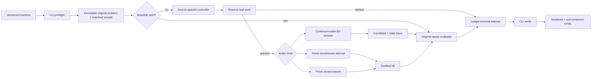

# Phase 5: Guided and Perturbative BP Interventions - Research

**Researched:** 2026-09-30
**Domain:** Binary CSS BP control-flow interventions, transformed problems, candidate lifts, replay, and evidence inspection
**Confidence:** MEDIUM

<user_constraints>
## User Constraints (from CONTEXT.md)

### Locked Decisions

### Matched CSS pilot
- **D-01:** Use B1 as the one primary code for matched Phase 5 physical-sample pilots. Use deterministic algebraic and policy fixtures for BB-144, HGP, and other eligible codes rather than running three code-wide comparison pilots. Confirm B1 artifact and logical-operator identity before sampling. — **Reversibility:** costly — changing the primary code would require new matched samples, manifests, and evidence rather than relabeling B1 results.
- **D-02:** Compare one common B1 baseline with each of the six Phase 5 intervention kinds separately: BPGD, impulse, freezing, syndrome flip, sign flip, and restarting. Use the same identified physical samples across eligible arms. Do not add intervention-pair arms to this pilot. This limits pilot coverage, not the canonical engine's compatibility contract. Source-unresolved or ineligible arms retain explicit availability/qualification status; no substitute is silently called source-faithful.
- **D-03:** Size the B1 pilot for mechanistic inspection: small, prespecified finite sample and work caps, visible attempts and bounded traces, original-problem outcomes, and complete cost attribution. Preserve inconclusive results and all admitted shots. Do not choose settings from this pilot to make a decoder ranking, and do not treat these outcomes as a publication-curve assessment.

### Researcher execution and inspection
- **D-04:** The public entry point is a versioned saved manifest with CLI preflight, execution, and verification. Provide a compact Phase 5 notebook to inspect the produced evidence; it is not the primary configuration or execution surface. Preserve historical manifest and ledger meanings. — **Reversibility:** costly — persisted manifest and evidence semantics become dependencies for later experiments and replay.
- **D-05:** Lead the notebook with a matched shot-by-shot path: baseline result, chosen intervention's attempts, candidate origins, selected candidate, original validation, and work. Keep the same physical sample in view while switching intervention arms. Show every failed, contradictory, invalid, and budget-denied attempt as a visible row with status, candidate origin, and work; make details expandable. Summaries complement these rows rather than hiding them.
- **D-06:** Include interactive outcome-category, attempt-count, and work-distribution plots in the notebook and a shareable HTML export. A legend click shows or hides an arm/series without modifying evidence. Initially show the baseline and one selected arm; the other arms remain available. Keep arm visibility synchronized across the outcome and work plots. Timing plots are not required in this first plot set.
- **D-07:** The HTML export includes plot hover details, manifest and source identities, assessment labels, and references or links to the saved evidence. A full per-shot attempt drilldown is required in the notebook, not in the HTML export. Preserve source, adaptation, unavailable, and not-assessed qualifications in tables and plot context even when a series is hidden.

### the agent's Discretion
- Resolve the source-defined BPGD, impulse, syndrome-flip, and sign-flip variants against primary papers, supplements, and available code. The user did not select preferred flip papers or settle paper/code ambiguities in this discussion. Record unresolved behavior and native-code availability explicitly; use separately labeled interpretations only under the project's existing source-qualification rules.
- Choose exact B1 noise point(s), finite shot/attempt/work/time/trace caps, display library, HTML packaging, and plot details consistent with D-01–D-07. Benchmark representative work and declare caps before collecting pilot outcomes. Do not turn the pilot into the oversized Phase 4 campaign that was cancelled.
- Choose module names, schema fields, and CLI command names while preserving canonical policy execution, original-problem validation, deterministic replay, and leaf-level work accounting.

### Deferred Ideas (OUT OF SCOPE)
- Multi-code pilot comparisons and intervention-pair arms are outside the selected Phase 5 pilot. Generic composition support remains governed by the roadmap and compatibility contract, not by the pilot's arm list.
- Statistical ranking and publication-curve claims remain in Phases 8–9. Quaternary and circuit behavior remain in Phases 10–13.
</user_constraints>

<phase_requirements>
## Phase Requirements

| ID | Description | Research Support |
|----|-------------|------------------|
| MOD-02 | A researcher can execute source-defined BPGD as a canonical guided-decimation composition with reliable-variable selection, fixation, BP rounds, and recorded state transitions. | Algorithm 1, its posterior-reliability rule, state continuation, fixation, and two source ambiguities are specified below. |
| MOD-03 | A researcher can execute source-defined impulse decoding with its failure trigger, shortening attempts, branch budgets, candidate lifting, and selection represented explicitly in the canonical execution model. | Algorithm 1 is separated from the project's optional algebraic-shortening adaptation; trigger, ordering, fresh state, and selection are explicit. |
| INT-01 | A researcher can apply an explicitly defined freezing policy with variable eligibility, fixed value, lifetime, and release/reset rules. | Poulin–Chung's frustrated-check loop is specified and its binary-CSS adaptation is bounded. |
| INT-02 | A researcher can apply a source-defined syndrome-flipping intervention while retaining the original syndrome and validating lifted candidates against it. | BP-SF's oscillation score, combinations, transformed syndrome, and certified XOR lift are specified from paper and code. |
| INT-03 | A researcher can apply a source-defined sign-flipping intervention with explicit target selection, magnitude/sign convention, trigger, and state consequences. | Huang–Hu–Ueng's normalized-min-sum posterior sign flip and three target rules are distinguished; the pilot uses a named deterministic adaptation. |
| INT-04 | A researcher can configure restarting with explicit reset/preserved state, stopping budget, and independent replayable random streams. | Restart Belief's root/branch reset, residual-syndrome loop, finite cap, and deterministic/no-RNG status are specified from paper and original code. |
</phase_requirements>

## Summary

Phase 5 needs six explicit controllers, not a single configurable perturbation. BPGD continues one BP session while fixing successively selected priors; impulse and BP-SF start independent fresh attempts; freezing mutates a prior for bounded periods and may release it; sign-flip mutates an iteration posterior while preserving message state; Restart Belief resets branch state and repeatedly solves residual syndromes. Treating these as one restart loop would change source behavior. [CITED: https://arxiv.org/html/2312.10950v2] [CITED: https://arxiv.org/html/2606.18240v1] [CITED: https://arxiv.org/html/0801.1241] [CITED: https://arxiv.org/html/2507.00254v1] [CITED: https://doi.org/10.1109/TQE.2023.3279379] [CITED: https://arxiv.org/html/2511.13281]

The existing engine has the right immutable-original and evidence foundations, but only identity working problems and one-shot kernel initialization. The exact present definitions are `OriginalProblem(lineage_id, hx, hz, syndrome)`, `WorkingProblem(lineage_id, original, parent_edge)` with `parent_edge.relation != "identity"` rejected, and `OriginalSpaceCandidate(lineage_id, working, candidate, local_order)`. [VERIFIED: src/bp_registry/canonical/problems.py:20-67] The kernel accepts `prior: float | np.ndarray`, but `run()` creates a new schedule and calls `initialize(error_rate)` on every invocation. [VERIFIED: src/bp_registry/canonical/kernel.py:50-92] Add typed intervention session/proposal/transform/lift contracts and engine-owned state transitions before implementing any paper algorithm.

**Primary recommendation:** implement source-specific state machines over a common engine-owned proposal/authorization/commit interface; label every B1 use that departs from a paper's code family or exact parameters as `pilot_adaptation`, and always lift then validate against the immutable original syndrome before selection.

## Architectural Responsibility Map

| Capability | Primary Tier | Secondary Tier | Rationale |
|------------|-------------|----------------|-----------|
| Intervention policies and target selection | Canonical policy layer | BP session | Policies see decoder-visible state and propose actions; the engine applies them. |
| BP continuation/reset | Canonical execution engine | Kernel/schedule | Only the engine may authorize budgeted state mutation. |
| Working-problem transform and lift | Problem/lineage layer | Independent evaluator | The transform records algebra; the evaluator checks the lifted original-space result. |
| Attempts, costs, and replay | Ledger/budget layer | Runner/CLI | Every branch, denial, invalid lift, and terminal result must be durable. |
| Matched B1 pilot | Manifest/runner | Notebook | Manifest fixes samples and caps; notebook only reads verified evidence. |
| Interactive report | Analysis/export | Ledger reader | Plot visibility changes presentation only. |

## Source-Defined Variant Matrix

| Arm | Source procedure to implement | Trigger and target | State/reset and lift | Qualification / unresolved detail |
|-----|-------------------------------|--------------------|----------------------|-----------------------------------|
| BPGD | Run BP for `T`; if invalid, compute posterior bias `L_i = mu_i + sum_j nu_{i,j}`, reliability `|L_i|`, choose a maximum, set its prior to `+llr_max` when nonnegative and `-llr_max` otherwise, remove it from the undecimated set, and repeat. The paper uses `llr_max=25`. [CITED: https://arxiv.org/html/2312.10950v2] | Failure after each `T`-iteration block; maximum reliability among undecimated variables. [CITED: https://arxiv.org/html/2312.10950v2] | Initialize once and continue the BP trajectory after each fixation; candidate already lives in original coordinates. [CITED: https://arxiv.org/html/2312.10950v2] | Algorithm 1 assigns exact zero to the positive fixation branch, while the hard decision maps zero to one and nearby prose uses a strict-positive test; maximum ties and whether a final post-last-fix BP block occurs are not defined. Implement a named `algorithm1_v2_interpretation`, stable original-index ties, record `zero_rule` and `final_round_rule`, and do not call those two choices source-verified. [CITED: https://arxiv.org/html/2312.10950v2] |
| Impulse | Run baseline BP. On failure, create one attempt per selected coordinate by replacing that coordinate's channel LLR with `-infinity` (fix to one), run fresh BP on the unchanged graph, collect converged candidates, and choose minimum Hamming weight. `+infinity` fixes zero and `-infinity` fixes one. [CITED: https://arxiv.org/html/2606.18240v1] | Baseline failure; source Algorithm 1 enumerates all `n` coordinates, while the text also discusses declared orderings. [CITED: https://arxiv.org/html/2606.18240v1] | Every impulse is an independent fresh attempt; unchanged graph means no coordinate lift. [CITED: https://arxiv.org/html/2606.18240v1] | Minimum-weight ties are unspecified. Any finite coordinate subset, finite LLR surrogate, or structural shortening is a controlled adaptation and must be named separately. The reviewed paper says data are available on request; no author-code identity was resolved in this session. [CITED: https://arxiv.org/html/2606.18240v1] |
| Freezing | After `T_pert` unsuccessful BP iterations, choose a frustrated check, choose one adjacent qubit, and set its prior to identity with probability one; after another period, release and try another neighbor if that check remains frustrated, otherwise move to another frustrated check. [CITED: https://arxiv.org/html/0801.1241] | Periodic failure and a frustrated check; qubit choice is random in the source. [CITED: https://arxiv.org/html/0801.1241] | Prior mutation lasts for the current trial period; failed same-check trials restore before trying another neighbor. [CITED: https://arxiv.org/html/0801.1241] | The source is quaternary depolarizing BP. Binary bit-to-zero freezing, stable check order, no-repeat neighbor sampling, and a total retry cap are explicit CSS adaptations. [CITED: https://arxiv.org/html/0801.1241] |
| Syndrome flip | First run BP while counting hard-decision oscillations; rank variables by oscillation count. For each test vector `t` from bounded combinations, solve `s' = s XOR (t H^T)` with fresh BP and, on convergence, return `e_hat XOR t`. [CITED: https://arxiv.org/html/2507.00254v1] | Baseline failure; top oscillating variables and bounded combination weight. [CITED: https://arxiv.org/html/2507.00254v1] | Independent fresh attempts; `t` is the algebraic lift certificate and the XOR-lifted candidate must pass original validation. [CITED: https://arxiv.org/html/2507.00254v1] | Original BP-SF code uses `np.argsort(...)[-topk:]`, unseeded `random.sample`, and parallel first-arrival return; replace these with declared stable test-vector order and replayable RNG for canonical use, labeled adaptation. Repository revision inspected: `0417d33fc2ffb3b442d0397bb09954fc1c6c3938`. [VERIFIED: https://github.com/Dies-Irae/BP-SF] |
| Sign flip | In normalized min-sum, after a failed trunk iteration form mismatched checks, choose a target by Global, Reliability, or Random strategy, then mutate the target posterior `L_j <- -L_j`; the next iteration continues from existing messages. [CITED: https://doi.org/10.1109/TQE.2023.3279379] | Failed iteration; Global chooses a neighbor of the most mismatched checks, Reliability chooses the least-absolute-posterior neighbor of a random mismatched check, Random chooses both randomly. [CITED: https://doi.org/10.1109/TQE.2023.3279379] | Persistent posterior mutation with continued message state; it is not a channel-prior flip or a fresh restart. [CITED: https://doi.org/10.1109/TQE.2023.3279379] | The full BSFBP also includes branch-assisted syndrome pruning. D-02 requires an isolated sign-flip arm, so use a named `bsfbp_sign_only_controlled_adaptation`, Global targeting, and stable-index ties. No author-code identity was resolved. [CITED: https://doi.org/10.1109/TQE.2023.3279379] |
| Restarting | Run a root BP attempt, sort output LLRs ascending, then create `eta` branches. Each branch resets the channel prior and temporary error; insert a low-LLR bit, update residual syndrome, force inserted bits to zero with positive-infinite LLR, run fresh branch BP, and iteratively add the current minimum-LLR bit. Lift by XOR with the inserted-error vector and retain strict lower weight. [CITED: https://arxiv.org/html/2511.13281] | Root failure subject to bounded-distance early exits; branch targets follow sorted output LLRs. [CITED: https://arxiv.org/html/2511.13281] | Root-to-branch reset; each residual solve is fresh; only declared inserted-error state persists within a branch. The source algorithm is deterministic, so random-stream metadata is `not_applicable`, not invented. [VERIFIED: https://github.com/DiegoForlivesi/QBelief] | Source uses `t=floor((d-1)/2)`. B1 has only `"distance": {"status": "source_bounded", "lower": 18, "upper": 24}`. [VERIFIED: data/artifacts/b1-panteleev-kalachev-v3.json:47-49] A B1 `t_cap=8` is a conservative mechanism-only adaptation, not source-faithful Restart Belief. Exact LLR ties are unspecified. Original-code revision inspected: `275535ec981763166c8549d91959dc6e371ec4b1`. [VERIFIED: https://github.com/DiegoForlivesi/QBelief] |

## Architecture Patterns

### System Architecture Diagram



### Recommended Project Structure

```text
src/bp_registry/canonical/
├── interventions.py      # typed proposals, actions, state, registry
├── transformations.py    # working views and certified lifts
├── sessions.py           # inspectable continue/reset BP state
├── guided_decimation.py  # BPGD controller
├── perturbations.py      # impulse, freezing, syndrome/sign flip
└── restarting.py         # Restart Belief controller
tests/canonical/           # algebra, state-machine, budget, replay tests
notebooks/                # compact evidence reader
```

### Pattern 1: Propose, authorize, commit

Policy code returns immutable data containing trigger evidence, target order, requested mutation, source variant, and expected state lifetime. The engine validates compatibility and reserves work before applying it; denial writes a terminal attempt without mutation. This follows the existing contract that policy decisions are data, but its current action union is exactly `"continue", "terminate", "state_update"`, so Phase 5 needs a versioned action contract rather than encoding transformations inside `state_updates`. [VERIFIED: src/bp_registry/canonical/contracts.py:293-305]

### Pattern 2: Transform, lift, original-check

For a structural fixed-coordinate adaptation with fixed set `F`, free set `R`, and assignment `a`, use `H_work = H[:,R]`, `s_work = s XOR H[:,F]a`; lift by restoring `a` on `F`. For a syndrome-flip certificate `t`, solve `s_work = s XOR Ht` and lift `e = e_work XOR t`. The independent finite oracle currently verifies shortening equivalence, injectivity, coverage, all-fixed contradictions, syndrome-flip lift, and the fact that finite bias is not an exact fixed constraint over 16,384 cases. [VERIFIED: tools/validate_intervention_design.py:25-101] The successful session output was `16384 shortening cases and 4 constructed cases passed`. [VERIFIED: local execution 2026-09-30]

### Pattern 3: Explicit BP session semantics

Use a session object containing prior vector, message buffers, posterior, hard decision, iteration index, and source-specific intervention state. Provide separate `continue`, `reset_fresh`, `mutate_prior`, and `mutate_posterior` operations; never infer reset from a generic attempt boundary. The current kernel cannot continue because every `run()` constructs a schedule and initializes `v2c`. [VERIFIED: src/bp_registry/canonical/kernel.py:73-92]

### Pattern 4: Versioned public evidence

Add a new public manifest and ledger version; preserve parsers for historical versions. Reuse existing event names where their meaning is unchanged—the exact current event registry is `"shot_begin", "attempt", "intervention", "branch", "branch_pruned", "relay_transfer", "candidate", "fallback", "selection", "termination", "work", "runtime", "missingness", "trace_link", "trace_truncated"`. [VERIFIED: src/bp_registry/ledger.py:387-393] New payloads must identify variant, source anchors, trigger, target/test vector, pre/post state digest, reset set, preserved set, working lineage, lift certificate, original validation, termination, and leaf work.

### Anti-Patterns to Avoid

- **One generic perturb-and-restart loop:** it erases BPGD continuation and sign-flip posterior mutation. [CITED: https://arxiv.org/html/2312.10950v2] [CITED: https://doi.org/10.1109/TQE.2023.3279379]
- **Calling finite LLR an exact fixation:** incoming messages can overturn a finite field; use a semantic constraint or disclose the numerical surrogate. [VERIFIED: tools/validate_intervention_design.py:79-82]
- **Validating in working space only:** transformed success is not original success; lift first and independently check `H e = s`. [VERIFIED: tools/validate_intervention_design.py:65-73]
- **Arrival-order selection:** stable declared order must decide ties and first success; concurrency is execution topology only.
- **Inventing source behavior:** unresolved zero, final-round, tie, or distance rules remain qualifications in manifests and evidence.

## Standard Stack

Use the existing Python/NumPy/Pydantic/pytest stack. The project declares `requires-python = ">=3.12"`, runtime dependencies `"numpy==2.2.6", "scipy==1.17.1", "ldpc==2.4.1", "pydantic==2.13.5"`, and analysis dependencies `"matplotlib==3.10.9", "nbformat==5.10.4", "nbclient==0.10.2", "ipykernel==6.29.5"`. [VERIFIED: pyproject.toml:5-18]

For D-06, add Plotly through a human verification checkpoint because the package-legitimacy seam returned `SUS` for the currently published package. Pin and probe a selected version in the project environment before implementation. Plotly supports grouped legend toggling through `legendgroup`/`groupclick` and self-contained HTML through `write_html(..., include_plotlyjs=True)`. [CITED: https://plotly.com/python/legend/] [CITED: https://plotly.com/python/interactive-html-export/]

## Package Legitimacy Audit

| Package | Registry | Source Repo | Verdict | Disposition |
|---------|----------|-------------|---------|-------------|
| `plotly` [WARNING: flagged as suspicious — verify before using.] | PyPI | `github.com/plotly/plotly.py` | SUS from GSD seam | Planner adds `checkpoint:human-verify`, pins the accepted release, installs, and runs notebook/export smoke test. |

**Packages removed due to SLOP verdict:** none.  
**Packages flagged as suspicious:** `plotly`.

## B1 Pilot Design Under D-01–D-07

Use two stages. First run four disjoint calibration shots to measure atomic work and verify that every arm reaches its trigger; then freeze one manifest containing the evaluation samples, arm availability, all caps, source/adaptation labels, and plot defaults before running any evaluation shot. [ASSUMED] The B1 artifact is exactly `"code_id": "b1-ghp-882"`, dimensions `"hx": [441, 882], "hz": [441, 882]`, ranks 429/429, `"k_gf2": 24`, row weight 6, column weight 3, and logical pairing `"identity"`. [VERIFIED: data/artifacts/b1-panteleev-kalachev-v3.json:2-49] Rerun the identity verifier; retained evidence says all seven identity/reconstruction checks are `true` and `"matrix_logical_identity_match": true`. [VERIFIED: data/evidence/phase4-b1-identity-resolution.json:2-30]

Prespecify a single `p=0.07` point and 16 matched evaluation shots, with an 80-sweep common baseline and the same sample-seed identity in all eligible arms. [ASSUMED] The point and count are for trigger-rich mechanistic inspection and bounded cost; they cannot support ranking or curve claims. Freeze arm-specific caps from calibration, with these planning ceilings: BPGD 16 decimation rounds of 10 sweeps; impulse 8 fresh attempts; freezing 8 perturbation periods; syndrome flip top-8 variables and weight-one tests; sign flip 16 actions within 80 sweeps; restart `eta<=8`, `t_cap=8`, and 10 sweeps per residual solve. [ASSUMED] A cap hit is a recorded outcome, never an excluded shot.

Every arm row must include eligibility/availability, source variant, qualification, sample identity, trigger, target/test order, attempt index, state/reset rule, candidate origin, lift certificate or `not_applicable`, original syndrome validity, logical outcome, termination, and leaf plus aggregate work. Initial HTML visibility is baseline plus one selected arm; other traces use `legendonly`, and all traces for one arm share a legend group so one click toggles that arm across outcome, attempt, and work panels. [CITED: https://plotly.com/python/legend/]

## Don't Hand-Roll

| Problem | Don't Build | Use Instead | Why |
|---------|-------------|-------------|-----|
| Binary algebra | Ad hoc list arithmetic | Existing NumPy GF(2) conventions plus independent exhaustive fixtures | Zero-column, all-fixed, and lift cases are easy to mishandle. |
| Source qualification | Boolean `source_faithful` flag | Existing structured PolicyEvidence plus variant/adaptation/unresolved fields | A variant can match equations while differing on ties or reset. |
| Work limits | Controller-local counters | Existing reserve/commit budget ledger extended with intervention units | Denial must precede mutation and aggregate exactly once. |
| Candidate validation | Controller success flag | Independent original-problem evaluator | The controller must not judge hidden logical truth. |
| HTML chart controls | Custom JavaScript state model | Plotly legend groups and offline export | Built-in grouping keeps series visibility synchronized. |

## Common Pitfalls

### Source equation matched, state machine changed
Running fresh BP after every BPGD or sign flip changes the algorithm even if the local equation matches. Test reset/preserved state explicitly with message-buffer fixtures. [CITED: https://arxiv.org/html/2312.10950v2] [CITED: https://doi.org/10.1109/TQE.2023.3279379]

### Source-family mismatch hidden by a common B1 benchmark
Freezing originates in quaternary depolarizing BP, sign flip in normalized min-sum, BP-SF in a different code/circuit setting, and Restart Belief needs exact distance. Their B1 arms are mechanism adaptations unless every source premise is satisfied. [CITED: https://arxiv.org/html/0801.1241] [CITED: https://doi.org/10.1109/TQE.2023.3279379] [CITED: https://arxiv.org/html/2507.00254v1] [CITED: https://arxiv.org/html/2511.13281]

### Work attribution after mutation
If a transform or branch is constructed before reservation, budget-denied attempts leave unaccounted state changes. Reserve all requested units first; commit actual work to the leaf and aggregate once.

### Parallel first-success nondeterminism
The inspected BP-SF code can return queue-arrival order. Canonical execution must select by declared test-vector order and record completion order only as diagnostics. [VERIFIED: https://github.com/Dies-Irae/BP-SF]

### Infinite values in persisted JSON
The strict base model uses `extra="forbid", strict=True, frozen=True, allow_inf_nan=False`. [VERIFIED: src/bp_registry/canonical/contracts.py:17-18] Persist semantic exact-fix actions and finite kernel realizations separately; never write IEEE infinity into manifests or ledgers.

## Validation Architecture

### Test Framework

| Property | Value |
|----------|-------|
| Framework | pytest 9.0.3 [VERIFIED: local environment probe 2026-09-30] |
| Config file | `pyproject.toml` with `testpaths = ["tests"]`, `pythonpath = ["src"]` [VERIFIED: pyproject.toml:24-26] |
| Quick run command | `OMP_NUM_THREADS=1 .venv/bin/python -m pytest -q <target> -x` |
| Full suite command | `OMP_NUM_THREADS=1 .venv/bin/python -m pytest -q` [VERIFIED: .planning/config.json:20-50] |

### Phase Requirements → Test Map

| Req ID | Behavior | Test Type | Automated Command | File Exists? |
|--------|----------|-----------|-------------------|-------------|
| MOD-02 | BPGD selection, fixation, continuation, zero/final rules, cap ledger | unit/integration | `OMP_NUM_THREADS=1 .venv/bin/python -m pytest -q tests/canonical/test_guided_decimation.py -x` | ❌ Wave 0 |
| MOD-03 | impulse trigger, fresh attempts, structural-adaptation lift, stable minimum | unit/integration | `OMP_NUM_THREADS=1 .venv/bin/python -m pytest -q tests/canonical/test_impulse.py -x` | ❌ Wave 0 |
| INT-01 | freeze eligibility, lifetime, release, retry and cap | unit | `OMP_NUM_THREADS=1 .venv/bin/python -m pytest -q tests/canonical/test_perturbative_interventions.py -x` | ❌ Wave 0 |
| INT-02 | oscillation rank, transformed syndrome, certificate lift, original check | unit/integration | `OMP_NUM_THREADS=1 .venv/bin/python -m pytest -q tests/canonical/test_perturbative_interventions.py -x` | ❌ Wave 0 |
| INT-03 | target rule, posterior mutation, message continuation | unit/integration | `OMP_NUM_THREADS=1 .venv/bin/python -m pytest -q tests/canonical/test_perturbative_interventions.py -x` | ❌ Wave 0 |
| INT-04 | root/branch reset, residual loop, caps, stable ties, RNG `not_applicable` | unit/integration | `OMP_NUM_THREADS=1 .venv/bin/python -m pytest -q tests/canonical/test_restart_execution.py -x` | ❌ Wave 0 |
| D-04–D-07 | new manifest preflight/run/verify, matched samples, notebook and HTML | integration/smoke | `OMP_NUM_THREADS=1 .venv/bin/python -m pytest -q tests/test_phase5_public_execution.py tests/test_phase5_notebook.py -x` | ❌ Wave 0 |

### Sampling Rate

- **Per task commit:** targeted file command above.
- **Per wave merge:** full suite.
- **Phase gate:** full suite; algebra oracle with `--check`; public preflight/run/verify on deterministic fixture; execute notebook; parse exported HTML; replay ledger byte-equivalently under the declared deterministic mode.

### Wave 0 Gaps

- [ ] Add contract/session/transform fixture tests before controllers.
- [ ] Add one source microfixture per algorithm, including zero/tie/final-round cases as declared interpretations.
- [ ] Add failed, contradictory, invalid-lift, budget-denied, cap-hit, and success evidence fixtures.
- [ ] Add notebook/export smoke fixtures without running the B1 evaluation campaign.

## Security Domain

Authentication, sessions, access control, and cryptography do not apply to this local research CLI. Input validation does apply: strict versioned manifests, finite JSON, artifact hash checks, path confinement, and hard branch/work/trace caps mitigate malformed input, traversal, tampered artifacts, and resource exhaustion. [VERIFIED: .planning/config.json:49-51] Escape all manifest/source text embedded in HTML and keep Plotly data serialization separate from markup.

## Project Constraints (from AGENTS.md)

- Use one canonical execution engine per mathematically compatible kernel family; native adapters are references.
- Prioritize BP-internal policies before OSD/LSD-style postprocessing; keep this phase in CSS code capacity.
- Preserve immutable original problems, hidden-truth separation, independent evaluation, manifests, per-shot/control-flow provenance, candidate lineage, numerical conventions, and full branch/restart work.
- Cite primary mathematical sources; record interpretations and unresolved source details; statistical reproduction does not replace algebraic checks.
- Prespecify tolerances, budgets, stopping, and denominator rules; retain failed and inconclusive evidence.
- Preserve configured GSD model/effort choices and do not automatically select Astra.
- This work is under the already invoked GSD planning workflow.

## Assumptions Log

| # | Claim | Section | Risk if Wrong |
|---|-------|---------|---------------|
| A1 | Four calibration shots and 16 evaluation shots at `p=0.07` will expose enough intervention paths for mechanistic inspection within practical runtime. | B1 Pilot | Too few triggers or excessive runtime; calibration must reject and replace the manifest before evaluation. |
| A2 | The proposed numerical arm ceilings are adequate for a mechanism pilot. | B1 Pilot | Excess cap hits or cost; calibration must freeze revised caps without using evaluation outcomes. |
| A3 | Stable original-index tie rules are acceptable canonical adaptations wherever papers are silent. | Variant Matrix | May differ from an author's unreported implementation; label and preserve source uncertainty. |
| A4 | B1 `t_cap=8` is useful for inspecting restart mechanics despite unknown exact distance. | Restarting | Cannot support a source-faithful or performance claim. |

## Open Questions

1. **BPGD exact-zero and final-round semantics:** Algorithm 1 and surrounding prose are not fully consistent. Ship only a named interpretation until author code or clarification resolves it. [CITED: https://arxiv.org/html/2312.10950v2]
2. **Impulse native implementation and shortening equivalence:** the source algorithm is unchanged-graph infinite-LLR forcing. Structural shortening is algebraically valid but not proven trajectory-equivalent; keep it a separate adaptation. [CITED: https://arxiv.org/html/2606.18240v1]
3. **Sign-flip original code and isolated-arm semantics:** the available primary description defines BSFBP as a compound method. The D-02 sign-only arm must remain explicitly adapted. [CITED: https://doi.org/10.1109/TQE.2023.3279379]
4. **B1 exact distance:** without exact `d`, source-defined Restart Belief's `t` is unavailable. Run the conservative cap only under `pilot_adaptation`, or mark the source preset unavailable. [VERIFIED: data/artifacts/b1-panteleev-kalachev-v3.json:47-49]
5. **Plotly release:** the legitimacy gate requires a human verification checkpoint before installation; pin and smoke-test the accepted release.

## Sources

### Primary (MEDIUM confidence from provider seam)

- [BPGD paper, arXiv:2312.10950v2](https://arxiv.org/html/2312.10950v2) — Algorithm 1, posterior reliability, hard decision, fixation, iteration limits.
- [Impulse decoding paper, arXiv:2606.18240v1](https://arxiv.org/html/2606.18240v1) — Algorithm 1, infinite LLR interpretation, fresh attempts, selection.
- [Poulin–Chung freezing paper, arXiv:0801.1241](https://arxiv.org/html/0801.1241) — frustrated-check freezing/release loop.
- [BP-SF paper, arXiv:2507.00254v1](https://arxiv.org/html/2507.00254v1) and [original code](https://github.com/Dies-Irae/BP-SF) — oscillation rank, syndrome transform, lift, implementation ordering.
- [Huang–Hu–Ueng sign-flip paper](https://doi.org/10.1109/TQE.2023.3279379) — normalized-min-sum equations, triggers, target strategies, posterior mutation.
- [Restart Belief paper, arXiv:2511.13281](https://arxiv.org/html/2511.13281) and [original code](https://github.com/DiegoForlivesi/QBelief) — root/branch reset, residual syndrome, fixation loop, lift, selection.
- [Plotly legend documentation](https://plotly.com/python/legend/) and [HTML export documentation](https://plotly.com/python/interactive-html-export/) — synchronized visibility and standalone export.

### Repository evidence

- `tools/validate_intervention_design.py` — exhaustive finite algebra oracle.
- `data/artifacts/b1-panteleev-kalachev-v3.json` and `data/evidence/phase4-b1-identity-resolution.json` — B1 identity, parameters, and distance bound.
- `src/bp_registry/canonical/{problems,kernel,contracts}.py`, `src/bp_registry/ledger.py` — current integration boundaries and exact discrete contracts.

## Metadata

**Confidence breakdown:**
- Source procedures: MEDIUM — primary papers and two original repositories checked; several source omissions/conflicts remain explicit.
- Architecture: HIGH — current source files and algebra oracle inspected and executed.
- Pilot sizing: LOW — intentionally prescriptive assumptions subject to disjoint calibration.
- Visualization: MEDIUM — official docs checked; package not installed and legitimacy checkpoint remains.

**Research date:** 2026-09-30  
**Valid until:** 2026-10-30
