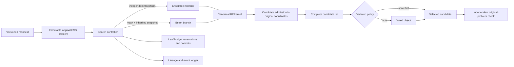

# Phase 6: Beam Search, Ensembles, and Candidate Selection - Research

**Researched:** 2026-10-04
**Domain:** BP search trees, automorphism ensembles, candidate selection, voting, and auditable work accounting
**Confidence:** HIGH for repository architecture; MEDIUM for source-paper interpretation because the BeamSearch paper and implementation differ at one material rule

## Summary

Phase 6 should add one versioned search controller around the existing canonical CSS kernel. The controller owns immutable member and branch identities, state-transfer declarations, finite reservations, candidate admission, pruning, voting, and selection; the kernel continues to own BP message updates. The source-qualified BeamSearch paths must bind that seam to min-sum BP; an SPA path is a separately named controlled CSS adaptation. [CITED: https://arxiv.org/html/2512.07057v2] [VERIFIED: https://github.com/ionq-publications/BeamSearchDecoder/blob/084a475b05fb64308103317a1ce5a0c4b0be58aa/decoder/src_cpp/beam_search.hpp#L131-L201] Existing lineage, candidate records, frozen selection records, and hierarchical budget trees already provide most of the controller foundation. [VERIFIED: `src/bp_registry/canonical/lineage.py:19-40,182-277`; `src/bp_registry/canonical/budgets.py:447-513`]

BeamSearch must expose qualified source variants. The paper branches on the least reliable unmasked variable. The pinned C++ scan skips degree-at-most-two variables, but its root initializes `min_score` and `min_idx` from index 0 before that filter; index 0 can therefore remain selected even when filtered. Later scans reuse the previous `min_idx` when no eligible unmasked variable exists. [CITED: https://arxiv.org/html/2512.07057v2] [VERIFIED: https://github.com/ionq-publications/BeamSearchDecoder/blob/084a475b05fb64308103317a1ce5a0c4b0be58aa/decoder/src_cpp/beam_search.hpp#L229-L240] [VERIFIED: https://github.com/ionq-publications/BeamSearchDecoder/blob/084a475b05fb64308103317a1ce5a0c4b0be58aa/decoder/src_cpp/beam_search.hpp#L425-L435] A cleaned degree-filter policy is an adaptation rather than the pinned implementation. Pin the native reference at commit `084a475b05fb64308103317a1ce5a0c4b0be58aa`; build it in a digest-bound isolated environment because its top-level license is CC BY-NC-SA 4.0 and its dependency surface differs from the project environment. [VERIFIED: https://github.com/ionq-publications/BeamSearchDecoder/tree/084a475b05fb64308103317a1ce5a0c4b0be58aa]

Use AutDEC as the source model for independent ensemble members and likelihood selection, not as evidence for voting. AutDEC transforms syndromes using automorphism-induced check permutations, runs constituent decoders, admits valid corrections, and selects minimum weight under its code-capacity model. Its official repository currently executes members serially even though the paper presents the online ensemble as parallel. [CITED: https://arxiv.org/html/2503.01738v1] [VERIFIED: https://github.com/hsayginel/autdec/blob/00746ced028ebc6edca1b4e56ee6db3d9039d553/autdec/code_capacity.py#L55-L120] Voting therefore needs an explicit `canonical_generic` status rather than a false paper attribution. [ASSUMED]

**Primary recommendation:** implement a kernel-generic masked seam whose source-qualified BeamSearch profiles bind min-sum, preserve the pinned C++ sentinel/reuse edge behavior only in its observed profile, use the exact AutDEC `U_A H = H A` coordinate convention, require an isolated native build attempt, and complete candidate/vote ledgers plus deterministic replay before a performance campaign. [ASSUMED]

Phase 5 provides a technically verified base: its report records `status: human_needed`, `score: 14/14 must-haves verified`, `behavior_unverified: 0`, and two remaining human review categories. [VERIFIED: `.planning/phases/05-guided-and-perturbative-bp-interventions/05-VERIFICATION.md:1-5,128-151`] Phase 6 may build on its immutable-original, truth-free controller, independent original check, and typed budget-denial patterns, while final phase progression still respects those human review items. [VERIFIED: `.planning/phases/05-guided-and-perturbative-bp-interventions/05-VERIFICATION.md:164-170`] [ASSUMED]

<phase_requirements>
## Phase Requirements

| ID | Description | Research support |
|---|---|---|
| MOD-04 | A researcher can execute a source-linked canonical BeamSearch composition with explicit branching, masked BP, beam ranking/pruning, width/budgets, and candidate selection, alongside the pinned original reference where available. | Exact paper flow, repository differences, pin, interface, license boundary, and fixtures are specified below. [CITED: https://arxiv.org/html/2512.07057v2] |
| INT-05 | A researcher can compose branching and ensembling with explicit parent/member identity, resource limits, shared versus independent state, and aggregated work. | Existing `SearchRelationship` values are quoted below; the recommended controller and budget hierarchy make every path and member explicit. [VERIFIED: `src/bp_registry/canonical/contracts.py:263-309`] |
| CAN-01 | A researcher can select from a candidate list using declared eligibility, scoring, and deterministic tie rules, preserving rejected candidates and their origins. | Existing `CandidateRecord` and `SelectionRecord` retain origin, validation, reason, ordinal, digest, score, and the complete ordered frozen list. [VERIFIED: `src/bp_registry/canonical/lineage.py:182-277`] |
| CAN-02 | A researcher can apply a precisely defined voting policy over a declared object and eligible set, with final original-problem validity checked rather than assumed. | Two canonical-generic vote objects and their validation rules are specified below. [ASSUMED] |
</phase_requirements>

## Project Constraints (from AGENTS.md)

- Use one canonical execution engine per mathematically compatible BP family; native implementations are executable references. [VERIFIED: `AGENTS.md:project-doc`]
- Develop CSS code-capacity before correlated quaternary and circuit-level decoding, and prioritize BP-internal policies before optional OSD/LSD. [VERIFIED: `AGENTS.md:project-doc`]
- Keep original problems immutable; policies cannot inspect hidden simulation truth; independent evaluators judge outputs in original coordinates. [VERIFIED: `AGENTS.md:project-doc`]
- Emit an event ledger for every simulation and a reproduction manifest for every supported paper; distinguish source-faithful reproduction, canonical adaptation, controlled comparison, and mapped-only evidence. [VERIFIED: `AGENTS.md:project-doc`]
- Prespecify tolerances, budgets, stopping, and denominator rules and retain failed or inconclusive evidence. [VERIFIED: `AGENTS.md:project-doc`]
- Do not alter the running BB72 v2 source-sealed study during this phase-planning work. [VERIFIED: parent task instruction]

## Architectural Responsibility Map

| Capability | Primary tier | Secondary tier | Rationale |
|---|---|---|---|
| BP and masked BP iteration | Canonical kernel | Search controller | The kernel owns numerical updates; source-qualified BeamSearch uses min-sum, while the controller supplies an explicit mask, fixed values, warm-start snapshot, and iteration cap. [CITED: https://arxiv.org/html/2512.07057v2] |
| Member and branch lifecycle | Search controller | Lineage ledger | Search creates parents, children, ordering, state-transfer evidence, and terminal status. [ASSUMED] |
| Candidate admission, scoring, voting, selection | Selection policy | Independent validator | Policy operates on decoder-visible records; validation recomputes original constraints before freezing. [ASSUMED] |
| Work and latency evidence | Budget tree | Runtime ledger | Aggregate work is a sum over unique leaf scopes; measured latency/topology is separate evidence. [VERIFIED: `src/bp_registry/canonical/budgets.py:447-513`] |
| Native BeamSearch/AutDEC execution | Isolated native stage | Adapter/registry | Native code is reference evidence and must not replace the canonical kernel. [ASSUMED] |

## Standard Stack

### Core

| Component | Version/pin | Purpose | Direction |
|---|---|---|---|
| Existing Python canonical engine | repository phase-5 baseline | BP execution, lineage, budgets, ledger, manifests | Extend versionedly; do not create a second CSS kernel. [VERIFIED: `src/bp_registry/canonical/contracts.py:21-73`] |
| NumPy / SciPy | project pins `numpy==2.2.6`, `scipy==1.17.1` | Arrays, sparse matrices, deterministic fixtures | Retain the project pins. [VERIFIED: `pyproject.toml:5-10`] |
| Pydantic | project pin `pydantic==2.13.5` | Manifest and ledger validation | Add phase-6 schema versions rather than mutating old grammars. [VERIFIED: `pyproject.toml:5-10`] |
| Pytest | environment `9.0.3` | Unit, replay, schema, adapter tests | Use deterministic small-tree fixtures. [VERIFIED: environment probe on 2026-10-04] |

### Executable references

| Reference | Immutable identity | Use | Boundary |
|---|---|---|---|
| BeamSearchDecoder | commit `084a475b05fb64308103317a1ce5a0c4b0be58aa` | Required source reference for MOD-04 | Mandatory stage-local build attempt; capture commit/tree/build/dependencies/logs and independently validate every returned vector. [VERIFIED: https://github.com/ionq-publications/BeamSearchDecoder/blob/084a475b05fb64308103317a1ce5a0c4b0be58aa/README.md#L6-L22] |
| AutDEC | commit `00746ced028ebc6edca1b4e56ee6db3d9039d553` | Ensemble semantic reference and optional fixture cross-check | Its repository is MIT, Python `>=3.11`, and pins `ldpc=2.1.2`, which differs from this project's `ldpc==2.4.1`; isolate it. [VERIFIED: https://github.com/hsayginel/autdec/blob/00746ced028ebc6edca1b4e56ee6db3d9039d553/pyproject.toml#L31-L41] |

**Installation:** no native-reference package belongs in the canonical environment for Phase 6. [ASSUMED] For BeamSearch, create a digest-bound stage-local virtual environment at the pinned commit, run `pip install -r requirements.txt`, then run `python3 setup.py build_ext --inplace` from `decoder`, exactly as the official README documents. [VERIFIED: https://github.com/ionq-publications/BeamSearchDecoder/blob/084a475b05fb64308103317a1ce5a0c4b0be58aa/README.md#L6-L22] Capture the Python/compiler/platform identities, resolved dependency lock, commands, stdout/stderr, extension digest, and smoke result. [ASSUMED] A `native_unavailable` result is admissible only after this isolated attempt fails for a recorded platform or build reason. [ASSUMED]

## Package Legitimacy Audit

The pinned BeamSearch `requirements.txt` declares 14 direct dependencies. Only `stimbposd==0.1.0` is exact; the other 13 are lower bounds, so an unrecorded install can resolve differently over time. [VERIFIED: https://github.com/ionq-publications/BeamSearchDecoder/blob/084a475b05fb64308103317a1ce5a0c4b0be58aa/requirements.txt] PyPI index probes on 2026-10-04 found every declared project and specifically listed `stimbposd` version `0.1.0`. [VERIFIED: PyPI index probe on 2026-10-04] Registry existence alone does not establish package legitimacy. The GSD legitimacy seam returned `SUS` for all 14 because download counts were unavailable; some entries also lacked repository metadata or had a recent latest release. [VERIFIED: `gsd_run query package-legitimacy check --ecosystem pypi ...` on 2026-10-04] Every package below is therefore **[WARNING: flagged as suspicious — verify before using.]** under the planning gate, even when it is a familiar project. [ASSUMED]

| Source-declared package | Constraint at pin | PyPI latest seen | Age | Download signal | Repository signal from seam | Verdict | Disposition |
|---|---:|---:|---|---|---|---|---|
| Cython | `>=3.0.0` | 3.3.0 | not assessed | unavailable | `https://cython.org/` | SUS | Human verify before isolated install |
| setuptools | `>=60.0.0` | 84.0.0 | not assessed | unavailable | `https://github.com/pypa/setuptools` | SUS | Human verify before isolated install |
| numpy | `>=2.0.0` | 2.5.3 | not assessed | unavailable | none reported | SUS | Human verify before isolated install |
| scipy | `>=1.10.0` | 1.18.1 | not assessed | unavailable | none reported | SUS | Human verify before isolated install |
| pandas | `>=2.0.0` | 3.0.6 | not assessed | unavailable | none reported | SUS | Human verify before isolated install |
| matplotlib | `>=3.5.0` | 3.11.2 | not assessed | unavailable | `https://matplotlib.org` | SUS | Human verify before isolated install |
| networkx | `>=3.0` | 3.7 | not assessed | unavailable | `https://networkx.org/` | SUS | Human verify before isolated install |
| ldpc | `>=2.0.0` | 2.4.1 | not assessed | unavailable | none reported | SUS | Human verify before isolated install |
| stim | `>=1.12.0` | 1.16.0 | not assessed | unavailable | `https://github.com/quantumlib/stim` | SUS | Human verify before isolated install |
| sinter | `>=1.10.0` | 1.16.0 | not assessed | unavailable | none reported | SUS | Human verify before isolated install |
| PyMatching | `>=2.0.0` | 2.4.0 | not assessed | unavailable | `https://github.com/oscarhiggott/PyMatching` | SUS | Human verify before isolated install |
| stimbposd | `==0.1.0` | 0.2.0; required 0.1.0 exists | not assessed | unavailable | `https://github.com/oscarhiggott/stimbposd` | SUS | Human verify before isolated install |
| decorator | `>=5.0.0` | 5.3.1 | not assessed | unavailable | none reported | SUS | Human verify before isolated install |
| pyparsing | `>=3.0.0` | 3.3.3 | not assessed | unavailable | `https://github.com/pyparsing/pyparsing.git` | SUS | Human verify before isolated install |

**Packages removed due to SLOP verdict:** none. [VERIFIED: legitimacy seam output on 2026-10-04]  
**Packages flagged SUS:** all 14 direct requirements above. [VERIFIED: legitimacy seam output on 2026-10-04]

The planner must place one blocking human-verification checkpoint before the isolated dependency install. That checkpoint should compare every resolved distribution name/version/index URL to the source-declared requirement, verify the distribution's authoritative project/source identity, and approve a fully resolved lock or wheelhouse manifest with artifact hashes. [ASSUMED] The install then uses only that approved resolution inside the native stage and records `pip --version`, Python/platform identity, the resolver report or lock, installed distributions, and hashes. [ASSUMED] The concrete current blocker is this required checkpoint; no declared dependency was missing from the PyPI index probe. [VERIFIED: PyPI index probe and legitimacy seam output on 2026-10-04]

### Build execution trust boundary

The pinned `setup.py` imports NumPy, Cython, and setuptools; reads the Cython source; writes a generated stub; and compiles a C++ extension with `-std=c++2a -O3` on non-Windows platforms. It also disables Cython bounds, wraparound, and initialized checks. [VERIFIED: https://github.com/ionq-publications/BeamSearchDecoder/blob/084a475b05fb64308103317a1ce5a0c4b0be58aa/decoder/setup.py#L1-L109] Running the documented build therefore executes pinned repository Python and native compiler steps, not merely declarative package metadata. [VERIFIED: same pinned `setup.py` source] Run it only after the checkpoint, in the digest-bound checkout and isolated environment, without credentials or writable project/study paths; finish dependency downloads before disabling network for the build when the environment supports that boundary. [ASSUMED] Capture modified/generated files and extension hashes so native evidence identifies the exact executable artifact. [ASSUMED]

## Architecture Patterns

### System Architecture Diagram



### Recommended Project Structure

```text
src/bp_registry/canonical/
├── search.py           # generic member/branch controller and replayable transitions
├── beam_search.py      # source-separated BeamSearch policies
├── ensemble.py         # transformations and independent-member execution
├── selection.py        # admission, scoring, ties, and voting
├── contracts.py        # versioned enums/configuration/state-transfer declarations
├── budgets.py          # versioned work grammar and leaf scopes
└── lineage.py          # existing branch/member/candidate/selection records
tests/
├── test_phase6_beam_search.py
├── test_phase6_ensemble_selection.py
├── test_phase6_voting.py
├── test_phase6_replay_budget.py
└── test_phase6_native_reference.py
```

Paths are recommended and therefore [ASSUMED]; reuse an existing module when that reduces churn without merging responsibilities.

### Pattern 1: Immutable logical order

Declare member order, parent order, branch value order, score direction, and all tie keys in the manifest. Workers may run concurrently, but the controller admits and commits results in logical order rather than completion order. [ASSUMED] This preserves byte-stable replay while keeping runtime topology observable separately. [ASSUMED]

### Pattern 2: State-transfer descriptor

Each child records whether state is independent, restarted, or branched; which parent it has; the digest of inherited state; the exact fields inherited; and the fields reset. Existing values are quoted verbatim as `"independent", "restarted", "branched", "relayed"`, and topology values are `"sequential", "concurrent", "batched"`. [VERIFIED: `src/bp_registry/canonical/contracts.py:263-309`] BeamSearch children inherit the parent's final variable-to-check messages plus mask history; AutDEC members share only the immutable original problem/configuration and otherwise use independent state. [CITED: https://arxiv.org/html/2512.07057v2] [CITED: https://arxiv.org/html/2503.01738v1]

### Pattern 3: Reserve before mutation

Reserve the complete atomic work vector against the branch/member leaf and its ancestors before changing messages, masks, candidate lists, or the ledger. Commit only on a unique leaf, so aggregate work includes accepted, rejected, and pruned paths exactly once. [VERIFIED: `src/bp_registry/canonical/budgets.py:447-513`] A budget-denied action emits a terminal branch/member event without partially mutating state. [ASSUMED]

### Pattern 4: Freeze before evaluation

Build the complete ordered candidate record list, record eligibility and rejection reasons, execute selection/voting, independently check the selected original-space output, freeze the selection, then expose it to the evaluator. The current record model already requires a complete ordered candidate list and freezes it before evaluation. [VERIFIED: `src/bp_registry/canonical/lineage.py:182-277`]

## Source-Qualified BeamSearch Contract

The v2 paper's Appendix A defines BeamSearch's BP operation as min-sum: each check-to-variable message uses the syndrome-dependent sign product and the minimum magnitude of the other incoming variable-to-check messages; variable messages add the channel LLR and other incoming check messages. The pinned C++ performs the same minimum-magnitude/sign calculation in both initial and masked rounds. [CITED: https://arxiv.org/html/2512.07057v2] [VERIFIED: https://github.com/ionq-publications/BeamSearchDecoder/blob/084a475b05fb64308103317a1ce5a0c4b0be58aa/decoder/src_cpp/beam_search.hpp#L131-L201] [VERIFIED: https://github.com/ionq-publications/BeamSearchDecoder/blob/084a475b05fb64308103317a1ce5a0c4b0be58aa/decoder/src_cpp/beam_search.hpp#L288-L363] The masked/warm-start execution seam should therefore be kernel-generic, but both source-qualified BeamSearch profiles must select the canonical min-sum update. [ASSUMED] Any SPA-based BeamSearch experiment must use a distinct status such as `canonical_css_spa_adaptation`; it cannot carry a paper- or official-source-exact label. [ASSUMED]

The paper procedure performs min-sum BP for `initial_iters`; if it fails, a root path branches on the unmasked variable with minimum absolute cumulative posterior LLR. Each child fixes that variable to 0 or 1, transforms the syndrome for fixed-one variables, excludes masked variables from BP messages, warm-starts remaining variable-to-check messages from its parent, accumulates posterior LLRs over the masked run, and chooses the next least-reliable unmasked variable. [CITED: https://arxiv.org/html/2512.07057v2]

The paper scores a child as the sum of absolute cumulative posterior LLRs over unmasked variables divided by the number of iterations actually executed. It retains the largest scores up to `beam_width`, processes paths in descending score order, stops on `num_results` or `max_rounds`, and among collected results minimizes the prior-weighted binary error cost. [CITED: https://arxiv.org/html/2512.07057v2]

Preserve the raw native defaults verbatim as `max_rounds=10`, `beam_width=8`, `num_results=1`, `initial_iters=30`, and `masked_round_iters=20`. [VERIFIED: https://github.com/ionq-publications/BeamSearchDecoder/blob/084a475b05fb64308103317a1ce5a0c4b0be58aa/decoder/beam_search_decoder/_beam_search_decoder.pyx#L88-L95] Register the paper configurations as source presets in the order `(max_rounds, beam_width, num_results, initial_iters, masked_round_iters)`: Beam-8 `(10, 8, 1, 30, 20)`, Beam-32 `(10, 32, 1, 40, 30)`, Beam-64 `(20, 64, 1, 40, 30)`, and Beam-64/32-results `(20, 64, 32, 40, 30)`. [CITED: https://arxiv.org/html/2512.07057v2] A preset fixes parameters only; it does not upgrade a CSS adaptation into a paper-experiment reproduction. [ASSUMED]

Implement these qualified profiles; the names below deliberately expose where deterministic completion or cleanup goes beyond a source statement:

| Field | `paper_v2_min_sum_plus_declared_ties` | `official_cpp_084a475_observed_min_sum` | Status |
|---|---|---|---|
| BP update | min-sum | min-sum | Source-aligned; SPA is a separately named adaptation. [CITED: https://arxiv.org/html/2512.07057v2] [VERIFIED: https://github.com/ionq-publications/BeamSearchDecoder/blob/084a475b05fb64308103317a1ce5a0c4b0be58aa/decoder/src_cpp/beam_search.hpp#L131-L201] |
| Branch index | minimum absolute cumulative LLR over every unmasked variable; add a declared stable lowest-index tie because the paper does not resolve ties | root seeds score/index from variable 0 before filtering, then scans degree-greater-than-two variables with strict `>`; later scans degree-greater-than-two unmasked variables and reuse the prior `min_idx` if none exists | The official profile reproduces observed edge behavior; a clean `degree_gt_2_lowest_index` rule must be labeled `canonical_cleaned_adaptation`. [CITED: https://arxiv.org/html/2512.07057v2] [VERIFIED: https://github.com/ionq-publications/BeamSearchDecoder/blob/084a475b05fb64308103317a1ce5a0c4b0be58aa/decoder/src_cpp/beam_search.hpp#L229-L240] [VERIFIED: https://github.com/ionq-publications/BeamSearchDecoder/blob/084a475b05fb64308103317a1ce5a0c4b0be58aa/decoder/src_cpp/beam_search.hpp#L425-L435] |
| Child order | 0 then 1 in pseudocode | 0 then 1 in loop | Source-aligned. [VERIFIED: https://github.com/ionq-publications/BeamSearchDecoder/blob/084a475b05fb64308103317a1ce5a0c4b0be58aa/decoder/src_cpp/beam_search.hpp#L255-L283] |
| Pruning | collective top beam by score plus a declared stable parent/child/ordinal tie completion | on-the-fly bounded min-priority queue of `(score, store_idx)`; a full queue rejects only strictly lower scores, then push/pop removes the lexicographically smallest pair, so equal scores favor later `store_idx` values | The paper tie completion is qualified; the official behavior is directly reproducible. [VERIFIED: https://github.com/ionq-publications/BeamSearchDecoder/blob/084a475b05fb64308103317a1ce5a0c4b0be58aa/decoder/src_cpp/beam_search.hpp#L401-L455] |
| Terminal candidate | collected valid paths, prior-weighted minimum | native `decoding` plus `converge` flag | Adapter independently recomputes syndrome validity and reports partial/no-result status. [VERIFIED: https://github.com/ionq-publications/BeamSearchDecoder/blob/084a475b05fb64308103317a1ce5a0c4b0be58aa/decoder/src_cpp/beam_search.hpp#L379-L484] |

The observed official branch-index reuse can select an already masked or otherwise ineligible prior index when a later scan has no eligible variable. [VERIFIED: https://github.com/ionq-publications/BeamSearchDecoder/blob/084a475b05fb64308103317a1ce5a0c4b0be58aa/decoder/src_cpp/beam_search.hpp#L425-L435] Preserve this only inside the observed pinned operational profile and add explicit termination/duplicate-mask safeguards outside that profile; do not silently repair it while retaining the official profile name. [ASSUMED]

The published experiments are circuit-level. A canonical CSS code-capacity use of the raw binary matrix interface is a `canonical_css_adaptation`, not a faithful reproduction of a paper curve. [CITED: https://arxiv.org/html/2512.07057v2] Keep native circuit evidence and canonical CSS controlled evidence in separate provenance categories. [ASSUMED]

## Ensemble, Selection, and Voting Contracts

### AutDEC source model

Require a supplied variable permutation `A` and compatible invertible check transformation `U_A` for every automorphism member, validate dimensions/bijection/invertibility, and verify the source convention `U_A H = H A` over GF(2). [CITED: https://arxiv.org/html/2503.01738v1] Compile the constituent decoder with `H A` and decode `U_A s`. If its returned vector `c` satisfies `(H A)c = U_A s`, then `U_A Hc = U_A s`, so invertibility gives `Hc = s`: `c` is already the candidate checked in the original coordinate convention used by the source path. [CITED: https://arxiv.org/html/2503.01738v1] Do not inverse-map `c` in this source convention. The pinned implementation constructs `H @ A`, decodes `U_A @ s`, and directly tests `H @ c == s` before appending `c`. [VERIFIED: https://github.com/hsayginel/autdec/blob/00746ced028ebc6edca1b4e56ee6db3d9039d553/autdec/code_capacity.py#L55-L104] An inverse map is permitted only for a separately named transform convention whose constituent output is explicitly defined in permuted coordinates. [ASSUMED]

Do not make automorphism discovery part of the decode path; stage and digest `(A, U_A)` data and revalidate `U_A H = H A` before member construction so replay and preparation cost remain explicit. [ASSUMED]

The official code keeps only corrections satisfying the original syndrome and selects minimum Hamming weight, with stable list index breaking equal-weight ties because Python sorts `(weight, index)` pairs. [VERIFIED: https://github.com/hsayginel/autdec/blob/00746ced028ebc6edca1b4e56ee6db3d9039d553/autdec/code_capacity.py#L93-L120] Its fallback to the base correction when no ensemble candidate converges must be recorded as a separate source rule and revalidated; it must not be silently treated as an eligible ensemble candidate. [VERIFIED: https://github.com/hsayginel/autdec/blob/00746ced028ebc6edca1b4e56ee6db3d9039d553/autdec/code_capacity.py#L107-L120]

### Candidate selection

Every candidate record must contain origin member/path, parent, construction ordinal, payload digest, retained payload or trace link, original-check result, policy eligibility, score value and direction, and rejection reason. [ASSUMED] Deterministic ordering is `(eligible first, primary score, declared secondary keys, construction ordinal, candidate identity)`. [ASSUMED] Preserve every rejected, pruned, duplicate, late, and budget-exhausted origin even when payloads deduplicate. [ASSUMED]

### Voting

Implement voting as `canonical_generic` because the inspected BeamSearch and AutDEC sources select candidates by reliability/likelihood rather than defining a vote. [CITED: https://arxiv.org/html/2512.07057v2] [CITED: https://arxiv.org/html/2503.01738v1]

1. `exact_candidate_plurality`: one declared ballot per eligible member's selected original-space candidate; the object is the candidate payload digest; the electorate is the ordered eligible-member set; identical payloads share a tally; ties resolve by earliest declared member order, then candidate identity. The winner remains an existing candidate and is independently revalidated. [ASSUMED]
2. `coordinate_majority`: one bit ballot per candidate per coordinate; the electorate and per-coordinate tie bit are declared; the synthesized vector receives new candidate lineage and is independently checked. It may fail the original syndrome, which must yield an invalid/no-selection outcome rather than a hidden repair. [ASSUMED]

No selection or vote may use the injected physical error, logical outcome, or evaluator label. [VERIFIED: `AGENTS.md:project-doc`]

## Work and Latency Accounting

The current work vector already contains the verbatim fields `"candidate_constructions"`, `"convergence_checks"`, `"bp_calls"`, `"candidate_checks"`, `"branch_expansions"`, `"branch_prunes"`, `"transformations"`, `"original_checks"`, and `"ranking_scans"`. [VERIFIED: `src/bp_registry/canonical/budgets.py:19-45`] Add member launches and vote operations only through a new structural-event/work-vector version; the current serializer derives its field set from the dataclass, so naively adding fields would change historical evidence grammar. [VERIFIED: `src/bp_registry/canonical/budgets.py:94-103`] Freeze the old field tuple, then add the new version and migration/parser tests. [ASSUMED]

Report at least three distinct quantities: aggregate algorithmic work summed over unique leaves, observed runtime/resource measurements, and an optional critical-path span derived from the declared branch DAG. [ASSUMED] Never report the paper's ideal parallel ensemble latency as measured runtime, and never hide discarded-path work. [ASSUMED] AutDEC's repository explicitly says its current implementation is serial, while the paper presents a parallel online stage. [VERIFIED: https://github.com/hsayginel/autdec/blob/00746ced028ebc6edca1b4e56ee6db3d9039d553/README.md#L1-L7] [CITED: https://arxiv.org/html/2503.01738v1]

## Versioning and Ledger Guidance

The current policy roles are quoted verbatim as `"update", "schedule", "state_memory", "intervention", "stopping", "selection", "postprocessing"`; Phase 6 should add search/vote semantics through a new contract version rather than reinterpret an old role. [VERIFIED: `src/bp_registry/canonical/contracts.py:21-28`] Existing lineage kinds already include the verbatim values `"member", "branch", "candidate", "selection"`, so extend their payloads instead of creating parallel identity machinery. [VERIFIED: `src/bp_registry/canonical/lineage.py:19-40`]

The existing ledger registry includes the verbatim event types `"branch"`, `"branch_pruned"`, `"candidate"`, `"selection"`, `"work"`, `"runtime"`, and `"original_check"`. [VERIFIED: `src/bp_registry/ledger.py:390-395`] Introduce versioned `member` and `vote` events, or versioned subtypes with equivalent explicit payloads; do not overload `branch` or `selection` so replay has to infer meaning. [ASSUMED]

Use the next unused public manifest and compact-contract versions after rechecking the source tree immediately before implementation. Current full manifests reach `CanonicalExperimentV6`, while compact canonical manifests reach `CanonicalManifestV7`; these namespaces are not numerically aligned. [VERIFIED: `src/bp_registry/manifests.py:351-550`; `src/bp_registry/canonical/contracts.py:996-1045`] A proposed full V7 and compact V8 is [ASSUMED] until the execution branch is checked for concurrent changes.

## Don't Hand-Roll

| Problem | Do not build | Use instead | Why |
|---|---|---|---|
| A second BP engine | Search-specific message updater | Existing canonical kernel with explicit mask/warm-start inputs | Preserves one interpretable CSS kernel. [VERIFIED: `AGENTS.md:project-doc`] |
| Identity/provenance | Ad hoc string paths | Existing stable lineage identities and typed parents | Stable identity already excludes arrival time and other nondeterministic data. [VERIFIED: `src/bp_registry/canonical/lineage.py:28-40,95-97`] |
| Aggregate counters | Global mutable integer totals | Hierarchical reservation/commit budget tree | Global counters double-count or omit discarded paths. [VERIFIED: `src/bp_registry/canonical/budgets.py:447-513`] |
| Native source copying | Vendored BeamSearch C++ | Pinned isolated checkout and adapter | Its top-level license is CC BY-NC-SA 4.0; preserve the legal and behavioral boundary. [VERIFIED: https://github.com/ionq-publications/BeamSearchDecoder/blob/084a475b05fb64308103317a1ce5a0c4b0be58aa/LICENSE] |
| Runtime automorphism search | Decoder-path graph automorphism discovery | Precomputed, validated, digested transformations | Keeps search cost and scientific input explicit. [ASSUMED] |

## Common Pitfalls

### Paper/repository conflation
**What goes wrong:** a run is labeled BeamSearch-exact while using SPA, a cleaned degree filter, the paper's collective pruning, or locally invented tie behavior. [ASSUMED] **Prevention:** bind both source profiles to min-sum, qualify paper tie completion, reproduce the pinned C++ sentinel/reuse edge behavior only in its observed profile, and test each rule independently. [ASSUMED]

### Arrival-order nondeterminism
**What goes wrong:** concurrent completion changes ties, result quota, or the selected candidate. [ASSUMED] **Prevention:** separate execution topology from logical admission order and replay under perturbed worker completion. [ASSUMED]

### Hidden invalid vote
**What goes wrong:** coordinate-wise majority produces a vector outside the original syndrome coset. [ASSUMED] **Prevention:** create new lineage for synthesized results and always run the independent original check. [ASSUMED]

### Historical schema drift
**What goes wrong:** adding dataclass fields silently changes old work evidence. [VERIFIED: `src/bp_registry/canonical/budgets.py:94-103`] **Prevention:** freeze old field tuples and add round-trip golden tests per structural version. [ASSUMED]

### Partial native success ambiguity
**What goes wrong:** the adapter trusts only the native `converge` flag or only its returned vector after the result quota is not reached. [ASSUMED] **Prevention:** retain native status verbatim, separately validate the returned vector, and distinguish no result, partial result set, quota reached, and budget exhausted. [ASSUMED]

## Code Examples

### Proposed transition contract

```python
# Proposed canonical contract [ASSUMED]
reserve(leaf_scope, atomic_work)
child = derive_child(parent_state_digest, mask_delta, reset_fields)
result = canonical_bp(problem=original_problem, state=child.state, mask=child.mask)
candidate = candidate_in_original_coordinates(result, convention=member.coordinate_convention)
valid = original_syndrome_check(candidate)
emit_candidate(origin=child.identity, valid=valid, score=declared_score)
commit(leaf_scope, atomic_work)
```

### Proposed deterministic selection key

```python
# Proposed canonical contract [ASSUMED]
key = (
    not candidate.eligible,
    score_direction * candidate.score,
    candidate.construction_ordinal,
    candidate.identity,
)
```

## Validation Architecture

### Test Framework

| Property | Value |
|---|---|
| Framework | pytest 9.0.3 [VERIFIED: environment probe on 2026-10-04] |
| Config | `pyproject.toml`, `testpaths = ["tests"]` [VERIFIED: `pyproject.toml:25-27`] |
| Quick run | `.venv/bin/python -m pytest -q tests/test_phase6_beam_search.py tests/test_phase6_ensemble_selection.py tests/test_phase6_voting.py tests/test_phase6_replay_budget.py` [ASSUMED] |
| Full run | `OMP_NUM_THREADS=1 .venv/bin/python -m pytest -q` [VERIFIED: `.planning/config.json:42`] |

### Phase Requirements to Test Map

| Req | Behavior | Test type | Automated command | Exists? |
|---|---|---|---|---|
| MOD-04 | min-sum binding, qualified paper ties, observed C++ root sentinel/reuse behavior, masking, warm start, pruning, quota, and native build/smoke | unit/integration | quick run above plus isolated native smoke | No, Wave 0 [ASSUMED] |
| INT-05 | member/branch identities, transfer declarations, leaf work aggregation, topology-independent replay | unit/integration | quick run above | No, Wave 0 [ASSUMED] |
| CAN-01 | eligibility, scoring, ties, complete rejected-origin retention | unit | quick run above | No, Wave 0 [ASSUMED] |
| CAN-02 | exact plurality plus invalid coordinate-majority output and final original check | unit | quick run above | No, Wave 0 [ASSUMED] |

### Required Fixtures

- A tiny deterministic parity-check problem whose tree contains accepted, rejected, pruned, duplicate, and budget-denied paths, with a hand-audited ledger and work total. [ASSUMED]
- A source-kernel fixture that fails if either source-qualified BeamSearch profile uses SPA instead of min-sum. [ASSUMED]
- Root index-0 degree-at-most-two, strict branch-index tie, and later no-eligible-variable fixtures that reproduce `official_cpp_084a475_observed_min_sum`; a separate cleaned-filter fixture must carry an adaptation label. [ASSUMED]
- Equal reliability/path/candidate scores that exercise every tie rule and remain stable under reversed completion order. [ASSUMED]
- A nontrivial AutDEC automorphism fixture validating `U_A H = H A`, `(H A)c = U_A s`, direct `Hc=s` without inverse mapping, independent state, and minimum-weight selection. [ASSUMED]
- A coordinate-majority fixture whose synthesized vector fails the original syndrome and is rejected. [ASSUMED]
- A mandatory pinned native build/smoke attempt in the isolated environment documented by the official README. Only a demonstrated build/platform failure may produce typed `native_unavailable` evidence, including commands, logs, platform, compiler, dependency resolution, and failure reason. [VERIFIED: https://github.com/ionq-publications/BeamSearchDecoder/blob/084a475b05fb64308103317a1ce5a0c4b0be58aa/README.md#L6-L22] [ASSUMED]

### Sampling Rate

- **Per task commit:** targeted Phase 6 tests. [ASSUMED]
- **Per wave merge:** full suite. [ASSUMED]
- **Phase gate:** full suite green, byte-identical replay, native identity captured, and all four requirements traced before `$gsd-verify-work`. [ASSUMED]

## Environment Availability

| Dependency | Required by | Available | Version/status | Fallback |
|---|---|---|---|---|
| Python | canonical implementation | yes | 3.12.2 [VERIFIED: environment probe on 2026-10-04] | none |
| Project virtualenv | tests | yes | Python 3.12.2, pytest 9.0.3 [VERIFIED: environment probe on 2026-10-04] | recreate from project pins |
| Git | pinned native sources | yes | 2.52.0 [VERIFIED: environment probe on 2026-10-04] | archive with digest |
| Slurm | optional native/performance runs | yes | 25.11.1 [VERIFIED: environment probe on 2026-10-04] | local deterministic fixtures |
| BeamSearch native build | required source comparison | source available; extension not yet built | pinned source inspected, README build path present [VERIFIED: https://github.com/ionq-publications/BeamSearchDecoder/blob/084a475b05fb64308103317a1ce5a0c4b0be58aa/README.md#L6-L22] | Mandatory isolated build attempt; typed failure only after captured evidence [ASSUMED] |
| AutDEC native package | optional semantic cross-check | not installed | pinned source inspected only [VERIFIED: environment probe on 2026-10-04] | canonical deterministic ensemble fixture |

**Missing blocking dependencies:** none for canonical implementation and deterministic validation; native MOD-04 qualification still requires the isolated build attempt and cannot be discharged by a policy-level unavailable declaration. [ASSUMED]

## Security Domain

This phase is an offline scientific Python library; authentication, session management, access control, and application cryptography do not apply. [ASSUMED]

| ASVS category | Applies | Control |
|---|---|---|
| V2 Authentication | no | No network identity boundary. [ASSUMED] |
| V3 Session Management | no | No user sessions. [ASSUMED] |
| V4 Access Control | no | No multi-user service. [ASSUMED] |
| V5 Input Validation | yes | Strict Pydantic manifests; bounded dimensions/counts; finite numeric values; bijective permutations; exact matrix/vector shape checks; path containment for staged artifacts. [ASSUMED] |
| V6 Cryptography | no | Digests are evidence identities, not security claims. [ASSUMED] |

Treat manifests and native outputs as untrusted inputs: reject unknown fields/versions, non-finite scores, duplicate member IDs, cyclic parentage, invalid permutations, out-of-range indices, negative budgets, and path traversal before allocation or execution. [ASSUMED] Do not allow manifests to supply shell command strings; invoke pinned tools with argument arrays and captured identities. [ASSUMED]

## State of the Art

| Source approach | Phase 6 representation | Impact |
|---|---|---|
| BeamSearch min-sum BP with beam pruning | Qualified paper procedure, exact observed pinned-C++ edge behavior, separately labeled cleaned/SPA adaptations, and native pin | Makes kernel, branch-index, and tie differences measurable without overstating source identity. [CITED: https://arxiv.org/html/2512.07057v2] [VERIFIED: https://github.com/ionq-publications/BeamSearchDecoder/blob/084a475b05fb64308103317a1ce5a0c4b0be58aa/decoder/src_cpp/beam_search.hpp#L131-L201] |
| AutDEC automorphism ensemble | Independent transformed members plus original-space admission and likelihood selection | Supplies a concrete ensemble model without mislabeling it as voting. [CITED: https://arxiv.org/html/2503.01738v1] |
| Ideal parallel ensemble discussion | Separate aggregate work, critical-path span, and observed runtime | Prevents resource use from disappearing behind wall-clock claims. [ASSUMED] |

## Assumptions Log

| # | Claim | Section | Risk if wrong |
|---|---|---|---|
| A1 | Voting is implemented as canonical-generic exact plurality and coordinate majority. | Voting | The planner may select a narrower policy set, but CAN-02 still needs a fully declared object/electorate and negative validation fixture. |
| A2 | Automorphisms are staged inputs rather than discovered during decode. | Ensemble | Runtime discovery would require extra dependencies and separate work accounting. |
| A3 | Full manifest V7 and compact manifest V8 are the next versions. | Versioning | Concurrent work may consume a version; recheck before coding. |
| A4 | The small synthetic fixtures can expose all pruning/tie/invalid-vote cases. | Validation | More than one fixture may be necessary. |
| A5 | Native dependencies install only in a digest-bound isolated environment, with a mandatory documented build attempt. | Stack | An integrated adapter must preserve environment isolation and cannot silently mutate the canonical environment. |
| A6 | One human checkpoint can review all 14 SUS dependency resolutions before the single isolated native install. | Package audit | If project policy requires package-by-package approvals, Plan 06-09 must split the checkpoint records without weakening the gate. |

## Open Questions (RESOLVED)

1. **RESOLVED — paper and pinned-C++ ties:** the paper does not prescribe complete node/path tie semantics, so the canonical paper profile is named `paper_v2_min_sum_plus_declared_ties` and records its stable lowest-index and parent/child/ordinal completions as project additions. [CITED: https://arxiv.org/html/2512.07057v2] The pinned C++ profile reproduces strict branch-index comparisons plus the root index-0 sentinel/reuse behavior and the lexicographic `(score, store_idx)` queue behavior; its profile is named `official_cpp_084a475_observed_min_sum`. [VERIFIED: https://github.com/ionq-publications/BeamSearchDecoder/blob/084a475b05fb64308103317a1ce5a0c4b0be58aa/decoder/src_cpp/beam_search.hpp#L229-L240] [VERIFIED: https://github.com/ionq-publications/BeamSearchDecoder/blob/084a475b05fb64308103317a1ce5a0c4b0be58aa/decoder/src_cpp/beam_search.hpp#L401-L455] A cleaned filter or SPA kernel always receives an adaptation label. [ASSUMED]
2. **RESOLVED — native build and distribution boundary:** do not vendor or redistribute the native source in this repository; retain the CC BY-NC-SA identity in evidence. [VERIFIED: https://github.com/ionq-publications/BeamSearchDecoder/blob/084a475b05fb64308103317a1ce5a0c4b0be58aa/LICENSE] Create a pinned, digest-bound isolated checkout/environment and attempt the repository's documented dependency install and extension build. [VERIFIED: https://github.com/ionq-publications/BeamSearchDecoder/blob/084a475b05fb64308103317a1ce5a0c4b0be58aa/README.md#L6-L22] Typed missingness is allowed only after a captured build/platform failure; absence of preinstalled prerequisites is not sufficient. [ASSUMED]
3. **RESOLVED — Phase 5 dependency:** the Phase 5 verification records `14/14 must-haves verified`, `behavior_unverified: 0`, and `status: human_needed` for two review categories. [VERIFIED: `.planning/phases/05-guided-and-perturbative-bp-interventions/05-VERIFICATION.md:1-5,128-151`] Phase 6 may use that technically verified API baseline while preserving the BB72 source seal; Phase 6 final release evidence must continue to report the outstanding Phase 5 human review rather than treating it as completed. [ASSUMED]

## Sources

### Primary

- [Beam Search for Quantum LDPC Code Decoding, arXiv v2](https://arxiv.org/html/2512.07057v2) — algorithm, masked BP, ranking, pruning, result selection, experimental regime. [CITED]
- [Official BeamSearchDecoder at pinned commit](https://github.com/ionq-publications/BeamSearchDecoder/tree/084a475b05fb64308103317a1ce5a0c4b0be58aa) — executable rules, Cython interface, license, build. [VERIFIED]
- [Automorphism Ensemble Decoding of Quantum LDPC Codes, arXiv v1](https://arxiv.org/html/2503.01738v1) — ensemble transforms, online procedure, selection, parallel presentation. [CITED]
- [Official AutDEC at pinned commit](https://github.com/hsayginel/autdec/tree/00746ced028ebc6edca1b4e56ee6db3d9039d553) — serial execution, concrete admission/ties/fallback, dependencies, MIT license. [VERIFIED]
- In-repository contracts, lineage, budgets, manifests, ledger, project constraints, roadmap, and requirements opened on 2026-10-04. [VERIFIED: paths cited inline]

### Confidence note

The configured documentation providers were unavailable, so the research seam selected Jina/web search and direct primary-source inspection; `classify-confidence` rates the resulting cross-checked provider path MEDIUM. [VERIFIED: research seam output on 2026-10-04] Repository architecture claims are HIGH because their source-of-truth files were opened directly. [VERIFIED: paths cited inline]

## Metadata

**Confidence breakdown:**

- Standard stack: HIGH — installed project and native source metadata inspected directly.
- Architecture: HIGH — current canonical contracts and budget/lineage implementations inspected directly.
- BeamSearch semantics: MEDIUM — paper and code are primary sources but contain a material divergence.
- Ensemble semantics: MEDIUM — paper and official repository agree on the core transform/admit/select flow, while topology differs.
- Voting: LOW — deliberately proposed canonical-generic behavior, not attributed to a source.

**Research date:** 2026-10-04  
**Valid until:** 2026-11-03, or immediately stale if either pinned native identity or the canonical schema head changes.
