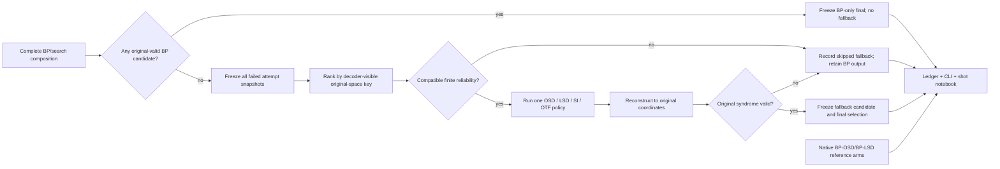

# Phase 7: Optional Postprocessing - Research

**Researched:** 2026-10-05
**Domain:** Reliability-guided BP fallback for binary CSS decoding
**Confidence:** MEDIUM

<user_constraints>
## User Constraints (from CONTEXT.md)

### Locked Decisions

#### Fallback trigger and handoff
- **D-01:** Invoke optional processing only after the entire declared BP/search composition finishes without any original-syndrome-valid BP candidate. A failed branch, restart, relay leg, or ensemble member does not individually trigger fallback while the composition can continue.
- **D-02:** When several BP attempts fail, hand one attempt to the configured fallback. Select it by a prespecified deterministic ranking based only on decoder-visible information, before fallback execution. Research/planning defines the exact ranking and ties; do not use hidden simulation truth or completion arrival order.
- **D-03:** Each fallback method declares whether it receives the immutable original CSS problem with translated reliability or the chosen attempt's working problem and reconstruction map. In either case, reconstruct and independently validate every resulting candidate against the original problem. The exact reliability convention and mathematically compatible handoff for each method require source and interface research.
- **D-04:** Execution errors and absent or unusable reliability state do not trigger fallback. Retain the BP/search terminal status and record why fallback was skipped, distinct from ordinary nonconvergence.

#### Method order and candidate choice
- **D-05:** A decoder configuration enables at most one of OSD, LSD, SI, or OTF. Compare methods in separate arms on matched physical samples; do not implicitly chain or race them. A source-defined SI/OTF procedure can still contain its own BP reruns, inactivation, graph work, and solve stages, all attributed within that method.
- **D-06:** If one fallback method yields multiple original-valid candidates, use its source-defined ranking for a source-faithful experiment. Use a prespecified common decoder-visible score and stable tie rule for controlled comparison, retaining the candidate set and provenance. Keep the two evaluation views explicitly labeled.
- **D-07:** If fallback yields no original-valid candidate, retain the chosen failed BP-only output as final. Record its original-problem validity and the unsuccessful fallback origin/status; never present the retained BP output as a fallback success.
- **D-08:** A fully reconstructed and original-validated fallback candidate remains eligible if later work in that fallback call reaches a cap. Retain the capped termination, partial work, and candidate lineage. Incomplete or unvalidated intermediate objects are not eligible.

#### Literature TOML workflow
- **D-09:** Store each paper-linked runnable BP-plus-fallback variant as one complete seven-role TOML policy file, including its `[postprocessing]` binding. Keep one source-specific variant per file and preserve the existing strict preflight and executable/provenance identity separation. — **Reversibility:** costly — a changed public policy-file shape would require migration of saved variant files, resolved manifests, and replay receipts.
- **D-10:** When BP and fallback come from different sources, record separate component-level paper/revision and equation or algorithm anchors in the same file. Preserve the distinction between a source's complete composite and a canonical combination of components from different sources; prose cannot silently change executable numerical identity.
- **D-11:** Support both complete paper-linked variant files and controlled studies that derive fallback arms from one fixed BP policy plus declared registered fallback choices. Save a fully resolved manifest and provenance for every generated arm; no implicit runtime override should change an arm's identity.
- **D-12:** When SI or OTF source details remain unresolved, retain a non-runnable `.spec.toml` with explicit blockers. A separately named runnable canonical adaptation may coexist only after focused compatibility/equation/control-flow checks, with its adaptation and assessment status clear. Do not relabel that adaptation as source-faithful.

#### Bounded Phase 7 evidence
- **D-13:** Keep the public CLI report and verified event ledger as durable evidence. Provide a compact shot-by-shot notebook for inspection, following the Phase 5 pattern. Display BP-only and final outcomes, fallback origin, candidate lineage, work, status, and native instrumentation missingness.
- **D-14:** Use the same prespecified, identified physical samples for a bounded B1 view with BP-only, each qualified runnable canonical fallback, and pinned native BP-OSD/BP-LSD composite arms. Native composite decoders retain distinct identities and their opaque internal work is marked unavailable where appropriate; they do not serve as the canonical BP engine.
- **D-15:** B1 is the primary matched demonstration code. Add focused deterministic fixtures on another suitable structure when a method's mechanism or compatibility requires it, without turning such fixtures into a cross-code performance ranking.
- **D-16:** Retain every prespecified B1 shot rather than selecting samples by observed BP outcome. Use separate deterministic fixtures to exercise both BP-success/no-fallback and BP-nonconvergence/fallback paths. Keep the sampled demonstration labeled as bounded, not a published-curve assessment.

### the agent's Discretion
- Resolve exact OSD/LSD standalone interfaces, reliability sign/order/method conventions, numerical behavior, source-revision/API drift, and method compatibility by primary-source and pinned-code investigation.
- Pin precise SI and OTF source variants and their inactivation/graph/BP/solve/reconstruction procedures; record paper/code discrepancies and any unavailable faithful path. Do not invent missing algorithm steps.
- Choose deterministic failed-attempt ranking, method-specific handoff contracts, finite B1 sample and work budgets, plot/table details, and module/schema names within D-01–D-16 and the project's existing truth-separation, evidence, and prespecification rules.

### Folded Todos
- **Make literature TOML a native policy-file input** (`.planning/todos/pending/literature-policy-toml-provenance-and-cli.md`, originally assigned to Phase 6): reconcile this todo with the already verified Phase 6 parser and public command, then extend that established route for fallback bindings, component-level source provenance, and controlled-study arm resolution. Do not redo completed Phase 6 behavior merely because the todo remains pending.

### Deferred Ideas (OUT OF SCOPE)
- Publication-scale statistical campaigns, denominator rules, throughput profiling, and CSS paper-curve assessment remain in Phases 8–9. The bounded Phase 7 view must not claim method ranking or reproduction.
- Public policy-file voting remains assigned to Phase 9 per Phase 6 verification. Correlated quaternary and circuit compatibility remain in Phases 10–13.

#### Reviewed Todos (not folded)
- **Execute first CSS literature gate in the Phase 6 replan** (`.planning/todos/pending/phase6-css-literature-vertical-slice.md`): left with Phase 6. Its bounded three-paper gate is verified; unresolved paper artifacts and full curve assessment follow the existing later-phase boundary.
</user_constraints>

<phase_requirements>
## Phase Requirements

| ID | Description | Research Support |
|----|-------------|------------------|
| POST-01 | Enable OSD after canonical BP with explicit reliability, order/method, trigger, and work. | Pinned OSD semantics, released-interface gap, handoff contract, and Wave 0 gate below. |
| POST-02 | Enable LSD after canonical BP with explicit reliability, method/order, trigger, and work. | Released standalone `LsdDecoder` interface, paper algorithm, and method-specific work map below. |
| POST-03 | Execute source-resolved SI with inactivation, BP rerun/solve, reconstruction, and compatibility. | Paper-v3 procedure is pinned; unresolved tie/solve/source-code identity remains a source-faithful blocker. |
| POST-04 | Execute source-resolved OTF with forest construction, BP rerun, reconstruction, and compatibility. | Paper and official code commit are pinned; Phase 7 CSS is explicitly an adaptation and faithful circuit execution remains deferred. |
| POST-05 | Preserve BP-only/final results and run native composites as distinct references. | Terminal snapshot, ledger, adapter, matched-shot, and missingness plan below. |
</phase_requirements>

## Summary

Phase 7 should add one postprocessing controller after the *complete* BP/search composition, not inside individual attempts. The controller freezes every failed attempt's diagnostic candidate and posterior LLR, chooses one attempt by an original-space deterministic key, runs at most one registered method, validates all outputs against the immutable original syndrome, and retains BP-only and final evidence separately. Existing code already has the `"postprocessing"` role, `"fallback"` event, `fallback_calls`, immutable original/working problems, and original-valid candidate selection, but executable admission currently requires `"postprocessing": "identity"`. [VERIFIED: src/bp_registry/canonical/contracts.py:21-28,101-110; exact values quoted: `POSTPROCESSING = "postprocessing"`; VERIFIED: src/bp_registry/ledger.py:391-397, exact value quoted: `"fallback"`; VERIFIED: src/bp_registry/canonical/budgets.py:18-44, exact value quoted: `fallback_calls`; VERIFIED: src/bp_registry/manifests.py:658-693, exact value quoted: `"postprocessing": "identity"`]

Use released `ldpc==2.4.1` for standalone LSD and for independently identified native `BpOsdDecoder`/`BpLsdDecoder` reference arms. Released 2.4.1 does **not** expose standalone OSD: the target probe returned `ldpc.OsdDecoder=FAIL AttributeError`, `ldpc.osd_decoder.OsdDecoder=FAIL ModuleNotFoundError`, while `ldpc.lsd_decoder.LsdDecoder=OK`. The official repository's `standalone_osd` branch at commit `baec4c8bfa2a679b0ba0e72df5582e277cd6918b` supplies the needed interface but is not an ancestor of the pinned 2.4.1 commit `d3429964cd4ffe1abfc041c6ec8b8425cb174f40`; therefore OSD needs a Wave 0 source-pinned isolated build/probe before becoming runnable. [VERIFIED: positive runtime import probe, 2026-10-05, failing output quoted above; VERIFIED: official quantumgizmos/ldpc git history and source probe at commits `d342996...` and `baec4c8...`, 2026-10-05]

SI means **stabilizer inactivation** and OTF means **ordered Tanner forest**. SI paper v3 leaves deterministic equal-reliability ties and selection among multiple GF(2) solutions unspecified, so retain the source-faithful variant as a non-runnable specification until resolved; a deterministic canonical adaptation may coexist. OTF's primary source and official code are circuit-oriented, and the pinned code has open implementation TODOs, so Phase 7 can implement a clearly named binary-CSS adaptation while keeping source-faithful circuit BP+OTF for Phases 12–13. [CITED: https://arxiv.org/html/2205.06125v3] [CITED: https://arxiv.org/html/2409.01440] [VERIFIED: https://github.com/Ademartio/BPOTF/tree/da6caa4509dadb8620d8cac38108b4816897b18b]

**Primary recommendation:** implement the postprocessing boundary and released LSD first; gate OSD on a pinned standalone build, keep SI source-faithful non-runnable, and expose OTF in Phase 7 only as a compatibility-tested CSS adaptation.

## Architectural Responsibility Map

| Capability | Primary Tier | Secondary Tier | Rationale |
|------------|-------------|----------------|-----------|
| Freeze BP posterior and choose failed attempt | Canonical execution engine | Evidence ledger | The engine owns attempt completion; the ledger records the frozen decision. [VERIFIED: src/bp_registry/canonical/execution.py:127-144; src/bp_registry/ledger.py:389-397] |
| OSD/LSD/SI/OTF execution | Postprocessing policy | External native library for OSD/LSD kernels | Policy selection remains canonical; pinned kernels may supply bounded algebra. [VERIFIED: src/bp_registry/canonical/contracts.py:21-28,53-72] |
| Reconstruction and original validation | Candidate selection/evaluator | Problem lineage | `OriginalSpaceCandidate` already requires original length and stable local order. [VERIFIED: src/bp_registry/canonical/problems.py:88-103] |
| Paper variant identity | Literature compiler/manifests | CLI | Runnable and non-runnable source documents already have separate executable/provenance identities. [VERIFIED: src/bp_registry/literature.py:87-130,226-235] |
| Native composite reference | Reference adapter | CLI/ledger | Composite internal BP remains external and separately identified. [VERIFIED: pyproject.toml:5-13; VERIFIED: installed `ldpc==2.4.1` runtime probe, 2026-10-05] |

## Project Constraints (from AGENTS.md)

- Use one canonical execution engine per mathematically compatible kernel family; native adapters are executable references. [VERIFIED: AGENTS.md, `## Architecture`]
- Prioritize BP-internal policies and named BP modifications before substantial OSD/LSD-style fallback work. [VERIFIED: AGENTS.md, `## Project` constraints]
- Keep immutable original problems, hide simulation truth from policies, and evaluate original-space outputs independently. [VERIFIED: AGENTS.md, `## Architecture`]
- Emit event-ledger provenance and distinguish source-faithful reproduction, canonical adaptation, controlled comparison, and mapped-only evidence. [VERIFIED: AGENTS.md, `## Project` and `## Architecture`]
- Statistical agreement, tolerances, campaigns, and curve assessment remain separately prespecified work; Phase 7 mechanism evidence cannot claim reproduction. [VERIFIED: AGENTS.md, `## Conventions`; VERIFIED: .planning/ROADMAP.md:418-432]
- Preserve saved GSD model/effort settings and do not introduce automatic Astra selection. [VERIFIED: AGENTS.md, personal model preferences; VERIFIED: .planning/config.json:93-166]
- Read `.planning/STATE.md`, `.planning/PROJECT.md`, and the active phase before work; use GSD workflow entry points before repository edits. [VERIFIED: AGENTS.md, `## Conventions` and `## GSD Workflow Enforcement`]

## Standard Stack

### Core

| Library/component | Version/identity | Purpose | Planning decision |
|-------------------|------------------|---------|-------------------|
| Python | `>=3.12`; observed `3.12.2` | Canonical orchestration and strict adapters | Keep current project runtime. [VERIFIED: pyproject.toml:5-10, exact quote: `requires-python = ">=3.12"`; VERIFIED: runtime probe, 2026-10-05] |
| NumPy / SciPy / Pydantic | `2.2.6` / `1.17.1` / `2.13.5` | Finite arrays, sparse matrices, strict schemas | Keep exact project pins. [VERIFIED: pyproject.toml:9-10, exact quote: `dependencies = ["numpy==2.2.6", "scipy==1.17.1", "ldpc==2.4.1", "pydantic==2.13.5"]`] |
| `ldpc` | release `2.4.1`; official commit `d3429964cd4ffe1abfc041c6ec8b8425cb174f40` | Standalone LSD and native BP-OSD/BP-LSD references | Use released interfaces exactly; persist package version, source commit, constructor controls, and probe receipt. [VERIFIED: pyproject.toml:9-10; VERIFIED: official quantumgizmos/ldpc tag/source and local runtime probe, 2026-10-05] |
| Standalone OSD seam | official branch commit `baec4c8bfa2a679b0ba0e72df5582e277cd6918b` | OSD with externally supplied syndrome, bit weights, and channel probabilities | Build in an isolated optional environment; no silent downgrade/replacement of project `ldpc`. [VERIFIED: official quantumgizmos/ldpc git source at pinned commit, 2026-10-05] |
| pytest | `9.0.3` observed | Contract and differential tests | Use existing suite and Wave 0 fixtures. [VERIFIED: runtime probe, 2026-10-05; VERIFIED: pyproject.toml:28-30, exact quote: `testpaths = ["tests"]`] |

No new core PyPI dependency is needed. `ldpc 2.4.1` is already installed; the OSD seam is source-pinned optional build work and must not mutate the primary environment. [VERIFIED: docs/environment-freeze.txt:1-69; VERIFIED: runtime probe, 2026-10-05]

**Installation:** none for the released Phase 7 path. If Wave 0 admits the standalone OSD branch, build exact commit `baec4c8...` in an isolated environment and persist the wheel/build digest, complete dependency freeze, and import probe. [ASSUMED]

**Rejected alternative:** do not replace the absent standalone OSD release with project-written elimination/enumeration code; the official source seam has a smaller semantic distance and an auditable upstream identity. [ASSUMED]

### Exact released interfaces

- Standalone LSD is `from ldpc.lsd_decoder import LsdDecoder`; constructor controls are `pcm`, `bits_per_step=1`, `lsd_order=0`, and `lsd_method=0`; `decode(syndrome, bit_weights)` requires one bit weight per column. Accepted method spellings map to the exact exposed values `"LSD_0"`, `"LSD_E"`, and `"LSD_CS"`. [VERIFIED: official quantumgizmos/ldpc commit `d342996...`, `src_python/ldpc/lsd_decoder/_lsd_decoder.pyx:51-75,87-122,129-175`, exact values quoted]
- Native OSD is `BpOsdDecoder(..., osd_method, osd_order)` and invokes its own BP before OSD on nonconvergence. Exact exposed method values are `"OSD_0"`, `"OSD_E"`, `"OSD_CS"`, and `"OSD_OFF"`. [VERIFIED: official quantumgizmos/ldpc commit `d342996...`, `src_python/ldpc/bposd_decoder/_bposd_decoder.pyx:51-70,78-136,140-185`, exact values quoted]
- Native LSD is `BpLsdDecoder(..., bits_per_step, lsd_order, lsd_method, always_run_lsd)` and invokes its own BP before LSD. It accepts legacy `osd_method`/`osd_order` aliases, but manifests should use the LSD names. [VERIFIED: official quantumgizmos/ldpc commit `d342996...`, `src_python/ldpc/bplsd_decoder/_bplsd_decoder.pyx:56-101,108-156`]

## Package Legitimacy Audit

The seam rated every queried existing PyPI dependency `SUS` because registry download/source metadata was incomplete; none was `SLOP`. This does not require a new install because Phase 7 preserves current exact pins, but any isolated OSD build requires a human verification checkpoint against the official source commit. [VERIFIED: `gsd_run query package-legitimacy check --ecosystem pypi ldpc numpy scipy pydantic pytest plotly`, 2026-10-05]

| Package | Registry | Project pin | Verdict | Disposition |
|---------|----------|-------------|---------|-------------|
| `ldpc` `[WARNING: flagged as suspicious — verify before using.]` | PyPI | `2.4.1` | SUS: unknown downloads/repository metadata | Existing pin only; verify official commit before optional source build. |
| `numpy`, `scipy`, `pydantic`, `pytest`, `plotly` `[WARNING: flagged as suspicious — verify before using.]` | PyPI | Exact current pins | SUS: registry metadata limitations | Existing environment only; no Phase 7 package change. |

**Packages removed due to SLOP:** none.  
**Packages flagged as suspicious:** all audited existing packages; planner adds a human verification checkpoint only before a new source/package install.

## Architecture Patterns

### System Architecture Diagram



### Pattern 1: Frozen fallback handoff

Add an immutable handoff containing attempt lineage/local ordinal, original and working problem identities, BP diagnostic candidate in original space, original residual weight, channel negative-log-likelihood score, terminal posterior LLR, LLR convention/profile, transform/lift identity, termination, and committed BP work. Flooding already retains terminal `beliefs` and `candidate`, while `CanonicalExecutionResult` currently retains only termination/evaluation/candidate; local schedules return candidates without beliefs, so Wave 0 must unify terminal posterior capture across every executable schedule. [VERIFIED: src/bp_registry/canonical/schedules.py:90-100, exact fields quoted: `beliefs`, `candidate`; VERIFIED: src/bp_registry/canonical/execution.py:127-144, exact fields quoted: `termination`, `evaluation`, `candidate`, `last_sweep`]

Rank failed snapshots before invoking fallback by `(original residual weight, original-channel negative-log-likelihood, declared attempt ordinal, lineage ID)`. This uses decoder-visible facts, is independent of arrival time, and follows the existing stable final selector's `(score, local_ordinal, lineage_id)` shape. [ASSUMED] [VERIFIED: src/bp_registry/canonical/candidate_selection.py:247-294]

### Pattern 2: Strict method compatibility

Pass the immutable original `H_Z`, syndrome, and translated full-length LLR only when the working transform is identity/permutation or declares a tested inverse reliability map. Reject shortening, masking, or non-bijective transforms without a method-specific translation. Always reconstruct and run the existing independent original check. Existing `WorkingProblem` requires unique bounded maps and explicit transform/lift identities; preserve that boundary. [VERIFIED: src/bp_registry/canonical/problems.py:35-85]

The handoff reliability representation should be finite float64 natural-log odds `log(P(0)/P(1))`, with negative meaning hard bit one, exact zero meaning bit zero, and reliability weight `abs(LLR)` for standalone OSD/LSD ordering. The canonical numerical profile already quotes `dtype: "float64"`, `llr_encoding: "natural_log_odds"`, `prior_initialization: "log((1-p)/p)"`, `exact_zero_decision: 0`, and `tie_break: "ascending_canonical_id"`. [VERIFIED: src/bp_registry/canonical/numerics.py:15-36; exact values quoted; VERIFIED: src/bp_registry/canonical/numerics.py:141-146]

### Pattern 3: One method, method-owned subwork

Increment `fallback_calls` once only after the whole BP/search composition fails. Record method leaves rather than converting unlike work to a universal cost: ranking scans; OSD elimination/pivots and candidates; LSD growth/merges/local elimination; SI inactivation trials, BP reruns, solves, lifts; OTF sort/union-find probes/accepted columns/forest BP. Reuse existing generic fields where exact (`bp_calls`, `candidate_checks`, `transformations`, `lifted_coordinates`, `original_checks`, `ranking_scans`) and introduce a versioned method-work record for the rest. [VERIFIED: src/bp_registry/canonical/budgets.py:18-57; exact fields quoted]

### Pattern 4: Literature and controlled-arm identities

Extend the existing closed parser rather than creating a second policy route. The current exact role tuple is `"update", "schedule", "state_memory", "intervention", "stopping", "selection", "postprocessing"`; postprocessing currently admits only `"identity"`. Add a typed discriminated postprocessing table, separate component source blocks, and a generated-arm resolver that writes a complete resolved manifest before execution. [VERIFIED: src/bp_registry/literature.py:19-47; exact values quoted]

### Recommended Project Structure

```text
src/bp_registry/
├── canonical/postprocessing/   # handoff, controller, compatibility, OSD/LSD/SI/OTF
├── canonical/execution.py      # freeze terminal snapshots; invoke controller once
├── canonical/budgets.py        # versioned fallback work and caps
├── literature.py               # complete TOML/spec parsing and component provenance
├── manifests.py                # new strict schema version and public admission
└── reference.py                # separately identified native composite adapters
tests/
├── canonical/test_postprocessing_*.py
├── test_phase7_public_execution.py
└── test_phase7_notebook.py
```

## Method Specifications and Source Boundaries

### OSD

The primary pattern sorts by reliability, chooses an independent basis, solves the remaining GF(2) system, and optionally enumerates higher-order flips. The pinned `ldpc` implementation's exact internal enum is `OSD_OFF`, `OSD_0`, `EXHAUSTIVE`, `COMBINATION_SWEEP`; exhaustive enumerates nonzero strings below `2**osd_order`, while combination sweep tests all weight-one patterns plus weight-two pairs among the first `osd_order` positions. It sorts the *supplied raw weights* ascending and scores higher-order candidates by `sum(log(1/channel_probability[i]))` over set bits; equal weights have no explicit stable secondary key. [CITED: https://doi.org/10.1103/PhysRevResearch.2.043423] [VERIFIED: official quantumgizmos/ldpc commit `d342996...`, `src_cpp/osd.hpp:18-23,59-102,110-187`; `src_cpp/sort.hpp:35-60`, exact enum values quoted]

Therefore pass `abs(canonical_llr)` to the standalone seam, pass declared per-bit original channel probabilities separately, add ascending original column ID before native invocation when ties occur, retain OSD0 and final outputs, and validate both. Do not pass signed LLR directly merely because the native composite does so; preserve that signed-raw behavior only in the native reference identity. [ASSUMED]

### LSD

LSD creates clusters at nonzero syndrome checks, grows invalid clusters toward low-weight neighboring variables, merges intersecting clusters, tests whether the local syndrome lies in the local matrix image, and solves valid clusters; the implementation updates elimination on the fly. Higher-order `LSD_E` and `LSD_CS` apply local OSD variants. [CITED: https://www.nature.com/articles/s41467-025-63214-7] [VERIFIED: official quantumgizmos/ldpc commit `d342996...`, `src_cpp/lsd.hpp:25-29,33-87,103-148`]

Use released `LsdDecoder` directly with `abs(LLR)`, `bits_per_step=1`, explicit method/order, and original validation. The source paper describes random ordering for exact equal weights, while the pinned implementation initializes `is_randomize_same_weight_indices = false` and its comparator has no stable secondary key; canonical controlled arms must sort by `(weight, original column ID)` before execution and label this deterministic tie convention as an adaptation. [CITED: https://www.nature.com/articles/s41467-025-63214-7] [VERIFIED: official quantumgizmos/ldpc commit `d342996...`, `src_cpp/lsd.hpp:25-29,63,131-145`]

### SI — stabilizer inactivation

Pin arXiv v3. For decoding X errors with `H_Z`, the method ranks opposite-check/stabilizer rows from `H_X` by the sum of absolute posterior LLRs on their support. After full BP failure it considers rows in ascending reliability; for a selected row it removes supported qubits and incident `H_Z` checks, reruns the same message-passing decoder on the reduced problem, then solves the remaining syndrome equation on the inactivated support and recombines the candidate. [CITED: https://arxiv.org/html/2205.06125v3]

The paper permits an arbitrary solution of the reconstruction system and does not establish a deterministic equal-check-reliability tie rule. This research also did not establish an executable author SI implementation identity. Retain source-faithful SI as `.spec.toml` with those blockers. A separately named canonical adaptation may use ascending stabilizer ID ties and a declared deterministic GF(2) free-variable rule after algebraic fixture tests. [CITED: https://arxiv.org/html/2205.06125v3] [ASSUMED]

### OTF — ordered Tanner forest

Pin arXiv:2409.01440 and official BPOTF commit `da6caa4509dadb8620d8cac38108b4816897b18b`. OTF converts failed-BP posterior LLRs to probabilities, sorts columns from highest error probability, and applies a modified Kruskal/union-find pass that accepts columns without creating Tanner-graph cycles; it then runs BP on the selected forest and lifts omitted columns as zero before original validation. [CITED: https://arxiv.org/html/2409.01440] [VERIFIED: https://github.com/Ademartio/BPOTF/blob/da6caa4509dadb8620d8cac38108b4816897b18b/README.md#L76-L102] [VERIFIED: official BPOTF commit `da6caa...`, `src/BPOTF/OBPOTF.cpp:571-595,744-900`]

The pinned repository requires C++20/Pybind11/CMake and embeds LDPC code. Its roadmap still lists sparsified detector-model construction and an LLR-based OTF function as unfinished, and code retains probability/decimation TODOs. Treat the repo as an executable reference for its declared identity, not a silently canonical implementation. Phase 7's original `H_Z` forest and same-kernel BP rerun is a `canonical_adaptation`; source-faithful circuit transfer/sparsification remains deferred. [VERIFIED: https://github.com/Ademartio/BPOTF/blob/da6caa4509dadb8620d8cac38108b4816897b18b/README.md#L92-L102] [VERIFIED: official BPOTF commit `da6caa...`, `README.md:182-193`, `src/BPOTF/OBPOTF.cpp:584-590,619-631`]

## Don't Hand-Roll

| Problem | Don't Build | Use Instead | Why |
|---------|-------------|-------------|-----|
| Sparse GF(2) OSD solve/enumeration | A new unreviewed elimination kernel | Pinned official standalone OSD source seam after Wave 0 | Rank deficiency, pivot order, candidate scoring, and method semantics are easy to change accidentally. [VERIFIED: official `ldpc` `src_cpp/osd.hpp`] |
| LSD cluster algebra | Custom cluster growth/merge/elimination | Released `ldpc.lsd_decoder.LsdDecoder` | The released implementation already owns local factorization and merge behavior. [VERIFIED: official `ldpc` `src_cpp/lsd.hpp`] |
| Native composite emulation | Recreate `BpOsdDecoder`/`BpLsdDecoder` from canonical components | Invoke pinned composites as separate reference arms | Their internal BP/reliability behavior is part of reference identity. [VERIFIED: official `ldpc` composite sources cited above] |
| Source gaps | Fill SI/OTF unspecified steps and call them faithful | Non-runnable spec plus separately named adaptation | D-12 requires blockers to remain explicit. [VERIFIED: 07-CONTEXT.md D-12] |
| Truth-aware fallback selection | Rank using sampled error/logical outcome | Existing decoder-visible frozen selection pattern | Policies cannot inspect hidden simulation truth. [VERIFIED: AGENTS.md Architecture; src/bp_registry/canonical/candidate_selection.py:247-294] |

## Common Pitfalls

1. **Triggering per branch.** It inflates fallback calls and changes the declared search. Freeze the complete candidate list first, then invoke once. [VERIFIED: 07-CONTEXT.md D-01,D-05]
2. **Calling native BP-OSD “canonical OSD.”** The composite reruns an internal BP and consumes its signed raw LLR. Give it a separate native identity and opaque-work missingness. [VERIFIED: official `ldpc` `_bposd_decoder.pyx:78-136`; VERIFIED: 07-CONTEXT.md D-14]
3. **Treating LLR sign as reliability.** The project LLR is `log(P(0)/P(1))`; ordering weight is magnitude. A signed ascending sort systematically places confident ones first. [VERIFIED: src/bp_registry/canonical/numerics.py:19-29,141-146; VERIFIED: official `ldpc` `src_cpp/sort.hpp:35-60`]
4. **Using transformed reliability without an inverse.** Candidate lifting alone does not define posterior translation. Reject incompatible handoffs. [VERIFIED: src/bp_registry/canonical/problems.py:35-85]
5. **Dropping a valid candidate on a later cap.** Freeze original-valid candidates immediately; terminal cap and partial work remain separate facts. [VERIFIED: 07-CONTEXT.md D-08]
6. **Converting unavailable work to zero.** Native internal counters are missing with a reason; zero means measured zero. [VERIFIED: 07-CONTEXT.md D-14; src/bp_registry/ledger.py:373-386]
7. **Claiming paper reproduction from B1.** Phase 7 is bounded mechanism evidence with all prespecified shots retained. [VERIFIED: 07-CONTEXT.md D-13,D-16]

## Code Examples

### Released standalone LSD adapter shape

```python
# Source: official quantumgizmos/ldpc commit d342996..., _lsd_decoder.pyx:51-175
from ldpc.lsd_decoder import LsdDecoder

weights = abs(handoff.posterior_llr_log_p0_over_p1)
decoder = LsdDecoder(
    handoff.original_hz,
    bits_per_step=1,
    lsd_method="LSD_0",
    lsd_order=0,
)
candidate = decoder.decode(handoff.original_syndrome, weights)
original_valid = original_check(candidate)
```

The exact method value `"LSD_0"` appears verbatim in the released source quote above. Wrapper validation must reject nonfinite/wrong-length weights before native entry and must not read hidden sampled truth. [VERIFIED: official source cited above; VERIFIED: src/bp_registry/canonical/numerics.py:52-62]

### Deterministic attempt ranking

```python
# Recommended Phase 7 policy; not a source-paper rule. [ASSUMED]
key = (
    snapshot.original_residual_weight,
    snapshot.original_channel_nll,
    snapshot.local_ordinal,
    snapshot.lineage_id,
)
chosen = min(compatible_failed_snapshots, key=lambda item: item.ranking_key)
```

## State of the Art

| Old/available path | Current planning implication | Impact |
|--------------------|-----------------------------|--------|
| `ldpc 2.4.1` composite OSD only | Official `standalone_osd` branch exists but is unreleased/diverged | OSD needs an isolated build/probe gate. [VERIFIED: official git history and runtime probe, 2026-10-05] |
| BP+LSD composite | Released standalone `LsdDecoder` accepts external bit weights | Canonical BP can feed LSD without hidden second BP. [VERIFIED: official `ldpc` `_lsd_decoder.pyx:51-175`] |
| OTF paper algorithm | Official BPOTF repository is available but remains circuit-oriented with TODOs | CSS path must carry adaptation status. [VERIFIED: official BPOTF commit `da6caa...`] |

## Assumptions Log

| # | Claim | Section | Risk if Wrong |
|---|-------|---------|---------------|
| A1 | Failed attempts should rank by residual, original-channel NLL, ordinal, lineage. | Architecture Patterns | Changes which failed posterior enters fallback; lock with user/planner review. |
| A2 | Canonical OSD/LSD should use `abs(LLR)` and ascending original-ID ties. | OSD/LSD | May differ from a source-specific convention; label controlled adaptation and differential-test. |
| A3 | SI adaptation may choose ascending stabilizer ID and a deterministic free-variable rule. | SI | Must never be labeled source-faithful without source confirmation. |
| A4 | No executable author SI implementation identity was established in this pass. | SI | A later author artifact could replace the blocker and change provenance. |
| A5 | Build the official standalone OSD branch in isolation rather than implementing a new kernel. | Standard Stack | Build incompatibility could leave POST-01 non-runnable until another audited seam is selected. |

## Open Questions

1. **Standalone OSD build identity:** Can commit `baec4c8...` build against Python 3.12 in an isolated environment without pulling incompatible `ldpc` code? Wave 0 must answer with build receipt, import probe, and tiny-matrix differential tests.
2. **SI exact determinism:** Resolve equal check-reliability ties, choice among nonunique reconstruction solutions, and author code identity before admitting a source-faithful file.
3. **OTF Phase 7 scope:** Admit only the tested binary-CSS adaptation; leave circuit sparsification, transfer matrices, and faithful BPOTF execution for later circuit phases.

## Environment Availability

| Dependency | Required By | Available | Version | Fallback |
|------------|-------------|-----------|---------|----------|
| Python | Canonical execution | ✓ | 3.12.2 | — |
| `ldpc` | LSD and native composites | ✓ | 2.4.1 | — |
| git | Source identity | ✓ | 2.52.0 | — |
| C++ compiler | Optional standalone OSD/BPOTF source build | ✓ | GCC 11.5.0 | Isolated build only |
| CMake | BPOTF build | ✗ | — | Keep BPOTF non-core; install only in verified isolated env |
| Ninja | Optional native build | ✗ | — | setuptools/CMake backend if verified |
| Jupyter CLI / pandoc | Notebook/PDF tooling | ✗ as commands | — | Existing `nbclient`/`nbformat` Python execution and HTML artifact |

[VERIFIED: command/version and import probes, 2026-10-05]

**Missing with no fallback:** none for canonical LSD/native composite work.  
**Missing with fallback:** CMake/Ninja/Jupyter/pandoc; planner must avoid assuming those commands exist.

## Validation Architecture

### Test Framework

| Property | Value |
|----------|-------|
| Framework | pytest 9.0.3 [VERIFIED: runtime probe, 2026-10-05] |
| Config file | `pyproject.toml` (`testpaths = ["tests"]`, `pythonpath = ["src"]`) [VERIFIED: pyproject.toml:28-30, exact quote] |
| Quick run command | `OMP_NUM_THREADS=1 .venv/bin/python -m pytest -q tests/canonical/test_postprocessing_handoff.py tests/canonical/test_postprocessing_lsd.py` [ASSUMED] |
| Full suite command | `OMP_NUM_THREADS=1 .venv/bin/python -m pytest -q` [VERIFIED: .planning/config.json:42, exact quote] |

### Phase Requirements → Test Map

| Req ID | Behavior | Test Type | Automated Command | File Exists? |
|--------|----------|-----------|-------------------|-------------|
| POST-01 | OSD import/build gate, reliability/order/method, valid reconstruction, work | contract/differential | `pytest -q tests/canonical/test_postprocessing_osd.py` | ❌ Wave 0 |
| POST-02 | Standalone LSD methods/order, tie fixture, valid reconstruction, work | contract/differential | `pytest -q tests/canonical/test_postprocessing_lsd.py` | ❌ Wave 0 |
| POST-03 | SI source fixture, reduced rerun/solve/lift, blocker/adaptation status | algebra/integration | `pytest -q tests/canonical/test_postprocessing_si.py` | ❌ Wave 0 |
| POST-04 | OTF stable forest, acyclicity, rerun/lift, adaptation status | algebra/integration | `pytest -q tests/canonical/test_postprocessing_otf.py` | ❌ Wave 0 |
| POST-05 | Whole-composition trigger, BP/final evidence, native identity/missingness, matched shots | integration/CLI | `pytest -q tests/test_phase7_public_execution.py` | ❌ Wave 0 |

### Required semantic fixtures

- BP success → no fallback event/call; one failed branch with later BP success → no fallback; whole composition failure → exactly one fallback. [VERIFIED: 07-CONTEXT.md D-01]
- Attempt order/completion permutation leaves chosen handoff unchanged; hidden truth mutation cannot change rank. [VERIFIED: src/bp_registry/canonical/candidate_selection.py:247-294]
- NaN/Inf, wrong LLR sign declaration, wrong length, or incompatible transform records a skip reason and preserves BP status. [VERIFIED: 07-CONTEXT.md D-03,D-04]
- Equal weights exercise deterministic original-ID tie behavior for controlled arms; a native arm retains its own observed behavior. [ASSUMED]
- Every produced candidate is lifted and original-checked; invalid, incomplete, and post-cap intermediates remain ineligible, while an already valid candidate survives a later cap. [VERIFIED: 07-CONTEXT.md D-07,D-08]
- Native composite fixture proves its BP output and final output differ on a forced nonconvergence case; the current tiny matrix `H=[[1,1,0,1],[1,0,0,0]], s=[1,0]` yielded BP `[0,0,0,0]` and valid OSD/LSD `[0,1,0,0]` in the pinned runtime. [VERIFIED: local `ldpc==2.4.1` runtime probe, 2026-10-05; exact arrays quoted]
- Strict TOML rejects incomplete component provenance, implicit runtime overrides, multiple methods, and runnable SI/OTF with unresolved blockers. [VERIFIED: src/bp_registry/literature.py:226-260; VERIFIED: 07-CONTEXT.md D-09–D-12]
- Ledger replay/tamper tests cover fallback origin, candidate lineage, BP-only/final outputs, method work, cap status, and native missingness. [VERIFIED: src/bp_registry/ledger.py:389-404]
- B1 CLI/notebook retains the prespecified shot set and visually separates BP-only, final, trigger, source/adaptation status, work, and missingness. [VERIFIED: 07-CONTEXT.md D-13–D-16]

### Sampling Rate

- **Per task commit:** targeted files for that method/controller, under 30 seconds.
- **Per wave merge:** `OMP_NUM_THREADS=1 .venv/bin/python -m pytest -q`.
- **Phase gate:** full suite green, deterministic fixture receipts, bounded B1 ledger verification, and notebook execution before `$gsd-verify-work`.

### Wave 0 Gaps

- [ ] `tests/canonical/test_postprocessing_handoff.py` — trigger/rank/reliability/compatibility contract.
- [ ] `tests/canonical/test_postprocessing_osd.py` — isolated official branch build/import and algorithm fixtures.
- [ ] `tests/canonical/test_postprocessing_lsd.py` — released standalone interface and work fixtures.
- [ ] `tests/canonical/test_postprocessing_si.py` and `test_postprocessing_otf.py` — source/adaptation algebra fixtures.
- [ ] `tests/test_phase7_public_execution.py` and `tests/test_phase7_notebook.py` — public evidence path.
- [ ] Versioned fallback ledger/work golden fixture and tamper case.

## Security Domain

Security enforcement is enabled at ASVS level 1. [VERIFIED: .planning/config.json:49-51, exact quote: `"security_enforcement": true`, `"security_asvs_level": 1`]

### Applicable ASVS Categories

| ASVS Category | Applies | Standard Control |
|---------------|---------|-----------------|
| V2 Authentication | no | Local research CLI has no authentication boundary in this phase. [VERIFIED: .planning/ROADMAP.md:418-432] |
| V3 Session Management | no | No sessions are introduced. [VERIFIED: .planning/ROADMAP.md:418-432] |
| V4 Access Control | no | No multi-user authorization surface is introduced. [VERIFIED: .planning/ROADMAP.md:418-432] |
| V5 Input Validation | yes | Strict frozen Pydantic/TOML schemas; binary shape, bounds, finiteness, method whitelist, hash and source-identity checks. [VERIFIED: src/bp_registry/canonical/contracts.py:17-18,76-99; src/bp_registry/literature.py:68-84,252-260] |
| V6 Cryptography | no | Only integrity identities/hashes are used; no cryptographic protocol is introduced. [VERIFIED: src/bp_registry/literature.py:68-74] |

### Known Threat Patterns

| Pattern | STRIDE | Mitigation |
|---------|--------|------------|
| Malformed/nonfinite matrix, syndrome, LLR, or native output | Tampering | Validate binary dtype/shape and finite float64 before/after native calls; fail closed. [VERIFIED: src/bp_registry/canonical/problems.py:11-17; src/bp_registry/canonical/numerics.py:52-62] |
| Untrusted TOML/provenance injects unsupported method/module path | Tampering/Elevation | Closed keys and registered method IDs only; never import or evaluate prose/module paths. [VERIFIED: src/bp_registry/literature.py:19-47,252-260] |
| Source drift or OSD branch replacement | Repudiation | Persist source URL, full commit, content/build receipt, environment freeze, and adapter identity. [VERIFIED: 07-CONTEXT.md D-09–D-11] |
| Native crash/partial evidence | Denial of Service | Scoped cap, terminal error evidence, no fallback retry cascade, preserve BP result. [VERIFIED: 07-CONTEXT.md D-04,D-05,D-07]

## Sources

### Primary (HIGH/MEDIUM confidence)

- [Roffe et al., decoding across the quantum LDPC landscape](https://doi.org/10.1103/PhysRevResearch.2.043423) — BP+OSD algorithm family.
- [Stabilizer inactivation, arXiv v3](https://arxiv.org/html/2205.06125v3) — exact acronym and algorithm.
- [Localized statistics decoding](https://www.nature.com/articles/s41467-025-63214-7) — LSD algorithm and higher-order local reprocessing.
- [Ordered Tanner forest](https://arxiv.org/html/2409.01440) — OTF construction and BP rerun.
- [Official `ldpc` repository](https://github.com/quantumgizmos/ldpc/tree/d3429964cd4ffe1abfc041c6ec8b8425cb174f40) — released interfaces and numerical behavior.
- [Official BPOTF repository](https://github.com/Ademartio/BPOTF/tree/da6caa4509dadb8620d8cac38108b4816897b18b) — pinned executable source and known TODOs.
- [Official `ldpc` BpOsd docs](https://software.roffe.eu/ldpc/ldpc/bposd_decoder.html) — public composite surface; pinned source governs discrepancies.

### In-repository sources

- `src/bp_registry/canonical/{contracts,execution,problems,budgets,candidate_selection,numerics,schedules}.py` — present architecture and exact discrete values.
- `src/bp_registry/{literature,manifests,ledger,reference}.py` — parser, public admission, evidence, and native patterns.
- `pyproject.toml`, `docs/environment-freeze.txt`, `.planning/config.json` — current dependency/test/security environment.

### Tertiary (LOW confidence)

- None used as authority. Claims without an authoritative resolution are marked `[ASSUMED]` and listed above.

## Metadata

**Confidence breakdown:**
- Standard stack: MEDIUM — exact project/runtime and official source are pinned, but standalone OSD is unreleased.
- Architecture: HIGH — grounded in existing immutable problem, selection, budget, ledger, and policy contracts.
- OSD/LSD semantics: MEDIUM — primary sources and pinned code checked; deliberate paper/code/tie differences remain explicit.
- SI/OTF fidelity: MEDIUM — primary variants pinned; unresolved faithful details are blockers rather than invented behavior.
- Validation: HIGH — each phase requirement maps to a concrete automated contract and public evidence gate.

**Research date:** 2026-10-05  
**Valid until:** 2026-11-04 for stable papers/project architecture; re-probe `ldpc` and source branches before any optional build.
