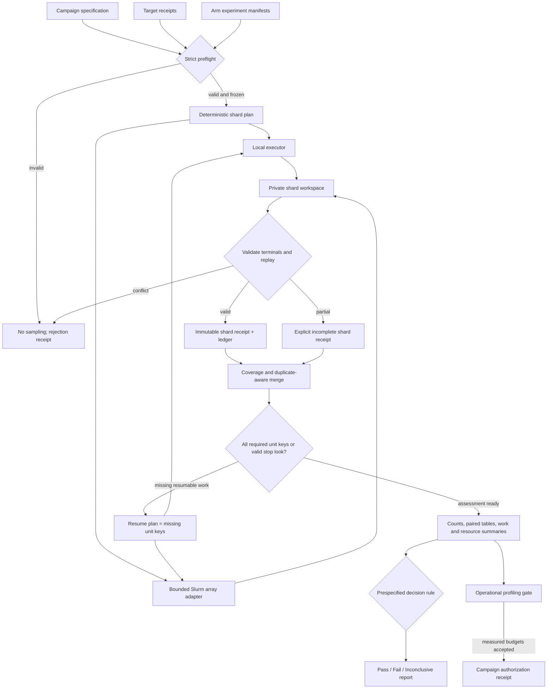

# Phase 8: Reproducible Campaigns and Statistical Assessment - Research

**Researched:** 2026-10-11
**Domain:** Durable HPC campaign execution, replayable evidence, and prespecified statistical assessment
**Confidence:** HIGH for repository architecture and fixed/finite-look inference; MEDIUM for site-specific HPC policy and plot-digitization error budgets

## Summary

Phase 8 should add a campaign layer around the existing strict experiment manifests, deterministic samplers, canonical event ledgers, replay verification, and typed profiling facts. It should not create another decoder engine or replace the per-shot evidence contracts. The repository already separates physical sample identity from decoder randomness, hashes full manifests, validates content-addressed events, reconstructs results from terminal evidence, and records unavailable measurements explicitly. [VERIFIED: `src/bp_registry/sampling.py:70-117`; `src/bp_registry/manifests.py:323-366,1198-1208`; `src/bp_registry/ledger.py:402-521,572-625`; `src/bp_registry/canonical/metrics.py:12-100`]

The main missing boundary is a general, typed campaign contract. That contract must freeze sample namespaces, arm manifests, expected unit keys, shard ranges, environment/source identities, denominator rules, interval procedure, finite stopping looks, comparison families, target provenance, and pass/fail/inconclusive rules before dispatch. Shards should be private immutable products with content receipts; merge should validate and replay each shard, detect missing and duplicate unit keys, and reconstruct reports only from verified terminal evidence. This directly implements the Phase 8 goal and all five roadmap success criteria. [VERIFIED: `.planning/ROADMAP.md:486-502`; `.planning/REQUIREMENTS.md:106-126`]

For statistics, use SciPy's existing exact Clopper-Pearson interval for fixed-shot Bernoulli rates. For adaptive execution, use only a finite, prespecified look schedule in Phase 8 V1 and allocate the family alpha across looks and target/comparison families; compute the same exact interval at each allocated local alpha. This is conservative, transparent, testable, and valid under the declared stopping rule. Do not reuse a nominal fixed-shot interval after repeated peeking. Time-uniform confidence sequences are the broader solution to optional stopping, but implementing one correctly would add a new statistical surface that the current stack does not provide. [VERIFIED: SciPy `BinomTestResult.proportion_ci` official documentation, https://docs.scipy.org/doc/scipy/reference/generated/scipy.stats._result_classes.BinomTestResult.proportion_ci.html] [VERIFIED: Howard et al., 2021, DOI 10.1214/20-AOS1991, https://doi.org/10.1214/20-AOS1991]

**Primary recommendation:** Build a separate `campaign_spec_v1` orchestration and assessment subsystem that wraps existing experiment manifests, uses immutable content-addressed shards, and supports two declared inference modes: final-only exact intervals and finite-look alpha-spent exact intervals.

<phase_requirements>
## Phase Requirements

| ID | Description | Research Support |
|----|-------------|------------------|
| LED-05 | A researcher can validate and merge durable ledger shards, detect incomplete or duplicate contributions, and reconstruct reported results from the preserved evidence. | Immutable shard receipts, exact unit-key coverage, independent ledger validation/replay, deterministic merge, and report reconstruction are specified below. [VERIFIED: `.planning/REQUIREMENTS.md:112`] |
| SIM-01 | Controlled comparison arms receive the same identified physical-error/fault samples, with sample generation independent of decoder randomness, worker count, and branch count, or use persisted samples when a backend cannot guarantee that invariance. | Arm-neutral sample namespaces and existing `physical_sample_identity + shot_id` derivation provide the default; persisted sample artifacts are the explicit fallback. [VERIFIED: `.planning/REQUIREMENTS.md:116`; `src/bp_registry/sampling.py:70-117`; `src/bp_registry/runner.py:496-533`] |
| SIM-02 | A researcher can run the same manifest locally or as bounded parallel/HPC jobs while recording resources, timing boundaries, environment, and actual work/budget consumption. | One deterministic shard map drives local workers or bounded Slurm arrays; shard receipts retain executor, allocation, timing, environment, and terminal work evidence. [VERIFIED: `.planning/REQUIREMENTS.md:117`; official Slurm job-array documentation, https://slurm.schedmd.com/job_array.html] |
| SIM-03 | A researcher can checkpoint and resume a campaign without double-counting shots or silently changing sample identity, stop rules, configuration, or dependency versions. | Resume is set subtraction over verified unit keys under one campaign digest. Sealed shards are immutable, and changed campaign/source/environment identities are rejected. [VERIFIED: `.planning/REQUIREMENTS.md:118`; `src/bp_registry/study.py:280-305`] |
| STAT-01 | Before a campaign, a researcher can declare the output/curve points, effect/tolerance, uncertainty method and level, comparison family, and pass/fail/inconclusive rule in the manifest. | A strict assessment-plan schema and deterministic decision algebra are specified below. [VERIFIED: `.planning/REQUIREMENTS.md:122`] |
| STAT-02 | Analysis retains actual shots and failures and reports valid rare-event uncertainty, including a positive upper bound for zero observed failures rather than an exact zero failure rate. | Reports retain integer counts and use exact Clopper-Pearson limits; a zero-failure regression fixture must assert a positive upper limit. [VERIFIED: `.planning/REQUIREMENTS.md:123`; official SciPy exact interval documentation, https://docs.scipy.org/doc/scipy/reference/generated/scipy.stats._result_classes.BinomTestResult.proportion_ci.html] |
| STAT-03 | Statistical assessment records planned and realized stopping, batch overshoot and partial runs, and uses an uncertainty procedure justified for fixed-shot or adaptive stopping as applicable. | Final-only and finite-look modes have separate typed contracts; dispatch batches, completed looks, overshoot, partial state, and stop reasons remain evidence. [VERIFIED: `.planning/REQUIREMENTS.md:124`; Howard et al., 2021, https://doi.org/10.1214/20-AOS1991] |
| STAT-04 | Reproduction targets preserve source figure/table/data identity and extraction precision, including plot-digitization uncertainty and missing published sample counts where relevant. | A target receipt retains source/image hashes, panel/curve identity, axis calibration, raw clicks, repeated extraction bounds, and published denominator status. [VERIFIED: `.planning/REQUIREMENTS.md:125`; official WebPlotDigitizer calibration interface, https://webplotdigitizer.bose.dev/] |
| STAT-05 | Controlled analyses use paired outcomes where samples are shared and declare denominators/treatment for nonconvergence, timeout, discard and post-selection, reporting acceptance rate alongside conditional performance. | Paired 2x2 tables, all-shot primary outcomes, exact discordance tests, conservative paired effect intervals, and explicit acceptance/conditional denominators are specified below. [VERIFIED: `.planning/REQUIREMENTS.md:126`; `src/bp_registry/phase4_analysis.py:48-132`] |
</phase_requirements>

## Project Constraints (from AGENTS.md)

- Preserve one canonical execution engine per mathematically compatible BP family; campaign orchestration must call existing engines and must not hide decoder behavior behind adapters. [VERIFIED: `AGENTS.md:11-18,55-64`]
- Every simulation must retain event-ledger provenance, and paper-specific reproduction configurations must remain distinct from controlled comparisons. [VERIFIED: `AGENTS.md:16-18,63-64`]
- Statistical curve reproduction does not replace algebraic and policy-semantics checks; tolerances, budgets, stopping, and denominator rules must be prespecified, and failed or inconclusive evidence must be retained. [VERIFIED: `AGENTS.md:41-49`]
- Keep native dependencies and environments separate from canonical execution and consider compiled acceleration only after profiling without changing the behavioral contract. [VERIFIED: `AGENTS.md:27-35`]
- Keep original problems immutable; policies cannot inspect hidden truth, and independent evaluators judge outputs in original problem space. [VERIFIED: `AGENTS.md:55-64`]
- Preserve autonomous mode, fine phases, parallel independent work, and configured role models; do not introduce automatic Astra selection. [VERIFIED: `AGENTS.md:41-49`; project instruction “Personal model and cost preferences”]
- Repository mutations must occur through a GSD workflow. Phase implementation should therefore be executed through `$gsd-execute-phase`, with small follow-up fixes through `$gsd-quick` and debugging through `$gsd-debug`. [VERIFIED: `AGENTS.md:75-87`]

## Architectural Responsibility Map

| Capability | Primary Tier | Secondary Tier | Rationale |
|------------|-------------|----------------|-----------|
| Campaign specification and preflight | API / Backend | Storage | Strict typed business rules freeze identities and assessment semantics before filesystem or scheduler work. |
| Physical sample namespace | API / Backend | Storage | The campaign derives an arm-neutral identity; samplers or persisted artifacts materialize it. |
| Local and Slurm dispatch | API / Backend | External scheduler | One deterministic shard plan is translated into either local calls or bounded Slurm array tasks. |
| Shard evidence and receipts | Database / Storage | API / Backend | Private append during execution becomes an immutable verified shard product. |
| Merge and resume | API / Backend | Database / Storage | Validation computes exact unit-key coverage and missing-work sets from stored receipts. |
| Statistical assessment | API / Backend | Database / Storage | Counts and paired cells come only from verified terminals; result artifacts persist methods and decisions. |
| Target digitization provenance | Database / Storage | API / Backend | Source bytes, calibration, clicks, and uncertainty are immutable inputs to assessment. |
| Operational profiling gate | API / Backend | External scheduler | Existing typed process metrics combine with shard/job observations to authorize later campaign budgets. |

## Standard Stack

### Core

| Library / facility | Version | Purpose | Why Standard Here |
|--------------------|---------|---------|-------------------|
| Python | `>=3.12`; observed `3.12.2` | Contracts, orchestration, filesystem durability, CLI | The package explicitly declares `requires-python = ">=3.12"`, and the project virtual environment reports 3.12.2. [VERIFIED: `pyproject.toml:5-10`; environment probe 2026-10-11] |
| Pydantic | `2.13.5` | Frozen, strict campaign/target/shard/assessment contracts | The repository pins `pydantic==2.13.5`; its base model is exactly `ConfigDict(extra="forbid", strict=True, frozen=True)`. [VERIFIED: `pyproject.toml:9-10`; `src/bp_registry/manifests.py:36-39`] |
| SciPy | `1.17.1` | Exact binomial intervals and tests, beta quantiles if a lower-level formula is needed | The repository pins and currently imports SciPy; official SciPy exposes `BinomTestResult.proportion_ci(..., method='exact')` as Clopper-Pearson. [VERIFIED: `pyproject.toml:9-10`; environment probe 2026-10-11; official SciPy docs, https://docs.scipy.org/doc/scipy/reference/generated/scipy.stats._result_classes.BinomTestResult.proportion_ci.html] |
| NumPy | `2.2.6` | Deterministic sample arrays and numeric summaries | The repository pins `numpy==2.2.6`, and current samplers use `Generator(PCG64(SeedSequence(...)))` from a SHA-256-derived seed. [VERIFIED: `pyproject.toml:9-10`; `src/bp_registry/sampling.py:70-73`] |
| Existing ledger and verification modules | Repository source | Per-shot structural evidence and independent replay | Canonical events carry content-derived IDs, exact versions, shot lifecycle, and replay validation. [VERIFIED: `src/bp_registry/ledger.py:21-28,402-521,572-625`; `src/bp_registry/cli.py:298-356`] |

### Supporting

| Library / facility | Version | Purpose | When to Use |
|--------------------|---------|---------|-------------|
| Python `hashlib`, `json`, `tempfile`, `os.fsync`, `os.replace` | Python 3.12 stdlib | Canonical bytes, content identities, same-directory staging, durable atomic publication | Use for every shard and merged receipt. Python documents `os.replace` as atomic on success and `fsync` as forcing buffered file contents to disk. [VERIFIED: official Python docs, https://docs.python.org/3.12/library/os.html#os.replace and https://docs.python.org/3.12/library/os.html#os.fsync] |
| Slurm job arrays | observed CLI `25.11.1` | Bounded HPC shard dispatch | Use only in the optional scheduler adapter; `SLURM_ARRAY_TASK_ID` maps one task to one frozen shard, and `%` limits simultaneous array tasks. [VERIFIED: environment probe 2026-10-11; official Slurm docs, https://slurm.schedmd.com/job_array.html] |
| pytest | observed `9.0.3` | Synthetic statistical, corruption, resume, and executor-equivalence fixtures | The repository config points pytest at `tests` with `src` on the Python path. [VERIFIED: `pyproject.toml:28-30`; environment probe 2026-10-11] |

### Alternatives Considered

| Instead of | Could Use | Tradeoff |
|------------|-----------|----------|
| Immutable file shards | Shared SQLite/PostgreSQL campaign database | A database offers transactional claiming, but introduces a service or shared-locking dependency and does not improve immutable publication evidence for this finite HPC workload. Use private shards plus a pure merge. |
| Finite-look alpha spending | A fully time-uniform confidence-sequence package or custom mixture boundary | Confidence sequences support arbitrary stopping, but no such package is currently pinned. Phase 8 V1 should constrain adaptive campaigns to declared looks and avoid hand-rolling a new method. [VERIFIED: Howard et al., 2021, https://doi.org/10.1214/20-AOS1991] |
| Exact Clopper-Pearson | Wilson interval | Wilson is useful descriptively and already exists in Phase 4, but the exact interval gives a simple rare-event contract and a positive upper limit at zero failures. Preserve old reports; standardize new Phase 8 assessed rates on the declared exact method. [VERIFIED: `src/bp_registry/phase4_analysis.py:24-34`; official SciPy docs, https://docs.scipy.org/doc/scipy/reference/generated/scipy.stats._result_classes.BinomTestResult.proportion_ci.html] |
| Slurm-specific campaign model | Scheduler-neutral shard plan plus Slurm adapter | A direct Slurm model couples scientific identity to one site. Keep scheduler facts observational and use the same shard IDs locally and on HPC. |

**Installation:** No new Python package should be installed. Phase 8 uses dependencies already pinned in `pyproject.toml` and standard-library durability primitives. Therefore a package-legitimacy audit is not triggered. [VERIFIED: `pyproject.toml:1-22`]

## Architecture Patterns

### System Architecture Diagram



### Recommended Project Structure

```text
src/bp_registry/campaigns/
├── contracts.py       # strict campaign, target, stop, denominator, shard, and receipt models
├── identity.py        # canonical JSON bytes and campaign/sample/unit identities
├── planning.py        # deterministic unit and shard map
├── execution.py       # local shard executor over existing one-shot runners
├── slurm.py           # bounded argv/job-array adapter; no scientific logic
├── shards.py          # staging, fsync, sealing, validation, merge, resume set difference
├── statistics.py      # fixed and finite-look exact intervals, paired tables, Holm adjustment
├── targets.py         # source target and digitization receipts
├── profiling_gate.py  # decoder/replay throughput, ledger size, shard cost authorization
└── reporting.py       # reconstruction from merged verified evidence only
tests/
├── test_campaign_contracts.py
├── test_campaign_shards.py
├── test_campaign_execution.py
├── test_campaign_statistics.py
├── test_campaign_targets.py
└── test_campaign_profile_gate.py
```

This is a proposed implementation map, not an existing path contract. Keep the public experiment manifests unchanged and make the campaign layer reference their byte hashes. A numeric experiment `schema_version = 8` is already occupied by `CanonicalExperimentV8`, while `study.py` also uses a transient numeric 8 to concretize multi-decoder studies into existing V5/V7 experiments. Use a namespaced string such as `campaign_spec_v1` for the new outer schema to avoid dispatch collisions. The existing values are verbatim: `schema_version: Literal[8]` and `study.get("schema_version") != 8`. [VERIFIED: `src/bp_registry/manifests.py:675-684`; `src/bp_registry/study.py:163-195,227-278`]

### Pattern 1: Outer Campaign, Inner Immutable Experiments

The campaign document owns statistical and execution-wide semantics; each arm points to a frozen existing experiment manifest and its SHA-256. The outer digest must cover the target receipts, source/environment lock, curve points, sample namespaces, arm IDs, expected unit keys, shard plan, stopping plan, denominator rules, and assessment plan. It must not rewrite policy manifests during dispatch.

This matches the existing study path, where canonical manifest bytes plus source identity form a cache key and immutable receipts bind manifest, policy, and source hashes. [VERIFIED: `src/bp_registry/study.py:273-305`]

### Pattern 2: Arm-Neutral Samples, Arm-Scoped Decoder Randomness

For each cohort and curve point, derive one physical sample namespace without arm or worker identity. Use the same `(sample_namespace, shot_id)` across every controlled arm. Derive decoder-local randomness from `(campaign_digest, arm_id, shot_id, declared decoder seed identity)` and never from worker, process, branch, or completion order. If a backend cannot reproduce samples independently, freeze a content-addressed sample artifact and make all arms read it.

The current CSS sampler derives both RNG material and `sample_identity` from the manifest/sample anchor and `shot_id`, independently of the decoder. Existing canonical manifests expose `physical_sample_identity` separately from `decoder_seed_identity`, and the runner already uses `physical_sample_identity or manifest_sha256` as the sample anchor. The verbatim persisted fields are `sample_seed`, `decoder_seed_identity`, `sample_derivation`, and `physical_sample_identity`. [VERIFIED: `src/bp_registry/sampling.py:60-117`; `src/bp_registry/manifests.py:323-327`; `src/bp_registry/runner.py:496-533`]

### Pattern 3: Unit-Key and Shard Algebra

Define the atomic expected contribution as `(campaign_digest, cohort_id, point_id, sample_id, arm_id)`. Partition the sorted unit list into disjoint shards before execution. Each shard receipt contains its exact expected keys, realized terminal keys, open/incomplete keys, ledger hash/bytes, environment/source hashes, executor facts, timing boundaries, and validation/replay status.

Merge behavior should be deterministic:

1. Validate the campaign digest and each shard receipt before reading outcome data.
2. Validate canonical JSONL structure and event IDs, then invoke the existing independent shot verifier for every terminal.
3. Collapse byte-identical repeated receipts as detected redundancy and record them; reject any conflicting contribution for one unit key.
4. Compute `missing = expected - verified_terminal - explicit_nonterminal_final`, retain partial/open evidence, and emit a resume plan for missing keys only.
5. Sort merged evidence by frozen unit order and event order; reconstruct summaries from terminal evidence rather than concatenated shard summaries.

Existing event readers already reject invalid JSON, bad event IDs, conflicting duplicate event IDs, terminal events without open shots, and duplicate/following `shot_begin` events. [VERIFIED: `src/bp_registry/ledger.py:572-605`]

### Pattern 4: Seal, Never Mutate

While a task is live, write inside a private staging directory on the same filesystem as the final shard. Flush and `fsync` every ledger append, write and `fsync` the receipt, then publish with `os.replace`; `fsync` the containing directory after publication. A sealed shard is never reopened for append. Resume produces another shard with a new attempt ID and an exact missing-key set.

The existing ledgers already flush and `fsync` appended evidence, and Python documents successful `os.replace` as atomic. [VERIFIED: `src/bp_registry/ledger.py:148-155,690-694`; official Python docs, https://docs.python.org/3.12/library/os.html#os.replace]

### Pattern 5: Two Explicit Stopping Modes

**Fixed-shot mode:** declare one final denominator per point/family. Analyze only at the final complete denominator. A partial campaign is `inconclusive`, with counts and missing work retained.

**Finite-look adaptive mode:** declare the ordered cumulative look boundaries, dispatch batch sizes, maximum shots, per-look/per-family alpha allocation, minimum evidence conditions, and exact stop rule before sampling. Only inspect outcomes at completed look boundaries. At each look, use exact binomial intervals at the allocated local confidence level. Stop only when every required primary decision is resolved or the declared maximum/resource boundary is reached. Record planned boundary, dispatched count, completed count, overshoot, alpha spent, and stop reason. The sum of local alpha allocations across all looks and simultaneous primary targets must not exceed the declared family alpha.

Howard et al. define confidence sequences as intervals uniformly valid over time and explain why time-uniform inference is the appropriate surface for arbitrary stopping. Phase 8 V1 obtains a simpler finite-horizon guarantee by restricting inspection to declared looks and allocating the total error budget across those looks. [VERIFIED: Howard et al., 2021, https://doi.org/10.1214/20-AOS1991]

### Pattern 6: Assessment Algebra Is Data

For a source target interval `T = [t_low, t_high]` and declared absolute tolerance `delta`, define the acceptable band `A = [t_low - delta, t_high + delta]`, clipped to the estimand domain. For a simulation uncertainty interval `C`:

- `pass` when `C` lies wholly inside `A`;
- `fail` when `C` is disjoint from `A`;
- `inconclusive` otherwise, including insufficient precision, partial work, or missing source sample-size uncertainty when the manifest requires it.

Persist `C`, `T`, `delta`, `A`, the rule identifier, and the exact input count/receipt hashes. Never compute the tolerance or target uncertainty from observed simulator outcomes.

For controlled paired differences, use the declared direction and practical-effect margin on a paired difference interval; retain the exact McNemar/binomial p-value as a test of equal marginal success only, not as an effect-size interval. Holm-adjust p-values within the frozen comparison family. Holm's original procedure controls the probability of any type-I error for arbitrary configurations of true hypotheses. [VERIFIED: Holm, 1979, “A Simple Sequentially Rejective Multiple Test Procedure,” Scandinavian Journal of Statistics 6:65-70]

### Pattern 7: Explicit Outcome and Denominator Matrix

Require a total mapping from every terminal category to the primary all-shot outcome and to any secondary conditional denominator. The recommended primary rule is:

| Terminal state | Primary all-shot logical-failure estimand | Acceptance / conditional estimand |
|----------------|--------------------------------------------|----------------------------------|
| exact or stabilizer-equivalent recovery | success | accepted |
| wrong logical action | failure | accepted if syndrome-valid |
| invalid syndrome / no proposal / declared nonconvergence / declared timeout | failure | not accepted |
| infrastructure interruption with no terminal evaluation | incomplete, never silently dropped | not in conditional denominator; resume or final inconclusive |
| postselected rejection | count according to declared all-shot rule; default failure | not accepted |

Always report planned samples, dispatched samples, terminal samples, incomplete samples, accepted samples, acceptance probability with uncertainty, all-shot performance, and conditional performance with its denominator. Existing Phase 4 paired summaries already keep `no_proposal` as all-shot failure, reject incomplete arms from outcome aggregation, and report selected-valid performance separately. [VERIFIED: `src/bp_registry/phase4_analysis.py:48-132`]

### Pattern 8: Operational Gate Before Campaign Authorization

Use a frozen, non-assessed representative CSS gate before any large campaign. It should include at least one nontrivial retained CSS artifact, representative fast and slow eligible policy paths, multiple physical sample identities selected before outcome, local execution, bounded Slurm execution, full shard merge, and independent replay. Measure:

- decoder wall and process CPU time per terminal shot;
- replay verification time per terminal shot;
- ledger and sidecar bytes per shot and per event;
- peak process memory when available, with typed missingness otherwise;
- Slurm requested/allocated CPUs and memory, elapsed time, exit state, array task identity, and accounting availability;
- scheduler launch overhead and shard fixed cost;
- throughput under the exact proposed worker/thread settings;
- projected total CPU, wall time, storage, and maximum shard size for the proposed production design.

The authorization receipt must bind observed evidence and the chosen safety margin; it should block large dispatch if replay throughput, storage, memory, or projected site cost exceeds the frozen budget. Timing values remain observations and do not enter replay equality. The repository already distinguishes pre-outcome representative cohorts from diagnostic cohorts and compares clean/profiled semantics while excluding timing from semantic equality. The exact cohort values are `"clean"`, `"representative"`, and `"diagnostic"`; semantic equality fields are `("candidate", "termination", "work", "lineage", "semantic_trace_digest")`. [VERIFIED: `src/bp_registry/canonical/profiling.py:223-279,296-307,310-390`]

### Anti-Patterns to Avoid

- **One shared cross-node append file:** private shard files avoid scheduler-order coupling and cross-node lock assumptions.
- **Manifest digest as the only sample namespace:** policy-specific manifests differ by arm. Require an explicit arm-neutral physical sample identity; existing study preflight already rejects matched comparisons without it. [VERIFIED: `src/bp_registry/study.py:227-246`]
- **Resume by rerunning a numeric range:** derive missing unit keys from verified receipts, or completed work can be double counted.
- **Merge by JSONL concatenation:** concatenation cannot prove expected coverage, arm matching, replay validity, or absence of conflicting duplicates.
- **Nominal fixed-shot intervals at repeated looks:** repeated peeking changes the coverage contract; use the declared finite-look alpha allocation.
- **Reporting zero failures as probability zero:** retain `0/n` and a positive exact upper bound.
- **Dropping timeout/nonconvergence/postselection:** these statuses require a prespecified primary outcome mapping and explicit acceptance denominator.
- **Digitized point without calibration evidence:** a CSV alone cannot reconstruct figure, axis, panel, click, or extraction uncertainty.
- **Using profile duration as clean duration:** retain clean and profiled observations separately and require semantic agreement before population profiling claims. [VERIFIED: `src/bp_registry/canonical/profiling.py:1-6,126-220,310-390`]
- **Reusing experiment schema number 8 for campaigns:** numeric 8 already has experiment and transient study meanings. [VERIFIED: `src/bp_registry/manifests.py:675-684`; `src/bp_registry/study.py:163-195`]

## Statistical Procedures

### Fixed-Shot Bernoulli Rates

Use `scipy.stats.binomtest(failures, n).proportion_ci(confidence_level=1-alpha_local, method="exact")`. Persist failures, denominator, estimate, confidence level, sidedness, method, and interval. The official SciPy method names are verbatim: `‘exact’`, `‘wilson’`, and `‘wilsoncc’`; Phase 8 assessed outputs should declare `"exact"`. [VERIFIED: official SciPy docs, https://docs.scipy.org/doc/scipy/reference/generated/scipy.stats._result_classes.BinomTestResult.proportion_ci.html]

At zero observed failures, the estimate is `0/n`, while the exact interval's upper endpoint remains positive. At all failures, the lower endpoint remains below one. Unit tests must lock both boundaries and must reject `n=0` as an assessable Bernoulli rate.

### Finite-Look Adaptive Rates

Let the manifest declare a finite set of looks `n_1 < ... < n_K`, a family alpha, and nonnegative allocations `alpha[j,k]` whose total across primary target `j` and look `k` is at most the family alpha. At completed look `k`, compute target `j` with confidence `1 - alpha[j,k]`. Because all possible inspections are included in the allocation, decisions can stop at a declared look without applying a fixed-final interval after optional stopping.

Use whole dispatched batches. If a stop criterion becomes true at a look, all already dispatched members of that batch remain in evidence and the realized denominator; record `decision_boundary_n`, `dispatched_n`, `realized_n`, and `batch_overshoot_n`. An external partial batch is retained but cannot trigger a look-based statistical decision unless that exact partial boundary was declared. It therefore ends `inconclusive` or resumes.

### Paired Outcomes

For each matched sample, form one binary failure indicator per arm after applying the declared all-shot rule. Persist the full paired 2x2 cell table. Report marginal failure estimates and the paired risk difference. Use the exact conditional discordance test already present in the codebase: when discordant count is nonzero, test one discordant cell count with `scipy.stats.binomtest(..., p=0.5, alternative="two-sided")`; if there are no discordances, report p-value 1.0. [VERIFIED: `scripts/run_fair_beam_relay_campaign.py:304-330`; official SciPy `binomtest` docs, https://docs.scipy.org/doc/scipy/reference/generated/scipy.stats.binomtest.html]

For a conservative paired risk-difference interval without a new dependency, construct simultaneous exact intervals for the two discordant-cell probabilities under allocated half-alpha and subtract them as `[L_10 - U_01, U_10 - L_01]`. Use the same finite-look alpha allocation in adaptive mode. This retains pairing in the estimand and is auditable, although conservative. Prespecify this method identifier and test its coverage logic with exhaustive small-n cell tables.

Apply Holm adjustment only within the manifest's frozen hypothesis family. Retain raw p-values, ordered ranks, adjusted p-values, alpha, family ID, and all family members, including non-significant and unavailable comparisons. [VERIFIED: Holm, 1979]

### Target Digitization and Missing Source Denominators

A digitized target receipt should retain:

- paper/source URI or DOI, revision, figure/table, panel, curve/marker, and access date;
- source image/PDF page hash, crop bounds, pixel dimensions, and image transform;
- axis types and scales, four XY calibration points with both pixel and data coordinates, and whether axes are linear or logarithmic;
- tool name/version, raw project/export bytes and hashes, raw click coordinates, extracted values, operator identity label, and extraction timestamp;
- at least two independent extraction passes for publication targets, their spread, the deterministic target interval derived before simulation assessment, and any author-supplied table/error bar;
- published sample count/status as observed, unavailable, or not applicable; never infer it from curve smoothness.

WebPlotDigitizer's official interface uses four XY calibration points, `X1`, `X2`, `Y1`, `Y2`, before acquisition and exposes the transformation after calibration. [VERIFIED: official WebPlotDigitizer interface, https://webplotdigitizer.bose.dev/]

If the source provides neither sample count nor an uncertainty band, the platform may publish a descriptive digitized target interval and simulator uncertainty, but source statistical agreement should remain `inconclusive` unless the prespecified tolerance explicitly defines how missing source uncertainty is handled. Do not manufacture a published denominator.

## Don't Hand-Roll

| Problem | Don't Build | Use Instead | Why |
|---------|-------------|-------------|-----|
| Exact binomial limits | Custom beta inversion/root finder | SciPy `binomtest(...).proportion_ci(method="exact")` | Handles boundary counts and is already pinned. [VERIFIED: official SciPy docs] |
| Exact paired discordance p-value | Custom combinatorial tail code in the campaign layer | SciPy `binomtest` on discordant pairs | Existing campaigns already use this API. [VERIFIED: `scripts/run_fair_beam_relay_campaign.py:304-317`] |
| Arbitrary anytime inference | Unreviewed mixture-boundary implementation | Finite declared looks with alpha allocation in Phase 8 V1 | Keeps the validity argument small and testable; future arbitrary peeking can add a separately qualified method. [VERIFIED: Howard et al., 2021] |
| Distributed work queue | Shared mutable queue/database | Frozen unit list, deterministic shards, local executor, bounded Slurm arrays | The workload is finite and content-addressed; merge/resume are set operations. |
| Shard integrity | Trust filenames or scheduler success | Canonical bytes, SHA-256 receipts, exact key coverage, replay | Existing project evidence already uses manifest, source, ledger, and event hashes. [VERIFIED: `src/bp_registry/manifests.py:1198-1208`; `src/bp_registry/ledger.py:518-521`; `src/bp_registry/study.py:280-305`] |
| Plot target uncertainty | A single rounded click | Frozen calibration, raw clicks, repeated extraction bounds, source denominator status | Preserves extraction precision and prevents target tuning after simulation. |
| Runtime equivalence | Replayed clocks or one universal iteration count | Typed observed timing plus existing `WorkVector` dimensions | The project explicitly keeps work resources distinct and excludes timing from semantic replay. [VERIFIED: `src/bp_registry/manifests.py:259-305`; `src/bp_registry/canonical/profiling.py:296-307`] |

**Key insight:** Phase 8 should centralize evidence composition and inference while reusing decoder and ledger primitives. Statistical and durability bugs occur at campaign boundaries, especially when a locally valid shot is merged, resumed, stopped, or compared incorrectly.

## Common Pitfalls

### Pitfall 1: Policy Identity Leaks Into Physical Sampling

**What goes wrong:** Each arm receives a different hidden error because its full manifest hash differs.

**Why it happens:** The current sampler uses the manifest identity by default, while controlled arms necessarily change policy fields.

**How to avoid:** Require one explicit arm-neutral `physical_sample_identity` per cohort/point and verify equal `sample_identity` across arms before assessment. Persist samples when an external backend cannot guarantee the derivation.

**Warning signs:** Equal shot IDs but different sample identities, syndromes, or hidden-sample artifact hashes. [VERIFIED: `src/bp_registry/manifests.py:323-327`; `src/bp_registry/runner.py:496-533`; `scripts/run_fair_beam_relay_campaign.py:244-260`]

### Pitfall 2: A Sealed Shard Is Reopened During Resume

**What goes wrong:** A crash or rerun changes bytes behind an existing receipt and invalidates publication evidence.

**How to avoid:** Seal immutable shard products; resume writes a new attempt shard containing only missing unit keys. The merge report records redundant identical receipts and rejects conflicts.

**Warning signs:** Ledger mtime or digest changes after receipt publication; a shard contains unit keys outside its frozen range.

### Pitfall 3: Partial Pairs Quietly Become Complete-Case Analysis

**What goes wrong:** Faster or more reliable arms have different denominators, biasing paired comparison.

**How to avoid:** Track pair completion separately. Terminal decoder timeout/nonconvergence follows the declared failure rule; infrastructure interruption remains incomplete and triggers resume or an inconclusive paired result. Report both per-arm and complete-pair counts.

**Warning signs:** Paired denominator is smaller than planned but no missing-pair table is present.

### Pitfall 4: Fixed Intervals Used After Adaptive Peeking

**What goes wrong:** Nominal coverage no longer describes the selection/stopping process.

**How to avoid:** Bind assessment mode before sampling. Fixed mode has one analysis; adaptive mode has finite looks and a frozen alpha allocation. Any undeclared inspection invalidates the assessed verdict and is retained as exploratory.

**Warning signs:** Stop reason mentions interval width or target crossing, but the manifest says fixed shots or lacks look-wise alpha.

### Pitfall 5: Zero Failures Reported as Zero Risk

**What goes wrong:** A finite run is presented as proof of no failures.

**How to avoid:** Always report `failures`, `shots`, estimate, and exact interval. Test that zero failures yields an upper endpoint greater than zero.

### Pitfall 6: Digitization Precision Is Added After Seeing the Simulation

**What goes wrong:** Target uncertainty becomes a hidden tuning parameter.

**How to avoid:** Freeze source bytes, calibration, repeated extractions, target interval, tolerance, and decision rule before campaign launch.

### Pitfall 7: Batch Overshoot Is Discarded

**What goes wrong:** Completed shots beyond the crossing boundary are omitted because they are inconvenient.

**How to avoid:** Analyze whole declared batches and retain planned boundary, dispatch cutoff, completed count, and overshoot. Never select which completed shots enter based on outcome.

### Pitfall 8: Scheduler State Becomes Scientific Identity

**What goes wrong:** Local and Slurm runs produce different sample IDs or shard membership.

**How to avoid:** Freeze shard IDs and unit keys before choosing executor. Record Slurm job/task IDs as observational resource context only. Slurm provides `SLURM_ARRAY_JOB_ID` and `SLURM_ARRAY_TASK_ID` for this context. [VERIFIED: official Slurm docs, https://slurm.schedmd.com/job_array.html]

### Pitfall 9: Profiling Changes Decoder Semantics

**What goes wrong:** Instrumented runs are used as performance evidence despite candidate, work, or termination drift.

**How to avoid:** Pair clean and profiled runs by sample/decoder identities and require semantic agreement. Divergences remain diagnostic and cannot estimate campaign cost. [VERIFIED: `src/bp_registry/canonical/profiling.py:296-390`]

## Code Examples

### Exact Fixed-Shot Interval

```python
from scipy.stats import binomtest

def exact_binomial_interval(failures: int, shots: int, alpha: float) -> tuple[float, float]:
    if shots <= 0 or not 0 <= failures <= shots:
        raise ValueError("invalid binomial counts")
    ci = binomtest(failures, n=shots).proportion_ci(
        confidence_level=1.0 - alpha,
        method="exact",
    )
    return float(ci.low), float(ci.high)
```

Source: official SciPy `BinomTestResult.proportion_ci` documentation, https://docs.scipy.org/doc/scipy/reference/generated/scipy.stats._result_classes.BinomTestResult.proportion_ci.html

### Exact Paired Discordance Test

```python
from scipy.stats import binomtest

def exact_paired_p(first_only: int, second_only: int) -> float:
    discordant = first_only + second_only
    if discordant == 0:
        return 1.0
    return float(
        binomtest(first_only, n=discordant, p=0.5, alternative="two-sided").pvalue
    )
```

This matches the repository's current paired campaign pattern. [VERIFIED: `scripts/run_fair_beam_relay_campaign.py:304-317`; official SciPy `binomtest` docs, https://docs.scipy.org/doc/scipy/reference/generated/scipy.stats.binomtest.html]

### Resume as Verified Set Difference

```python
def missing_units(expected, verified_terminals, explicit_final_nonterminals):
    completed = verified_terminals | explicit_final_nonterminals
    if not completed <= expected:
        raise ValueError("shard contributed undeclared campaign units")
    return tuple(sorted(expected - completed))
```

The executor should materialize `expected`, `verified_terminals`, and `explicit_final_nonterminals` from strict typed records. It must reject conflicting duplicate keys before this calculation.

### Atomic Shard Publication

```python
with staged_receipt.open("wb") as handle:
    handle.write(receipt_bytes)
    handle.flush()
    os.fsync(handle.fileno())
os.replace(staged_receipt, final_receipt)
```

Create the staging file in the destination directory and `fsync` the directory after replacement. [VERIFIED: official Python `os.fsync` and `os.replace` documentation, https://docs.python.org/3.12/library/os.html#os.fsync and https://docs.python.org/3.12/library/os.html#os.replace]

## State of the Art

| Existing / old approach | Phase 8 approach | Impact |
|-------------------------|------------------|--------|
| One-off campaign scripts with local schema and report logic | Shared strict campaign, shard, target, and assessment contracts | Phase 9 and Phase 11 can use one verified execution/statistics boundary. [VERIFIED: `scripts/run_fair_beam_relay_campaign.py:60-230,299-330`] |
| Shared append ledger and path locks | Private immutable shard ledgers plus verified deterministic merge | Cross-node execution no longer depends on one append target. |
| Resume by existing prefix length | Resume by exact verified unit-key set difference | Reordered, duplicated, conflicting, and incomplete contributions are visible. |
| Wilson or exact intervals chosen by individual scripts | Manifest-declared exact fixed or finite-look alpha-spent procedure | Rare events, zero failures, and adaptive stopping have one reproducible contract. |
| Marginal arm counts | Paired cell table, paired difference interval, exact discordance test, and family adjustment | Shared samples are used statistically as well as operationally. |
| Digitized scalar target | Source/image/calibration/click receipt and target uncertainty interval | Reproduction verdicts can be reconstructed and audited. |
| Profiling mixed into normal execution | Pre-outcome representative profiling gate with clean/profile semantic links | Resource budgets come from measured evidence without turning timing into replay facts. |

**Deprecated/outdated for new assessed campaigns:** unqualified nominal intervals after repeated looks; mutable sealed ledgers; source targets without byte/calibration provenance; and reports reconstructed from shard summary JSON instead of terminal evidence.

## Assumptions Log

No implementation claim in this research depends on an unverified package or unstated compatibility assumption. Site allocation limits and paper-specific Phase 9/11 tolerances remain explicit open inputs rather than assumed values.

## Open Questions

1. **What are the site's current production limits?**
   - What we know: Slurm client commands are installed at version 25.11.1, and job arrays support stable task IDs and concurrency caps. [VERIFIED: environment probe 2026-10-11; official Slurm docs]
   - What's unclear: partition names, `MaxArraySize`, maximum wall time, memory/CPU policy, accounting fields/retention, and project storage quota were not supplied.
   - Recommendation: implement a site-capability receipt and keep production authorization blocked until the operational gate records these values.

2. **Which source curves and tolerances will Phase 9 and Phase 11 assess?**
   - What we know: Phase 8 owns the generic schema and procedures; Phase 9 owns CSS reproduction and Phase 11 owns quaternary reproduction. [VERIFIED: `.planning/ROADMAP.md:505-515`; `.planning/REQUIREMENTS.md:128-143`]
   - What's unclear: final paper-specific curve points, tolerances, and missing-denominator policies.
   - Recommendation: Phase 8 should ship synthetic target receipts and validation fixtures. Each later reproduction campaign must freeze its own target receipts and thresholds before sampling.

3. **Is arbitrary continuous optional stopping needed in the first publication campaign?**
   - What we know: finite-look alpha allocation satisfies the current requirement for justified adaptive stopping and fits the pinned stack.
   - What's unclear: whether future campaigns need inspection after every shot or an unbounded horizon.
   - Recommendation: keep V1 finite-look only. Add a time-uniform confidence-sequence method later through a separately sourced and validated design if a concrete campaign requires it.

## Environment Availability

| Dependency | Required By | Available | Version | Fallback |
|------------|-------------|-----------|---------|----------|
| Python virtual environment | All Phase 8 code/tests | ✓ | 3.12.2 | Project requires Python `>=3.12`. [VERIFIED: `pyproject.toml:9`; environment probe 2026-10-11] |
| NumPy | Sampling and numeric evidence | ✓ | 2.2.6 | None needed. [VERIFIED: `pyproject.toml:10`; environment probe] |
| SciPy | Exact intervals/tests | ✓ | 1.17.1 | No fallback should silently change the method. [VERIFIED: `pyproject.toml:10`; environment probe] |
| Pydantic | Strict contracts | ✓ | 2.13.5 | No fallback should weaken validation. [VERIFIED: `pyproject.toml:10`; environment probe] |
| pytest | Validation | ✓ | 9.0.3 | None needed. [VERIFIED: environment probe] |
| Slurm `sbatch`, `srun`, `sacct`, `scontrol` | HPC adapter and job receipts | ✓ executables | 25.11.1 | Local executor uses the identical frozen shard plan. [VERIFIED: environment probe] |
| `sha256sum` / Python `hashlib` | Operator inspection / internal identities | ✓ | coreutils 8.32 / stdlib | Internal code should use `hashlib`; CLI is diagnostic only. [VERIFIED: environment probe] |
| `jq` | Optional operator inspection | ✓ | 1.6 | Python JSON reader; never a runtime requirement. [VERIFIED: environment probe] |

**Missing dependencies with no fallback:** None.

**Missing dependencies with fallback:** No binary is missing. Site policy and accounting-field availability require a runtime capability receipt; the local executor remains available.

## Validation Architecture

### Test Framework

| Property | Value |
|----------|-------|
| Framework | pytest 9.0.3 [VERIFIED: environment probe 2026-10-11] |
| Config file | `pyproject.toml`; verbatim settings are `testpaths = ["tests"]` and `pythonpath = ["src"]`. [VERIFIED: `pyproject.toml:28-30`] |
| Quick run command | `OMP_NUM_THREADS=1 .venv/bin/python -m pytest -q tests/test_campaign_contracts.py tests/test_campaign_statistics.py` |
| Full suite command | `OMP_NUM_THREADS=1 .venv/bin/python -m pytest -q` [VERIFIED: `.planning/config.json:20-49`] |

### Phase Requirements → Test Map

| Req ID | Behavior | Test Type | Automated Command | File Exists? |
|--------|----------|-----------|-------------------|-------------|
| LED-05 | Valid shards merge; exact duplicates are detected; conflicts, missing keys, open shots, bad hashes, and replay failures cannot become reports | integration / corruption | `pytest -q tests/test_campaign_shards.py -x` | ❌ Wave 0 |
| SIM-01 | Worker counts and arm order produce identical sample identities; persisted-sample fallback is byte-bound | deterministic integration | `pytest -q tests/test_campaign_execution.py -x -k sample` | ❌ Wave 0 |
| SIM-02 | Local and synthetic Slurm adapters consume the same shard plan and retain resource/timing/work context | unit / integration | `pytest -q tests/test_campaign_execution.py -x -k executor` | ❌ Wave 0 |
| SIM-03 | Resume plans contain exactly missing unit keys and reject campaign/source/environment/stop-rule drift | integration | `pytest -q tests/test_campaign_shards.py -x -k resume` | ❌ Wave 0 |
| STAT-01 | Strict manifest requires targets, effects/tolerances, method/level, family, stopping, and deterministic decision rules before launch | schema unit | `pytest -q tests/test_campaign_contracts.py -x -k assessment` | ❌ Wave 0 |
| STAT-02 | Zero/rare/all failures retain integer counts and exact boundary-safe uncertainty | exhaustive unit | `pytest -q tests/test_campaign_statistics.py -x -k binomial` | ❌ Wave 0 |
| STAT-03 | Fixed mode analyzes only final n; adaptive mode honors look alpha, records overshoot/partial state, and rejects undeclared peeking | unit / property table | `pytest -q tests/test_campaign_statistics.py -x -k stopping` | ❌ Wave 0 |
| STAT-04 | Source/image/calibration/click hashes round-trip; changed axes/clicks fail; missing source n restricts verdict as declared | schema / corruption | `pytest -q tests/test_campaign_targets.py -x` | ❌ Wave 0 |
| STAT-05 | Paired table, difference interval, exact discordance p, Holm family, status mapping, acceptance, and conditional denominators are correct | exhaustive unit | `pytest -q tests/test_campaign_statistics.py -x -k paired` | ❌ Wave 0 |
| Operational gate | Representative clean/profile replay measures throughput/storage/cost and blocks an over-budget production design | integration with fake clock/scheduler plus bounded smoke | `pytest -q tests/test_campaign_profile_gate.py -x` | ❌ Wave 0 |

### Sampling Rate

- **Per task commit:** run the focused test file for the contract being changed.
- **Per wave merge:** run all six Phase 8 test files plus existing `tests/test_ledger.py`, `tests/test_sampling.py`, `tests/test_canonical_cli.py`, and `tests/canonical/test_profiling.py`.
- **Phase gate:** full suite green, one bounded local/HPC-equivalent synthetic campaign verified, and the representative operational profiling gate retained before `$gsd-verify-work`.

### Wave 0 Gaps

- [ ] `tests/test_campaign_contracts.py` — strict outer contract and drift fixtures.
- [ ] `tests/test_campaign_statistics.py` — exhaustive small-n fixed/adaptive/paired/zero-failure fixtures.
- [ ] `tests/test_campaign_shards.py` — durability, corruption, duplicate, partial, merge, and resume fixtures.
- [ ] `tests/test_campaign_execution.py` — worker/order invariance and local/Slurm plan equivalence.
- [ ] `tests/test_campaign_targets.py` — target and digitization provenance.
- [ ] `tests/test_campaign_profile_gate.py` — measured resource/storage/replay authorization.
- [ ] Small deterministic canonical terminal fixture reused across shard tests to avoid expensive decoder execution.

## Security Domain

Security enforcement is enabled at ASVS level 1. [VERIFIED: `.planning/config.json:49-51`]

### Applicable ASVS Categories

| ASVS Category | Applies | Standard Control |
|---------------|---------|-----------------|
| V2 Authentication | No network/user-auth surface | HPC filesystem ownership and scheduler identity are operational context, not application authentication. |
| V3 Session Management | No session surface | No cookies/tokens/sessions. |
| V4 Access Control | Yes, filesystem scope | Resolve configured roots, reject absolute/parent traversal, reject symlink escape, and create outputs with caller-only permissions where feasible. Existing trace confinement rejects absolute paths, `..`, symlink traversal, and resolved paths outside the root. [VERIFIED: `src/bp_registry/canonical/tracing.py:99-120`] |
| V5 Input Validation | Yes | Frozen strict Pydantic models, bounded counts/bytes, canonical finite JSON, exact field sets, and untrusted ledger/target validation before use. [VERIFIED: `src/bp_registry/manifests.py:31-39`; `src/bp_registry/ledger.py:402-515`] |
| V6 Cryptography | Integrity only | Use SHA-256 for content identity and verify bytes before trust. State explicitly that an unsigned digest provides integrity linkage, not publisher authenticity. [VERIFIED: `src/bp_registry/manifests.py:1198-1208`; `src/bp_registry/ledger.py:518-521`] |

### Known Threat Patterns for the Phase 8 Stack

| Pattern | STRIDE | Standard Mitigation |
|---------|--------|---------------------|
| Path traversal or symlink escape in shard/target paths | Tampering / Information disclosure | Confined repository/campaign root, relative paths only, component-wise symlink rejection, final resolved containment check. |
| Malicious or truncated JSONL/JSON | Tampering / Denial of service | File-size/event-count caps, UTF-8 finite JSON only, exact schemas, per-event IDs, terminal lifecycle validation. |
| Duplicate or conflicting shard contribution | Tampering / Repudiation | Exact unit-key index; record identical redundancy; reject different bytes/terminal claims for one key. |
| TOCTOU between validation and merge | Tampering | Read one immutable byte snapshot, hash and parse that snapshot, stage output privately, publish atomically. Existing code already exposes byte-snapshot preflight/read functions. [VERIFIED: `src/bp_registry/manifests.py:927-944`; `src/bp_registry/ledger.py:609-617`] |
| Scheduler argument injection | Elevation / Tampering | Build argv arrays from validated scalar fields; never interpolate manifest text into a shell command; allowlist partitions/QOS through site config. |
| Resource exhaustion from huge manifests/shards/traces | Denial of service | Bound shots, looks, arms, array width, events, bytes, sidecars, and decompressed input before allocation. Existing trace caps are verbatim `_MAX_RECORDS = 1_000_000` and `_MAX_BYTES = 64 * 1024 * 1024`. [VERIFIED: `src/bp_registry/canonical/tracing.py:20-23,123-150`] |
| Environment secrets copied into receipts | Information disclosure | Record an allowlist of non-secret runtime facts. Existing profiler allowlists exactly `OMP_NUM_THREADS`, `OPENBLAS_NUM_THREADS`, `MKL_NUM_THREADS`, and `NUMEXPR_NUM_THREADS`. [VERIFIED: `src/bp_registry/canonical/profiling.py:26-31,78-92`] |
| Digest presented as authorization | Spoofing | Label SHA-256 as content identity only; publication trust requires repository history or a separately configured signature policy. |

## Sources

### Primary (HIGH confidence)

- Repository source files cited inline, opened with line numbers on 2026-10-11 — manifest, sampling, ledger, study, runner, profiling, and existing statistical contracts.
- SciPy official documentation — exact Clopper-Pearson confidence intervals and `binomtest`: https://docs.scipy.org/doc/scipy/reference/generated/scipy.stats._result_classes.BinomTestResult.proportion_ci.html and https://docs.scipy.org/doc/scipy/reference/generated/scipy.stats.binomtest.html
- Howard, Ramdas, McAuliffe, and Sekhon (2021), “Time-uniform, nonparametric, nonasymptotic confidence sequences,” *Annals of Statistics* 49(2), DOI 10.1214/20-AOS1991: https://doi.org/10.1214/20-AOS1991
- Holm (1979), “A Simple Sequentially Rejective Multiple Test Procedure,” *Scandinavian Journal of Statistics* 6:65-70.
- Slurm official job-array documentation: https://slurm.schedmd.com/job_array.html
- Python 3.12 official `os` and `tempfile` documentation: https://docs.python.org/3.12/library/os.html and https://docs.python.org/3.12/library/tempfile.html
- WebPlotDigitizer official calibration interface: https://webplotdigitizer.bose.dev/

### Secondary (MEDIUM confidence)

- None used for core statistical or architectural decisions.

### Tertiary (LOW confidence)

- None.

## Metadata

**Confidence breakdown:**
- Standard stack: HIGH — exact pins, runtime versions, and official APIs were inspected.
- Architecture: HIGH — recommendations compose existing source contracts and address explicit roadmap requirements.
- Fixed-shot statistics: HIGH — official SciPy exact method and boundary behavior.
- Finite-look adaptive design: HIGH for the validity structure; MEDIUM for campaign-specific alpha allocation because later phases must choose scientific families and precision.
- Digitization uncertainty: MEDIUM — calibration provenance is official, while the number of repeated extractions and paper-specific tolerance must be prespecified per target.
- HPC limits: MEDIUM — clients are installed and Slurm semantics are official; site limits and accounting policy remain unobserved.
- Pitfalls: HIGH — most are directly evidenced by current source seams and prior campaign patterns.

**Research date:** 2026-10-11
**Valid until:** 2026-11-10 for environment/site details; statistical and repository-architecture recommendations remain valid until their cited contracts change.
