# Phase 9: CSS Reproduction and Controlled Comparisons - Research

**Researched:** 2026-10-11
**Domain:** CSS code-capacity source qualification, curve assessment, paired policy comparison, and public coordinate-majority voting
**Confidence:** MEDIUM

<user_constraints>
## User Constraints (from CONTEXT.md)

### Locked Decisions

### Source experiment qualification
- **D-01:** Start from the user-approved three-paper CSS gate: Yao BPGD, Bhatnagar impulse, and Rabeti–Mahdavifar MBBP-LD. The 14 source specifications and three selected runnable adaptations are the inventory, not evidence of source-faithful reproduction. Research may prioritize points within this set by source completeness and feasible cost; retain an explicit status for every selected variant and target.
- **D-02:** Before a source-faithful label, check the ordered paper-experiment code and logical identities, original implementation and settings, noise/denominator/stopping rules, and exact figure/table target. Unresolved facts remain typed gaps. A canonical adaptation may be assessed as an adaptation but never promoted by apparent numerical agreement alone.
- **D-03:** Extract or digitize paper targets with pinned source revisions, figure or table identity, extraction precision, and target uncertainty; freeze tolerances and acceptance rules before assessing simulation output. Record discrepant and inconclusive outcomes as well as passes.

### Controlled comparisons
- **D-04:** Use Phase 8's paired campaign and exact replay contracts. Keep paper-specific reproductions separate from cross-paper controlled comparisons. Fix code, noise, physical samples, eligibility, work limits, and outcome denominators for each comparison before evaluation; report actual work and runtime, not just configured limits.
- **D-05:** Stage a focused question-driven design around update/schedule, memory/intervention, and search/selection mechanisms. Carry forward Phase 6's matched initial BP and distinct extra-work accounting for BeamSearch and RelayBP; do not revive the cancelled Phase 4 448-shot/14-arm grid. Qualify optional fallback methods independently before interpreting their effects.

### Compute and evidential scope
- **D-06:** The user set no fixed HPC limits and directed measurement first. Use bounded development and profiling runs to obtain actual wall time, cores, memory, storage, and scheduler facts. Do not infer site ceilings or authorize publication-scale Slurm dispatch while the Phase 8 production gate is denied. Predefine feasible sample-size and precision calculations before any larger campaign.
- **D-07:** Retain every attempted shard, interruption, failed/inconclusive assessment, and resource receipt. A small operational gate establishes execution and replay only; it cannot establish a paper curve or decoder ranking.

### Voting
- **D-08:** Expose an explicitly declared eligible ballot set and voting object in a public decoder file. Execute the existing Phase 6 coordinate-majority primitive only with compatible candidates; retain every ballot and lineage; independently validate the aggregate against the original syndrome; make the terminal ledger replayable.
- **D-09:** Compare voting to list-selection controls on the same physical samples and declared work budgets. Keep ties, abstentions, invalid ballots, and no eligible candidate visible in the ledger and assessment.

### Folded Todos
- **Make literature TOML a native policy-file input:** Complete the remaining source-variant qualification and use the existing public TOML route, including the Phase 9 voting policy. The earlier Phase 6 gate established bounded execution for selected adaptations.
- **Execute first CSS literature gate in Phase 6 replan:** Treat the completed three-paper gate as the Phase 9 starting inventory, without rerunning it as a substitute for curve assessment.

### the agent's Discretion
- Select the first feasible B1 source point and a smaller algebraic fixture for vertical tracer verification, provided source qualification gates and adaptation labels remain explicit.
- Choose concrete statistical precision, family correction, and stopping parameters from a prespecified power/cost analysis and source evidence. Do not represent these as prior user decisions.

### Deferred Ideas (OUT OF SCOPE)
- Correlated quaternary source-curve reproduction belongs to Phase 11 and circuit-level curves to Phase 13.
- Phase 5 notebook/HTML human review remains pending and is not marked passed by Phase 9 work.
</user_constraints>

<phase_requirements>
## Phase Requirements

| ID | Description | Research Support |
|----|-------------|------------------|
| EVAL-01 | Run selected CSS publication experiments under source settings and inspect native-reference assessments, with gaps and discrepancies explicit. | The qualification matrix below defines the required experiment identity, source-setting, native-reference, and unavailable-reference receipts. |
| EVAL-02 | Assess canonical CSS realizations against selected reported curves without promoting adaptations or unsupported results to reproduced. | The target extraction and statistical sections define revision-pinned targets, inverse-binomial stopping, tolerance families, and evidence-state transitions. |
| EVAL-03 | Compare eligible CSS policies on shared conditions and explicit budgets, with outcome, convergence, work, runtime, and fallback effects separate. | The three focused paired families below reuse Phase 8 sample identity, outcome mapping, work vectors, replay, and Holm family handling. |
| CAN-02 | Execute a declared voting policy over an eligible set, validate the aggregate against the original problem, and expose policy-file execution, replay, and matched assessment. | The voting section maps the existing primitive into the public MBBP execution, event, replay, and list-control paths. |
</phase_requirements>

## Summary

Phase 9 should begin with evidence qualification, not a large simulation grid. The current qualification registry says each selected source record has `"source_execution_status": "not_runnable"`, `"source_faithful": false`, and `"qualification": "canonical_adaptation_not_assessed"`; only five records have a runnable canonical counterpart. These are verbatim registry values, and the runnable files remain adaptations. [VERIFIED: literature_policies/qualification-v1.json:1-297] The local B1 artifact has `"code_id": "b1-ghp-882"`, arrays `["hx", "hz", "lx", "lz"]`, and `"logical_provenance": {"status": "project-derived", ... "author_supplied": false}`. Its construction receipt is strong, but none of the selected papers pins the same ordered matrix and logical basis, so paper-experiment identity remains unresolved. [VERIFIED: data/artifacts/b1-panteleev-kalachev-v3.json:1-49]

The papers use failure-count stopping: Yao Figure 3 states 100 error cases, Bhatnagar states at least 100 failures, and Rabeti–Mahdavifar states 100 decoding failures. [CITED: https://arxiv.org/html/2312.10950v2#S4] [CITED: https://arxiv.org/html/2606.18240v1#S5] [CITED: https://arxiv.org/html/2605.14170v1#S4] Phase 8 currently accepts only the verbatim stopping union `FixedShotStoppingV1 | FiniteLookStoppingV1`, and its exact interval is explicitly `"exact_clopper_pearson"`. [VERIFIED: src/bp_registry/campaigns/contracts.py:79-86,111-166,203-213] A source-matched assessment therefore needs an explicit inverse-binomial/failure-count contract and tail inversion; treating the random terminal shot count as a prespecified fixed sample would misstate the sampling design. [CITED: https://docs.scipy.org/doc/scipy/reference/generated/scipy.stats.nbinom.html] [CITED: https://arxiv.org/abs/0809.2402]

The bounded first slice should freeze the authored Yao Figure 3 `T=1`, `p=0.10`, target `0.855932`, and stop after 100 failures, then execute the existing `bpgd-t001` canonical adaptation only after a local pre-outcome profile. This point is selected because the source provides the exact target and stopping rule and the registry provides a runnable counterpart; the expected stopping count from the published rate is about 117 shots, but actual wall time and work must be measured. [CITED: https://export.arxiv.org/e-print/2312.10950v2] [VERIFIED: literature_policies/qualification-v1.json:27-48] Until ordered B1/logical identity and author settings are resolved, the outcome remains an assessed canonical adaptation even if statistically compatible. [VERIFIED: .planning/phases/09-css-reproduction-and-controlled-comparisons/09-CONTEXT.md:17-20]

**Primary recommendation:** Plan Phase 9 as five gated slices: source/target receipts; failure-count assessment support; public voting and replay; one Yao B1 adaptation tracer plus measured profiling; then three small, paired question families. Publication-scale Slurm work stays denied until the existing site-capability gate has measured ceilings. [VERIFIED: docs/campaigns.md:83-116,220-233]

## Project Constraints (from AGENTS.md)

- Own one canonical execution engine per mathematically compatible BP kernel family; native decoder adapters are executable references. [VERIFIED: AGENTS.md:51-52]
- Prioritize BP-internal policies and named BP modifications before optional OSD/LSD-style postprocessing. [VERIFIED: AGENTS.md:15-16]
- Preserve the sequence CSS code-capacity, correlated quaternary code-capacity, then circuit-level decoding. [VERIFIED: AGENTS.md:16-17]
- Statistical agreement is sufficient, but discrepancies must be documented; every simulation emits an event ledger and every supported paper has a reproduction manifest. [VERIFIED: AGENTS.md:17-19]
- Preserve separate source-faithful reproduction and controlled-comparison configurations. [VERIFIED: AGENTS.md:19-20]
- Keep original problems immutable, deny policies hidden simulation truth, and have an independent evaluator judge original-problem outputs. [VERIFIED: AGENTS.md:54-56]
- Record equations/order, compatibility, numerical conventions, scoped stopping, candidate lineage, and branch/relay/fallback work. [VERIFIED: AGENTS.md:55-57]
- Cite primary mathematical sources, record interpretations and unresolved facts, prespecify tolerances/budgets/stopping/denominators, and retain failed or inconclusive evidence. [VERIFIED: AGENTS.md:37-41]
- Preserve the saved GSD model/effort settings and do not automatically select Astra. [VERIFIED: AGENTS.md:1-8,40-41]
- Use the GSD workflow before file changes. This research was dispatched by the Phase 9 planning workflow. [VERIFIED: AGENTS.md:70-80]

## Architectural Responsibility Map

| Capability | Primary Tier | Secondary Tier | Rationale |
|------------|--------------|----------------|-----------|
| Source experiment and target receipts | Research registry / storage | Campaign assessment | Immutable evidence establishes what is being assessed before compute. [VERIFIED: src/bp_registry/campaigns/targets.py:1-5,48-160,319-330] |
| Source qualification and evidence labels | Literature compiler / registry | Report layer | Source records, runnable adaptations, blockers, and assessment state must remain separate. [VERIFIED: literature_policies/qualification-v1.json:1-300] |
| Physical sample generation and paired dispatch | Campaign execution | Canonical decoder | One evaluator-owned sample is replayed through all matched arms. [VERIFIED: docs/campaigns.md:8-24] |
| BP/BPGD/impulse/MBBP behavior | Canonical decoder engine | Policy controller | Decoder-visible mechanisms belong in the compatible binary kernel and policy controllers. [VERIFIED: .planning/phases/09-css-reproduction-and-controlled-comparisons/09-CONTEXT.md:69-84] |
| Voting electorate, ballots, aggregation, and original validation | Candidate-selection engine | Event/replay projection | The primitive already owns aggregation and validation; the public path must transport its evidence. [VERIFIED: src/bp_registry/canonical/candidate_selection.py:297-387] |
| Confidence intervals, comparison families, and verdicts | Campaign assessment | Reporting | Statistical semantics are frozen before dispatch and reconstructed from receipts. [VERIFIED: src/bp_registry/campaigns/contracts.py:59-108,203-229] |
| Resource observation and production authorization | Campaign profiling gate | Slurm transport | Site facts authorize delivery only after scientific work is frozen. [VERIFIED: docs/campaigns.md:83-116,220-233] |

## Standard Stack

No new package is required for this phase. Use the installed project stack and standard library receipts; this avoids a Package Legitimacy Audit. [VERIFIED: pyproject.toml:5-23]

### Core

| Library | Version | Purpose | Why Standard Here |
|---------|---------|---------|-------------------|
| Python | `>=3.12`; environment `3.12.2` | Typed manifests, execution, replay, reporting | Project runtime constraint and observed environment. [VERIFIED: pyproject.toml:5-10] [VERIFIED: environment probe 2026-10-11] |
| NumPy | `2.2.6` | GF(2) arrays, samples, corrections | Pinned project dependency and installed version. [VERIFIED: pyproject.toml:10] [VERIFIED: environment probe 2026-10-11] |
| SciPy | `1.17.1` | Exact binomial and negative-binomial distribution functions | Pinned dependency; current fixed-shot code delegates exact intervals to SciPy. [VERIFIED: pyproject.toml:10] [VERIFIED: src/bp_registry/campaigns/statistics.py:1-16] |
| Pydantic | `2.13.5` | Strict source, campaign, voting, and receipt contracts | Pinned dependency used throughout the current contracts. [VERIFIED: pyproject.toml:10] [VERIFIED: src/bp_registry/campaigns/targets.py:14-18] |
| pytest | environment `9.0.3` | Contract, replay, and scientific regression tests | Existing test root is verbatim `testpaths = ["tests"]`. [VERIFIED: pyproject.toml:29-31] [VERIFIED: environment probe 2026-10-11] |

### Supporting

| Tool | Version | Purpose | When to Use |
|------|---------|---------|-------------|
| Slurm CLI | `25.11.1` | Frozen shard transport after authorization | Installed commands do not establish site ceilings or authorize submission. [VERIFIED: environment probe 2026-10-11] [VERIFIED: docs/campaigns.md:101-116] |
| WebPlotDigitizer-compatible receipt | Tool/version must be pinned at extraction | Bhatnagar Figure 5 only if author data are not obtained | Current receipt model stores calibration, independent project/export snapshots, clicks, and repeated-pass intervals. [VERIFIED: src/bp_registry/campaigns/targets.py:163-330] [CITED: https://github.com/automeris-io/WebPlotDigitizer] |

## Source Experiment Qualification

### Required identity tuple

For each paper/curve/variant/point, freeze this tuple before execution: source URI and revision; source-byte digest; figure/table and curve locator; ordered `Hx/Hz` bytes and logical-operator bytes; channel/error convention; policy file and compiled execution digest; author implementation URI, revision, environment, and settings or a typed unavailable/unverified reason; target interval/precision; source denominator/stopping evidence; random/permutation seeds; and assessment label. This extends existing target receipts, whose SHA-256 fields are explicitly “integrity linkage, not a claim about who authored a source document.” [VERIFIED: src/bp_registry/campaigns/targets.py:1-5,93-160]

The downloaded primary-source archives were pinned during research as: Yao `arXiv:2312.10950v2`, SHA-256 `8ddade4c50c9b12853e5431c53f4906fd29913bbf3be306422bafd984a05d654`; Bhatnagar `arXiv:2606.18240v1`, SHA-256 `ad7b63a456b9ec16a20aa7712b8be1f1c8d0cad48f6702583746b05363940208`; Rabeti–Mahdavifar `arXiv:2605.14170v1`, SHA-256 `467622e2f17f01d302d6c790b13078569f17d71cd83910558535019a594e07c1`. [VERIFIED: SHA-256 over https://export.arxiv.org/e-print/2312.10950v2, https://export.arxiv.org/e-print/2606.18240v1, and https://export.arxiv.org/e-print/2605.14170v1 on 2026-10-11]

### Paper-specific findings

| Paper | Direct source evidence | Source-faithful blockers | Phase 9 disposition |
|-------|------------------------|--------------------------|---------------------|
| Yao et al. BPGD | Algorithm 1 uses sum-product BP, up to `T` iterations per round, selects the most reliable undecimated variable, and clips/fixes to magnitude 25; Figure 3 has author-authored coordinates and states 100 error cases. [CITED: https://arxiv.org/html/2312.10950v2#S4] | Ordered B1/logical identity and author implementation/settings remain unverified; the zero-bias boundary differs between the displayed algorithm and Eq. 36. [VERIFIED: literature_policies/yao-2024-guided-decimation/paper_reproduction/PAPER.md:27-33] | Build source receipts for authored coordinates; assess `bpgd-t001` as an adaptation first; never promote on numeric agreement alone. |
| Bhatnagar et al. impulse | Initial BP is followed on failure by one fresh shortened attempt per variable; the paper specifies 100 iterations, V2C clipping to `[-25,25]`, failure as nonconvergence or logical error, and at least 100 failures. [CITED: https://arxiv.org/html/2606.18240v1#S4] [CITED: https://arxiv.org/html/2606.18240v1#S5] | The exact infinity realization, schedule, ordered B1/logicals, and author implementation revision remain unresolved. The v1 source embeds Figure 5 as `Figures/B1_01.pdf`, not numeric coordinates; the extracted vector PDF hash observed here is `7e49980c87891a7bd21bbeca29563e2026713ef59e447e34e654118f96a454d1`. [VERIFIED: literature_policies/qualification-v1.json:206-268] [VERIFIED: https://export.arxiv.org/e-print/2606.18240v1] | Request author data first, as the paper offers data on request; otherwise run two independent pinned digitization passes. Any finite forced-LLR completion remains an adaptation. [CITED: https://arxiv.org/html/2606.18240v1#S8] |
| Rabeti–Mahdavifar MBBP-LD | The source specifies normalized min-sum `0.875`, serial scheduling, 100 iterations, frequency divided by weight-plus-one selection, and 100 failures per point; Figure 5 coordinates are authored in the source. [CITED: https://arxiv.org/html/2605.14170v1#S3] [CITED: https://arxiv.org/html/2605.14170v1#S4] | The check permutation/partition, augmented-syndrome notation, score ties, author implementation, and exact ordered artifact are unresolved. The runnable file uses two one-hot duplicate-row bases and is explicitly not the source maximal-subtree ensemble. [VERIFIED: literature_policies/rabeti-2026-multiple-bases-bp-list-decoding/paper_reproduction/PAPER.md:5-26] | Freeze Figure 5 authored targets now; keep the existing two-member execution as a mechanism adaptation, not a source-curve realization. |

### Native-reference handling

The current paper records use the verbatim status `Author implementation identity: unverified`; a targeted search did not positively identify a citable author repository, which is not evidence that none exists. [VERIFIED: literature_policies/yao-2024-guided-decimation/paper_reproduction/PAPER.md:3-8; literature_policies/bhatnagar-2026-impulse-decoding/paper_reproduction/PAPER.md:3-8; literature_policies/rabeti-2026-multiple-bases-bp-list-decoding/paper_reproduction/PAPER.md:3-8] Emit a native-assessment receipt for every selected variant even when execution is unavailable. It must distinguish `identity_unverified`, `source_obtained_not_executable`, `executed`, and `execution_discrepant` as proposed typed states [ASSUMED]; missing counters remain unavailable rather than zero, consistent with LED-04. [VERIFIED: .planning/REQUIREMENTS.md:106-112]

## Target Extraction and Frozen Values

### Authored numeric coordinates

The following values are transcribed from the pinned author TeX sources. Store their literal decimal strings, not binary floats alone; record a rounding interval of half the final displayed unit. The rounding interval captures display precision and does not claim the unpublished Monte Carlo denominator. [CITED: https://export.arxiv.org/e-print/2312.10950v2] [CITED: https://export.arxiv.org/e-print/2605.14170v1]

| Source target | `p = 0.04, 0.05, 0.06, 0.07, 0.08, 0.09, 0.10` |
|---------------|------------------------------------------------------|
| Yao Fig. 3 BP | `.0434, .0867, .1449, .2505, .4448, .7141, .9139` |
| Yao Fig. 3 BPGD T=1 | `.000029, .000391, .006060, .053763, .248768, .534759, .855932` |
| Yao Fig. 3 BPGD T=10 | `.000006, .000179, .003891, .038801, .216942, .595376, .863248` |
| Yao Fig. 3 BPGD T=70 | `.000002, .000116, .003703, .042721, .213836, .507538, .834711` |
| Yao Fig. 3 BPGD T=100 | `.000001, .000095, .003031, .036055, .247002, .517766, .814516` |
| Yao Fig. 6 BPGD R=2 | `.009440, .023300, .065600, .150100, .370800, .680100, .904800` |
| Yao Fig. 6 BPGD R=5 | `.000588, .003396, .022356, .091491, .313480, .694444, .877193` |
| Yao Fig. 6 BPGD R=10 | `.000124, .000940, .010620, .081000, .320000, .675000, .910000` |
| Yao Fig. 6 BPGD R=50 | `.000069, .000340, .006838, .060241, .263852, .625000, .900901` |
| Yao Fig. 6 BPGD R=882 | `.000001, .000095, .003031, .036055, .247002, .517766, .814516` |
| Rabeti Fig. 5 MBBP-LD | `8.139e-7, 6.833e-5, 2.030e-3, 3.622e-2, 2.028e-1, 5.155e-1, 8.197e-1` |

Yao Figure 6 does not separately state its stopping rule in the figure caption inspected here; retain that point-level stopping fact as unresolved rather than inheriting Figure 3's statement. [CITED: https://arxiv.org/html/2312.10950v2#S4] Rabeti Figure 5's numeric targets are available without digitization, but its experimental ensemble identity remains unresolved. [CITED: https://export.arxiv.org/e-print/2605.14170v1]

### Bhatnagar Figure 5 extraction

1. Request the authors' numeric data and bind the received bytes, communication date, curve/column identity, and revision. The paper affirmatively states data are available on reasonable request. [CITED: https://arxiv.org/html/2606.18240v1#S8]
2. If data are not obtained within the planning checkpoint, render the pinned vector figure, record exact page/panel/curve/crop and image hash, and perform two independently attributed extraction passes. Current models require verbatim scales `"linear"` or `"log10"`, four calibration points, project/export snapshots, raw clicks, and frozen min/max spreads. [VERIFIED: src/bp_registry/campaigns/targets.py:163-330]
3. Freeze each target's interval as the union of repeated-pass values plus one vertical curve-width/pixel calibration allowance [ASSUMED]. Preserve raw projects so a changed extraction can be diffed rather than overwritten.

## Statistical Precision and Bounded Compute

### Source-matched stopping

Add `FailureCountStoppingV1` as a proposed contract with: target failure count; whole-batch dispatch; maximum shots, decoder work, evidence bytes, storage, and wall-time authorization references; realized shots; overshoot; and a censored terminal state if any cap arrives before the target. These proposed field names are [ASSUMED]; their semantics follow the papers' positive stopping statements and Phase 8's existing immutable resource caps. [CITED: https://arxiv.org/html/2312.10950v2#S4] [CITED: https://arxiv.org/html/2606.18240v1#S5] [CITED: https://arxiv.org/html/2605.14170v1#S4] [VERIFIED: src/bp_registry/campaigns/contracts.py:47-56]

Implement a two-sided 95% interval by exact inversion of the negative-binomial stopping-time distribution, with coverage tests over boundary and representative probabilities. SciPy defines `nbinom` as the distribution of failures before a prespecified number of successes; map decoder failures to the stopping “success” consistently and retain that mapping in the receipt. [CITED: https://docs.scipy.org/doc/scipy/reference/generated/scipy.stats.nbinom.html] Do not reuse the current fixed-shot helper, whose docstring is verbatim `"A two-sided exact Clopper-Pearson rate report with integer evidence."` and whose inputs are fixed `failures` and `shots`. [VERIFIED: src/bp_registry/campaigns/statistics.py:72-84]

If a hard cap is reached before 100 failures, retain the partial evidence and report the source point inconclusive; do not substitute a fixed-shot verdict after observing the cap. [VERIFIED: this follows STAT-03 in .planning/REQUIREMENTS.md:120-126]

### Acceptance and family correction

- **First vertical target:** Yao Figure 3, BPGD `T=1`, `p=0.10`, target `0.855932`, 100 decoder failures, 95% exact inverse-binomial interval. [CITED: https://export.arxiv.org/e-print/2312.10950v2]
- **Tolerance:** use a multiplicative equivalence band of target divided/multiplied by `1.5`, clipped to `[0,1]`, and require the entire canonical 95% interval inside the band for a pass; a disjoint interval is discrepant; overlap without containment is inconclusive. This is a research recommendation derived from the source's 100-event precision and must be frozen before execution, not represented as a user decision. [ASSUMED]
- **Decision-rule gap:** the current target contract exposes only verbatim `lower`, `upper`, and `absolute_tolerance`, and the assessment discriminator is `"target_interval_containment_v1"`; it cannot express the asymmetric multiplicative band without conflating source uncertainty and acceptance tolerance. [VERIFIED: src/bp_registry/campaigns/contracts.py:59-76,203-213] Add a versioned multiplicative/asymmetric decision rule, with exact proposed spelling left to the planner [ASSUMED].
- **Family:** the first tracer is a one-member family at two-sided alpha `0.05`. Full-curve points form one family per paper/figure/variant; controlled mechanism questions form separate families. Use the existing Holm implementation across multiple pairwise claims, which returns an explicit family `"inconclusive"` when a member p-value is unavailable. [VERIFIED: src/bp_registry/campaigns/statistics.py:379-483]
- **Controlled pilot precision:** at `p=0.10`, freeze a minimally relevant all-shot risk difference of `0.05`, 80% power, and familywise alpha `0.05`; estimate paired discordance and cost only from a separate pre-outcome pilot, then freeze `N` before evaluative samples. The effect threshold and 80% power are research recommendations [ASSUMED]. No pilot outcome may enter the evaluative denominator.

The existing statistics path already joins on the full campaign/cohort/point/sample identity, rejects partial pairs, provides an exact conditional McNemar p-value, and reports a simultaneous exact interval for paired risk difference. Reuse it. [VERIFIED: src/bp_registry/campaigns/statistics.py:234-376]

### Compute gate

The current statistics implementation bounds shots at verbatim `_MAX_SHOTS = 1_000_000`. [VERIFIED: src/bp_registry/campaigns/statistics.py:26-39] At Yao's reported `1e-6` and Rabeti's `8.139e-7`, 100 failures require about 100 million and 123 million shots in expectation; this arithmetic shows why low-rate full-curve points cannot be scheduled under the present cap and must not drive the first slice. [VERIFIED: arithmetic from the cited authored coordinates and 100-failure rules] Do not raise the cap speculatively. Profile representative fast and slow paths, measure replay and evidence bytes, obtain real site ceilings, then decide which points are feasible.

Phase 8 verified direct local/selected-shard execution but submitted no Slurm job; scheduler allocation/accounting remained unobserved and production authorization denied. [VERIFIED: .planning/phases/08-reproducible-campaigns-and-statistical-assessment/08-VERIFICATION.md:98-126] The Phase 9 plan may run bounded local development/profiling and synthetic/direct shard checks. It must not include a publication `sbatch` task until the site-capability and profile authorization receipts permit it. [VERIFIED: docs/campaigns.md:83-116,220-233]

## Architecture Patterns

### System Architecture Diagram

```mermaid
flowchart LR
    P[Primary paper revision] --> Q[Source experiment qualification]
    A[Ordered code and logical artifact] --> Q
    N[Author implementation or typed unavailable receipt] --> Q
    Q -->|qualified source experiment| R[Reproduction manifest]
    Q -->|gaps remain| D[Canonical adaptation manifest]
    T[Authored coordinates or pinned digitization] --> F[Frozen target receipt]
    R --> C[Campaign preflight and plan]
    D --> C
    F --> C
    C --> S[Shared physical samples]
    S --> X[Canonical or native arm execution]
    X --> L[Immutable shot and control-flow ledgers]
    L --> M[Verify, merge, replay]
    M --> E{Stopping design}
    E -->|fixed shots / paired| B[Existing exact binomial and McNemar]
    E -->|100 failures| I[Inverse-binomial interval]
    B --> O[Pass / discrepant / inconclusive report]
    I --> O
    O --> G[Registry evidence-state transition]
```



### Recommended Project Structure

Use the existing boundaries. Proposed Phase 9 additions should live beside their owning contracts: paper-specific receipts/manifests under each existing paper reproduction directory; general stopping/statistics under `src/bp_registry/campaigns/`; voting execution under the existing canonical MBBP/phase6 projection; and retained campaign studies/results under the established data roots. Exact new paths are planner choices [ASSUMED]. Do not create a second simulation engine.

### Pattern 1: Evidence-state machine

Use monotone, typed transitions:

```text
mapped source specification
  -> runnable canonical adaptation
  -> adaptation assessed: pass | discrepant | inconclusive

source experiment qualified
  -> native reference executed | native reference explicitly unavailable
  -> source-faithful canonical run
  -> reproduced | discrepant | inconclusive
```

The current public status path already distinguishes mapped, specified, implemented, evaluated, and reproduced/discrepant work; numeric compatibility must not skip qualification. [VERIFIED: literature_policies/README.md:27-33] Proposed exact enum spellings are [ASSUMED] and should be centralized once.

### Pattern 2: Question-driven paired families

Plan three small families, each with a single causal question and two primary arms:

| Family | Shared facts | Differing fact | Required cost accounting |
|--------|--------------|----------------|--------------------------|
| Update/schedule | B1 artifact, `p=0.10`, physical samples, initial priors, stopping and total eligibility | One eligible update/schedule choice | C2V/V2C updates, BP calls, convergence, wall/RSS |
| Memory/intervention | Same initial BP run and sample; same outcome matrix | One named memory/intervention | Initial BP work separate from added leg/round/branch work |
| Search/selection | Same MBBP ensemble/member results or same declared member budgets | Frequency list selection versus coordinate vote | Member work common; selection/vote validation work separate |

BeamSearch and RelayBP must preserve their matched initial BP and separately named extra work; optional fallback arms remain out until independently qualified. [VERIFIED: .planning/phases/09-css-reproduction-and-controlled-comparisons/09-CONTEXT.md:22-24]

### Pattern 3: Public voting adapter

The manifest already declares the exact public grammar:

```python
object: Literal["correction_bits"]
electorate_rule: Literal["admitted_members"]
aggregation: Literal["coordinate_majority"]
tie_bit: Literal[0, 1]
vote: MbbpCoordinateVoteV7 | None = None
```

[VERIFIED: src/bp_registry/manifests.py:613-627]

Complete CAN-02 without changing the mathematical primitive:

1. Remove the current explicit rejection only after execution and replay support exist; the present validator says `"coordinate-majority voting is declared but not yet executable in the public MBBP-LD contract"`. [VERIFIED: src/bp_registry/manifests.py:629-647]
2. Freeze every member terminal and derive the electorate only from admitted, original-valid candidates. Preserve nonconverged, budget-denied, original-invalid, and missing-candidate members as visible exclusions/abstentions outside `VoteBallot`; the primitive intentionally rejects `eligible is not True`. [VERIFIED: src/bp_registry/canonical/candidate_selection.py:297-309]
3. If the electorate is empty, emit a typed no-eligible terminal and do not call the primitive. This is required because the primitive rejects an empty electorate. [VERIFIED: src/bp_registry/canonical/candidate_selection.py:351-366]
4. Supply exactly one binary correction ballot per electorate member, call `CoordinateMajorityVote`, and retain the sorted electorate, every ballot, tie bit, aggregate correction, candidate/vote lineage, and `original_valid`. [VERIFIED: src/bp_registry/canonical/candidate_selection.py:311-387]
5. Let presence of `vote` select the voting terminal; absent `vote` retains list selection. Keep list-selection evidence available as a matched control, but never silently replace an invalid vote aggregate with the list winner. [ASSUMED]
6. Project these facts into the terminal event ledger and make replay recompute the aggregate and original-problem validity. Worker/member order must not change the vote receipt. [ASSUMED]

The aggregate can fail the original syndrome even if each ballot was individually valid; the primitive therefore computes `_original_valid(original, correction)` after aggregation and only marks the result eligible when that check passes. [VERIFIED: src/bp_registry/canonical/candidate_selection.py:369-387]

### Anti-Patterns to Avoid

- **Promoting an adaptation by curve proximity:** experiment identity and settings qualification precede source-faithful labels. [VERIFIED: .planning/phases/09-css-reproduction-and-controlled-comparisons/09-CONTEXT.md:17-20]
- **Assuming all “B1” artifacts are identical:** the local logical basis is project-derived and author-supplied is verbatim `false`. [VERIFIED: data/artifacts/b1-panteleev-kalachev-v3.json:32-37]
- **Using fixed-shot Clopper-Pearson after stopping on failures:** this changes the sampling design; add and test inverse-binomial inference. [CITED: https://docs.scipy.org/doc/scipy/reference/generated/scipy.stats.nbinom.html]
- **Reconstructing missing author settings:** preserve typed gaps and assess declared completions as adaptations. [VERIFIED: literature_policies/qualification-v1.json:1-297]
- **Conditioning away decoder failures:** preserve the all-shot denominator and report conditional acceptance separately. [VERIFIED: src/bp_registry/campaigns/contracts.py:169-200]
- **Treating Slurm CLI presence as authorization:** site ceilings and accounting remain required observations. [VERIFIED: docs/campaigns.md:101-116]
- **Voting over incompatible or ineligible records:** ineligible ballots fail closed; exclusions stay visible in the ledger. [VERIFIED: src/bp_registry/canonical/candidate_selection.py:297-309]
- **Reviving the Cartesian grid:** use the three prespecified paired questions above. [VERIFIED: .planning/phases/09-css-reproduction-and-controlled-comparisons/09-CONTEXT.md:22-24]

## Don't Hand-Roll

| Problem | Don't Build | Use Instead | Why |
|---------|-------------|-------------|-----|
| Fixed-shot exact intervals | Custom beta quantile algebra | Existing SciPy-backed `exact_binomial_rate` | Already tested and receipt-bound. [VERIFIED: src/bp_registry/campaigns/statistics.py:1-16,72-84] |
| Paired policy inference | Independent-arm tests or ad hoc joins | Existing `paired_outcome_table` | Enforces complete sample identity and exact McNemar inference. [VERIFIED: src/bp_registry/campaigns/statistics.py:287-376] |
| Multiple comparison correction | Custom p-value sorting | Existing Holm family implementation | It preserves unavailable members as inconclusive. [VERIFIED: src/bp_registry/campaigns/statistics.py:379-483] |
| Coordinate-majority voting | A second voting algorithm in campaign code | Existing `CoordinateMajorityVote` | It closes the electorate, tie, lineage, and original-validation contract. [VERIFIED: src/bp_registry/canonical/candidate_selection.py:343-387] |
| Plot extraction receipts | CSV points without calibration/provenance | Existing digitization receipt models | They bind source/image/tool/calibration/projects/clicks/spread. [VERIFIED: src/bp_registry/campaigns/targets.py:163-330] |
| Scheduler dispatch | Raw generated shell scripts | Existing frozen plan and bounded Slurm transport | Delivery stays separate from scientific identity and authorization. [VERIFIED: docs/campaigns.md:83-116] |

**Key insight:** Phase 9 is integration of evidence semantics. New mathematics is limited to failure-count stopping; source identity, voting, paired analysis, replay, and resource gates already have authoritative components that should be connected rather than duplicated.

## Common Pitfalls

### Pitfall 1: Exact coordinates mistaken for exact source expectations
**What goes wrong:** Authored TeX numbers are treated as having zero uncertainty.

**Why it happens:** They avoid digitization error but still come from a finite Monte Carlo run and displayed rounding.

**How to avoid:** Retain literal precision, stopping evidence, unknown denominator, and a prespecified equivalence margin separately. [CITED: https://export.arxiv.org/e-print/2312.10950v2]

**Warning signs:** `lower == upper` plus `absolute_tolerance == 0` for a plotted Monte Carlo point.

### Pitfall 2: Rare points silently exceed the executable contract
**What goes wrong:** A 100-failure source target at rate near `1e-6` is planned under a one-million-shot cap.

**Why it happens:** Failure-count and fixed-shot budgets are conflated.

**How to avoid:** Size from source rate, profile per-shot work, freeze caps, and return censored/inconclusive if the cap wins. [VERIFIED: src/bp_registry/campaigns/statistics.py:26-39]

**Warning signs:** expected shots exceed `max_shots`, or the plan proposes raising caps before measured site ceilings.

### Pitfall 3: A source variant inherits facts from an adjacent curve
**What goes wrong:** Figure 6 stopping is copied from Figure 3 or the paper's generic B1 name is used as an ordered-artifact receipt.

**How to avoid:** Qualify every variant/target tuple independently; share evidence only through a digest-bound equivalence assertion. [VERIFIED: literature_policies/yao-2024-guided-decimation/paper_reproduction/PAPER.md:10-33]

**Warning signs:** one receipt names multiple figures but has no per-figure locator or stopping anchor.

### Pitfall 4: Voting hides abstentions or repairs an invalid aggregate
**What goes wrong:** Invalid/nonconverged members disappear, or an invalid aggregate is replaced by a list winner.

**How to avoid:** Ledger all member dispositions, close the ballot set before voting, and make invalid aggregate a visible terminal. [VERIFIED: .planning/phases/09-css-reproduction-and-controlled-comparisons/09-CONTEXT.md:30-32]

**Warning signs:** electorate size cannot be reconciled to member outcomes, or replay lacks the original-syndrome check.

### Pitfall 5: Work matching by configured iteration count
**What goes wrong:** Two arms both say “100 iterations” but perform different numbers of messages, branches, attempts, or candidate checks.

**How to avoid:** Freeze declared limits and report realized BP calls, C2V/V2C work, branch/relay/member work, selection checks, runtime, and resource context separately. [VERIFIED: .planning/REQUIREMENTS.md:106-112]

**Warning signs:** a result table has only one universal `iterations` column.

## Code Examples

### Proposed source target receipt use

```python
# Proposed workflow: exact new enum/field names are [ASSUMED].
source = SourceIdentityV1(
    uri_or_doi="https://arxiv.org/abs/2312.10950v2",
    revision="arXiv:2312.10950v2 source archive sha256:8ddade4c...",
    accessed_on=date(2026, 10, 11),
)
# Freeze the literal target 0.855932, Figure 3 / T=1 / p=0.10,
# its displayed rounding interval, and the 100-failure stopping evidence.
```

`SourceIdentityV1` requires an HTTPS URI/DOI, revision, and access date; target receipts bind a source snapshot, exact locator, reported bounds/precision, and denominator status. [VERIFIED: src/bp_registry/campaigns/targets.py:93-160]

### Existing voting primitive call shape

```python
vote = CoordinateMajorityVote(tie_bit=parsed.vote.tie_bit).vote(
    original,
    graph=graph,
    parent=ensemble_lineage,
    electorate=electorate,
    ballots=ballots,
)
```

This call shape and `tie_bit` domain are verified; `parsed.vote` integration and event projection are the Phase 9 work. [VERIFIED: src/bp_registry/canonical/candidate_selection.py:343-387] [VERIFIED: src/bp_registry/manifests.py:613-627]

## Recommended Planning Slices

| Order | Slice | Exit condition |
|-------|-------|----------------|
| 1 | Source identity and target receipts | Three paper/curve inventories; Yao and Rabeti authored coordinates frozen; Bhat author-data request or two-pass extraction path; native identity statuses explicit. |
| 2 | Failure-count stopping and assessment | Contract, exact negative-binomial tail inversion, censoring, replay, reporting, and coverage tests pass; fixed-shot behavior unchanged. |
| 3 | CAN-02 public voting vertical | Public decoder file parses; eligible set/ballots/ties/exclusions/aggregate validity reach immutable ledger and replay; empty/invalid cases fail closed. |
| 4 | Bounded Yao vertical tracer | Algebraic fixture passes; Yao Fig. 3 T=1 p=.10 preflight, local execution, merge, replay, profile, and adaptation assessment retained. No source-faithful label while identity gaps remain. |
| 5 | Three paired controlled pilots | One two-arm question per update/schedule, memory/intervention, and search/selection; shared samples and frozen denominators; actual work/runtime/resource reports; no optional fallback. |
| 6 | Production authorization checkpoint | Site ceilings and representative profiles either authorize a specifically bounded campaign or produce a retained denial. No publication dispatch on denial. |

## Assumptions Log

| # | Claim | Section | Risk if Wrong |
|---|-------|---------|---------------|
| A1 | A multiplicative factor-1.5 equivalence band is scientifically adequate for the first 100-failure source target. | Statistical Precision | A pass may be too permissive or infeasibly strict; freeze and justify before execution. |
| A2 | An 80%-powered paired pilot for a 0.05 absolute risk difference at p=0.10 is the right first controlled target. | Statistical Precision | Sample size may answer a question of limited scientific value; revise before freezing if the manuscript claim differs. |
| A3 | Bhatnagar digitization uncertainty can be conservatively represented by two-pass spread plus one curve-width/pixel allowance. | Target Extraction | Undercoverage if calibration or rendering error is larger. |
| A4 | Proposed evidence and failure-count state names will fit existing serialization without migration conflicts. | Architecture | Planner may need different names or schema versioning after code inspection. |

## Open Questions

1. **Are author implementations and exact B1 experiment artifacts obtainable?**
   - What we know: all three current records say author implementation identity is unverified; local B1 logicals are project-derived. [VERIFIED: three PAPER.md records; data/artifacts/b1-panteleev-kalachev-v3.json:32-37]
   - What's unclear: repository/revision, ordered matrices, logical basis, and exact launch settings.
   - Recommendation: time-box direct author/source searches and emit typed unavailable/unverified receipts; do not block adaptation assessment.
2. **What exact tolerance supports the intended journal claim?**
   - What we know: source runs use about 100 observed failures but generally do not publish actual per-point shot denominators or source intervals. [CITED: the three primary paper revisions]
   - What's unclear: whether factor-1.5 equivalence is acceptable to the target venue.
   - Recommendation: use it for the bounded tracer only; freeze manuscript-scale margins after source denominators/author data and target-journal expectations are known.
3. **Which site ceilings permit a larger B1 campaign?**
   - What we know: Slurm tools are installed, but Phase 8 production authorization is denied because site ceilings/accounting were unobserved. [VERIFIED: environment probe; docs/campaigns.md:101-116]
   - What's unclear: permitted wall, CPU, RSS, storage, replay, and scheduler cost.
   - Recommendation: keep this as an authorization checkpoint, not a guessed planning constant.

## Environment Availability

| Dependency | Required By | Available | Version | Fallback |
|------------|-------------|-----------|---------|----------|
| Project Python | Campaign/voting/test work | ✓ | `3.12.2` | — [VERIFIED: environment probe 2026-10-11] |
| NumPy / SciPy / Pydantic | Kernels, inference, contracts | ✓ | `2.2.6 / 1.17.1 / 2.13.5` | — [VERIFIED: environment probe 2026-10-11] |
| pytest | Validation | ✓ | `9.0.3` | — [VERIFIED: environment probe 2026-10-11] |
| Slurm `sbatch` / `srun` | Optional authorized shard transport | ✓ | `25.11.1` | Local/direct selected-shard development route [VERIFIED: environment probe 2026-10-11] |
| Slurm site ceilings/accounting | Publication authorization | ✗ observed evidence | — | No publication dispatch; retain denial [VERIFIED: docs/campaigns.md:101-116,220-233] |
| `pdftotext` / `pdfinfo` | Optional Bhat figure inspection | ✗ | — | Use source vector snapshot and pinned browser/tool extraction; no new package is required [VERIFIED: environment probe 2026-10-11] |

**Missing dependencies with no fallback:** measured site ceilings/accounting block publication-scale Slurm dispatch. [VERIFIED: docs/campaigns.md:220-233]

**Missing dependencies with fallback:** local PDF CLI utilities are absent; Bhat author data or a pinned graphical extraction project is viable.

## Validation Architecture

Nyquist validation is enabled verbatim as `"nyquist_validation": true`. [VERIFIED: .planning/config.json:20-25]

### Test Framework

| Property | Value |
|----------|-------|
| Framework | pytest `9.0.3` [VERIFIED: environment probe 2026-10-11] |
| Config file | `pyproject.toml`, with verbatim `testpaths = ["tests"]` and `pythonpath = ["src"]`. [VERIFIED: pyproject.toml:29-31] |
| Quick run command | `OMP_NUM_THREADS=1 .venv/bin/python -m pytest -q <focused files>` [VERIFIED: .planning/config.json:42] |
| Full suite command | `OMP_NUM_THREADS=1 .venv/bin/python -m pytest -q` [VERIFIED: .planning/config.json:42] |

### Phase Requirements → Test Map

| Req ID | Behavior | Test Type | Automated Command | File Exists? |
|--------|----------|-----------|-------------------|--------------|
| EVAL-01 | Source/native identity, unavailable-reference, and qualification states never overclaim | unit/integration | focused literature qualification tests | ❌ Wave 0 additions [ASSUMED path] |
| EVAL-02 | Authored/digitized targets, failure-count stopping, exact interval, censoring, and pass/discrepant/inconclusive reconstruction | unit/property/integration | focused campaign target/statistics/replay tests | Existing target/statistics suites; ❌ failure-count additions [VERIFIED: 08-VERIFICATION.md:77-83] |
| EVAL-03 | Complete matched pairs, fixed denominators, work/runtime/resource separation, and Holm family behavior | integration | existing campaign statistics/execution/reporting tests plus Phase 9 studies | ✅ infrastructure; ❌ Phase 9 scenario fixtures [VERIFIED: 08-VERIFICATION.md:77-83,102-110] |
| CAN-02 | Public vote parse/execute/ledger/replay, ties, exclusions, empty electorate, invalid aggregate, order invariance, matched list control | unit/integration | focused canonical voting and public execution tests | ✅ primitive; ❌ public vertical [VERIFIED: src/bp_registry/manifests.py:613-647] |

### Sampling Rate

- **Per task commit:** focused tests for the changed contract/execution module.
- **Per wave merge:** `OMP_NUM_THREADS=1 .venv/bin/python -m pytest -q`.
- **Phase gate:** full suite green plus independent reconstruction of retained tracer, voting, paired, and production-authorization receipts before `$gsd-verify-work`.

### Wave 0 Gaps

- [ ] Failure-count stopping, negative-binomial exact inference, cap censoring, and coverage fixtures.
- [ ] Versioned multiplicative/asymmetric target decision rule that keeps source uncertainty separate from the equivalence margin.
- [ ] Source experiment/native status and target receipt fixtures for all three papers.
- [ ] Public MBBP vote execution/event/replay fixtures covering tie, invalid aggregate, no eligible ballot, exclusions, and worker-order invariance.
- [ ] Yao B1 first-point campaign fixture labeled canonical adaptation.

## Security Domain

Security enforcement is verbatim `true` at ASVS level `1`. [VERIFIED: .planning/config.json:47-51]

### Applicable ASVS Categories

| ASVS Category | Applies | Standard Control |
|---------------|---------|------------------|
| V2 Authentication | no | Local research artifact workflow has no authentication feature in this phase. [ASSUMED] |
| V3 Session Management | no | No session feature is in scope. [ASSUMED] |
| V4 Access Control | yes | Confine evidence reads to caller-owned roots and deny symlink/traversal escape. [VERIFIED: src/bp_registry/campaigns/targets.py:41-90] |
| V5 Input Validation | yes | Strict Pydantic models, bounded strings/collections/numbers, closed literals, hashes, and total outcome mappings. [VERIFIED: src/bp_registry/campaigns/contracts.py:47-75,169-213] |
| V6 Cryptography | no for secrecy/authentication | SHA-256 is content integrity linkage and explicitly not authorship. [VERIFIED: src/bp_registry/campaigns/targets.py:1-5] |

### Known Threat Patterns for This Stack

| Pattern | STRIDE | Standard Mitigation |
|---------|--------|---------------------|
| Path traversal or symlink swap in source/digitization evidence | Tampering | Confined relative paths, reject every symlink hop, regular-file check, resolved-root containment, content digest. [VERIFIED: src/bp_registry/campaigns/targets.py:41-90] |
| Oversized campaign, ballot, click, or evidence payload | Denial of service | Existing bounded Pydantic fields plus scientific resource caps; add analogous bounds to new failure-count/vote records. [VERIFIED: src/bp_registry/campaigns/contracts.py:47-56; src/bp_registry/campaigns/targets.py:243-271] |
| Receipt substitution or replay drift | Tampering | Recompute canonical digests, verify immutable shards/merge/report chain, reject duplicates and partial pairs. [VERIFIED: docs/campaigns.md:161-184] |
| Policy learns hidden simulated error | Information disclosure / scientific validity | Immutable original problem and independent evaluator; vote only over decoder-visible correction candidates. [VERIFIED: AGENTS.md:54-56; src/bp_registry/canonical/candidate_selection.py:343-387] |
| Untrusted paper/web text changes execution instructions | Tampering | Treat publications as scientific evidence only; translate claims into reviewed typed manifests, never execute embedded commands. [ASSUMED] |

## Sources

### Primary (HIGH confidence: repository source opened this session)

- `09-CONTEXT.md`, `.planning/REQUIREMENTS.md`, `.planning/ROADMAP.md` — locked decisions and Phase 9 contract.
- `literature_policies/qualification-v1.json` and the three `paper_reproduction/PAPER.md` files — current source/runnable status and blockers.
- `data/artifacts/b1-panteleev-kalachev-v3.json` — local B1 construction and logical provenance.
- `src/bp_registry/campaigns/{contracts,targets,statistics}.py` and `docs/campaigns.md` — installed target, stopping, statistical, replay, and authorization contracts.
- `src/bp_registry/manifests.py` and `src/bp_registry/canonical/candidate_selection.py` — public vote schema seam and verified primitive.

### Secondary (MEDIUM confidence: primary paper/documentation fetched via web search)

- [Yao et al., arXiv:2312.10950v2 HTML](https://arxiv.org/html/2312.10950v2) and [source archive](https://export.arxiv.org/e-print/2312.10950v2) — BPGD algorithm, B1 experiments, authored coordinates, stopping.
- [Bhatnagar et al., arXiv:2606.18240v1 HTML](https://arxiv.org/html/2606.18240v1) and [source archive](https://export.arxiv.org/e-print/2606.18240v1) — impulse algorithm, settings, failure definition, Figure 5 source, data availability.
- [Rabeti and Mahdavifar, arXiv:2605.14170v1 HTML](https://arxiv.org/html/2605.14170v1) and [source archive](https://export.arxiv.org/e-print/2605.14170v1) — MBBP-LD algorithm, experiment settings, authored coordinates, stopping.
- [SciPy negative-binomial documentation](https://docs.scipy.org/doc/scipy/reference/generated/scipy.stats.nbinom.html) — distribution semantics for the proposed stopping-time inversion.
- [Mendo and Hernando, inverse binomial sampling](https://arxiv.org/abs/0809.2402) — distinct sampling design and confidence-analysis context.

### Tertiary (LOW confidence)

- Factor-1.5 first-target equivalence margin, 80% power, 0.05 paired risk-difference target, and digitization curve-width allowance are explicit research assumptions requiring prespecification review.

## Metadata

**Confidence breakdown:**
- Standard stack: HIGH — current project constraints and installed versions were directly read/probed.
- Architecture: HIGH — integration seams and validators were opened in source.
- Paper experiment facts: MEDIUM — checked against pinned primary arXiv revisions and source archives; author implementations/ordered experiment artifacts remain unresolved.
- Statistical recommendation: MEDIUM — sampling-design distinction is authoritative; equivalence/power thresholds are declared assumptions.
- Compute feasibility: MEDIUM — contract bounds and denial are verified, while representative Phase 9 B1 costs and site ceilings are unmeasured.

**Research date:** 2026-10-11

**Valid until:** 2026-11-10 for repository architecture; recheck paper revisions, author artifacts, environment, and site authorization immediately before any publication campaign.
