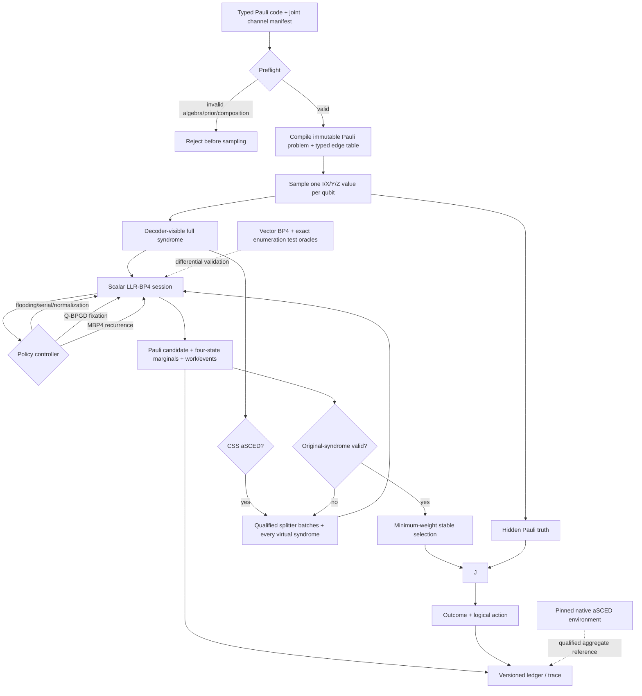

# Phase 10: Correlated Quaternary Execution - Research

**Researched:** 2026-10-06  
**Domain:** Four-state Pauli belief propagation, joint Pauli channels, and source-backed quaternary BP policies  
**Confidence:** MEDIUM — repository facts were read from source files (HIGH); mathematical recommendations come from primary papers retrieved through the configured `websearch` seam, whose verified tier is MEDIUM.

<user_constraints>
## User Constraints (from CONTEXT.md)

The following decisions, discretion, and deferred scope are copied verbatim from Phase 10 context. [VERIFIED: .planning/phases/10-correlated-quaternary-execution/10-CONTEXT.md:12-131]

### Locked Decisions

- **D-01:** The public quaternary path supports general stabilizer codes in Phase 10, including non-CSS Pauli check rows. Existing validated CSS artifacts can be supplied directly and compiled losslessly into that model, preserving their identity and an explicitly declared combined check/syndrome order. — **Reversibility:** costly — public artifact identity, manifests, and ledgers depend on this model boundary and ordering.
- **D-02:** A logical-operator basis is optional for running a general stabilizer code. The independent evaluator must use original-syndrome agreement and stabilizer-span membership to distinguish `invalid_syndrome`, `exact`, `stabilizer_equivalent`, and `logical_failure`. Without a supplied logical basis, the specific logical action is unavailable and must be marked as such; it is not inferred. — **Reversibility:** costly — changing this would invalidate stored outcome semantics and allowed code artifacts.
- **D-03:** Demonstrate the general path with at least one small non-CSS code through the public manifest, decoder, evaluator, and ledger, in addition to independent algebraic fixtures. This is an implementation check, not a statistical result.
- **D-04:** Accept both a named depolarizing channel with physical rate `p` and an explicit `I/X/Y/Z` probability table. The explicit form may be one shared row or one row per qubit. Persist the resolved four probabilities for every qubit, channel identity, and declared ordering in manifests and ledgers. — **Reversibility:** costly — saved manifest and sample identities depend on these conventions.
- **D-05:** Physical sampling honors exact zeros. A log-domain decoder faced with any zero prior requires an explicitly configured and recorded smoothing rule; the smoothing changes decoder beliefs only, not the physical sampling distribution. Reject silent smoothing or silent normalization of malformed user channel tables.
- **D-06:** For a per-qubit table, report each physical non-identity rate as `1-P(I)`. Use a scalar `p` only when a named uniform channel defines it; do not label an average of heterogeneous rows as the experiment's physical `p`.
- **D-07:** Expose source-defined quaternary flooding and serial schedules, plus quaternary check-message normalization and offset as explicit policies with their own equations, order, and preflight compatibility checks. Existing binary policy names do not automatically qualify as quaternary policies.
- **D-08:** Implement source-defined MBP4 as a distinct quaternary recurrence after the required Q-BPGD path. It is not a port of the binary memory adapter.
- **D-09:** Individually source-backed quaternary policies may be combined when mathematical and lifecycle compatibility checks pass. If their combination is not source-defined, label the run a canonical adaptation and record its effective order and semantics. Unsupported combinations fail preflight; no source-fidelity claim follows merely from source-backed components.
- **D-10:** Add the full paper aSCED method in Phase 10 for CSS codes: splitter-row construction/qualification, batches and all declared virtual-syndrome paths, original-syndrome-valid candidate selection by the paper's rule, and the overcomplete-check option. Keep the original code and measured syndrome immutable; attribute each path's graph, virtual syndrome, candidate, work, and termination. — **Reversibility:** costly — ensemble lineage, candidate selection, and work are persisted evidence contracts.
- **D-11:** The aSCED source-backed profile is CSS-specific. The general stabilizer kernel remains available for ordinary quaternary BP, but non-CSS aSCED is rejected until a separate splitter derivation and compatibility qualification exists. Do not generalize the paper's concrete CSS construction by name alone.
- **D-12:** Pin and run the authors' public `kit-cel/quantum_asced` repository as a bounded executable native reference and source guide. Keep its implementation, environment, numerical settings, instrumentation limits, and results distinct from canonical aSCED. It does not replace canonical policy execution.
- **D-13:** Run a bounded, prespecified, shot-matched Pauli-sample comparison of canonical aSCED and standalone BP4, with the qualified native aSCED reference on matched inputs where its interface permits. Retain every admitted shot, path-level work, and unavailable native counters with reasons. Label this evidence `not_assessed`; it cannot establish paper-curve reproduction or a performance ranking.
- **D-14:** Continue committed Q-BP edge messages across decimation rounds while updating the chosen qubit's prior. Record this as a canonical interpretation of source-ambiguous buffer handling, subject to authoritative author-code findings; do not call it proven source-literal behavior.
- **D-15:** Preserve the paper's literal fixation weights `(1-ε, ε, ε, ε)` with the leading weight at the chosen Pauli. Record the raw vector, divide all four entries by their common sum for the probability interface, and record that ratio-preserving interpretation. Do not silently change the leading term to `1-3ε`.
- **D-16:** Resolve equal Q-BPGD reliability by lowest qubit index, and equal Pauli posterior components by `I < X < Y < Z`. Persist this deterministic interpretation for replay.
- **D-17:** Keep the depolarizing Q-BPGD setup as the source-backed profile. Q-BPGD with an arbitrary declared joint or per-qubit prior is permitted as a separately labeled canonical adaptation after compatibility checks.

### the agent's Discretion

- Select exact combined CSS syndrome row order, manifest/schema version, numerical profile and saturation, positive-prior smoothing options, finite fixture sizes, aSCED path caps, bounded run size, and paper-linked demonstration code before collecting evidence. Persist the chosen conventions; verify them independently. The user did not prescribe numerical values or a particular paper curve.
- Inspect aSCED's paper and pinned author revision for splitter generation, overcomplete matrices, BP4 settings, candidate tie behavior, reference entry points, and license/packaging constraints. Resolve source ambiguities explicitly; preserve missing native instrumentation as missing.

### Deferred Ideas (OUT OF SCOPE)

- Non-CSS aSCED awaits a separate source/compatibility derivation; Phase 10 must reject it explicitly.
- Statistical quaternary reproduction and controlled comparisons remain in Phase 11 after Phase 8. Circuit decoding remains in Phases 12–13.

### Reviewed Todos (not folded)
- `.planning/todos/pending/literature-policy-toml-provenance-and-cli.md` — previously assigned to paused Phase 7; Phase 10 reuses the established policy-file route without absorbing that paused task.
- `.planning/todos/pending/phase6-css-literature-vertical-slice.md` — the bounded CSS literature gate was assigned to Phase 6; no new Phase 10 scope follows from its keyword match.
</user_constraints>

## Summary

Phase 10 should add a second canonical kernel family for four-state Pauli variables. The recommended baseline is Lai and Kuo's scalar log-domain BP: each qubit retains a three-component identity-referenced LLR belief for `X`, `Y`, and `Z`, while each Tanner edge passes the scalar likelihood that the qubit error commutes rather than anticommutes with that edge's Pauli label. This retains the joint `I/X/Y/Z` prior, including the shared `Y=(X,Z)` event, and has a source-stated equivalence to the refined linear-domain BP4 for qubits. [CITED: https://arxiv.org/html/2104.00304]

The scalar implementation must be verified against two deliberately independent references: conventional four-vector BP4 on tiny graphs and exact enumeration of all `4^n` Pauli assignments on very small problems. Kuo and Lai give both conventional vector equations and the refined scalar equations, while also stating that the scalar algorithm has the same output as conventional BP4. [CITED: https://arxiv.org/html/2002.06502] The exact oracle is a project validation recommendation, not a production decoder. [ASSUMED]

The public Phase 10 path should compile immutable Pauli checks, declared joint priors, and the full ordered syndrome into a quaternary problem; sample one categorical Pauli value per qubit; run only compositions admitted by a quaternary compatibility matrix; emit Pauli candidates plus four-state marginals; and hand candidates and hidden truth to an independent evaluator. This follows the repository's existing separation of decoder-visible observation and hidden truth and its four CSS outcome meanings. [VERIFIED: src/bp_registry/sampling.py:16-40; src/bp_registry/evaluator.py:13-19,33-83]

**Primary recommendation:** Build a source-defined scalar LLR-BP4 kernel with independent vector/exact oracles, then add Q-BPGD, fixed-`α` MBP4, and full CSS aSCED including overcomplete checks. Pin native aSCED commit `816772071486615dfc7d71d1e15df597edc58a26` as an isolated bounded reference, and keep every paper/native discrepancy explicit. [CITED: https://arxiv.org/html/2104.00304] [CITED: https://arxiv.org/html/2104.13659] [CITED: https://arxiv.org/html/2605.06547v2]

## Architectural Responsibility Map

| Capability | Primary Tier | Secondary Tier | Rationale |
|------------|--------------|----------------|-----------|
| Pauli/stabilizer algebra and CSS compilation | Model compiler | Independent evaluator | The compiler owns typed immutable checks; the evaluator recomputes syndrome and equivalence independently. [VERIFIED: .planning/research/ARCHITECTURE.md:51-60] |
| Joint four-state BP | Canonical kernel | Policy controller | The kernel owns commutation-factor message math; schedules and interventions select when state advances. [VERIFIED: .planning/research/ARCHITECTURE.md:54-57] |
| Joint channel sampling | Experiment runner | Evidence ledger | Sampling owns physical randomness and hidden truth; the ledger records the resolved prior and sample identity. [VERIFIED: .planning/research/ARCHITECTURE.md:58-60] |
| Q-BPGD | Policy controller | Canonical kernel | The controller chooses an undecimated variable and changes its prior; the kernel supplies four-state marginals without knowing hidden truth. [CITED: https://arxiv.org/html/2312.10950v2] |
| MBP4 | Canonical quaternary kernel | Schedule policy | MBP4 changes the quaternary variable recurrence and edge inhibition; schedule determines message freshness. [CITED: https://arxiv.org/html/2104.13659] |
| CSS aSCED | Ensemble controller | Canonical quaternary kernel | The controller owns qualified splitter graphs, virtual syndromes, all paths, and selection; each path invokes BP4/MBP4 without access to hidden truth. [CITED: https://arxiv.org/html/2605.06547v2] |
| Native aSCED | Isolated reference environment | Evidence ledger | The pinned author program is assessed as an executable reference with its own environment and missingness, never used as the canonical engine. [VERIFIED: .planning/phases/10-correlated-quaternary-execution/10-CONTEXT.md:47-50] |
| Exact/degenerate/logical classification | Independent evaluator | Model compiler | Outcome classification requires original checks, logical basis, and hidden truth, all outside decoder visibility. [VERIFIED: src/bp_registry/evaluator.py:33-83] |
| Manifests, trace, replay, and work | Evidence ledger | Experiment runner | Project architecture assigns provenance and final evaluation to the runner/evaluator boundary, while the kernel emits typed work and state events. [VERIFIED: .planning/research/ARCHITECTURE.md:59-73] |

<phase_requirements>
## Phase Requirements

The requirement text below is quoted verbatim from the source of truth. [VERIFIED: .planning/REQUIREMENTS.md:134-139]

| ID | Description | Research Support |
|----|-------------|------------------|
| QBP-01 | “A researcher can execute a canonical four-state Pauli BP kernel using source-defined commutation factors, message representation, numerical conventions, and joint X/Z inference.” [VERIFIED: .planning/REQUIREMENTS.md:136] | Sections **Canonical Mathematical Contract**, **Numerical Contract**, and **Validation Architecture** specify the source equations, representation, and differential oracles. |
| QBP-02 | “A researcher can sample a declared joint I/X/Y/Z channel, including correlated X/Z behavior, and verify priors, error-rate conventions, and Y-error fixtures.” [VERIFIED: .planning/REQUIREMENTS.md:137] | Section **Joint Pauli Sampling Contract** specifies one categorical draw per qubit, analytic correlation identities, and deterministic I/X/Y/Z fixtures. |
| QBP-03 | “Quaternary outputs pass independent syndrome, exact/degenerate/logical-outcome checks against the common code-capacity mathematical conventions.” [VERIFIED: .planning/REQUIREMENTS.md:138] | Section **Independent Evaluation Contract** maps Pauli values to independent symplectic checks and preserves the existing four outcome names. |
| QBP-04 | “A researcher can run source-backed compatible policy compositions in the quaternary kernel, including the published quaternary BPGD case, with unsupported ports explicitly rejected or labeled new adaptations.” [VERIFIED: .planning/REQUIREMENTS.md:139] | Sections **Policy Compatibility Matrix** and **Q-BPGD Contract** identify admitted source policies, source-literal semantics, and closed rejection behavior. |
</phase_requirements>

## Project Constraints (from AGENTS.md)

The following actionable directives are quoted from `AGENTS.md` and must be treated as planning constraints. [VERIFIED: AGENTS.md:11-21,41-49,55-64,77-87]

- “One canonical execution engine per mathematically compatible kernel family.” [VERIFIED: AGENTS.md:13]
- “BP-internal policies and named BP modifications before optional OSD/LSD-style postprocessing.” [VERIFIED: AGENTS.md:14]
- “CSS code-capacity before correlated quaternary code-capacity before circuit-level decoding.” [VERIFIED: AGENTS.md:15]
- “Statistical agreement with published curves is sufficient,” with discrepancies documented. [VERIFIED: AGENTS.md:16]
- “Every simulation must emit an event ledger, and every supported paper must have a reproduction manifest.” [VERIFIED: AGENTS.md:17]
- Preserve both paper-specific and controlled configurations. [VERIFIED: AGENTS.md:18]
- Cite primary mathematical sources; record interpretations and unresolved source details; do not replace algebraic and policy checks with curve agreement. [VERIFIED: AGENTS.md:45-47]
- Preserve approved workflow/model settings, keep all three regimes in the journal milestone, and keep BP modifications ahead of substantial optional fallback work. [VERIFIED: AGENTS.md:48-49]
- Keep original problems immutable; keep hidden truth outside policies; evaluate outputs independently; and record equations, order, compatibility, numerics, stopping, lineage, and work. [VERIFIED: AGENTS.md:59-63]
- Distinguish source-faithful reproduction, canonical adaptation, controlled comparison, and mapped-only evidence. [VERIFIED: AGENTS.md:64]
- Repo changes must begin through a GSD workflow; this research was dispatched through `$gsd-plan-phase` and makes no implementation edits. [VERIFIED: AGENTS.md:77-87]

## Current Repository Baseline and Required Boundary

### What can be reused

The repository already pins Python `>=3.12` and the exact dependency string `dependencies = ["numpy==2.2.6", "scipy==1.17.1", "ldpc==2.4.1", "pydantic==2.13.5"]`. [VERIFIED: pyproject.toml:5-10] The new canonical kernel can therefore use the existing NumPy `float64` and strict Pydantic manifest conventions without adding a runtime package. [VERIFIED: pyproject.toml:9-10; src/bp_registry/canonical/contracts.py:12-18]

The current numerical layer already contains a stable ordered `boxplus_pair`, an ordered `boxplus` fold, finite saturation, explicit syndrome sign, and exact-zero binary hard decisions. [VERIFIED: src/bp_registry/canonical/numerics.py:15-41,52-62,95-146] Reuse the arithmetic primitive only through a new quaternary numerical profile; the existing profile is verbatim `profile_id="binary-spa-flooding-f64-v1"`, `saturation=25.0`, and `exact_zero_decision=0`, so silently inheriting its full semantics would mislabel the new kernel. [VERIFIED: src/bp_registry/canonical/numerics.py:15-36]

The work schema already counts verbatim `check_to_variable_updates`, `variable_to_check_updates`, `belief_assemblies`, `candidate_constructions`, `convergence_checks`, `bp_calls`, `candidate_checks`, `intervention_actions`, `fixation_actions`, and `original_checks`, among other atomic categories. [VERIFIED: src/bp_registry/canonical/budgets.py:18-44] Those categories can cover Q-BP and Q-BPGD if each count's unit is documented as an edge message, four-state belief assembly, Pauli hard decision, or fixation; schema changes are unnecessary unless planners decide to count scalar arithmetic separately. [ASSUMED]

The evaluator already defines the outcome union verbatim as `"invalid_syndrome", "exact", "stabilizer_equivalent", "logical_failure"` and checks both X and Z residuals against original CSS checks and logical operators. [VERIFIED: src/bp_registry/evaluator.py:13-19,33-83] Preserve those names for Phase 10 evidence. [VERIFIED: .planning/ROADMAP.md:531-534]

### What must remain a separate kernel family

The existing `OriginalProblem` contains verbatim fields `lineage_id`, `hx`, `hz`, and `syndrome`, and validates the syndrome length against `hz.shape[0]`; `WorkingProblem` defaults to the single binary matrix `original.hz`. [VERIFIED: src/bp_registry/canonical/problems.py:20-32,35-85] It cannot represent an ordered full stabilizer matrix with X/Y/Z edge labels and the combined syndrome without changing its mathematical meaning. Create a quaternary problem type rather than widening these binary fields. [VERIFIED: .planning/ROADMAP.md:531-537]

The existing candidate is a binary one-dimensional array whose length is checked against `original.hz.shape[1]`. [VERIFIED: src/bp_registry/canonical/problems.py:88-98] A quaternary candidate needs an explicit Pauli representation and an independently convertible symplectic pair. [CITED: https://arxiv.org/html/2312.10950v2]

The current sampler draws `hidden_x` and `hidden_z` from separate random calls using separate scalar rates. [VERIFIED: src/bp_registry/sampling.py:76-118] That produces an independent product channel and cannot represent an arbitrary declared joint `I/X/Y/Z` prior; it must not be used as the Phase 10 physical sampler. [VERIFIED: .planning/REQUIREMENTS.md:137]

The existing policy registry admits the verbatim update kinds `"identity", "binary_spa", "min_sum", "normalized_min_sum", "offset_min_sum"` and schedule kinds `"identity", "flooding", "layered", "check_node_serial", "variable_node_serial", "residual", "randomized", "group_shuffled"`. [VERIFIED: src/bp_registry/canonical/contracts.py:62-73] A Phase 10 contract must define a separate closed set; accepting these names automatically would violate the project's compatibility boundary. [VERIFIED: .planning/research/ARCHITECTURE.md:77-88]

## Standard Stack

### Core

| Library/runtime | Version | Purpose | Why Standard |
|-----------------|---------|---------|--------------|
| Python | `>=3.12`; probed `3.12.2` | Typed reference implementation and orchestration | This is the declared project runtime and installed interpreter. [VERIFIED: pyproject.toml:9; environment probe 2026-10-06] |
| NumPy | `2.2.6` | Immutable Pauli arrays, sparse edge buffers, categorical sampling, stable log arithmetic | Already pinned and installed; `numpy.logaddexp` computes log-sums without returning to probability scale. [VERIFIED: pyproject.toml:10; environment probe 2026-10-06] [CITED: https://numpy.org/doc/2.2/reference/generated/numpy.logaddexp.html] |
| SciPy | `1.17.1` | Independent sparse/linear-algebra checks where existing project utilities require it | Already pinned and installed; do not add a new finite-field dependency for four Pauli symbols. [VERIFIED: pyproject.toml:10; environment probe 2026-10-06] |
| Pydantic | `2.13.5` | Strict, frozen manifest and policy validation | Already pinned; current contracts use `extra="forbid"`, `strict=True`, `frozen=True`, and `allow_inf_nan=False`. [VERIFIED: pyproject.toml:10; src/bp_registry/canonical/contracts.py:12-18] |

### Supporting

| Tool/reference | Version | Purpose | When to Use |
|----------------|---------|---------|-------------|
| pytest | `9.0.3` installed | Unit, differential, replay, and public execution gates | Use from Wave 0 through the phase gate. [VERIFIED: environment probe 2026-10-06] |
| Kuo author C reference | commit `402a83e8afd0df5203693aeeed1e42f1900e344d` | Optional isolated reference inspection for MBP-family behavior | Treat as a GPL reference environment, not a canonical dependency or a Yao Q-BPGD implementation. [CITED: https://github.com/kywukuo/qLDPC_dec/tree/402a83e8afd0df5203693aeeed1e42f1900e344d] |

### Alternatives Considered

| Instead of | Could Use | Tradeoff |
|------------|-----------|----------|
| Scalar log-domain BP4 production kernel | Conventional four-vector probability-domain BP4 | The vector equations are direct and valuable as a tiny-graph oracle, but the primary paper reports greater check-node complexity; keep it out of the production execution path. [CITED: https://arxiv.org/html/2002.06502] |
| Explicit Pauli commutation algebra | A third-party GF(4) package | The factor only needs Pauli commutation parity, and another package would add identity, licensing, and representation risk without replacing the independent oracle. [CITED: https://arxiv.org/html/2104.00304] |
| New quaternary problem/candidate types | Coercing Pauli values through the binary `OriginalProblem` | Coercion loses the full syndrome and joint state meaning documented above. [VERIFIED: src/bp_registry/canonical/problems.py:20-98] |

**Installation:** No package installation is recommended for Phase 10; retain the current project environment. [VERIFIED: pyproject.toml:5-22]

**Version verification:** `pip index versions` confirmed the pinned releases on 2026-10-06. PyPI JSON reported first file upload times: NumPy `2.2.6` on `2025-05-17`, SciPy `1.17.1` on `2026-02-23`, Pydantic `2.13.5` on `2026-08-28`, and pytest `9.0.3` on `2026-04-07`. [VERIFIED: PyPI registry probes 2026-10-06] Newer NumPy, SciPy, and pytest releases exist, but dependency upgrades are outside this phase and should not be mixed into the scientific change. [VERIFIED: PyPI registry probes 2026-10-06]

## Package Legitimacy Audit

No external package is added to the canonical runtime. [VERIFIED: pyproject.toml:5-22] The required native aSCED reference is a separate build environment whose author manifest names `numpy>=1.24`, `galois>=0.4`, `matplotlib>=3.7`, `scikit-build-core>=0.10`, and `pybind11>=2.12`; the legitimacy seam returned `SUS` for all five because registry download/repository metadata was incomplete, so the planner must add a human verification checkpoint before creating that environment. [VERIFIED: kit-cel/quantum_asced@816772071486615dfc7d71d1e15df597edc58a26:pyproject.toml:1-22] [VERIFIED: package-legitimacy probe 2026-10-06]

| Package | Registry | Registry version observed | Verdict | Disposition |
|---------|----------|---------------------------|---------|-------------|
| `numpy` | PyPI | `2.5.3` | SUS | Native-only; verify and resolve through the pinned native lock/environment. [VERIFIED: PyPI probe 2026-10-06] |
| `galois` | PyPI | `0.4.11` | SUS | Native-only; human verification checkpoint. [VERIFIED: PyPI probe 2026-10-06] |
| `matplotlib` | PyPI | `3.11.2` | SUS | Native demo-only; human verification checkpoint. [VERIFIED: PyPI probe 2026-10-06] |
| `scikit-build-core` | PyPI | `1.1.1` | SUS | Native build-only; human verification checkpoint. [VERIFIED: PyPI probe 2026-10-06] |
| `pybind11` | PyPI | `3.1.0` | SUS | Native build-only; pin a source revision because the author checkout lacks the declared submodule. [VERIFIED: PyPI probe 2026-10-06] |

**Packages removed due to SLOP verdict:** none. [VERIFIED: package-legitimacy probe 2026-10-06]

**Packages flagged as suspicious [SUS]:** `numpy`, `galois`, `matplotlib`, `scikit-build-core`, `pybind11`; these findings apply to the isolated native environment, not the already pinned canonical environment. [VERIFIED: package-legitimacy probe 2026-10-06]

## aSCED Source Resolution and Required Contract

### Exact source identities

Use Wursthorn et al., *Affine Subcode Ensemble Decoding for Degeneracy-Aware Quantum Error Correction*, arXiv `2605.06547v2` dated 2026-05-08, as the mathematical source. [CITED: https://arxiv.org/html/2605.06547v2] Pin the native reference to author repository commit `816772071486615dfc7d71d1e15df597edc58a26` (commit date 2026-08-10, subject `Updated README`), which is the revision audited during this research. [VERIFIED: https://github.com/kit-cel/quantum_asced/tree/816772071486615dfc7d71d1e15df597edc58a26]

The paper's concrete aSCED construction is CSS-specific: each batch augments the component Tanner graphs with `Δ/2` X-type and `Δ/2` Z-type splitter rows, so the literal profile requires even `Δ`; `L` batches yield `K=L·2^Δ` decoder paths. [CITED: https://arxiv.org/html/2605.06547v2] Each batch must enumerate every virtual syndrome `g∈F₂^Δ`, preserving a declared bit order. [CITED: https://arxiv.org/html/2605.06547v2] The pinned code resolves the bit convention as least-significant-bit first via bit `j` of the integer path index. [VERIFIED: kit-cel/quantum_asced@816772071486615dfc7d71d1e15df597edc58a26:qec/Ensemble_Decoder.cpp]

### Splitter construction and qualification

The paper requires splitter rows independent of the stabilizer row span and outside the logical normalizer, with linearly independent detectable components so all `2^Δ` affine subsets are represented. [CITED: https://arxiv.org/html/2605.06547v2] Plan a deterministic preflight that records and hashes the original CSS matrices, ordered splitter rows, augmented matrix, batch ID, row roles, weight, cycle check, and qualification witnesses. [ASSUMED]

For symplectic splitter matrix `T` and original stabilizer matrix `H`, verify both `rank([H;T])=rank(H)+Δ` and `rank(T Λ Hᵀ)=Δ`; the latter is a recommended executable qualification of independent detectable components and rejects any nonzero splitter combination in the normalizer. [ASSUMED] Also verify CSS row type, even `Δ`, requested row weight, and no new component-graph 4-cycle for the paper-linked profile. [CITED: https://arxiv.org/html/2605.06547v2]

The pinned generator enforces rank growth and removes co-neighbor positions to avoid extra 4-cycles, but contains an explicit TODO to check that a generated row is not logical. [VERIFIED: kit-cel/quantum_asced@816772071486615dfc7d71d1e15df597edc58a26:qec/Graph_Optimization.cpp; qec/Graph_Optimization_GF4.cpp] Therefore native-generated rows are inputs to canonical qualification, never proof that qualification passed. [ASSUMED]

### Path execution and selection

For every admitted shot, run all declared `(batch, virtual-syndrome)` paths unless a prespecified evidence cap rejects the manifest before sampling. [VERIFIED: .planning/phases/10-correlated-quaternary-execution/10-CONTEXT.md:40-50] Each path ledger must contain graph identity, batch/index, `g`, augmented syndrome, numerical/profile identity, terminal reason, iteration/work vector, candidate, extended-syndrome validity, original-syndrome validity, and selection status. [ASSUMED]

The paper forms the candidate pool from every path output that satisfies the immutable **original** syndrome, then chooses minimum Pauli weight; no valid candidate is a type-I failure. [CITED: https://arxiv.org/html/2605.06547v2] The paper does not resolve equal-weight ties. [ASSUMED] Use stable `(batch index, virtual path index)` order for canonical replay and label it an implementation interpretation; the pinned native code also retains the first strict minimum in ascending path order. [VERIFIED: kit-cel/quantum_asced@816772071486615dfc7d71d1e15df597edc58a26:qec/Ensemble_Decoder.cpp]

### Overcomplete option

The full Phase 10 method must support both ordinary augmented checks and the paper's overcomplete path. For every batch verify over GF(2) that `H_oc=M H_ext`, compute `z_oc=M z_ext`, and persist `M`, its rank/shape, row order, and all hashes. [CITED: https://arxiv.org/html/2605.06547v2] The pinned repository's audited precomputed GB46 and toric artifacts satisfied these matrix relations; use them as fixtures, not as a substitute for generic validation. [VERIFIED: kit-cel/quantum_asced@816772071486615dfc7d71d1e15df597edc58a26:Extended_PCMs]

### Paper/repository discrepancies that must stay visible

| Ambiguity or discrepancy | Source result | Planning consequence |
|--------------------------|---------------|----------------------|
| Candidate admission | Paper admits any original-syndrome-valid candidate; native code uses its path decoder's extended-syndrome success flag and includes a TODO about ensemble validity. [CITED: https://arxiv.org/html/2605.06547v2] [VERIFIED: kit-cel/quantum_asced@816772071486615dfc7d71d1e15df597edc58a26:qec/Ensemble_Decoder.cpp] | Canonical aSCED follows the paper/original syndrome. Record both validity flags and classify the native difference. |
| Pauli order | Canonical/source BP4 order is `I,X,Y,Z`; the native repository encodes `0,1,2,3` as `I,X,Z,Y` and stores LLRs in X,Z,Y order. [CITED: https://arxiv.org/html/2312.10950v2] [VERIFIED: kit-cel/quantum_asced@816772071486615dfc7d71d1e15df597edc58a26:qec/BP_Decoder_GF4.cpp] | Require an explicit tested translation at the native evidence boundary. |
| Hard-decision ties | Native strict comparisons send equal nonpositive minima to Y; paper tie behavior is unspecified. [VERIFIED: kit-cel/quantum_asced@816772071486615dfc7d71d1e15df597edc58a26:qec/BP_Decoder_GF4.cpp] | Persist canonical tie policy and do not claim trajectory identity. |
| GB126 splitter weight | Paper v2 describes weight-six splitters for its GB126 figure; the pinned repository's GB126 precomputed splitters audited as weight four. [CITED: https://arxiv.org/html/2605.06547v2] [VERIFIED: pinned repository artifact audit 2026-10-06] | Do not call that artifact a source-faithful recreation of the paper figure without resolution. |
| Channel proportions | Native initialization assigns `pZ` and `pY` from `config.pX`; default equal proportions hide the defect. [VERIFIED: kit-cel/quantum_asced@816772071486615dfc7d71d1e15df597edc58a26:qec/Pauli_Channel.cpp] | Restrict unmodified native evidence to the equal-proportion depolarizing profile. |
| Shared shots | Native Python bindings do not expose per-shot error/syndrome injection or seed control. [VERIFIED: kit-cel/quantum_asced@816772071486615dfc7d71d1e15df597edc58a26:qec/python_bindings.cpp] | Canonical aSCED and BP4 use exact shared samples; native matching is `unavailable` with this reason unless a non-algorithmic instrumentation patch is separately pinned. |

### Native reference execution gate

Keep the native checkout, build inputs, environment freeze, driver, stdout/stderr, results, and instrumentation-limit record outside canonical execution. [VERIFIED: .planning/phases/10-correlated-quaternary-execution/10-CONTEXT.md:47-50] The audited checkout declares a pybind11 submodule but contains no `pybind11/` gitlink while CMake calls `add_subdirectory(pybind11)`; its demos reference `Check_Matrices/` while the checkout provides `Extended_PCMs/`. [VERIFIED: kit-cel/quantum_asced@816772071486615dfc7d71d1e15df597edc58a26:.gitmodules; CMakeLists.txt; Examples/demo_asced.py] The planner must pin and hash a build-only pybind11 overlay and an out-of-tree driver/path correction, with no algorithm edits. [ASSUMED]

No license file or package license field was located during the audit; absence is not proof of license status. [ASSUMED] Treat licensing as an explicit human gate before copying or redistributing native source, and keep the initial use to isolated executable-reference assessment. [ASSUMED]

### Bounded mechanism evidence

Prespecify one small CSS code/profile, fixed admitted shot IDs, sample count, `L`, even `Δ`, path cap, iteration caps, smoothing, selection tie, and work units before execution. [VERIFIED: .planning/phases/10-correlated-quaternary-execution/10-CONTEXT.md:47-50] A compact paper-linked choice is GB46 with `Δ=2`, ordinary BP4 aSCED plus the available overcomplete artifact, while retaining the exact selected parameters in the manifest. [ASSUMED] Run canonical standalone BP4 and canonical aSCED on identical Pauli samples, retain all path results, and label the evidence `not_assessed`; run native only on the closest equal-proportion aggregate input and record that shot matching and per-shot native counters are unavailable. [VERIFIED: .planning/phases/10-correlated-quaternary-execution/10-CONTEXT.md:47-50]

## Canonical Mathematical Contract

### Pauli representation and syndrome

Yao et al. define the numeric order verbatim as “0,1,2,3 representing the absence of error, or the presence of a Pauli σx, σy or σz error.” [CITED: https://arxiv.org/html/2312.10950v2] Persist that order as `I=0, X=1, Y=2, Z=3`; never infer it from an array position at an API boundary. [CITED: https://arxiv.org/html/2312.10950v2]

Represent each Pauli independently as symplectic bits with `I=(0,0)`, `X=(1,0)`, `Y=(1,1)`, `Z=(0,1)`, following `Y=iXZ` and Yao's `D(a,b)` definition. [CITED: https://arxiv.org/html/2312.10950v2] For an error `(x,z)` and stabilizer matrix `H=[H_x,H_z]`, compute the syndrome as `s=(x,z) Λ H^T`, equivalently the rowwise commutation parity. [CITED: https://arxiv.org/html/2312.10950v2]

The Pauli Tanner graph has an edge exactly where a stabilizer entry is not identity, and each edge carries label `X`, `Y`, or `Z`. [CITED: https://arxiv.org/html/2002.06502] The typed edge table must therefore include check index, qubit index, and Pauli label in its semantic hash. [ASSUMED]

Compile current CSS artifacts losslessly: rows of `hx` become X-labeled stabilizer rows, rows of `hz` become Z-labeled stabilizer rows, and the combined syndrome order is declared in the artifact rather than inferred. Existing code defines `hx`/`hz`, verifies `hx @ hz.T == 0`, and labels `Hz eX` as a Z-check observation and `Hx eZ` as an X-check observation. [VERIFIED: src/bp_registry/css.py:64-107,160-163; src/bp_registry/sampling.py:105-114] The exact concatenation order is a new persisted convention and must be locked before implementation. [ASSUMED]

### Recommended production message representation

For each qubit `n`, store the three identity-referenced LLRs

`Λ_n^W = log(P(E_n=I) / P(E_n=W))`, for `W in {X,Y,Z}`. [CITED: https://arxiv.org/html/2104.00304]

For edge Pauli `η`, quantize a three-component LLR belief to the scalar commutation LLR

`λ_η(Γ) = log(P(<E_n,η>=0) / P(<E_n,η>=1))`. [CITED: https://arxiv.org/html/2104.00304]

For check `m`, edge `(m,n)`, and syndrome bit `z_m`, compute

`Δ_{m→n} = (-1)^{z_m} boxplus_{n' in N(m)\{n}} λ_{H_mn'}(Γ_{n'→m})`. [CITED: https://arxiv.org/html/2104.00304]

For each nonidentity Pauli `W`, compute the excluded variable message

`Γ_{n→m}^W = Λ_n^W + Σ_{m' in M(n)\{m}, <W,H_m'n>=1} Δ_{m'→n}`. [CITED: https://arxiv.org/html/2104.00304]

The posterior uses the same sum without excluding `m`; decide `I` if all three identity-referenced LLRs are positive, otherwise choose the nonidentity Pauli with minimum LLR, then test the original syndrome. [CITED: https://arxiv.org/html/2104.00304] An exact-zero/equal-minimum rule is not specified in the consulted algorithm text, so the manifest must persist a project tie rule and label it an interpretation. [ASSUMED]

For qubits (`q=2`), the paper states that this LLR algorithm is equivalent to the refined linear-domain BP4 and that schedules other than parallel, including serial, are permitted. [CITED: https://arxiv.org/html/2104.00304]

### Independent vector BP4 oracle

Implement conventional probability-vector BP4 only in test/reference code. A V2C message is a normalized distribution over `I/X/Y/Z`; the C2V component for candidate `W` sums products over neighboring assignments whose total commutation parity matches the check syndrome; V2C then multiplies the prior by all other C2V components and normalizes. [CITED: https://arxiv.org/html/2002.06502]

On cycle-free tiny graphs and matched priors, assert agreement among vector BP4, scalar LLR-BP4, and exact enumeration to a prespecified tolerance. The source states BP is exact on a tree and the scalar implementation is output-equivalent to conventional BP4. [CITED: https://arxiv.org/html/2104.00304] [CITED: https://arxiv.org/html/2002.06502]

### Numerical Contract

Use `float64`, ordered edge reductions, stable pairwise box-plus, and log-sum-exp for commutation/anticommutation groups. The source recommends Jacobian-logarithm computation, and NumPy documents `logaddexp` for adding probabilities represented in log form. [CITED: https://arxiv.org/html/2104.00304] [CITED: https://numpy.org/doc/2.2/reference/generated/numpy.logaddexp.html]

Do not use the all-neighbor `boxminus` shortcut in the correctness path. The source warns that the shortcut may be approximate because a zero input requires a tiny disturbance. [CITED: https://arxiv.org/html/2104.00304]

Persist a quaternary numerical profile containing dtype, LLR orientation, saturation, zero/tie rule, reduction order, normalization, and nonfinite policy. The source equations require real LLRs but do not prescribe this project's finite saturation value. [CITED: https://arxiv.org/html/2104.00304] The bound must be selected by Wave 0 differential tests and must not inherit binary `25.0` without evidence. [ASSUMED]

Keep two prior forms: a sampler distribution may include exact zeros for deterministic fixtures, while a decoder prior must either be strictly positive or pass through an explicitly recorded smoothing policy before taking LLRs. The LLR definition is a log ratio in the real domain, while the current binary helper rejects probabilities at zero and one. [CITED: https://arxiv.org/html/2104.00304] [VERIFIED: src/bp_registry/canonical/numerics.py:65-86]

## Joint Pauli Sampling Contract

### Channel schema

Represent a memoryless joint Pauli channel as a validated `(n,4)` array in the declared `I,X,Y,Z` order. Require finite, nonnegative rows with sums equal to one within a named manifest tolerance; reject malformed rows instead of silently normalizing user input. This is the recommended strict contract needed to verify QBP-02. [ASSUMED]

Sample exactly one categorical value per qubit and derive its `(x,z)` truth pair from that value. Do not draw X and Z independently. The primary algorithms accept per-qubit four-state priors, and the current independent sampler uses two random draws that cannot express an arbitrary joint table. [CITED: https://arxiv.org/html/2104.00304] [VERIFIED: src/bp_registry/sampling.py:76-118]

Provide a named depolarizing constructor with the source formula `P(I)=1-p` and `P(X)=P(Y)=P(Z)=p/3`. [CITED: https://arxiv.org/html/2002.06502] Record both the named physical error rate and the resolved four probabilities in manifests and ledgers. [VERIFIED: .planning/PROJECT.md:64-80]

For any declared row `(p_I,p_X,p_Y,p_Z)`, verify analytically:

- `P(x=1)=p_X+p_Y`; [CITED: https://arxiv.org/html/2312.10950v2]
- `P(z=1)=p_Z+p_Y`; [CITED: https://arxiv.org/html/2312.10950v2]
- `P(x=1,z=1)=p_Y`; [CITED: https://arxiv.org/html/2312.10950v2]
- `Cov(x,z)=p_Y-(p_X+p_Y)(p_Z+p_Y)`. [ASSUMED]

The covariance identity is an algebraic test recommendation derived from the cited Pauli-to-bit mapping. [ASSUMED]

### Required fixtures

1. Deterministic all-I, all-X, all-Y, and all-Z channels verify categorical mapping, syndrome order, and exact zero/one sampling without statistical tolerance. [ASSUMED]
2. A single-Y fixture must flip every adjacent X-type and Z-type CSS check because Y has both symplectic components. [CITED: https://arxiv.org/html/2312.10950v2]
3. A non-product four-state prior with `p_Y != (p_X+p_Y)(p_Z+p_Y)` must prove the sampler preserves X/Z correlation and that separate marginal sampling does not reproduce the same `p_Y`. [ASSUMED]
4. The source `[[5,1,3]]` check matrix with error `IIIYI` at depolarizing rate `0.1` must be retained as a schedule-sensitive kernel regression: Kuo and Lai report parallel BP4 oscillation and serial BP4 convergence for this case. [CITED: https://arxiv.org/html/2002.06502]
5. Exact enumeration on at least one tiny tree must compare posterior four-state marginals, not only hard decisions. [ASSUMED]

## Independent Evaluation Contract

The evaluator receives the immutable original Pauli check problem, hidden Pauli truth, and candidate only after decoding. This keeps the current truth boundary: `HiddenTruth` is documented as “never native decoding,” and `ShotSample` exposes decoder input as `observation`. [VERIFIED: src/bp_registry/sampling.py:24-40,84-90]

Evaluate in this order:

1. Recompute candidate syndrome using an evaluator-owned symplectic routine and compare it with the immutable observed syndrome. A mismatch is `invalid_syndrome`. [CITED: https://arxiv.org/html/2312.10950v2] [VERIFIED: src/bp_registry/evaluator.py:61-66]
2. Multiply truth and recovery modulo Pauli phase, which is XOR in symplectic bits. Identity residual is `exact`. [CITED: https://arxiv.org/html/2312.10950v2] [VERIFIED: src/bp_registry/evaluator.py:67-69]
3. Test residual membership in the stabilizer row space. A nonidentity stabilizer residual is `stabilizer_equivalent`. [CITED: https://arxiv.org/html/2312.10950v2] [VERIFIED: src/bp_registry/evaluator.py:70-76]
4. Independently compute residual action on the declared logical basis. A syndrome-valid residual with nontrivial logical action is `logical_failure`; row-space and logical-action checks must agree when the basis is present. [CITED: https://arxiv.org/html/2312.10950v2] [VERIFIED: src/bp_registry/evaluator.py:77-83]

Recommend a general Pauli stabilizer/logical model with a lossless CSS compiler so the non-CSS five-qubit source fixture can be evaluated end to end. This broadens the data model beyond the minimum CSS experiments but matches the baseline kernel's source domain. [ASSUMED]

Independence requires separate evaluator algebra or exhaustive reference code; importing the kernel's commutation lookup into the evaluator would allow one wrong table to validate itself. [ASSUMED]

## Policy Compatibility Matrix

The Phase 10 registry should be closed and fail during preflight, before sampling. The repository's existing compatibility architecture already requires resolution before a run and rejects policies with incompatible state ownership. [VERIFIED: .planning/research/ARCHITECTURE.md:53-57,63-73]

| Policy | Phase 10 disposition | Source basis / reason |
|--------|----------------------|-----------------------|
| Scalar LLR sum-product + flooding | **Admit: source-backed baseline** | Lai and Kuo Algorithm 1 specifies parallel LLR-BP with scalar edge messages and three-component node beliefs. [CITED: https://arxiv.org/html/2104.00304] |
| Variable-node serial BP4 | **Admit: source-backed** | Kuo and Lai specify serial BP4 and report the `IIIYI` convergence contrast. [CITED: https://arxiv.org/html/2002.06502] |
| Check-message normalization | **Admit: source-backed** | Divide `Δ_{m→n}` by declared `α_c>0` before subsequent computations. [CITED: https://arxiv.org/html/2104.00304] |
| Check-message offset | **Admit: source-backed** | Apply `sign(Δ) max(0, |Δ|-β)` for declared `β>0`. [CITED: https://arxiv.org/html/2104.00304] |
| Q-BPGD | **Admit: required, source-backed intervention** | Yao Algorithm 3 defines reliability, fixation, round count, and early success for quaternary BP. [CITED: https://arxiv.org/html/2312.10950v2] |
| MBP4 | **Admit: required after Q-BPGD** | Kuo and Lai define a distinct quaternary LLR recurrence with `1/α` posterior scaling and fixed edge inhibition. D-08 requires this recurrence in Phase 10; it is not the binary Phase 4 memory transform. [CITED: https://arxiv.org/html/2104.13659] [VERIFIED: .planning/phases/10-correlated-quaternary-execution/10-CONTEXT.md:35-38] |
| CSS aSCED / overcomplete aSCED | **Admit: required ensemble controller, CSS only** | Wursthorn et al. define the augmented CSS graphs, virtual syndromes, original-syndrome candidate rule, and overcomplete mapping. [CITED: https://arxiv.org/html/2605.06547v2] |
| Non-CSS aSCED | **Reject** | The selected source profile is CSS-specific and D-11 forbids generalization without a separate derivation. [VERIFIED: .planning/phases/10-correlated-quaternary-execution/10-CONTEXT.md:40-46] |
| AMBP4 | **Do not include without its complete adaptive search contract** | The MBP paper treats adaptive MBP as a separate algorithm; a scalar `α` field alone is incomplete. [CITED: https://arxiv.org/html/2104.13659] |
| Binary SPA | **Reject in quaternary registry** | It factorizes X and Z and cannot represent one joint Y variable/prior. [VERIFIED: .planning/research/ARCHITECTURE.md:37-43] |
| Binary min-sum / normalized min-sum / offset min-sum | **Reject unless a quaternary derivation is added and labeled adaptation** | Existing registered rules are binary, while the source-backed quaternary offset/normalization acts on scalar commutation C2V messages. [VERIFIED: src/bp_registry/canonical/contracts.py:62-67] [CITED: https://arxiv.org/html/2104.00304] |
| Binary damping, field mixing, momentum, EWA, Relay memory | **Reject automatic port; source-qualify individually** | The current audit explicitly labels these executions as binary CSS adaptations, including the GF(4)-source momentum reduced to scalar binary LLR. [VERIFIED: docs/memory-policy-sources.md:1-17,37-72] |
| Residual, randomized, group-shuffled, layered schedules | **Reject until quaternary atomicity/freshness/residual semantics are derived** | Their names exist in the binary registry, but no Phase 10 source derivation was established in this research. [VERIFIED: src/bp_registry/canonical/contracts.py:64-67] [ASSUMED] |
| OSD/LSD/SI/OTF postprocessing | **Out of Phase 10 execution scope** | Phase 7 optional postprocessing remains paused and project priority keeps BP-internal modifications first. [VERIFIED: .planning/STATE.md:4-11,27-38; AGENTS.md:14,49] |

### Q-BPGD Contract

Implement Algorithm 3 as a persistent Q-BP session with controller-owned decimation state:

1. Initialize every qubit with `(1-p,p/3,p/3,p/3)` for the source depolarizing profile; accept general declared joint priors only under a separately labeled canonical extension. [CITED: https://arxiv.org/html/2312.10950v2]
2. Maintain the undecimated set `V_u`; run exactly `T` Q-BP iterations in each of at most `n` rounds; form a hard Pauli candidate and return early if it matches the original syndrome. [CITED: https://arxiv.org/html/2312.10950v2]
3. Define reliability as the maximum of the four normalized posterior components; choose the maximum-reliability undecimated variable and its maximum-probability Pauli value. [CITED: https://arxiv.org/html/2312.10950v2]
4. Replace that variable's channel weights with the source-literal vector containing `1-ε` at the selected Pauli and `ε` at each other Pauli; remove the variable from `V_u`. The simulation source states `ε=1×10^-10`. [CITED: https://arxiv.org/html/2312.10950v2]
5. Continue the existing committed BP state across rounds unless a future author implementation establishes different state semantics; record this as a canonical interpretation because the paper pseudocode says “run Q-BP” but does not resolve all buffer-reset details. [ASSUMED]

The literal fixation vector sums to `1+2ε`, so its ratios are defined but it is not a normalized probability vector. Preserve the raw source weights, normalize them for a probability API by their common sum, and record both forms; changing the leading term to `1-3ε` would be an unmarked algorithm edit. [CITED: https://arxiv.org/html/2312.10950v2] The normalize-for-API choice is an interpretation that must be locked in the manifest. [ASSUMED]

The source writes `argmax` without a tie rule. Use a persisted deterministic ordering for canonical replay, tentatively lowest qubit index and `I<X<Y<Z`, and label it an interpretation. [ASSUMED]

### MBP4 boundary

MBP4 is mathematically compatible with the same Pauli checks and LLR quantizer, but it changes the variable recurrence: the posterior anticommute sum is scaled by `1/α`, while the outgoing-edge inhibition `-<W,S_mn>Δ_m→n` remains unscaled. [CITED: https://arxiv.org/html/2104.13659] This is a distinct update/state-memory policy and must not be implemented by applying the Phase 4 binary memory adapter after ordinary Q-BP. [VERIFIED: docs/memory-policy-sources.md:1-24] [CITED: https://arxiv.org/html/2104.13659]

Implement fixed-`α` MBP4 after Q-BPGD as required by D-08. [VERIFIED: .planning/phases/10-correlated-quaternary-execution/10-CONTEXT.md:35-38] Keep the source distinction exact: normalized BP4 scales both posterior accumulation and edge inhibition, whereas MBP4 scales the posterior accumulation by `1/α` but subtracts the unscaled destination-edge message when forming outgoing state. [CITED: https://arxiv.org/html/2104.13659] Parameter `α` is explicit and persisted; no universal source value applies across all codes. [CITED: https://arxiv.org/html/2104.13659]

AMBP4 is a different source algorithm that searches a declared descending sequence of `α` values and returns the first valid result; do not silently include that search in a run labeled MBP4. [CITED: https://arxiv.org/html/2104.13659] Support parallel/flooding or source-defined serial scheduling only when the composition preflight owns exact freshness and ordering semantics. [CITED: https://arxiv.org/html/2104.13659]

## Architecture Patterns

### System Architecture Diagram



This flow follows the project's required compile/sample/decode/evaluate lifecycle and keeps truth outside the policy controller. [VERIFIED: .planning/research/ARCHITECTURE.md:63-73]

### Recommended Project Structure

```text
src/bp_registry/
├── pauli.py                         # typed Pauli/symplectic algebra shared with evaluator
├── quaternary_sampling.py           # categorical joint channel and Pauli shot
├── quaternary_evaluator.py          # independent syndrome/equivalence/logical checks
└── canonical/quaternary/
    ├── problems.py                  # immutable checks, priors, candidates, semantic hashes
    ├── numerics.py                  # three-LLR profile, quantization, stable box-plus
    ├── kernel.py                    # scalar LLR-BP4 pure updates/session
    ├── schedules.py                 # admitted flooding and serial semantics
    ├── guided_decimation.py         # source-profile Q-BPGD controller
    ├── mbp4.py                      # fixed-alpha modified quaternary recurrence
    ├── asced.py                     # CSS splitter batches, paths, and selection
    ├── asced_overcomplete.py        # H/M and mapped-syndrome qualification
    ├── native_asced.py              # isolated reference identity/missingness adapter
    ├── compatibility.py             # closed policy registry/preflight
    ├── contracts.py                 # strict manifests and resolved evidence
    └── execution.py                 # sampling boundary, ledger, replay
tests/canonical/quaternary/
├── test_algebra.py
├── test_sampling.py
├── test_vector_oracle.py
├── test_kernel.py
├── test_schedules.py
├── test_bpgd.py
├── test_mbp4.py
├── test_asced_splitters.py
├── test_asced_ensemble.py
├── test_asced_overcomplete.py
├── test_asced_evidence.py
├── test_evaluator.py
└── test_public_execution.py
```

The package boundary is a recommendation that makes the second mathematical kernel explicit; exact filenames are not locked by upstream context. [ASSUMED]

### Pattern 1: Immutable original problem and derived session state

**What:** Hash ordered Pauli checks, full ordered syndrome, logical basis, prior order, and numerical profile into the immutable original problem. Keep edge messages, marginals, decimation eligibility, and round/iteration counters in a session owned by one attempt. [VERIFIED: .planning/research/ARCHITECTURE.md:63-72]

**When to use:** Every canonical Q-BP or Q-BPGD shot. [VERIFIED: .planning/ROADMAP.md:523-537]

### Pattern 2: Kernel emits marginals; controllers consume them

**What:** The kernel exposes normalized four-state posterior marginals as a typed output without allowing interventions to inspect hidden truth. Q-BPGD consumes reliability and changes only the declared channel prior/eligibility state. [CITED: https://arxiv.org/html/2312.10950v2]

**When to use:** Any intervention whose source ranks or fixes Pauli variables. [CITED: https://arxiv.org/html/2312.10950v2]

### Pattern 3: Source profile versus controlled extension

**What:** Keep `yao-qbpgd-depolarizing-v2` source settings separate from a general-prior Q-BPGD extension. Both may share code, but manifests must persist fidelity label, raw source settings, resolved priors, interpretations, and source revision. [VERIFIED: AGENTS.md:17-18,64]

**When to use:** Whenever a paper's policy is executed outside its exact noise, code, schedule, or reset semantics. [VERIFIED: .planning/PROJECT.md:82-89]

### Pattern 4: Materialized ensemble before shots

**What:** Construct, qualify, order, and hash every aSCED batch graph and overcomplete mapping during preflight. Shot execution supplies only the measured original syndrome and enumerated virtual bits; it never regenerates splitters. [ASSUMED]

**When to use:** Every aSCED manifest so graph identity, path cardinality, work, and replay are fixed before physical sampling. [VERIFIED: .planning/phases/10-correlated-quaternary-execution/10-CONTEXT.md:40-50]

### Anti-Patterns to Avoid

- **Two independent binary decoders presented as Q-BP:** this loses the joint Y state and is only a comparison arm. [VERIFIED: .planning/research/ARCHITECTURE.md:37-43]
- **One widened binary data class:** it hides the full-syndrome and typed-edge change inside binary field names. [VERIFIED: src/bp_registry/canonical/problems.py:20-98]
- **Policy names as compatibility proof:** a binary `normalized_min_sum` and a quaternary normalized commutation message are different equations. [VERIFIED: .planning/research/ARCHITECTURE.md:77-88]
- **Shared algebra between kernel and evaluator:** one error could self-validate. [ASSUMED]
- **Reproduction settings hidden as defaults:** source and controlled configurations answer different questions. [VERIFIED: AGENTS.md:16-18]
- **Filtering aSCED by extended-syndrome convergence:** the paper selection pool is based on the immutable original syndrome; store extended validity separately. [CITED: https://arxiv.org/html/2605.06547v2]
- **Calling the native run shot-matched:** its current Python interface cannot accept the canonical shot or deterministic seed. Record this as unavailable instead of aligning only aggregate `p`. [VERIFIED: pinned native binding audit 2026-10-06]

## Don't Hand-Roll

| Problem | Don't Build | Use Instead | Why |
|---------|-------------|-------------|-----|
| Stable log-sum | Direct `log(exp(a)+exp(b))` | `numpy.logaddexp` / ordered reduction | Official NumPy support avoids overflow/underflow in log probability sums. [CITED: https://numpy.org/doc/2.2/reference/generated/numpy.logaddexp.html] |
| Check parity convolution | General GF(4) multiplication tables or FFT | Binary commute/anticommute quantization plus box-plus | The source factor is binary commutation parity and admits scalar messages. [CITED: https://arxiv.org/html/2104.00304] |
| Scientific outcome labels | Decoder-local success flags | Existing four outcome meanings plus independent logical checks | The existing evaluator already distinguishes syndrome, exact, stabilizer, and logical outcomes. [VERIFIED: src/bp_registry/evaluator.py:13-83] |
| Replay identity | Ad hoc random seeds inside policies | Existing manifest identity + shot ID pattern and decoder-local substreams | Current sampling hashes manifest identity and shot ID; project architecture separates physical and decoder randomness. [VERIFIED: src/bp_registry/sampling.py:60-73,84-90] |
| Q-BPGD reliability | Binary absolute LLR | Maximum normalized I/X/Y/Z posterior | This is the source definition for Q-BPGD. [CITED: https://arxiv.org/html/2312.10950v2] |
| Tiny-problem truth oracle | Another rearrangement of the production scalar equations | Exhaustive enumeration and conventional vector BP4 | These fail differently and can expose commutation or normalization errors. [CITED: https://arxiv.org/html/2002.06502] [ASSUMED] |
| aSCED path pruning | Early exit after one converged virtual path | Enumerate the manifest's complete `L·2^Δ` path set | The source decoder selects among candidates across all declared paths. [CITED: https://arxiv.org/html/2605.06547v2] |
| Overcomplete projection | Informal row duplication or a new measured syndrome | Explicit `M` with verified `H_oc=M H_ext` and `z_oc=M z_ext` | The mapping is part of the paper method and must leave the original observation immutable. [CITED: https://arxiv.org/html/2605.06547v2] |
| Native/reference unification | Import author C++ as the canonical kernel | Isolated pinned executable reference plus canonical policy implementation | The native interface, Pauli order, selection rule, and instrumentation differ from the canonical evidence contract. [VERIFIED: pinned repository audit 2026-10-06] |

**Key insight:** the difficult part is preserving semantic independence among the joint channel, Pauli factor graph, source policy, and evaluator. Reusing equations without those boundaries would make an implementation fast to write but scientifically unauditable. [VERIFIED: AGENTS.md:59-64]

## Common Pitfalls

### Pitfall 1: Sampling X and Z separately

**What goes wrong:** The measured Y frequency becomes the product of marginal X and Z rates rather than the declared `p_Y`. [ASSUMED]

**Why it happens:** The current sampler draws two binary arrays independently. [VERIFIED: src/bp_registry/sampling.py:96-104]

**How to avoid:** Make one categorical draw in `I/X/Y/Z` and derive both symplectic bits. [CITED: https://arxiv.org/html/2312.10950v2]

**Warning signs:** Empirical `P(Y)` agrees with `P(x=1)P(z=1)` even for a deliberately correlated fixture. [ASSUMED]

### Pitfall 2: CSS row/syndrome order drift

**What goes wrong:** Correct Pauli candidates appear syndrome-invalid because X-check and Z-check rows were concatenated differently between compiler, sampler, manifest, and evaluator. [ASSUMED]

**Why it happens:** The existing public `ShotSample.observation` is the Z-check observation, while the mapping also stores both observations under string keys. [VERIFIED: src/bp_registry/sampling.py:105-118]

**How to avoid:** Persist row roles and combined order in semantic bytes and recompute them independently in tests. [ASSUMED]

**Warning signs:** X-only and Z-only fixtures pass separately while a Y fixture swaps syndrome segments. [ASSUMED]

### Pitfall 3: Losing correlations in a scalar-message implementation

**What goes wrong:** A developer stores only one scalar belief per qubit, confusing scalar edge messages with scalar node state, and cannot reconstruct four-state marginals for Q-BPGD. [ASSUMED]

**Why it happens:** The paper's efficiency result concerns edge messages; node beliefs remain a three-component LLR vector for nonidentity values. [CITED: https://arxiv.org/html/2104.00304]

**How to avoid:** Type edge commutation LLRs separately from node Pauli LLR vectors and normalized four-state marginals. [CITED: https://arxiv.org/html/2104.00304]

**Warning signs:** The kernel cannot return all four posterior probabilities required by Yao's reliability definition. [CITED: https://arxiv.org/html/2312.10950v2]

### Pitfall 4: Naive probability products and hyperbolic functions

**What goes wrong:** Messages underflow, `atanh` saturates, or zero inputs lead to unstable division. [CITED: https://arxiv.org/html/2104.00304]

**Why it happens:** The source equations are compact mathematical forms, while finite `float64` needs stable Jacobian-log/box-plus implementations. [CITED: https://arxiv.org/html/2104.00304]

**How to avoid:** Use the stable existing pairwise box-plus shape, a quaternary profile, ordered reduction, and log-sum-exp; reject nonfinite values with terminal evidence. [VERIFIED: src/bp_registry/canonical/numerics.py:52-62,95-138]

**Warning signs:** Tree-oracle differences grow with check degree or depend on edge iteration order. [ASSUMED]

### Pitfall 5: Silently “fixing” Q-BPGD source weights

**What goes wrong:** Replacing source `(1-ε,ε,ε,ε)` with `(1-3ε,ε,ε,ε)` changes the documented algorithm while still looking reasonable. [CITED: https://arxiv.org/html/2312.10950v2]

**Why it happens:** The source vector is used as a channel message and is not exactly normalized as printed. [CITED: https://arxiv.org/html/2312.10950v2]

**How to avoid:** Preserve the raw weights, normalize only by a common factor at the probability boundary, and ledger the interpretation. [ASSUMED]

**Warning signs:** The manifest contains only a normalized vector and cannot reconstruct the paper's literal inputs. [ASSUMED]

### Pitfall 6: Treating convergence as logical success

**What goes wrong:** A syndrome-valid candidate is counted as a successful recovery even when its residual is a nontrivial logical operator. [CITED: https://arxiv.org/html/2312.10950v2]

**Why it happens:** BP stopping checks the syndrome, while outcome classification needs hidden truth and logical operators. [VERIFIED: src/bp_registry/evaluator.py:61-83]

**How to avoid:** Record kernel convergence and final evaluator outcome as separate fields. [VERIFIED: AGENTS.md:60-63]

**Warning signs:** Every converged shot is reported as logical success. [ASSUMED]

### Pitfall 7: Porting binary policies by shared names

**What goes wrong:** Binary min-sum, damping, residual scheduling, or prior memory is applied to quaternary state without a derived operand, update order, reset rule, or source qualification. [VERIFIED: docs/memory-policy-sources.md:1-24]

**Why it happens:** The common lifecycle makes hooks look mechanically compatible even when the message algebra differs. [VERIFIED: .planning/research/ARCHITECTURE.md:77-88]

**How to avoid:** Use a quaternary capability registry with exact required/provided types and source labels. [ASSUMED]

**Warning signs:** A Phase 10 manifest accepts every current binary `kind` unchanged. [VERIFIED: src/bp_registry/canonical/contracts.py:62-73]

### Pitfall 8: Non-independent validation

**What goes wrong:** The same Pauli enum table or syndrome routine is imported by kernel, sampler, and evaluator, so a consistent mapping bug passes all tests. [ASSUMED]

**Why it happens:** Sharing a helper reduces code duplication but also removes fault independence. [ASSUMED]

**How to avoid:** Use independent symplectic evaluator code, hand fixtures, vector BP4, and exhaustive enumeration. [ASSUMED]

**Warning signs:** All algebra tests are round trips through one common function. [ASSUMED]

### Pitfall 9: Rejecting useful aSCED candidates with the virtual syndrome

**What goes wrong:** A candidate that corrects the immutable original syndrome is discarded because it did not satisfy the particular augmented path syndrome. [CITED: https://arxiv.org/html/2605.06547v2]

**Why it happens:** The pinned native implementation uses per-path `syndromes_match`, which checks the extended path condition, while the paper's candidate set is defined by the original syndrome. [VERIFIED: pinned repository audit 2026-10-06]

**How to avoid:** Compute and ledger extended and original validity independently; selection filters only on original validity. [CITED: https://arxiv.org/html/2605.06547v2]

**Warning signs:** Canonical aSCED reproduces the native candidate count while disagreeing with a direct original-syndrome enumeration. [ASSUMED]

### Pitfall 10: Treating native aggregate output as paired evidence

**What goes wrong:** Runs at the same physical `p` are described as shot matched even though native samples and seeds are inaccessible. [VERIFIED: pinned native binding audit 2026-10-06]

**How to avoid:** Pair canonical BP4/aSCED exactly; mark native shot identity and per-shot counters `unavailable` with reasons and compare only the prespecified mechanism fields the interface exposes. [VERIFIED: .planning/phases/10-correlated-quaternary-execution/10-CONTEXT.md:47-50]

## Code Examples

The examples below are implementation skeletons derived from the cited equations; names and final module locations remain planner decisions. [ASSUMED]

### Explicit Pauli order and independent commutation

Source order quoted above: “0,1,2,3 representing the absence of error, or the presence of a Pauli σx, σy or σz error.” [CITED: https://arxiv.org/html/2312.10950v2]

```python
from enum import IntEnum

class Pauli(IntEnum):
    I = 0
    X = 1
    Y = 2
    Z = 3

SYMPLECTIC = {
    Pauli.I: (0, 0),
    Pauli.X: (1, 0),
    Pauli.Y: (1, 1),
    Pauli.Z: (0, 1),
}

def anticommutes(left: Pauli, right: Pauli) -> int:
    left_x, left_z = SYMPLECTIC[left]
    right_x, right_z = SYMPLECTIC[right]
    return (left_x * right_z + left_z * right_x) & 1
```

The bit mapping follows `Y=iXZ` and the symplectic product in Yao et al. [CITED: https://arxiv.org/html/2312.10950v2]

### Stable commutation quantization from three LLRs

```python
import numpy as np

def logsumexp(values: np.ndarray) -> float:
    return float(np.logaddexp.reduce(values))

def commutation_llr(pauli_log_weights: np.ndarray, edge_label: Pauli) -> float:
    # pauli_log_weights has declared order I, X, Y, Z.
    parity = np.array([anticommutes(Pauli(index), edge_label) for index in range(4)])
    return logsumexp(pauli_log_weights[parity == 0]) - logsumexp(
        pauli_log_weights[parity == 1]
    )
```

This implements the paper's ratio of total commuting probability to total anticommuting probability, using the official NumPy log-sum primitive. [CITED: https://arxiv.org/html/2104.00304] [CITED: https://numpy.org/doc/2.2/reference/generated/numpy.logaddexp.html]

### Q-BPGD source-weight resolution

The source states `ε=1×10^-10` and places `1-ε` on the selected component and `ε` on each other component. [CITED: https://arxiv.org/html/2312.10950v2]

```python
SOURCE_EPSILON = 1e-10

def resolved_fixation(selected: Pauli) -> tuple[np.ndarray, np.ndarray]:
    raw = np.full(4, SOURCE_EPSILON, dtype=np.float64)
    raw[int(selected)] = 1.0 - SOURCE_EPSILON
    normalized = raw / raw.sum()
    return raw, normalized
```

Returning both arrays preserves the literal source weights and the normalization interpretation. [ASSUMED]

## State of the Art

| Old approach | Current recommended approach | When changed | Impact |
|--------------|------------------------------|--------------|--------|
| Conventional four-component edge messages | Refined scalar commute/anticommute messages with four-state node beliefs | Kuo–Lai arXiv:2002.06502v2, 2020 | Same reported BP4 output with lower check-node complexity. [CITED: https://arxiv.org/html/2002.06502] |
| Linear-domain scalar difference messages | Identity-referenced LLR vectors plus scalar box-plus edge messages | Lai–Kuo arXiv:2104.00304v3, 2021 | Stable log-domain implementation and direct normalization/offset policies. [CITED: https://arxiv.org/html/2104.00304] |
| Plain BP4 on short-cycle graphs | Serial/normalized BP4 and MBP4 as source-distinct policies | 2020–2023 source revisions | Schedule and recurrence are explicit policy dimensions, not generic tuning flags. [CITED: https://arxiv.org/html/2002.06502] [CITED: https://arxiv.org/html/2104.13659] |
| Binary-only guided decimation | Q-BPGD based on four-state posterior reliability and Pauli fixation | Yao et al. arXiv:2312.10950v2, 2024 | The intervention now consumes joint Pauli marginals and preserves Y as one value. [CITED: https://arxiv.org/html/2312.10950v2] |

**Deprecated/outdated for this phase:**

- Separate X/Z binary decoding is a controlled comparator, not the canonical correlated kernel. [VERIFIED: .planning/research/ARCHITECTURE.md:37-43]
- Conventional vector BP4 should not be the production engine; retain it as an independent oracle. [CITED: https://arxiv.org/html/2002.06502]
- The zero-disturbance all-neighbor boxminus optimization is unsuitable for the correctness baseline because the source marks it potentially approximate. [CITED: https://arxiv.org/html/2104.00304]

## Assumptions Log

| # | Claim | Section | Risk if Wrong |
|---|-------|---------|---------------|
| A1 | Keep existing work-vector fields and qualify their units rather than add arithmetic counters. | Current Repository Baseline | Work comparisons could miss a required schema distinction. |
| A2 | Persist Pauli label in each quaternary edge-table hash. | Canonical Mathematical Contract | Artifact identity could be insufficient if omitted. |
| A3 | Lock a combined CSS syndrome row order during Phase 10 planning. | Canonical Mathematical Contract | Cross-component syndrome evidence could drift. |
| A4 | Bind `quaternary-bp4-f64-v1` to symmetric saturation `±25.0`, subject to its mandatory pre-evidence oracle gate. | Numerical Contract | Numerical behavior and source comparisons depend on the bound. |
| A5 | Strict user priors must already sum to one; only explicitly source-literal weights may be normalized with raw values retained. | Sampling / Q-BPGD | A different API policy changes rejection and provenance semantics. |
| A6 | Use `rank(T Λ Hᵀ)=Δ` with rank growth, CSS type, weight, and cycle checks as the canonical executable splitter qualification. | aSCED Source Resolution | A different formalization could admit the wrong affine partition. |
| A7 | Use stable `(batch index, virtual path index)` to resolve equal-weight aSCED candidates. | aSCED Source Resolution | The paper does not specify ties; trajectory identity with another implementation may differ. |
| A8 | Use the resolved GB46 `p=0.05`, seed `10`, 256-shot, `Δ=2`, `L=1` bounded profile and its declared native aggregate arm. | Bounded Mechanism Evidence | These project-level settings determine evidence identity and resource use. |
| A9 | Apply a pinned build-only pybind11 overlay and out-of-tree path-corrected driver to the native checkout. | Native Reference Gate | Native upstream may publish a repair before execution. |
| A10 | Native licensing remains unresolved until a human verifies authoritative license information. | Native Reference Gate | Copying or redistribution without resolution creates legal/provenance risk. |
| A11 | Use the proposed `canonical/quaternary/` module layout. | Architecture Patterns | Repository maintainers may prefer the current flat module convention. |
| A12 | The author implementation identity for Yao Q-BPGD remains unresolved; the current project record must not be read as proof of absence. | Open Questions | Reproduction planning could miss an available source implementation. |

## Open Questions (RESOLVED FOR PLANNING)

These source gaps remain visible, but none is left for the planner to decide. Items 1, 2, 3, and 5 are binding Phase 10 implementation choices. Item 4 is a mandatory execution precondition for the D-12 native run. [VERIFIED: .planning/phases/10-correlated-quaternary-execution/10-CONTEXT.md:40-63]

1. **Combined CSS syndrome order — binding decision**
   - **Evidence boundary:** current code computes the observation labeled `"X"` as `hx @ hidden_z` and the observation labeled `"Z"` as `hz @ hidden_x`; the quaternary source requires one ordered stabilizer matrix. [VERIFIED: src/bp_registry/sampling.py:105-114] [CITED: https://arxiv.org/html/2312.10950v2]
   - **Plan decision:** compile CSS rows as X-type stabilizers first, in stored `H_x` row order, then Z-type stabilizers in stored `H_z` row order. Persist the combined syndrome as `[s_X, s_Z] = [H_x z, H_z x]`, with every row's type and original index in semantic bytes. [ASSUMED]
   - **aSCED extension:** for a batch, persist augmented syndrome order `[s_X, g_X, s_Z, g_Z]`; the overcomplete form is the declared matrix image of that exact vector. [CITED: https://arxiv.org/html/2605.06547v2]
   - **Execution gate:** CSS compilation must round-trip both current observations and independent Y-error fixtures byte-for-byte before any public manifest is admitted. [ASSUMED]

2. **Canonical quaternary saturation — binding decision with validation gate**
   - **Evidence boundary:** the source Q-BP equations use real LLRs but do not prescribe this project's finite bound; the existing binary profile uses `float64`, natural log odds, and saturation `25.0`. [CITED: https://arxiv.org/html/2104.00304] [VERIFIED: src/bp_registry/canonical/numerics.py:15-41]
   - **Plan decision:** define `quaternary-bp4-f64-v1` with `float64`, natural-log identity-referenced LLRs, stable ordered box-plus/log-sum-exp, symmetric clipping at `±25.0` after every public message/belief primitive, and terminal evidence for any nonfinite intermediate. This is a project numerical convention, not a paper-specified constant. [ASSUMED]
   - **Execution gate:** before freezing a public manifest, the profile must agree with conventional vector BP4 and exact enumeration on the Wave 0 tree/adversarial fixtures at declared tolerances. Failure blocks evidence collection and requires a newly named profile; it cannot silently change `quaternary-bp4-f64-v1`. [ASSUMED]

3. **Authoritative Q-BPGD code — no planning dependency**
   - **Evidence boundary:** no authoritative author-code identity is qualified in the project record. [VERIFIED: literature_policies/yao-2024-guided-decimation/paper_reproduction/PAPER.md:3-8,27-33] Algorithm 3 still supplies the paper-level iteration and reliability contract. [CITED: https://arxiv.org/html/2312.10950v2]
   - **Plan decision:** implement D-14 through D-16 exactly as the persisted canonical interpretation: continue committed edge messages, ratio-normalize the literal `(1-ε, ε, ε, ε)` vector, and use the locked qubit/Pauli tie orders. Label the result `canonical_adaptation` wherever the unresolved buffer semantics matter. [VERIFIED: .planning/phases/10-correlated-quaternary-execution/10-CONTEXT.md:52-58]
   - **Later source handling:** newly discovered authoritative code may add a separate source profile or revise a future schema, but it does not alter Phase 10 evidence already identified under this interpretation. [ASSUMED]

4. **Native aSCED license/build identity — mandatory blocking execution gate**
   - **Evidence boundary:** commit `816772071486615dfc7d71d1e15df597edc58a26` is the audited native source, but its declared pybind11 submodule and demo matrix path do not resolve from that tree. [VERIFIED: pinned repository audit 2026-10-06] Authoritative license terms and the upstream-compatible pybind11 revision remain unknown. [ASSUMED]
   - **Precondition A — license:** before cloning/building for the retained D-12 evidence, a human must record an authoritative license or explicit permission that covers the intended build/run and artifact retention. Unknown terms do not pass. [ASSUMED]
   - **Precondition B — reproducible build identity:** pin the pybind11 source revision, environment/compilers, and minimal build-only overlay; store their hashes and a diff proving that the overlay changes packaging/paths only. Build and smoke-test the pinned native revision in its isolated environment. [ASSUMED]
   - **Blocking disposition:** canonical implementation may proceed while these gates are addressed, but Phase 10 cannot complete and D-12 cannot be waived if either gate fails. Escalate the unresolved gate to the user rather than substituting canonical output or dropping the native arm. [VERIFIED: .planning/phases/10-correlated-quaternary-execution/10-CONTEXT.md:47-50]

5. **Bounded aSCED mechanism profile — binding decision**
   - **Evidence boundary:** the paper/repository provide GB46 ordinary and overcomplete materials, while D-13 deliberately excludes curve reproduction and ranking. [CITED: https://arxiv.org/html/2605.06547v2] [VERIFIED: .planning/phases/10-correlated-quaternary-execution/10-CONTEXT.md:47-63]
   - **Plan decision:** freeze a GB46 depolarizing smoke profile at physical `p=0.05`, canonical seed `10`, and admitted shot IDs `0..255`. Run standalone canonical BP4 and canonical aSCED on those identical 256 samples. For each ordinary and overcomplete aSCED arm declare `Δ=2`, `L=1`, enumerate all four virtual paths, use the first qualified pinned batch, cap ordinary BP4 at 25 iterations and overcomplete BP4 at 12 iterations, and retain every path record. These bounded choices are project conventions and do not claim to reproduce a paper curve. [ASSUMED]
   - **Native arm:** after item 4 passes, run the closest supported equal-proportion depolarizing native configurations with one worker, `max_trials=10000`, and `target_errors=10`; retain the actual denominator and aggregate counters. Mark native seed, shot IDs, injected errors, and per-shot/path counters `unavailable` because the audited binding does not expose them. [VERIFIED: pinned native binding audit 2026-10-06] [ASSUMED]
   - **Evidence label:** all three arms remain `not_assessed`; no logical-error-rate reproduction or ranking claim is permitted. [VERIFIED: .planning/phases/10-correlated-quaternary-execution/10-CONTEXT.md:47-50]

## Environment Availability

| Dependency | Required By | Available | Version | Fallback |
|------------|-------------|-----------|---------|----------|
| Python | Canonical runtime/tests | ✓ | `3.12.2` | — [VERIFIED: environment probe 2026-10-06] |
| NumPy | Kernel/sampler/oracles | ✓ | `2.2.6` | — [VERIFIED: environment probe 2026-10-06] |
| SciPy | Existing scientific stack | ✓ | `1.17.1` | NumPy/GF(2) helpers for Phase 10 core [VERIFIED: environment probe 2026-10-06] |
| Pydantic | Strict manifests | ✓ | `2.13.5` | — [VERIFIED: environment probe 2026-10-06] |
| pytest | Validation | ✓ | `9.0.3` | — [VERIFIED: environment probe 2026-10-06] |
| Kuo C reference | Optional native differential/reference work | Source available | commit `402a83e…` | Paper equations + canonical/vector oracles [CITED: https://github.com/kywukuo/qLDPC_dec/tree/402a83e8afd0df5203693aeeed1e42f1900e344d] |
| Yao Q-BPGD author code | Source reproduction identity | Unresolved | — | Implement paper Algorithm 3 and label interpretations [VERIFIED: literature_policies/yao-2024-guided-decimation/paper_reproduction/PAPER.md:3-8] [ASSUMED] |
| `kit-cel/quantum_asced` | Required native reference | Source ✓; build ✗ | commit `8167720…` | Canonical aSCED proceeds; native run waits for isolated build gate. [VERIFIED: pinned repository and environment probes 2026-10-06] |
| C++ compiler | Native aSCED | ✓ | GCC `11.5.0` | — [VERIFIED: environment probe 2026-10-06] |
| CMake | Native aSCED | ✗ | — | Install in isolated native environment and record version. [VERIFIED: environment probe 2026-10-06] |
| `uv` | Author README entry point | ✗ | — | Use a frozen isolated environment only after human package verification. [VERIFIED: environment probe 2026-10-06] |
| Conda | Native environment bootstrap | executable unhealthy | `24.11.3`; `libmambapy.QueryFormat` error | Repair solver or use another isolated environment; preserve diagnostics. [VERIFIED: environment probe 2026-10-06] |

**Missing dependencies with no fallback:** The required native reference cannot currently build until CMake, the pybind11 overlay, and a working isolated environment are supplied; canonical Phase 10 execution is not blocked. [VERIFIED: environment and pinned repository probes 2026-10-06]

**Missing dependencies with fallback:** The unresolved Yao author implementation identity does not block a paper-equation canonical realization, but it blocks any claim of author-code trajectory agreement. [VERIFIED: literature_policies/yao-2024-guided-decimation/paper_reproduction/PAPER.md:3-8]

## Validation Architecture

### Test Framework

| Property | Value |
|----------|-------|
| Framework | pytest `9.0.3` [VERIFIED: environment probe 2026-10-06] |
| Config file | `pyproject.toml`, verbatim `testpaths = ["tests"]` and `pythonpath = ["src"]` [VERIFIED: pyproject.toml:28-30] |
| Quick run command | `OMP_NUM_THREADS=1 .venv/bin/python -m pytest -q tests/canonical/quaternary -x` [ASSUMED] |
| Full suite command | `OMP_NUM_THREADS=1 .venv/bin/python -m pytest -q` [VERIFIED: .planning/config.json workflow.test_command, read 2026-10-06] |

The existing targeted baseline `tests/canonical/test_numerics.py tests/test_sampling.py tests/test_css_small.py tests/test_phase6_public_execution.py` passed `24` tests in `1.76s` on 2026-10-06. [VERIFIED: pytest probe 2026-10-06]

### Phase Requirements → Test Map

| Req ID | Behavior | Test Type | Automated Command | File Exists? |
|--------|----------|-----------|-------------------|-------------|
| QBP-01 | Pauli commutation, scalar LLR messages, vector/exact oracle agreement, numerics | unit + differential | `pytest -q tests/canonical/quaternary/test_algebra.py tests/canonical/quaternary/test_vector_oracle.py tests/canonical/quaternary/test_kernel.py -x` | ❌ Wave 0 [VERIFIED: repository file audit 2026-10-06] |
| QBP-02 | Strict joint priors, one categorical Pauli draw, Y and correlation fixtures | unit + property | `pytest -q tests/canonical/quaternary/test_sampling.py -x` | ❌ Wave 0 [VERIFIED: repository file audit 2026-10-06] |
| QBP-03 | Independent syndrome/exact/stabilizer/logical outcomes | unit + exhaustive | `pytest -q tests/canonical/quaternary/test_evaluator.py -x` | ❌ Wave 0 [VERIFIED: repository file audit 2026-10-06] |
| QBP-04 | Closed compatibility, Q-BPGD semantics, trace/replay and unsupported-policy rejection | unit + integration | `pytest -q tests/canonical/quaternary/test_bpgd.py tests/canonical/quaternary/test_public_execution.py -x` | ❌ Wave 0 [VERIFIED: repository file audit 2026-10-06] |
| D-08 | Fixed-`α` MBP4 posterior scaling, unscaled edge inhibition, schedule compatibility, AMBP4 rejection | unit + differential | `pytest -q tests/canonical/quaternary/test_mbp4.py -x` | ❌ Wave 0 [VERIFIED: repository file audit 2026-10-06] |
| D-10/D-11 | CSS splitter qualification, all virtual paths, original-valid selection, non-CSS rejection | unit + exhaustive | `pytest -q tests/canonical/quaternary/test_asced_splitters.py tests/canonical/quaternary/test_asced_ensemble.py -x` | ❌ Wave 0 [VERIFIED: repository file audit 2026-10-06] |
| D-10 | Overcomplete matrix/syndrome mapping and immutable-original evaluation | unit + fixture | `pytest -q tests/canonical/quaternary/test_asced_overcomplete.py -x` | ❌ Wave 0 [VERIFIED: repository file audit 2026-10-06] |
| D-12/D-13 | Pinned native identity/build diagnostics and bounded `not_assessed` matched-shot evidence with qualified missingness | integration + evidence | `pytest -q tests/canonical/quaternary/test_asced_evidence.py -x` | ❌ Wave 0 [VERIFIED: repository file audit 2026-10-06] |

### Required Oracle Ladder

1. **Hand algebra:** full 4×4 commutation table and every single-Pauli syndrome. [CITED: https://arxiv.org/html/2002.06502]
2. **Exact enumeration:** enumerate every Pauli assignment on tiny problems, condition on syndrome, and compute normalized posterior marginals. [ASSUMED]
3. **Conventional vector BP4:** compare each iteration/message/marginal with scalar LLR-BP4 on trees. [CITED: https://arxiv.org/html/2002.06502]
4. **Source fixtures:** five-qubit `IIIYI`, depolarizing prior, Q-BPGD fixation/reliability, fixed-`α` MBP4 recurrence, and pinned aSCED H/H0/M artifacts. [CITED: https://arxiv.org/html/2002.06502] [CITED: https://arxiv.org/html/2312.10950v2] [CITED: https://arxiv.org/html/2104.13659] [VERIFIED: pinned aSCED artifact audit 2026-10-06]
5. **aSCED exhaustive oracle:** for tiny CSS matrices, enumerate stabilizer elements to prove the splitter partition, enumerate every virtual syndrome, recompute both extended and original syndromes independently, and compare selection with a direct minimum over the original-valid candidate pool. [ASSUMED]
6. **Public evidence:** manifest round trip, semantic hashes, truth-boundary tests, all-path work reconstruction, native qualified missingness, replay, and tamper rejection. [VERIFIED: .planning/research/ARCHITECTURE.md:63-73]

### Sampling Rate

- **Per task commit:** run the new file-specific test command plus the closest existing boundary test. [ASSUMED]
- **Per wave merge:** `OMP_NUM_THREADS=1 .venv/bin/python -m pytest -q tests/canonical/quaternary tests/test_sampling.py tests/test_css_small.py tests/test_phase6_public_execution.py`. [ASSUMED]
- **Phase gate:** full suite green before `$gsd-verify-work`. [VERIFIED: .planning/config.json workflow.test_command and GSD workflow]

### Wave 0 Gaps

- [ ] `tests/canonical/quaternary/test_algebra.py` — QBP-01 Pauli order, symplectic mapping, commutation table, CSS compiler and semantic hash. [ASSUMED]
- [ ] `tests/canonical/quaternary/test_vector_oracle.py` — QBP-01 conventional BP4 and exact-enumeration oracles. [ASSUMED]
- [ ] `tests/canonical/quaternary/test_kernel.py` — QBP-01 scalar update equations, saturation/nonfinite behavior, hard decisions and tree agreement. [ASSUMED]
- [ ] `tests/canonical/quaternary/test_sampling.py` — QBP-02 prior validation, depolarizing mapping, deterministic I/X/Y/Z and non-product correlation. [ASSUMED]
- [ ] `tests/canonical/quaternary/test_evaluator.py` — QBP-03 exhaustive outcome and CSS/general-Pauli agreement. [ASSUMED]
- [ ] `tests/canonical/quaternary/test_schedules.py` — source flooding versus variable-serial freshness and `IIIYI`. [ASSUMED]
- [ ] `tests/canonical/quaternary/test_bpgd.py` — QBP-04 reliability, undecimated selection, raw/resolved fixation, state continuation, early success, round cap, work and ties. [ASSUMED]
- [ ] `tests/canonical/quaternary/test_mbp4.py` — D-08 fixed inhibition, `1/α` posterior scaling, flooding/serial semantics, invalid `α`, and AMBP4 boundary. [ASSUMED]
- [ ] `tests/canonical/quaternary/test_asced_splitters.py` — D-10/D-11 rank, detectable-component, CSS type, weight, cycle, even-`Δ`, hash, and non-CSS rejection gates. [ASSUMED]
- [ ] `tests/canonical/quaternary/test_asced_ensemble.py` — D-10 all `L·2^Δ` paths, bit order, original-valid pool, stable tie, type-I failure, lineage, work, and immutable observation. [ASSUMED]
- [ ] `tests/canonical/quaternary/test_asced_overcomplete.py` — D-10 `H_oc=M H_ext`, `z_oc=M z_ext`, pinned artifact fixtures, and tamper rejection. [ASSUMED]
- [ ] `tests/canonical/quaternary/test_asced_evidence.py` — D-12/D-13 pinned native revision/build record, canonical paired shots, `not_assessed`, unavailable native counters, and paper/native discrepancy preservation. [ASSUMED]
- [ ] `tests/canonical/quaternary/test_public_execution.py` — QBP-04 preflight, closed registry, manifests, ledger grammar, replay, tamper and truth boundary. [ASSUMED]
- [ ] Shared exact-enumeration fixtures and independent evaluator helpers under `tests/canonical/quaternary/conftest.py`. [ASSUMED]
- [ ] No framework install is needed. [VERIFIED: environment probe 2026-10-06]

## Security Domain

Security enforcement is enabled at ASVS level 1 in the project configuration. [VERIFIED: .planning/config.json workflow.security_enforcement and workflow.security_asvs_level, read 2026-10-06]

### Applicable ASVS Categories

| ASVS Category | Applies | Standard Control |
|---------------|---------|------------------|
| V2 Authentication | no | No authenticated service is introduced by this phase. [VERIFIED: .planning/ROADMAP.md:523-537] |
| V3 Session Management | no | Decoder sessions are in-process scientific state, not user authentication sessions. [VERIFIED: .planning/research/ARCHITECTURE.md:63-73] |
| V4 Access Control | no | No multi-user authorization boundary is added. [VERIFIED: .planning/ROADMAP.md:523-537] |
| V5 Input Validation | yes | Strict frozen Pydantic manifests; finite probability/LLR checks; exact shapes, enum values, and closed policy registries. [VERIFIED: src/bp_registry/canonical/contracts.py:12-18,76-99] |
| V6 Cryptography | yes, integrity only | Reuse project semantic/content SHA-256 for artifact and ledger identity; do not invent cryptography. [VERIFIED: src/bp_registry/css.py:128-147] |

### Known Threat Patterns for the Stack

| Pattern | STRIDE | Standard Mitigation |
|---------|--------|---------------------|
| NaN/Inf or malformed probability rows alter decisions | Tampering | `allow_inf_nan=False`, explicit finite/range/sum checks, terminal numerical evidence. [VERIFIED: src/bp_registry/canonical/contracts.py:17-18; src/bp_registry/canonical/numerics.py:52-81] |
| Unknown manifest fields or policy kinds silently accepted | Tampering | `extra="forbid"` plus a quaternary closed compatibility registry. [VERIFIED: src/bp_registry/canonical/contracts.py:17-18,62-73] |
| Hidden truth leaks into Q-BPGD reliability or stopping | Information disclosure / scientific integrity | Separate observation and hidden truth types; pass only marginals/observations to policies. [VERIFIED: src/bp_registry/sampling.py:16-40] |
| Artifact or ledger substitution | Tampering | Semantic hashes, content hashes, and structural replay against the preflighted public identity. [VERIFIED: src/bp_registry/css.py:128-147; src/bp_registry/canonical/verification.py:1-31] |
| Unbounded rounds/traces cause resource exhaustion | Denial of service | Typed `T`, at most `n` Q-BPGD rounds, work caps, and bounded trace sidecars. [CITED: https://arxiv.org/html/2312.10950v2] [VERIFIED: src/bp_registry/canonical/budgets.py:18-65] |
| GPL reference code copied into canonical package | Legal/provenance risk | Keep the Kuo repository isolated and derive canonical code from cited equations and independent tests. [CITED: https://github.com/kywukuo/qLDPC_dec] |

## Sources

### Primary repository sources (HIGH confidence)

- `.planning/phases/10-correlated-quaternary-execution/10-CONTEXT.md:12-131` — D-01 through D-17, discretion, canonical references, and deferred scope. [VERIFIED: .planning/phases/10-correlated-quaternary-execution/10-CONTEXT.md:12-131]
- `.planning/REQUIREMENTS.md:134-139` — QBP-01 through QBP-04. [VERIFIED: .planning/REQUIREMENTS.md:134-139]
- `.planning/ROADMAP.md:523-537` — Phase 10 goal, dependency, success criteria, research focus, and priority. [VERIFIED: .planning/ROADMAP.md:523-537]
- `.planning/research/ARCHITECTURE.md:35-88` — kernel-family boundary, joint Pauli semantics, lifecycle, ownership, and compatibility. [VERIFIED: .planning/research/ARCHITECTURE.md:35-88]
- `src/bp_registry/canonical/problems.py:20-98` — current binary problem and candidate limits. [VERIFIED: src/bp_registry/canonical/problems.py:20-98]
- `src/bp_registry/canonical/numerics.py:15-157` — current numerical profile and stable scalar primitives. [VERIFIED: src/bp_registry/canonical/numerics.py:15-157]
- `src/bp_registry/canonical/contracts.py:17-85` — strict manifests and current closed binary policy registry. [VERIFIED: src/bp_registry/canonical/contracts.py:17-85]
- `src/bp_registry/canonical/budgets.py:18-120` — current atomic work vector. [VERIFIED: src/bp_registry/canonical/budgets.py:18-120]
- `src/bp_registry/sampling.py:16-118` — truth boundary and current separate-X/Z sampler. [VERIFIED: src/bp_registry/sampling.py:16-118]
- `src/bp_registry/evaluator.py:13-83` — current outcome vocabulary and independent CSS evaluation. [VERIFIED: src/bp_registry/evaluator.py:13-83]
- `docs/memory-policy-sources.md:1-86` — existing memory source/adaptation labels. [VERIFIED: docs/memory-policy-sources.md:1-86]
- `literature_policies/yao-2024-guided-decimation/paper_reproduction/PAPER.md:3-37` — existing Yao source status and unresolved implementation identity. [VERIFIED: literature_policies/yao-2024-guided-decimation/paper_reproduction/PAPER.md:3-37]

### Primary mathematical and implementation sources (MEDIUM confidence by configured seam)

- [Yao et al., arXiv:2312.10950v2](https://arxiv.org/html/2312.10950v2) — Pauli/symplectic conventions, outcome meanings, Q-BPGD Algorithm 3, reliability, fixation, `ε`, and experiments. [CITED: https://arxiv.org/html/2312.10950v2]
- [Kuo and Lai, arXiv:2002.06502v2](https://arxiv.org/html/2002.06502) — conventional vector BP4, scalar delta-rule BP4, serial schedule, normalization, and five-qubit `IIIYI` fixture. [CITED: https://arxiv.org/html/2002.06502]
- [Lai and Kuo, arXiv:2104.00304v3](https://arxiv.org/html/2104.00304) — identity-referenced LLRs, commutation quantizer, scalar box-plus updates, stable numerical recommendations, schedules, normalization, and offset. [CITED: https://arxiv.org/html/2104.00304]
- [Kuo and Lai, arXiv:2104.13659v2](https://arxiv.org/html/2104.13659) — MBP4 recurrence, fixed inhibition, schedules, and adaptive boundary. [CITED: https://arxiv.org/html/2104.13659]
- [Wursthorn et al., arXiv:2605.06547v2](https://arxiv.org/html/2605.06547v2) — aSCED splitter theorem, CSS batch construction, virtual syndromes, original-syndrome selection, overcomplete mapping, and source experiment settings. [CITED: https://arxiv.org/html/2605.06547v2]
- [kit-cel `quantum_asced` at commit `8167720…`](https://github.com/kit-cel/quantum_asced/tree/816772071486615dfc7d71d1e15df597edc58a26) — exact audited author implementation, artifacts, build manifests, bindings, and implementation divergences. [VERIFIED: https://github.com/kit-cel/quantum_asced/tree/816772071486615dfc7d71d1e15df597edc58a26]
- [NumPy 2.2 `logaddexp`](https://numpy.org/doc/2.2/reference/generated/numpy.logaddexp.html) — official stable log-sum primitive. [CITED: https://numpy.org/doc/2.2/reference/generated/numpy.logaddexp.html]
- [Kuo `qLDPC_dec` repository at commit `402a83e…`](https://github.com/kywukuo/qLDPC_dec/tree/402a83e8afd0df5203693aeeed1e42f1900e344d) — GPL C reference archive and its stated paper association. [CITED: https://github.com/kywukuo/qLDPC_dec/tree/402a83e8afd0df5203693aeeed1e42f1900e344d]

### Tertiary (LOW confidence / requires planning confirmation)

- Module layout, finite saturation, splitter qualification formalization, aSCED candidate ties/demo profile, native overlay, and licensing are the explicit assumptions A1–A12 above. [ASSUMED]

## Metadata

**Confidence breakdown:**

- Standard stack: HIGH — existing pins, installed versions, and test command were probed; no new package is proposed. [VERIFIED: pyproject.toml:5-30; environment probe 2026-10-06]
- Mathematical kernel: MEDIUM — equations and equivalence claims come from primary paper versions retrieved through a seam classified MEDIUM. [CITED: https://arxiv.org/html/2104.00304]
- Architecture: HIGH for existing boundaries; MEDIUM for the proposed quaternary package/data model. [VERIFIED: .planning/research/ARCHITECTURE.md:35-88] [ASSUMED]
- Q-BPGD semantics: MEDIUM for paper-literal behavior; LOW for reset, normalization, and tie interpretations. [CITED: https://arxiv.org/html/2312.10950v2] [ASSUMED]
- MBP4 semantics: MEDIUM — the required fixed-`α` recurrence and AMBP4 boundary come from the primary paper; code-specific `α` remains a manifest decision. [CITED: https://arxiv.org/html/2104.13659]
- aSCED semantics: MEDIUM — paper v2 and exact author commit were inspected; paper/native differences and unresolved ties are recorded explicitly. [CITED: https://arxiv.org/html/2605.06547v2] [VERIFIED: pinned repository audit 2026-10-06]
- Native aSCED execution: LOW until the build overlay, environment, and license checkpoint are resolved; instrumentation limits are HIGH-confidence source findings. [ASSUMED] [VERIFIED: pinned repository audit 2026-10-06]
- Pitfalls and validation: MEDIUM overall — source facts are cited and project-specific oracle design is explicit as assumptions. [CITED: https://arxiv.org/html/2002.06502] [CITED: https://arxiv.org/html/2605.06547v2] [ASSUMED]

**Research date:** 2026-10-06  
**Valid until:** 2026-11-05 for canonical mathematics; re-audit the native repository revision immediately before building. [ASSUMED]
