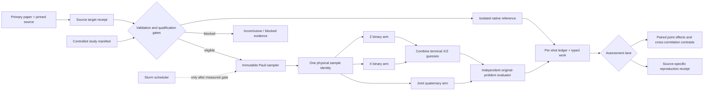

# Phase 11: Quaternary Reproduction and Comparisons - Research

**Researched:** 2026-10-14

**Domain:** Correlated Pauli code-capacity reproduction, matched decoder comparison, and paired statistical assessment

**Confidence:** HIGH for existing project contracts and the mathematical comparison design; MEDIUM for publication-source reconstruction; LOW where author code or paper metadata is incomplete

<user_constraints>
## User Constraints (from CONTEXT.md)

### Locked Decisions

### Publication targets and native reference
- **D-01:** Start with aSCED. Identify one exact reported paper result and reproduce its code, channel, decoder settings, stopping rule, denominator, and figure or table target. Assess ordinary and overcomplete aSCED separately when that result contains both; do not broaden the first target into an unspecified collection of curves.
- **D-02:** Use the pinned author repository to resolve canonical aSCED equations, construction, selection, and numerical details. Prioritize an independently qualified way to feed the *same injected Pauli errors* to native and canonical aSCED while preserving the author's algorithm. Record any input or instrumentation changes and maintain separate native and canonical identities. The existing Phase 10 native evidence is aggregate-only; it does not supply matched shots. If a faithful matched-input route is unavailable, record that gap rather than infer pairing.
- **D-03:** After the first aSCED target, qualify at least one reported result for each of Q-BPGD and MBP4 in Phase 11. Keep source gaps, failed assessments, and inconclusive assessments visible. The Phase 10 continued-message Q-BPGD and project-constructed aSCED runs remain canonical adaptations until source fidelity is established; apparent curve agreement alone cannot change their label.
- **D-04:** Apply the existing source-target receipt, manifest, uncertainty, and discrepancy rules to each selected result. Freeze target extraction, eligibility, tolerances, stopping, and resource bounds before assessment. Published settings and controlled-study settings remain distinct.

### Separate binary inference
- **D-05:** For the main controlled comparison, give the binary X and Z decoders the exact per-qubit marginals of the sampled joint channel: `q_X=P(X)+P(Y)` and `q_Z=P(Z)+P(Y)`. Neither binary decoder receives the within-qubit X/Z dependence. Persist the physical joint row and both derived priors so the inference difference is inspectable. — **Reversibility:** costly — changing the baseline beliefs would invalidate comparison identities and interpretation of saved paired results.
- **D-06:** Anchor the inference comparison with ordinary quaternary BP versus two ordinary canonical binary BP decoders. Add binary counterparts of named policies only when their semantics are independently qualified; do not claim every quaternary policy has a faithful binary port.
- **D-07:** Establish the matched comparison on the existing GB46 CSS artifact, then qualify a second CSS code before generalizing a finding beyond GB46. Keep code identity and observation mapping exact within every paired comparison.
- **D-08:** If one binary component does not satisfy its syndrome, combine all available terminal X/Z guesses and evaluate the resulting Pauli candidate against the immutable original problem. Keep each component's convergence, missing guess, and work separate from the pair's original-problem outcome; do not silently discard a partially nonconverged pair. — **Reversibility:** costly — terminal, denominator, and outcome semantics are stored in shot evidence.

### Correlation study
- **D-09:** Make the primary controlled channel sweep hold the X and Z marginals fixed while varying `P(Y)`, so the binary decoder priors remain unchanged. Record that the total non-identity rate `1-P(I)` can change across the sweep; never label the points as a fixed-`p` experiment.
- **D-10:** Include the independent X/Z channel as an anchor and valid channels with both less and more Y co-occurrence. Choose numerical points within the feasible four-probability bounds and prespecify them before running.
- **D-11:** Use one uniform I/X/Y/Z row across qubits in the primary sweep. A heterogeneous per-qubit check may be separately labeled if source qualification and measured resources support it; it is not part of the primary contrast.
- **D-12:** Make the prespecified lead analysis the *change in the paired logical-failure difference* between joint and separate inference as correlation changes. Report each arm's logical failure, convergence, denominator/uncertainty, work, and runtime separately. Do not presume the sign or size of the effect. — **Reversibility:** costly — changing the primary contrast after data collection would undermine the assessment plan.

### Policy ablations and fair work
- **D-13:** In the controlled policy study, change one mathematically compatible, source-qualified policy from ordinary quaternary BP at a time. Keep aSCED ordinary versus overcomplete construction as its own comparison. Unsupported combinations fail qualification; source-backed components alone do not make a new composition source-faithful.
- **D-14:** Run the policy ablations at three prespecified channel anchors: independence, one feasible lower-Y point, and one feasible higher-Y point at the same X/Z marginals. Avoid an unplanned all-policy-by-all-channel grid.
- **D-15:** Present two effort views: prespecified algorithmic work limits and measured runtime under the same declared hardware and time conditions. Retain typed work by algorithm and do not equate a four-state message update with a binary update without a qualified conversion. Include all attempted work, including decimation rounds and ensemble paths. — **Reversibility:** costly — budget definitions and work measures determine which results are comparable.
- **D-16:** After one-change ablations, compare complete, qualified BP4, Q-BPGD, MBP4, and aSCED configurations on matched samples at shared channel points and declared resources. Preserve their differing mechanisms and actual cost; keep this controlled comparison distinct from each paper's source-specific reproduction.

### the agent's Discretion
- Select the precise aSCED figure or table result, Q-BPGD and MBP4 targets, second CSS code, feasible channel probabilities, qualified policy swaps, numerical work definitions, sample sizes, uncertainty procedures, and campaign stopping rules from source evidence and measured resources. Prespecify these choices and retain inconclusive evidence.
- Determine whether the pinned native aSCED interface can accept externally supplied errors without altering algorithm semantics. The earlier approval covered a bounded isolated build/run; any materially changed native source or rights scope requires its own qualification. Do not treat the previous aggregate receipt as matched-shot evidence.
- Start with bounded profiling and replay checks. Phase 8's verified campaign infrastructure does not grant publication-scale HPC dispatch while site ceilings and scheduler accounting remain unmeasured.

### Deferred Ideas (OUT OF SCOPE)
- A heterogeneous per-qubit channel check is optional and separately labeled after the primary uniform study; it does not expand the primary design.
- Circuit-level decoding and curves remain in Phases 12–13. Optional postprocessing remains paused in Phase 7, and Phase 5 human review remains deferred.

### Reviewed Todos (not folded)
- `.planning/todos/pending/literature-policy-toml-provenance-and-cli.md` — already addressed as a Phase 9 starting contract; its keyword match does not create new Phase 11 work.
- `.planning/todos/pending/phase6-css-literature-vertical-slice.md` — the CSS literature gate was previously assigned and reviewed; it is not a quaternary target.
</user_constraints>

<phase_requirements>
## Phase Requirements

| ID | Description | Research Support |
|----|-------------|------------------|
| QEV-01 | “A researcher can execute selected quaternary source experiments and assess canonical reproduction within declared statistical tolerances, preserving reference availability and discrepancy records.” [VERIFIED: `.planning/REQUIREMENTS.md:140`] | The target ledger below fixes one aSCED Figure 2 slice, Q-BPGD Figure 7, and the MBP4 Figures 8–9 mechanism; the architecture reuses source receipts, immutable manifests, explicit fidelity states, and exact uncertainty. [VERIFIED: `.planning/REQUIREMENTS.md:140`; CITED: https://arxiv.org/html/2605.06547v2; CITED: https://arxiv.org/html/2312.10950v2; CITED: https://arxiv.org/html/2104.13659] |
| QEV-02 | “A researcher can compare joint quaternary and separate binary decoding on the same sampled joint Pauli channel and declared budgets, with source-backed policy ablations and provenance.” [VERIFIED: `.planning/REQUIREMENTS.md:141`] | The design below fixes sample identity, exact binary marginals, three dependence points, the paired effect, source-qualified ablations, typed work, and runtime conditions. [VERIFIED: `src/bp_registry/quaternary/sampling.py:1-7`; VERIFIED: `src/bp_registry/campaigns/statistics.py:601-690`] |
</phase_requirements>

## Summary

Plan Phase 11 as two evidence lanes with separate identities: source-specific reproduction and controlled matched comparisons. The source lane should begin with the GB46 portion of aSCED Figure 2, then qualify Q-BPGD Figure 7 on the A5 `[[180,10,15≤d≤18]]` code and the deterministic MBP4 Figures 8–9 five-qubit mechanism. [CITED: https://arxiv.org/html/2605.06547v2; CITED: https://arxiv.org/html/2312.10950v2; CITED: https://arxiv.org/html/2104.13659] Curve agreement must not upgrade the Phase 10 Q-BPGD or project-constructed aSCED implementations beyond `canonical_adaptation` until the listed source gaps are closed. [VERIFIED: `src/bp_registry/quaternary/qbpgd.py:1-6`; VERIFIED: `data/native/phase10-asced-source-spec.json:43-53`]

The controlled lane should compare ordinary BP4 with two ordinary binary BP decoders on identical Pauli samples, first on GB46 and then on the existing BB72 artifact. Fix `q_X=q_Z=1/30` and use the three shared rows in the Correlation Design section; these rows change `P(Y)` while leaving the binary priors fixed. [VERIFIED: exact rational arithmetic probe, 2026-10-14] The lead estimand is the change, relative to independence, in `D_y = P(failure_joint)-P(failure_separate)`. Add a cross-point assessment contract because the current paired table deliberately accepts only one campaign/cohort/point. [VERIFIED: `src/bp_registry/campaigns/statistics.py:624-642`]

The pinned native aSCED binding cannot currently accept an externally supplied Pauli error: the simulation path samples internally and the binding exposes aggregate operations. [CITED: https://github.com/kit-cel/quantum_asced/blob/816772071486615dfc7d71d1e15df597edc58a26/src/Simulation_Env.cpp; CITED: https://github.com/kit-cel/quantum_asced/blob/816772071486615dfc7d71d1e15df597edc58a26/src/Pybind11_Module.cpp] A minimal injected-error entry point is technically identifiable, but it changes native source and therefore requires a new rights/source qualification and a separately identified instrumented-native build before it can generate paired evidence. [VERIFIED: `data/native/phase10-asced-source-spec.json:73-78`] Publication-scale scheduler dispatch remains denied until measured site ceilings and accounting are frozen. [VERIFIED: `.planning/phases/08-reproducible-campaigns-and-statistical-assessment/08-VERIFICATION.md`]

**Primary recommendation:** Build the Pauli campaign and cross-correlation assessment contracts first, freeze all source targets and the three point design, pass bounded replay/profiling gates, and only then execute eligible source assessments or controlled campaigns. [ASSUMED]

## Architectural Responsibility Map

| Capability | Primary Tier | Secondary Tier | Rationale |
|------------|-------------|----------------|-----------|
| Source target qualification | API / Backend | Database / Storage | The campaign layer validates frozen target receipts; storage preserves the paper, figure, extraction, digest, and discrepancy evidence. [VERIFIED: `src/bp_registry/campaigns/targets.py`; VERIFIED: `src/bp_registry/campaigns/contracts.py`] |
| Physical Pauli sampling and sample identity | API / Backend | Database / Storage | One deterministic sampler creates the immutable error; ledgers persist the exact `I,X,Y,Z` row and sample identity used by all arms. [VERIFIED: `src/bp_registry/quaternary/sampling.py:1-7,79-90,169-180`] |
| Joint and separate inference | API / Backend | — | Canonical decoder engines receive observations and declared priors; they do not own sampling or truth evaluation. [VERIFIED: `AGENTS.md:59-64`] |
| Original-problem evaluation | API / Backend | Database / Storage | An independent evaluator combines terminal guesses and judges logical outcome against immutable truth while storage retains component statuses. [VERIFIED: `AGENTS.md:59-64`; VERIFIED: `.planning/phases/11-quaternary-reproduction-and-comparisons/11-CONTEXT.md:22-26`] |
| Paired and cross-correlation statistics | API / Backend | Database / Storage | Assessment code joins by full sample identity and emits immutable count/interval receipts. [VERIFIED: `src/bp_registry/campaigns/statistics.py:601-690`] |
| Native aSCED execution | External service boundary | API / Backend | The pinned C++ build is an isolated reference; a Python adapter may validate inputs and receipts without merging native identity into the canonical engine. [VERIFIED: `data/native/phase10-asced-source-spec.json:61-78`] |
| Production scheduling | External service boundary | API / Backend | Slurm launches are a separate gated action after resource ceilings and accounting are measured; campaign manifests remain scheduler independent. [VERIFIED: `.planning/phases/08-reproducible-campaigns-and-statistical-assessment/08-VERIFICATION.md`] |

## Project Constraints (from AGENTS.md)

- Use one canonical execution engine for each mathematically compatible BP family; native decoders are executable references rather than substitute engines. [VERIFIED: `AGENTS.md:13-21,59-64`]
- Prioritize BP-internal policies and named BP modifications; CSS precedes correlated quaternary, which precedes circuit-level decoding. [VERIFIED: `AGENTS.md:13-21`]
- Preserve source-faithful reproduction and controlled comparison as distinct experiment identities, and emit manifests plus per-shot/control-flow provenance. [VERIFIED: `AGENTS.md:13-21,59-64`]
- Keep original problems immutable, prevent policies from seeing hidden simulation truth, and use independent evaluation. [VERIFIED: `AGENTS.md:59-64`]
- Cite primary sources for algorithms, record interpretive decisions and unresolved details, prespecify tolerance/budget/stopping/denominator rules, and retain failed or inconclusive evidence. [VERIFIED: `AGENTS.md:43-49`]
- Begin with inspectable Python plus NumPy/SciPy; keep native decoder environments separate and compile only after profiling while preserving the behavioral contract. [VERIFIED: `AGENTS.md:31-35`]
- This research artifact is being written through the active GSD phase workflow, as required before file-changing work. [VERIFIED: `AGENTS.md:79-87`]

## Standard Stack

### Core

The project declares the exact values `requires-python = ">=3.12"` and `dependencies = ["numpy==2.2.6", "scipy==1.17.1", "ldpc==2.4.1", "pydantic==2.13.5"]`. [VERIFIED: `pyproject.toml:5-10`]

| Library / component | Version | Purpose | Why standard here |
|---------------------|---------|---------|-------------------|
| Python | `>=3.12` | Campaign, canonical decoder, evidence, and analysis runtime | Already the declared project runtime; retain one strict implementation path. [VERIFIED: `pyproject.toml:5-10`] |
| NumPy | `2.2.6` | Pauli rows, samples, matrices, and deterministic numerical arrays | Already pinned and used by the canonical quaternary sampler. [VERIFIED: `pyproject.toml:10`; VERIFIED: `src/bp_registry/quaternary/sampling.py:20-23`] |
| SciPy | `1.17.1` | Exact binomial and McNemar component calculations | Already pinned and used in the campaign statistics implementation. [VERIFIED: `pyproject.toml:10`; VERIFIED: `src/bp_registry/campaigns/statistics.py:665-687`] |
| Pydantic | `2.13.5` | Strict campaign, target, and assessment contracts | Already pinned and used for bounded statistical designs. [VERIFIED: `pyproject.toml:10`; VERIFIED: `src/bp_registry/campaigns/sizing.py:21-65`] |
| Existing canonical quaternary engine | repository source | BP4, Q-BPGD, MBP4, aSCED and evidence | Phase 10 verified the engine boundary; Phase 11 should extend campaigns and assessments rather than add a second engine. [VERIFIED: `.planning/phases/10-correlated-quaternary-execution/10-VERIFICATION.md`] |

### Supporting

| Component | Version / identity | Purpose | When to use |
|-----------|--------------------|---------|-------------|
| pytest | `9.0.3` in `.venv` | Contract, replay, statistics, and bounded integration tests | Every task commit and phase gate. [VERIFIED: environment probe, 2026-10-14] |
| Pinned quantum aSCED source | commit `816772071486615dfc7d71d1e15df597edc58a26` | Native reference and source semantics | Isolated qualification only; keep canonical and native identities separate. [VERIFIED: `data/native/phase10-asced-source-spec.json:7-23`] |
| Slurm CLI | site commands present | Eventual bounded scheduler execution | Do not dispatch until the resource gate is satisfied. [VERIFIED: environment probe, 2026-10-14; VERIFIED: `.planning/phases/08-reproducible-campaigns-and-statistical-assessment/08-VERIFICATION.md`] |

### Alternatives Considered

| Instead of | Could Use | Tradeoff |
|------------|-----------|----------|
| Existing exact paired methods | A new bootstrap dependency | Adds a new stochastic inference surface and is unnecessary for bounded outcomes; extend the exact discordant-cell construction to the two point difference. [ASSUMED] |
| BB72 as second code | Import another new CSS family | A new artifact adds source, matrix, logical-basis, and validation work before the comparison can start. [ASSUMED] |
| Separate instrumented-native identity | Patch the native checkout in place | In-place patching would erase the distinction between the pinned author implementation and the injected-input derivative. [ASSUMED] |

**Installation:** No new package installation is needed for the recommended Phase 11 plan. [VERIFIED: `pyproject.toml:5-23`; ASSUMED]

## Package Legitimacy Audit

No external package is proposed. Reuse the pinned project environment and the already qualified isolated native inputs. If implementation introduces another dependency, the planner must add the ecosystem registry check, official-source confirmation, legitimacy seam, and Node postinstall check when applicable before installation. [VERIFIED: `pyproject.toml:5-23`; ASSUMED]

## Source Target Ledger

### Target 1: aSCED Figure 2, GB46

Use the GB46 panel of Figure 2 as the first exact paper target. The paper specifies the `[[46,2,9]]` generalized bicycle code under a depolarizing channel, BP4 maximum iterations `25`, OBP4 maximum iterations `12`, OBP4 initialization `p0=0.3` for GB46, splitter weight `4`, and a stopping rule of at least `400` logical errors or `10^6` trials. [CITED: https://arxiv.org/html/2605.06547v2]

Freeze two separate comparisons from that panel before execution: ordinary `BP4 baseline` versus `BP4-aSCED K=16, Δ=2, L=4`, and overcomplete `OBP4 baseline` versus `OBP4-aSCED K=16, Δ=2, L=4`. The Figure 2 legend reports the configurations `K=4 Δ2 L1`, `K=16 Δ4 L1`, `K=16 Δ2 L4`, and `K=64 Δ2 L16`; selecting one ordinary and one overcomplete `K=16 Δ2 L4` comparison keeps D-01 bounded while exercising both constructions. [CITED: https://arxiv.org/pdf/2605.06547v2]

Before any run, create a target receipt that records the panel, legend label, digitization method, every selected plotted channel point, axis transforms, eligibility rule, curve uncertainty convention, and acceptance tolerance. The inspected paper text does not provide a machine-readable table of the plotted GB46 coordinates, so the exact point list remains unresolved until digitization. [CITED: https://arxiv.org/html/2605.06547v2; ASSUMED]

The author demo is useful only as a source guide: it selects GB46, four batches, ensemble size `16`, `Δ=2`, splitter weight `4`, BP4 iterations `25`, and eight channel points from `.03` through `.10`; it does not establish that its grid and stopping behavior exactly reproduce the chosen Figure 2 curves. [CITED: https://github.com/kit-cel/quantum_asced/blob/816772071486615dfc7d71d1e15df597edc58a26/Examples/demo_asced.py]

### Target 2: Q-BPGD Figure 7, A5

Use Figure 7 on the A5 hypergraph-product code. The paper identifies A5 as `[[180,10,15≤d≤18]]`, uses depolarizing noise, gives Q-BPGD `T=10` BP iterations per decimation round, compares ordinary Q-BP with `T=100`, and reports simulation until `100` error cases. [CITED: https://arxiv.org/html/2312.10950v2]

The source algorithm permits up to `n` decimation rounds, returns early when the syndrome is satisfied, and fixes a selected qubit with the probability vector `(1-ε, ε, ε, ε)` using `ε=10^-10`. [CITED: https://arxiv.org/html/2312.10950v2] Freeze selection/tie behavior, message lifecycle across rounds, normalization, terminal outcome, and all-round work before claiming source fidelity; the current implementation explicitly records these issues as unsettled and labels the run `canonical_adaptation`. [VERIFIED: `src/bp_registry/quaternary/qbpgd.py:1-6,137-225`]

Reconstruct A5 from the official source definition with circulant size `ℓ=90`, `a(x)=1+x^28+x^80+x^89`, and `b(x)=1+x^2+x^21+x^25`; bind the reconstructed matrix digest into the target receipt. [CITED: https://arxiv.org/src/1904.02703v3] No authoritative Q-BPGD author-code identity was established during this research, so the planner must treat author-code equivalence as unresolved rather than assert that no code exists. [ASSUMED]

### Target 3: MBP4 Figures 8–9 mechanism

Use the deterministic Figures 8–9 mechanism on the `[[5,1,3]]` code as the bounded Phase 11 MBP4 result: the paper provides the check matrix, the error `IIIYI`, channel parameter `ε=0.003`, parallel schedule, `β=0`, and contrasts oscillation at `α=1` with correct convergence at `α=1.5`. [CITED: https://arxiv.org/html/2104.13659]

This target is preferable to treating Figure 6 as the first statistical reproduction because the Figure 6 text gives the five-qubit code and approximately `α=1.5`, `β=0`, but the inspected text does not state an exact iteration cap, denominator, or stopping rule for the curve. [CITED: https://arxiv.org/html/2104.13659] Record Figure 6 as `blocked_metadata` or an equivalent explicit inconclusive status until those items are resolved. [ASSUMED]

The current project supports the fixed-inhibition MBP4 recurrence and a parallel schedule; AMBP and other later-paper search procedures must not be inferred from that support. [VERIFIED: `src/bp_registry/quaternary/mbp4.py:1-7,27-47`; CITED: https://arxiv.org/html/2104.13659] No authoritative MBP4 author-code identity was established during this research, so code-equivalence claims remain unresolved. [ASSUMED]

### Fidelity state machine

Use the exact ordered states `mapped_only`, `canonical_adaptation`, `source_qualified`, `assessed_pass`, `assessed_fail`, `inconclusive`, and `blocked_metadata` only if implementation defines and validates them verbatim; otherwise reuse the repository's existing exact enum values. [ASSUMED] The planner must not invent new discrete values from this paragraph without first opening the relevant source-of-truth type. [ASSUMED]

Promotion requires source equation/construction equivalence, full configuration identity, source target receipt, stopping/denominator identity, and a discrepancy review; numerical agreement by itself is insufficient. [VERIFIED: `AGENTS.md:43-49,59-64`]

## Native aSCED Matched-Input Feasibility

The pinned native evidence declares the exact Pauli translation `"canonical": ["I", "X", "Y", "Z"]`, `"native": ["I", "X", "Z", "Y"]`, and the unavailable instrumentation values `"shot_error_injection", "random_seed", "per_shot_identity", "per_path_counters", "native_edge_updates", "native_control_flow_events"`. [VERIFIED: `data/native/phase10-asced-source-spec.json:43-53`]

At the pinned commit, `Simulation_Env::simulate_trial` samples through the channel before syndrome calculation, decoding, and evaluation, while the public pybind module exposes initialization/settings and aggregate error-rate operations without an injected-error method. [CITED: https://github.com/kit-cel/quantum_asced/blob/816772071486615dfc7d71d1e15df597edc58a26/src/Simulation_Env.cpp; CITED: https://github.com/kit-cel/quantum_asced/blob/816772071486615dfc7d71d1e15df597edc58a26/src/Pybind11_Module.cpp] Therefore the current binding cannot produce a native/canonical same-error pair. [CITED: https://github.com/kit-cel/quantum_asced/tree/816772071486615dfc7d71d1e15df597edc58a26]

Plan a gated feasibility task, not an assumed implementation: propose a narrow method that accepts one validated native-order Pauli vector, bypasses only `channel.simulate_error`, then reuses the unchanged syndrome/decode/evaluate path. [ASSUMED] The task must record a source diff, before/after algorithm-file digests, translation round trips, injected vector digest, native build identity, and whether the authors or rights holder approve the changed scope. [ASSUMED] Name the derivative `instrumented_native` only after defining that literal in a source-of-truth enum; do not reuse the pinned `native` identity. [ASSUMED]

The earlier build authorization was restricted to an out-of-tree driver and explicitly listed `"forbidden_changes": ["algorithm source", "Pauli semantics", "candidate selection", "channel code"]`, with bounds `"workers": 1`, `"max_trials": 10000`, and `"target_errors": 10`. [VERIFIED: `data/native/phase10-asced-source-spec.json:73-78`] A Phase 11 source patch is outside that scope and needs a new qualification checkpoint. [VERIFIED: `data/native/phase10-asced-source-spec.json:73-78`; VERIFIED: `.planning/phases/11-quaternary-reproduction-and-comparisons/11-CONTEXT.md:40-43`]

The native constructor also uses randomized splitter selection without a public seed in the inspected binding, and native candidate filtering differs from the paper's original-syndrome-valid rule. [CITED: https://github.com/kit-cel/quantum_asced/blob/816772071486615dfc7d71d1e15df597edc58a26/src/Graph_Optimization.cpp; VERIFIED: `data/native/phase10-asced-source-spec.json:47-52`] These are fidelity discrepancies to resolve or retain, not knobs to normalize away. [ASSUMED]

## Controlled Comparison Design

### Second CSS code: BB72

Use the existing BB72 artifact after GB46. Its source-of-truth provenance quotes `"path": "data/artifacts/bb72-css.json"`, shapes `"hx": [36, 72]`, `"hz": [36, 72]`, `"lx": [12, 72]`, `"lz": [12, 72]`, `"code_id": "bravyi-bb-72"`, and distance fields `"independently_verified": false`, `"status": "source_reported"`, `"value": 6`. [VERIFIED: `data/artifacts/bb72-css.provenance.json:13-40`]

The same receipt records GF(2) ranks `30` and `30`, `k_gf2=12`, and labels the logical provider `"status": "project_derived"` with `"source_logical_equivalence": "not_assessed"`. [VERIFIED: `data/artifacts/bb72-css.provenance.json:43-53`] This makes BB72 an efficient second-family comparison artifact, but Phase 11 must retain the unverified-distance and project-derived-logical qualifications in every manifest. [ASSUMED]

### Fixed-marginal correlation sweep

For a shared row in `I,X,Y,Z` order with fixed marginals `q_X` and `q_Z`, parameterize by `y=P(Y)`:

\[
P(X)=q_X-y,\qquad P(Z)=q_Z-y,\qquad P(I)=1-q_X-q_Z+y.
\]

Feasibility is `max(0,q_X+q_Z-1) ≤ y ≤ min(q_X,q_Z)`, and X/Z independence occurs at `y=q_X q_Z`. [VERIFIED: algebraic derivation from nonnegative four-state probabilities, checked by exact rational arithmetic probe, 2026-10-14]

Freeze `q_X=q_Z=1/30` and these three primary points:

| Point ID | `P(I), P(X), P(Y), P(Z)` | `P(Y)` relationship | `1-P(I)` | Covariance `P(Y)-q_Xq_Z` |
|----------|---------------------------|---------------------|----------|----------------------------|
| `lower_y` | `(1681/1800, 59/1800, 1/1800, 59/1800)` | below independence | `119/1800` | `-1/1800` [VERIFIED: exact rational arithmetic probe, 2026-10-14] |
| `independent_xz` | `(841/900, 29/900, 1/900, 29/900)` | independence | `59/900` | `0` [VERIFIED: exact rational arithmetic probe, 2026-10-14] |
| `higher_y` | `(19/20, 1/60, 1/60, 1/60)` | above independence; depolarizing `p=1/20` | `1/20` | `7/450` [VERIFIED: exact rational arithmetic probe, 2026-10-14] |

All three rows sum to one and give `q_X=q_Z=1/30`; their nonidentity rates differ, so label the axis by `P(Y)` or X/Z covariance and never as fixed physical `p`. [VERIFIED: exact rational arithmetic probe, 2026-10-14] The positive lower-Y point avoids introducing an exact zero prior as an additional decoder-smoothing factor. [ASSUMED]

The sampler's source-of-truth quotes `PAULI_ORDER = "I,X,Y,Z"`, accepts only shared shape `(4,)` or per-qubit shape `(n, 4)`, and returns exact kind literals `"explicit_shared"` and `"explicit_per_qubit"`. [VERIFIED: `src/bp_registry/quaternary/sampling.py:26,51-76`] Its marginal methods implement `P(X)+P(Y)` and `P(Y)+P(Z)`, and its evidence includes identity, order, raw declaration, resolved probabilities, nonidentity rates, and scalar `p`. [VERIFIED: `src/bp_registry/quaternary/sampling.py:152-180`]

### Same-sample arm boundary

Generate one physical Pauli vector and immutable sample identity per `(campaign, cohort, code, channel point, sample index)`, then route that exact vector to both arms. [ASSUMED] Derive binary syndromes from the same vector, pass `q_X` only to the X component and `q_Z` only to the Z component, and never pass `P(Y)` or covariance to either component. [VERIFIED: `.planning/phases/11-quaternary-reproduction-and-comparisons/11-CONTEXT.md:22-32`]

Persist, for every pair, the physical row and identity; injected Pauli digest; derived X and Z bits/syndromes; both marginal priors; joint-arm terminal candidate/status/work; each binary component candidate/status/work; combined Pauli candidate; and independent original-problem outcome. [ASSUMED] If one binary component is nonconverged but has a terminal guess, combine it with the other guess and evaluate it; if a component truly emits no guess, record that absence and apply the prespecified all-shot failure mapping without dropping the pair. [VERIFIED: `.planning/phases/11-quaternary-reproduction-and-comparisons/11-CONTEXT.md:22-26`]

### Policy ablation matrix

Use ordinary quaternary BP as the anchor and change only one source-qualified behavior per ablation. [VERIFIED: `.planning/phases/11-quaternary-reproduction-and-comparisons/11-CONTEXT.md:34-38`] Run the frozen ablations at exactly `lower_y`, `independent_xz`, and `higher_y`; complete-method BP4, Q-BPGD, MBP4, and aSCED comparisons form a later, separately labeled matrix. [VERIFIED: `.planning/phases/11-quaternary-reproduction-and-comparisons/11-CONTEXT.md:34-38`]

Recommended initial one-change candidates are the MBP4 fixed-inhibition recurrence versus ordinary BP4 and the aSCED ensemble layer versus its matching ordinary or overcomplete base. [CITED: https://arxiv.org/html/2104.13659; CITED: https://arxiv.org/html/2605.06547v2] Treat Q-BPGD as a complete mechanism rather than a one-line policy swap because decimation rounds change priors, state, stopping, and total work. [CITED: https://arxiv.org/html/2312.10950v2] Do not create binary versions of these named mechanisms during this phase unless separate sources qualify their binary semantics. [VERIFIED: `.planning/phases/11-quaternary-reproduction-and-comparisons/11-CONTEXT.md:22-25`]

## Statistical and Resource Design

### Estimands and denominators

For controlled comparisons use a fixed number of complete physical sample identities per point. Define the paired shot value `d_i = F_joint,i - F_separate,i`, where each failure indicator is determined by the frozen all-shot outcome matrix, and define `D_y = mean(d_i)` at each channel point. [ASSUMED] The prespecified lead contrasts are `Δ_lower = D_lower_y-D_independent_xz` and `Δ_higher = D_higher_y-D_independent_xz`; report both with simultaneous intervals without presuming sign. [ASSUMED]

Decoder nonconvergence remains an observed terminal decoder result under the frozen all-shot mapping; infrastructure interruption is incomplete evidence and cannot be converted into a decoder failure or silently dropped. [VERIFIED: `src/bp_registry/campaigns/statistics.py:587-598`] A comparison is available only when both arms exist for every included sample identity. [VERIFIED: `src/bp_registry/campaigns/statistics.py:624-642`]

For source curve reproduction, follow each paper's source-specific stopping and denominator rules rather than the controlled fixed-pair denominator. [CITED: https://arxiv.org/html/2605.06547v2; CITED: https://arxiv.org/html/2312.10950v2] Use the existing exact inverse-binomial/binomial assessment machinery where its assumptions match the frozen source stopping rule; otherwise record a method gap before execution. [VERIFIED: `src/bp_registry/campaigns/statistics.py`]

### Exact paired uncertainty

The current one-point paired table reports the exact literal methods `"simultaneous_exact_discordant_cells_v1"` and `"exact_conditional_mcnemar_v1"`. [VERIFIED: `src/bp_registry/campaigns/statistics.py:569-583,675-687`] It estimates `D_y` from the two discordant cell rates and constructs a conservative interval by subtracting simultaneous exact binomial intervals. [VERIFIED: `src/bp_registry/campaigns/statistics.py:643-674`]

Extend that construction for each lead change. If `p10_y=P(joint fails, separate succeeds)` and `p01_y=P(joint succeeds, separate fails)`, then

\[
\Delta_y=(p10_y-p01_y)-(p10_0-p01_0).
\]

Given simultaneous exact bounds `L` and `U` for all four terms, use

\[
[L10_y-U01_y-U10_0+L01_0,\quad U10_y-L01_y-L10_0+U01_0].
\]

This interval follows by interval arithmetic; allocate the familywise alpha across both frozen lead contrasts and all constituent cell intervals in the contract before observing outcomes. [ASSUMED] Keep the existing within-point exact McNemar results as secondary evidence and apply the existing Holm family implementation only to a predeclared family of pointwise hypotheses. [VERIFIED: `src/bp_registry/campaigns/statistics.py:675-797`]

Add a versioned cross-point design and result contract rather than passing multiple points to `paired_outcome_table`, because that function explicitly requires one identical campaign, cohort, and point. [VERIFIED: `src/bp_registry/campaigns/statistics.py:624-642`] The new contract should bind point order, reference point, contrast definitions, arm order, failure mapping, alpha allocation, count-receipt digests, and unavailable/inconclusive behavior. [ASSUMED]

### Sample sizing

The existing sizing contract quotes `estimand: Literal["paired_all_shot_risk_difference_v1"]`, limits `max_pairs` to `5_000`, requires distinct calibration/evaluation identities, and emits exact status literals `"powered"` or `"blocked_precision"`. [VERIFIED: `src/bp_registry/campaigns/sizing.py:21-70`] It does not size the cross-point lead contrasts. [VERIFIED: `src/bp_registry/campaigns/sizing.py:21-65`]

Run a small, disjoint calibration cohort at all three points, freeze a minimum relevant change and conservative discordant-cell assumptions, then compute or bound the fixed evaluation `N` under the new contrast design. [ASSUMED] If the required `N` exceeds the declared pair/resource cap, emit `blocked_precision` or `inconclusive` and do not enlarge the campaign after seeing evaluation outcomes. [ASSUMED]

### Work and runtime

Prespecify typed work rather than one synthetic unit:

| Method | Required algorithmic work fields |
|--------|----------------------------------|
| BP4 | quaternary check-to-variable updates, variable-to-check updates, full sweeps, original-syndrome checks, iterations attempted. [ASSUMED] |
| Separate binary BP | the same categories for X and Z separately, plus combined-candidate evaluations; never sum them into “equivalent BP4 updates.” [ASSUMED] |
| Q-BPGD | all BP message updates plus ranking scans, fixation events, decimation rounds, syndrome checks, and terminal evaluation. [CITED: https://arxiv.org/html/2312.10950v2] |
| MBP4 | four-state message updates, sweeps, inhibition applications, syndrome checks, and terminal evaluation. [CITED: https://arxiv.org/html/2104.13659] |
| aSCED | base and every ensemble path's attempted updates, construction/optimization work, selection work, validations, and terminal evaluation. [CITED: https://arxiv.org/html/2605.06547v2] |

Report runtime as a separate descriptive view under one declared node/CPU model, affinity, process/thread count, warmup rule, timing boundary, repetitions, and software/build identity. [ASSUMED] Compare wall time and typed work side by side; do not derive a conversion between binary and four-state updates without a separately qualified study. [VERIFIED: `.planning/phases/11-quaternary-reproduction-and-comparisons/11-CONTEXT.md:34-38`]

### Resource gates

Use a staged gate: deterministic unit/replay tests; one-shot integration; bounded calibration; measured local profile; scheduler dry-run/accounting qualification; frozen production manifest; authorized production dispatch. [ASSUMED] The presence of `/usr/bin/sbatch`, `/usr/bin/sacct`, and `/usr/bin/scontrol` confirms client availability only; it does not establish queue limits, allocation, accounting semantics, or permission to dispatch. [VERIFIED: environment probe, 2026-10-14; VERIFIED: `.planning/phases/08-reproducible-campaigns-and-statistical-assessment/08-VERIFICATION.md`]

## Architecture Patterns

### System Architecture Diagram



The decision nodes preserve unavailable and inconclusive evidence instead of manufacturing an assessment or dispatch. [ASSUMED]

### Recommended Project Structure

```text
src/bp_registry/
├── campaigns/                 # Extend versioned Pauli campaign, sizing, and cross-point assessment contracts
├── quaternary/                # Reuse sampler, engines, policies, evaluator, native adapter
└── study_cli.py               # Public plan/run/replay/assess entry points
data/
├── artifacts/                 # GB46, BB72, and qualified A5 matrix plus provenance
├── manifests/                 # Separate source reproduction and controlled comparison manifests
├── native/                    # Pinned and, if approved, separately identified instrumented-native receipts
├── source-targets/            # Figure/table extraction and discrepancy receipts
└── results/phase11-*/         # Immutable ledgers, profiles, counts, and assessments
tests/
├── canonical/quaternary/      # Engine and matched-input semantics
└── test_phase11_*.py          # Campaign, statistics, qualification, replay, and resource gates
```

These are recommended ownership boundaries; the planner should use existing module names where an established contract already exists. [ASSUMED]

### Pattern 1: Sample once, infer twice, evaluate independently

**What:** Sampling owns the physical error. Each decoder arm receives only its declared observation/prior boundary, and an evaluator outside both arms judges candidates against the immutable original problem. [VERIFIED: `AGENTS.md:59-64`; VERIFIED: `src/bp_registry/quaternary/sampling.py:1-7`]

**When to use:** Every QEV-02 pair, including partially nonconverged binary components. [VERIFIED: `.planning/REQUIREMENTS.md:141`; VERIFIED: `.planning/phases/11-quaternary-reproduction-and-comparisons/11-CONTEXT.md:22-26`]

### Pattern 2: Evidence identity before compute

**What:** Canonical JSON plus content digests bind target, source, artifact, channel, sample, arms, budgets, stopping, outcome mapping, and analysis before execution. [VERIFIED: `src/bp_registry/campaigns/contracts.py`; VERIFIED: `src/bp_registry/campaigns/targets.py`]

**When to use:** All source reproductions, controlled comparisons, calibration cohorts, resumes, merges, and assessments. [VERIFIED: `.planning/phases/08-reproducible-campaigns-and-statistical-assessment/08-VERIFICATION.md`]

### Pattern 3: Separate source and controlled lanes

**What:** A source lane matches paper settings and stopping; a controlled lane fixes samples, marginals, budgets, and hardware conditions for comparison. [VERIFIED: `AGENTS.md:13-21,59-64`]

**When to use:** The same decoder may appear in both lanes, but each occurrence needs a different manifest and claim scope. [VERIFIED: `.planning/phases/11-quaternary-reproduction-and-comparisons/11-CONTEXT.md:16-20,34-38`]

### Anti-Patterns to Avoid

- **Re-sampling for the binary arm:** destroys the paired estimand and confounds inference with physical noise. [VERIFIED: `.planning/REQUIREMENTS.md:141`]
- **Treating `1-P(I)` as fixed:** it changes across the selected fixed-marginal sweep. [VERIFIED: exact rational arithmetic probe, 2026-10-14]
- **Dropping nonconverged binary components:** changes the denominator and hides the combined terminal candidate. [VERIFIED: `.planning/phases/11-quaternary-reproduction-and-comparisons/11-CONTEXT.md:26`]
- **Upgrading fidelity from curve resemblance:** source semantics and discrepancies must be qualified independently. [VERIFIED: `AGENTS.md:43-49,59-64`]
- **Using native aggregate counts as paired shots:** Phase 10 exposes neither injected errors nor per-shot identities. [VERIFIED: `data/native/phase10-asced-source-spec.json:50-53`]
- **Equating update counts across alphabets:** binary and four-state messages have different operations and memory traffic. [VERIFIED: `.planning/phases/11-quaternary-reproduction-and-comparisons/11-CONTEXT.md:37`]
- **Launching a large grid:** D-14 limits ablations to three anchors, and resource ceilings remain unmeasured. [VERIFIED: `.planning/phases/11-quaternary-reproduction-and-comparisons/11-CONTEXT.md:36-37`; VERIFIED: `.planning/phases/08-reproducible-campaigns-and-statistical-assessment/08-VERIFICATION.md`]

## Don't Hand-Roll

| Problem | Don't Build | Use Instead | Why |
|---------|-------------|-------------|-----|
| Joint Pauli sampling | Two independent Bernoulli samplers | Existing `JointPauliChannel` and one Pauli vector | Independent sampling would force one dependence structure and lose physical Y identity. [VERIFIED: `src/bp_registry/quaternary/sampling.py:1-7,93-141`] |
| Paired join | Row-order matching | Existing full sample-identity join | The existing table rejects duplicate, partial, or cross-point pairs. [VERIFIED: `src/bp_registry/campaigns/statistics.py:624-642`] |
| Pointwise paired interval/test | Normal approximation | Existing exact discordant-cell interval and exact conditional McNemar | These methods already encode the repository's all-shot mapping and finite-count evidence. [VERIFIED: `src/bp_registry/campaigns/statistics.py:643-690`] |
| Multiplicity | Ad hoc selected p-values | Existing Holm family contract for frozen pointwise hypotheses | It retains unavailable members and freezes family size. [VERIFIED: `src/bp_registry/campaigns/statistics.py:693-797`] |
| Source artifact identity | Filename trust | Existing digested artifact/source-target receipts | Content-addressed evidence detects substitution and replay mismatch. [VERIFIED: `data/artifacts/bb72-css.provenance.json:1-15`; VERIFIED: `src/bp_registry/campaigns/targets.py`] |
| Native algorithm rewrite | Python approximation labeled native | Pinned author code, or a separately qualified minimal instrumented derivative | Algorithm/source identity is part of the scientific claim. [VERIFIED: `data/native/phase10-asced-source-spec.json:7-23,73-78`] |
| Scheduler orchestration | Raw shell strings | Existing bounded campaign plan plus an approved scheduler adapter | Raw strings increase command-injection and accounting risk and bypass evidence gates. [ASSUMED] |

**Key insight:** Phase 11 needs new composition contracts around trusted kernels: Pauli campaign transport, cross-point paired assessment, and qualification gates. Rewriting samplers, exact pointwise statistics, decoder engines, or provenance would multiply semantic surfaces without advancing QEV-01 or QEV-02. [ASSUMED]

## Common Pitfalls

### Pitfall 1: Calling the aSCED demo the Figure 2 reproduction

**What goes wrong:** The demo's code/configuration resembles one plotted setup, so its output is mislabeled as the selected publication result. [CITED: https://github.com/kit-cel/quantum_asced/blob/816772071486615dfc7d71d1e15df597edc58a26/Examples/demo_asced.py]

**Why it happens:** The paper figure does not expose machine-readable coordinates and the demo supplies a convenient eight-point grid. [CITED: https://arxiv.org/html/2605.06547v2]

**How to avoid:** Freeze a Figure 2 target receipt and digitized points independently, then treat the demo as configuration evidence only. [ASSUMED]

**Warning signs:** Missing panel/curve identity, missing extraction uncertainty, or a manifest whose point list is justified only by the demo. [ASSUMED]

### Pitfall 2: Claiming native/canonical pairing from aggregate counts

**What goes wrong:** Two runs at the same scalar channel rate are described as matched even though they did not receive the same errors. [VERIFIED: `data/native/phase10-asced-source-spec.json:47-53`]

**Why it happens:** The Phase 10 run receipt proves bounded native execution but exposes no injected error or per-shot identity. [VERIFIED: `.planning/phases/10-correlated-quaternary-execution/10-15-SUMMARY.md`]

**How to avoid:** Require a qualified injected-input binding and persisted vector digest, or mark native matched input unavailable. [ASSUMED]

**Warning signs:** A paired table sourced from aggregate error counts or a native receipt without a physical sample digest. [ASSUMED]

### Pitfall 3: Holding binary priors fixed but describing fixed physical error rate

**What goes wrong:** A correlation effect is interpreted as a fixed-`p` result even though `1-P(I)` varies. [VERIFIED: exact rational arithmetic probe, 2026-10-14]

**Why it happens:** `q_X`, `q_Z`, and total nonidentity probability are different channel summaries. [VERIFIED: `src/bp_registry/quaternary/sampling.py:147-163`]

**How to avoid:** Store all four probabilities, both marginals, covariance, and nonidentity rate; name the sweep by `P(Y)` or covariance. [ASSUMED]

**Warning signs:** A plot x-axis labeled only `p` or manifests containing marginals without the physical row. [ASSUMED]

### Pitfall 4: Allowing the separate arm to inspect dependence

**What goes wrong:** The binary decoders receive `P(Y)`, covariance, or conditional priors and cease to be the locked separate-inference baseline. [VERIFIED: `.planning/phases/11-quaternary-reproduction-and-comparisons/11-CONTEXT.md:22-24`]

**Why it happens:** The channel object contains more information than each binary component is permitted to consume. [VERIFIED: `src/bp_registry/quaternary/sampling.py:93-180`]

**How to avoid:** Materialize narrow X and Z input records containing only their syndrome, matching code matrix, `q_X` or `q_Z`, and declared ordinary-BP settings. [ASSUMED]

**Warning signs:** A binary decoder API accepts the entire joint row. [ASSUMED]

### Pitfall 5: Conditioning on convergence

**What goes wrong:** Removing nonconverged shots estimates failure only among converged decodes and can reverse paired effects. [VERIFIED: `src/bp_registry/campaigns/statistics.py:587-598`]

**Why it happens:** Component convergence is confused with original-problem success. [VERIFIED: `AGENTS.md:59-64`]

**How to avoid:** Freeze the all-shot mapping, combine terminal guesses when available, and report convergence separately. [VERIFIED: `.planning/phases/11-quaternary-reproduction-and-comparisons/11-CONTEXT.md:22-26`]

**Warning signs:** Pair counts differ by arm or are smaller than completed physical samples without an infrastructure-interruption receipt. [ASSUMED]

### Pitfall 6: Reusing one-point statistics for the lead contrast

**What goes wrong:** Pointwise McNemar results are mistaken for evidence that the joint-versus-separate difference changes with correlation. [VERIFIED: `src/bp_registry/campaigns/statistics.py:601-690`]

**Why it happens:** The current table intentionally enforces one point. [VERIFIED: `src/bp_registry/campaigns/statistics.py:624-642`]

**How to avoid:** Add and test a frozen cross-point contrast receipt with simultaneous interval allocation. [ASSUMED]

**Warning signs:** The lead claim has no `D_y-D_independence` estimate or uses post hoc selected channel points. [ASSUMED]

### Pitfall 7: Mixing source stopping with controlled stopping

**What goes wrong:** Failure-count stopping from a paper enters a controlled paired comparison, or fixed-pair stopping is used to claim an exact paper reproduction. [CITED: https://arxiv.org/html/2605.06547v2; CITED: https://arxiv.org/html/2312.10950v2]

**Why it happens:** Both lanes call their outputs logical failure rates. [VERIFIED: `AGENTS.md:13-21`]

**How to avoid:** Separate manifest schemas/identities and assessment methods for source-specific and controlled lanes. [ASSUMED]

**Warning signs:** One manifest carries both paper and controlled labels or lacks an explicit denominator/stopping contract. [ASSUMED]

### Pitfall 8: Letting profiling authorize production

**What goes wrong:** A successful bounded job is treated as permission and capacity evidence for a publication campaign. [VERIFIED: `.planning/phases/08-reproducible-campaigns-and-statistical-assessment/08-VERIFICATION.md`]

**Why it happens:** Scheduler clients exist and small jobs complete. [VERIFIED: environment probe, 2026-10-14]

**How to avoid:** Require measured site ceilings, allocation/accounting identity, projected total work/runtime/storage, and a frozen dispatch receipt. [ASSUMED]

**Warning signs:** An `sbatch` command appears before the production gate artifact. [ASSUMED]

## Code Examples

Verified project patterns and prescriptive Phase 11 extensions follow.

### Build the frozen shared channel rows

The exact channel order is quoted as `PAULI_ORDER = "I,X,Y,Z"`, and `JointPauliChannel.explicit` accepts a shared four-value row without normalizing it. [VERIFIED: `src/bp_registry/quaternary/sampling.py:26,130-140`]

```python
from fractions import Fraction
from bp_registry.quaternary.sampling import JointPauliChannel

q_x = q_z = Fraction(1, 30)
rows = {
    "lower_y": (Fraction(1681, 1800), Fraction(59, 1800), Fraction(1, 1800), Fraction(59, 1800)),
    "independent_xz": (Fraction(841, 900), Fraction(29, 900), Fraction(1, 900), Fraction(29, 900)),
    "higher_y": (Fraction(19, 20), Fraction(1, 60), Fraction(1, 60), Fraction(1, 60)),
}

channel = JointPauliChannel.explicit(tuple(map(float, rows["independent_xz"])), n=code.n)
assert channel.x_rate(0) == float(q_x)
assert channel.z_rate(0) == float(q_z)
```

The three literal rows and their marginal equalities were checked by exact rational arithmetic in this research. [VERIFIED: exact rational arithmetic probe, 2026-10-14]

### Derive binary inputs without dependence leakage

```python
# physical_pauli is sampled once and remains outside both decoder policies.
x_bits, z_bits = to_symplectic(physical_pauli)
x_input = BinaryArmInput(syndrome=h_z @ x_bits % 2, prior_one=q_x)
z_input = BinaryArmInput(syndrome=h_x @ z_bits % 2, prior_one=q_z)

x_terminal = x_decoder.decode(x_input)
z_terminal = z_decoder.decode(z_input)
combined_pauli = from_symplectic(x_terminal.guess, z_terminal.guess)
outcome = evaluator.evaluate(original_problem, combined_pauli)
```

`BinaryArmInput` and `from_symplectic` are schematic names; the planner must map them to existing source symbols or define validated contracts rather than copy undefined APIs. [ASSUMED] The information boundary and final evaluation order implement D-05 and D-08. [VERIFIED: `.planning/phases/11-quaternary-reproduction-and-comparisons/11-CONTEXT.md:22-26`]

### Compute the lead paired-effect change from frozen counts

```python
def paired_difference(table):
    n = table.complete_pairs
    return (
        table.table["first_failure_second_success"]
        - table.table["first_success_second_failure"]
    ) / n

delta_lower = paired_difference(lower) - paired_difference(independent)
delta_higher = paired_difference(higher) - paired_difference(independent)
```

The exact discordant cell key strings are quoted from the current table implementation: `"first_failure_second_success"` and `"first_success_second_failure"`. [VERIFIED: `src/bp_registry/campaigns/statistics.py:643-663`] The example computes point estimates only; the production result must use the prespecified simultaneous exact interval contract. [ASSUMED]

## State of the Art

| Old / insufficient approach | Current required approach | When established | Impact |
|-----------------------------|---------------------------|------------------|--------|
| Independent aggregate decoder runs | Identical physical Pauli samples and full sample-identity joins | Existing Phase 8 paired campaign contract plus Phase 11 D-02/D-05 [VERIFIED: `.planning/phases/08-reproducible-campaigns-and-statistical-assessment/08-VERIFICATION.md`; VERIFIED: `.planning/phases/11-quaternary-reproduction-and-comparisons/11-CONTEXT.md:17-24`] | Supports paired effects and separates inference from sample variation. [ASSUMED] |
| Scalar depolarizing sweeps only | Explicit four-state rows with fixed binary marginals and varying Y co-occurrence | Phase 10 sampler plus Phase 11 D-09–D-12 [VERIFIED: `src/bp_registry/quaternary/sampling.py:93-180`; VERIFIED: `.planning/phases/11-quaternary-reproduction-and-comparisons/11-CONTEXT.md:28-32`] | Tests the value of joint inference under controlled dependence. [ASSUMED] |
| One generic “BP work” number | Typed per-algorithm work plus separately measured runtime | Phase 11 D-15 [VERIFIED: `.planning/phases/11-quaternary-reproduction-and-comparisons/11-CONTEXT.md:37`] | Prevents false equivalence between binary, four-state, decimation, and ensemble work. [ASSUMED] |
| Curve resemblance as fidelity evidence | Source-target, equation/configuration, stopping, discrepancy, and code/artifact qualification | Project architecture and Phase 11 D-01–D-04 [VERIFIED: `AGENTS.md:43-49,59-64`; VERIFIED: `.planning/phases/11-quaternary-reproduction-and-comparisons/11-CONTEXT.md:16-20`] | Keeps reproduction claims auditable. [ASSUMED] |

**Deprecated/outdated for Phase 11:**

- Phase 10 native aggregate evidence cannot be used as matched-shot evidence. [VERIFIED: `data/native/phase10-asced-source-spec.json:50-53`]
- Phase 10 Q-BPGD and constructed aSCED mechanism runs cannot be called source faithful without completing their source qualifications. [VERIFIED: `.planning/phases/11-quaternary-reproduction-and-comparisons/11-CONTEXT.md:19`]
- Publication-scale HPC launch remains outside the verified capability despite the presence of campaign transport. [VERIFIED: `.planning/phases/08-reproducible-campaigns-and-statistical-assessment/08-VERIFICATION.md`]

## Assumptions Log

| # | Claim | Section | Risk if Wrong |
|---|-------|---------|---------------|
| A1 | The GB46 Figure 2 plotted coordinates and acceptable extraction tolerance can be recovered by a documented digitization step. [ASSUMED] | Source Target Ledger | The first aSCED curve assessment remains `blocked_metadata`. |
| A2 | A minimal injected-error native method can bypass only sampling and retain the author's downstream algorithm behavior. [ASSUMED] | Native Feasibility | Native/canonical matched-shot evidence may be unavailable. |
| A3 | The selected three rows and `q_X=q_Z=1/30` provide useful measurable differences within the resource cap. [ASSUMED] | Controlled Comparison | Calibration may show inadequate discordance or precision. |
| A4 | BB72 is the most efficient scientifically useful second code for this phase. [ASSUMED] | Second CSS Code | Another code may be needed for a stronger generalization claim. |
| A5 | The conservative four-cell exact interval is sufficiently informative under the eventual calibration counts. [ASSUMED] | Statistical Design | The result may be valid but too wide, requiring an inconclusive verdict. |
| A6 | MBP4 Figures 8–9 satisfy the requirement for a selected reported MBP4 result even if the broader curve metadata remains unresolved. [ASSUMED] | Source Target Ledger | The planner may need an additional curve target after source clarification. |
| A7 | No authoritative public author repository is required to execute Q-BPGD or MBP4 source qualification if equations and all target details can be resolved from primary materials. [ASSUMED] | Source Target Ledger | Fidelity may remain limited to a canonical adaptation. |
| A8 | The proposed module/file placements match the best existing ownership boundaries. [ASSUMED] | Architecture Patterns | The planner may need to place contracts beside a closer existing analog. |
| A9 | The suggested fidelity-state names are schematic until the implementation opens or defines the source-of-truth enum. [ASSUMED] | Source Target Ledger | An executor could emit a value rejected by parsing or type checking. |
| A10 | The proposed instrumented-native method, evidence fields, separate identity, and authorization checkpoint are sufficient to make any matched-native claim reviewable. [ASSUMED] | Native Feasibility | The derivative could alter semantics or exceed the approved rights scope. |
| A11 | The proposed sample identity fields, paired ledger fields, narrow binary inputs, and partial-nonconvergence handling fully capture the controlled comparison. [ASSUMED] | Controlled Comparison | Pairing or denominator provenance could be incomplete. |
| A12 | The proposed cross-point contract, alpha allocation, calibration procedure, and `blocked_precision` behavior are the correct conservative extension of the pointwise method. [ASSUMED] | Statistical Design | Coverage, power, or status semantics may need a different qualified contract. |
| A13 | The proposed method-specific counters, runtime conditions, and staged resource gate are sufficient for fair effort reporting. [ASSUMED] | Work and Runtime | Methods could omit material work or runtime conditions could remain incomparable. |
| A14 | The source/controlled lane diagram, directory ownership, and new composition-contract boundary fit the existing architecture. [ASSUMED] | Architecture Patterns | Planning could introduce duplication or place logic in the wrong tier. |
| A15 | The recommended preventions and warning signs in Common Pitfalls are complete enough for plan verification. [ASSUMED] | Common Pitfalls | A known failure mode might lack a task or verification step. |
| A16 | The schematic binary-input and symplectic-combination APIs can be mapped cleanly onto existing implementation symbols. [ASSUMED] | Code Examples | Extra adapter work or a revised data boundary may be needed. |
| A17 | The proposed Wave 0 filenames, test commands, test behaviors, and sampling cadence are the appropriate Nyquist architecture. [ASSUMED] | Validation Architecture | The closest existing analog or file layout may differ. |
| A18 | The proposed path, command, resource, truth-boundary, and native-translation controls cover the applicable Phase 11 threat surface. [ASSUMED] | Security Domain | An unmodeled high-severity path could remain. |
| A19 | The listed environment fallbacks allow all bounded canonical work while native work can be skipped explicitly. [ASSUMED] | Environment Availability | An undeclared native or scheduler dependency could block a planned task. |
| A20 | A 30-day validity window is appropriate for stable source and repository evidence. [ASSUMED] | Metadata | Upstream source or site policy could change earlier. |

## Open Questions (RESOLVED for planning; evidence pending)

These questions do not block PLAN.md creation: each has a frozen current disposition, an execution gate, and a terminal outcome if later evidence remains unavailable. The dispositions decide what the plan does; they do not assert that missing paper facts, permissions, or measurements have been resolved. [ASSUMED]

1. **What are the exact GB46 Figure 2 x/y coordinates and digitization tolerance?**
   - Evidence state: The panel, code, decoder iteration limits, ensemble labels, channel family, and stopping rule are identifiable, while the inspected paper representation does not expose machine-readable point coordinates or digitization uncertainty. [CITED: https://arxiv.org/html/2605.06547v2]
   - Current planning disposition: The GB46 Figure 2 target is selected, but its reproduction run is blocked pending a reviewed digitization receipt; the author demo cannot substitute for that receipt. [ASSUMED]
   - Execution gate: Freeze and review the plotted point list, axis transform, extraction method/uncertainty, curve eligibility, and acceptance tolerance before generating an executable source manifest. [ASSUMED]
   - Terminal outcome: If the review passes, execute only the approved points; if exact target extraction remains unresolved, record the target as `blocked_metadata` in planning evidence and do not run or infer the curve. [ASSUMED]

2. **Can native aSCED accept matched injected errors under an approved scope?**
   - Evidence state: The pinned binding lacks injection, and the prior approval forbade algorithm-source changes. [VERIFIED: `data/native/phase10-asced-source-spec.json:50-53,73-78`]
   - Current planning disposition: Matched native evidence is unavailable at the start of Phase 11; aggregate Phase 10 evidence must not enter a paired assessment. [VERIFIED: `data/native/phase10-asced-source-spec.json:50-53`; VERIFIED: `.planning/phases/11-quaternary-reproduction-and-comparisons/11-CONTEXT.md:17-18`]
   - Execution gate: Require explicit rights/scope approval, a reviewed minimal source diff, unchanged downstream algorithm-file evidence, exact Pauli-translation tests, and replayable injected-error identity before building or running a separately identified derivative. [ASSUMED]
   - Terminal outcome: If every gate passes, run only a bounded instrumented-native qualification before admitting paired shots; otherwise preserve explicit `unavailable` evidence with the failed gate reason and make no native/canonical pairing claim. [ASSUMED]

3. **Can Q-BPGD Figure 7 reach source-qualified status?**
   - Evidence state: The paper supplies A5, BP iteration settings, decimation rule, fixation vector, and reported stopping count; message continuation/reset details, tie rules, normalization, exact plotted coordinates, and an authoritative author-implementation identity remain unresolved. [CITED: https://arxiv.org/html/2312.10950v2; VERIFIED: `src/bp_registry/quaternary/qbpgd.py:1-6`; ASSUMED]
   - Current planning disposition: Execute bounded mechanism and controlled-study work only as `canonical_adaptation`; do not plan a source-faithful promotion from apparent curve agreement. [VERIFIED: `src/bp_registry/quaternary/qbpgd.py:1-6,219-228`; VERIFIED: `.planning/phases/11-quaternary-reproduction-and-comparisons/11-CONTEXT.md:19`]
   - Execution gate: Freeze primary-source evidence for every unresolved message, tie, normalization, target-coordinate, stopping, and code-construction field, then review source-equivalence and discrepancies before promotion. [ASSUMED]
   - Terminal outcome: If all fidelity fields close, admit a separately receipted source assessment; otherwise retain `canonical_adaptation` and emit an inconclusive or metadata-blocked source result without changing the label. [ASSUMED]

4. **What metadata completes an MBP4 statistical curve target?**
   - Evidence state: The paper specifies the fixed-inhibition recurrence and provides several curve settings, but the exact iteration cap, denominator/stopping, point coordinates, and stated 95% interval method for the candidate broader curve remain unresolved. [CITED: https://arxiv.org/html/2104.13659]
   - Current planning disposition: Proceed with the fully specified Figures 8–9 deterministic mechanism as the Phase 11 MBP4 target; exclude the broader statistical curve from executable reproduction scope. [CITED: https://arxiv.org/html/2104.13659; ASSUMED]
   - Execution gate: Add a broader curve only after primary evidence freezes its iteration limit, denominator/stopping rule, point coordinates, interval method, and acceptance tolerance. [ASSUMED]
   - Terminal outcome: If that evidence passes review, create a separate curve target receipt; otherwise preserve the broader curve as `blocked_metadata` while completing the Figures 8–9 mechanism assessment. [ASSUMED]

5. **What evaluation sample size is feasible?**
   - Evidence state: The current one-point design caps pairs at `5_000`, while discordance at the three selected points, method/code runtime distributions, and site allocation/accounting ceilings remain unmeasured. [VERIFIED: `src/bp_registry/campaigns/sizing.py:21-34`; VERIFIED: `.planning/phases/08-reproducible-campaigns-and-statistical-assessment/08-VERIFICATION.md`; ASSUMED]
   - Current planning disposition: Plan only disjoint bounded calibration and profiling before fixing evaluation `N`; no publication-scale dispatch is authorized by this research. [VERIFIED: `.planning/phases/08-reproducible-campaigns-and-statistical-assessment/08-VERIFICATION.md`; ASSUMED]
   - Execution gate: Freeze calibration receipts, minimum relevant change, simultaneous-alpha design, required pair count, per-method resource projections, and measured site ceilings before creating an evaluation or scheduler manifest. [ASSUMED]
   - Terminal outcome: If the frozen design fits the `5_000`-pair and measured resource caps, execute that fixed evaluation size; if it does not, emit `blocked_precision` and retain an inconclusive assessment rather than increasing the cap after observing evaluation data. [VERIFIED: `src/bp_registry/campaigns/sizing.py:21-34,68-75`; ASSUMED]

## Environment Availability

| Dependency | Required By | Available | Version / evidence | Fallback |
|------------|-------------|-----------|--------------------|----------|
| Python | Canonical campaigns/tests | ✓ | `3.12.2` [VERIFIED: environment probe, 2026-10-14] | — |
| NumPy | Sampling/matrices | ✓ | `2.2.6` [VERIFIED: environment probe, 2026-10-14] | — |
| SciPy | Exact statistics | ✓ | `1.17.1` [VERIFIED: environment probe, 2026-10-14] | — |
| Pydantic | Contracts | ✓ | `2.13.5` [VERIFIED: environment probe, 2026-10-14] | — |
| pytest | Validation | ✓ | `9.0.3` [VERIFIED: environment probe, 2026-10-14] | — |
| Git | Pinned source verification | ✓ | `/usr/bin/git` [VERIFIED: environment probe, 2026-10-14] | Source archives plus digests if separately qualified. [ASSUMED] |
| C++ compiler | Native aSCED feasibility | ✓ | `/usr/bin/g++` [VERIFIED: environment probe, 2026-10-14] | Skip native derivative and record unavailable. [ASSUMED] |
| CMake on ambient `PATH` | Native aSCED feasibility | ✗ | No command returned [VERIFIED: environment probe, 2026-10-14] | Reuse only the already approved, digest-pinned isolated CMake artifact after new scope approval. [VERIFIED: `data/native/phase10-asced-source-spec.json:73-74`] |
| Slurm client | Eventual production campaign | ✓ client only | `/usr/bin/sbatch`, `/usr/bin/sacct`, `/usr/bin/scontrol` [VERIFIED: environment probe, 2026-10-14] | Local bounded profiles; no publication dispatch. [VERIFIED: `.planning/phases/08-reproducible-campaigns-and-statistical-assessment/08-VERIFICATION.md`] |

**Missing dependencies with no fallback:** None for canonical implementation and bounded local validation. [VERIFIED: environment probe, 2026-10-14; ASSUMED]

**Missing dependencies with fallback:** Ambient CMake is missing; the pinned isolated build input is a possible fallback only after the new native-source scope is approved. [VERIFIED: environment probe, 2026-10-14; VERIFIED: `data/native/phase10-asced-source-spec.json:73-78`]

## Validation Architecture

The project has `workflow.nyquist_validation: true` and the configured full command is exactly `"OMP_NUM_THREADS=1 .venv/bin/python -m pytest -q"`. [VERIFIED: `.planning/config.json:20-50`]

### Test Framework

| Property | Value |
|----------|-------|
| Framework | pytest `9.0.3` [VERIFIED: environment probe, 2026-10-14] |
| Config file | `pyproject.toml`, with exact values `testpaths = ["tests"]` and `pythonpath = ["src"]`. [VERIFIED: `pyproject.toml:29-31`] |
| Quick run command | `OMP_NUM_THREADS=1 .venv/bin/python -m pytest -q tests/canonical/quaternary tests/test_campaign_statistics.py tests/test_campaign_execution.py -x` [ASSUMED] |
| Full suite command | `OMP_NUM_THREADS=1 .venv/bin/python -m pytest -q` [VERIFIED: `.planning/config.json:42`] |

### Phase Requirements → Test Map

| Req ID | Behavior | Test Type | Automated Command | File Exists? |
|--------|----------|-----------|-------------------|-------------|
| QEV-01 | Target receipt freezes exact paper result and rejects incomplete/mutated target metadata. [ASSUMED] | unit | `OMP_NUM_THREADS=1 .venv/bin/python -m pytest -q tests/test_phase11_source_targets.py -x` | ❌ Wave 0 [ASSUMED] |
| QEV-01 | aSCED/Q-BPGD/MBP4 source campaigns retain fidelity state, discrepancies, stopping, denominator, and unavailable evidence. [ASSUMED] | integration | `OMP_NUM_THREADS=1 .venv/bin/python -m pytest -q tests/test_phase11_quaternary_campaign.py -x` | ❌ Wave 0 [ASSUMED] |
| QEV-01 | Deterministic MBP4 Figures 8–9 target replays with the same ledger/result digest. [ASSUMED] | regression | `OMP_NUM_THREADS=1 .venv/bin/python -m pytest -q tests/canonical/quaternary/test_phase11_mbp4_target.py -x` | ❌ Wave 0 [ASSUMED] |
| QEV-02 | One Pauli sample feeds both arms; binary priors equal exact marginals and receive no dependence field. [ASSUMED] | integration | `OMP_NUM_THREADS=1 .venv/bin/python -m pytest -q tests/test_phase11_joint_separate.py -x` | ❌ Wave 0 [ASSUMED] |
| QEV-02 | Partial binary nonconvergence retains both component statuses, combines available guesses, and preserves all-shot denominator. [ASSUMED] | unit | `OMP_NUM_THREADS=1 .venv/bin/python -m pytest -q tests/test_phase11_joint_separate.py -x` | ❌ Wave 0 [ASSUMED] |
| QEV-02 | Three rows preserve `q_X=q_Z=1/30`, vary covariance/nonidentity as declared, and reject reorder/tampering. [ASSUMED] | unit | `OMP_NUM_THREADS=1 .venv/bin/python -m pytest -q tests/test_phase11_joint_separate.py -x` | ❌ Wave 0 [ASSUMED] |
| QEV-02 | Pointwise paired tables and both cross-point lead contrasts match hand-computed counts and simultaneous bounds. [ASSUMED] | unit | `OMP_NUM_THREADS=1 .venv/bin/python -m pytest -q tests/test_phase11_correlation_statistics.py -x` | ❌ Wave 0 [ASSUMED] |
| QEV-02 | Typed work retains every Q-BPGD round and aSCED path; runtime metadata rejects unequal conditions. [ASSUMED] | integration | `OMP_NUM_THREADS=1 .venv/bin/python -m pytest -q tests/test_phase11_quaternary_campaign.py -x` | ❌ Wave 0 [ASSUMED] |
| QEV-01, QEV-02 | Publication dispatch is denied before measured resource/accounting gates and permitted only for a matching frozen manifest. [ASSUMED] | unit/integration | `OMP_NUM_THREADS=1 .venv/bin/python -m pytest -q tests/test_phase11_resource_gate.py -x` | ❌ Wave 0 [ASSUMED] |

### Sampling Rate

- **Per task commit:** Run the narrow new/changed test file plus the existing closest analog under `OMP_NUM_THREADS=1`. [ASSUMED]
- **Per wave merge:** Run the quaternary and campaign quick command. [ASSUMED]
- **Phase gate:** Run `OMP_NUM_THREADS=1 .venv/bin/python -m pytest -q`; require all tests green before `$gsd-verify-work`. [VERIFIED: `.planning/config.json:42`; ASSUMED]

### Wave 0 Gaps

- [ ] `tests/test_phase11_source_targets.py` — QEV-01 target qualification and tamper cases. [ASSUMED]
- [ ] `tests/test_phase11_quaternary_campaign.py` — QEV-01/QEV-02 Pauli campaign, fidelity, ledger, work, merge/replay. [ASSUMED]
- [ ] `tests/test_phase11_joint_separate.py` — QEV-02 sample sharing, marginal boundary, partial convergence, GB46/BB72. [ASSUMED]
- [ ] `tests/test_phase11_correlation_statistics.py` — QEV-02 frozen contrast and simultaneous exact interval. [ASSUMED]
- [ ] `tests/test_phase11_resource_gate.py` — denial before production eligibility. [ASSUMED]
- [ ] `tests/canonical/quaternary/test_phase11_mbp4_target.py` — deterministic Figures 8–9 source mechanism. [ASSUMED]
- [ ] A native injected-input test belongs in Wave 0 only after source modification and rights scope are qualified. [ASSUMED]

## Security Domain

Security enforcement is enabled at ASVS level `1` and blocks on `high`. [VERIFIED: `.planning/config.json:49-51`]

### Applicable ASVS Categories

| ASVS Category | Applies | Standard Control |
|---------------|---------|-----------------|
| V2 Authentication | no | Offline research CLI and filesystem artifacts have no user authentication surface in this phase. [VERIFIED: `pyproject.toml:12-14`; ASSUMED] |
| V3 Session Management | no | No browser or server session exists in the Phase 11 architecture. [ASSUMED] |
| V4 Access Control | yes, execution scope | Separate source qualification, native modification, and production dispatch capabilities; deny by default until their receipts/gates pass. [VERIFIED: `data/native/phase10-asced-source-spec.json:61-83`; VERIFIED: `.planning/phases/08-reproducible-campaigns-and-statistical-assessment/08-VERIFICATION.md`] |
| V5 Input Validation | yes | Strict Pydantic contracts, finite bounded probabilities, exact shapes, enums, and content digests. [VERIFIED: `src/bp_registry/quaternary/sampling.py:36-76`; VERIFIED: `src/bp_registry/campaigns/sizing.py:21-65`] |
| V6 Cryptography | yes, integrity only | Standard SHA-256 content identities already used by artifacts, channels, and campaign receipts; do not create custom hashes. [VERIFIED: `data/artifacts/bb72-css.provenance.json:1-15`; VERIFIED: `src/bp_registry/quaternary/sampling.py:79-90`] |
| V12 File and Resource Handling | yes | Seal source/artifact roots, validate relative paths and digests, cap sizes/counts, and keep native builds isolated. [VERIFIED: `data/native/phase10-asced-source-spec.json:61-78`; ASSUMED] |

### Known Threat Patterns for This Stack

| Pattern | STRIDE | Standard Mitigation |
|---------|--------|---------------------|
| Path traversal or symlink escape in source/artifact inputs | Tampering | Resolve under sealed roots, reject escapes/symlinks where contracts require regular files, and verify SHA-256 before use. [ASSUMED] |
| Source or matrix substitution under a familiar filename | Tampering | Bind raw and semantic digests plus pinned revisions into target/campaign identities. [VERIFIED: `data/artifacts/bb72-css.provenance.json:1-15,58-74`] |
| Shell injection through scheduler/native arguments | Elevation of privilege | Use validated argument vectors and allowlisted fields; never interpolate manifest strings into `shell=True` commands. [ASSUMED] |
| Oversized campaigns or malformed evidence causing resource exhaustion | Denial of service | Strict count/size bounds, calibration caps, worker/time/memory limits, and denied production dispatch before measured eligibility. [VERIFIED: `src/bp_registry/campaigns/sizing.py:21-34`; VERIFIED: `data/native/phase10-asced-source-spec.json:73-78`] |
| Decoder policy sees physical truth | Information disclosure / scientific integrity | Pass only syndrome and declared priors into policies; keep truth in the independent evaluator. [VERIFIED: `AGENTS.md:59-64`] |
| Pauli-order mismatch between canonical and native code | Tampering / integrity | Validate and receipt the exact `I,X,Y,Z` ↔ `I,X,Z,Y` translation at every native boundary. [VERIFIED: `data/native/phase10-asced-source-spec.json:47-53`] |
| Partial pair silently enters inference | Repudiation / integrity | Reject partial or duplicate sample identities and preserve interruption evidence. [VERIFIED: `src/bp_registry/campaigns/statistics.py:624-642`] |

## Sources

### Primary (HIGH confidence for in-repo behavior)

- `src/bp_registry/quaternary/sampling.py` — exact Pauli order, explicit rows, marginals, covariance, and evidence. [VERIFIED: `src/bp_registry/quaternary/sampling.py:1-180`]
- `src/bp_registry/campaigns/statistics.py` — all-shot mapping, full identity join, exact paired interval/test, and Holm family. [VERIFIED: `src/bp_registry/campaigns/statistics.py:549-797`]
- `src/bp_registry/campaigns/sizing.py` — current estimand, disjoint calibration, cap, and precision states. [VERIFIED: `src/bp_registry/campaigns/sizing.py:21-70`]
- `data/native/phase10-asced-source-spec.json` — pinned source identity, discrepancies, instrumentation, prior approval scope, and native bounds. [VERIFIED: `data/native/phase10-asced-source-spec.json:1-83`]
- `data/artifacts/bb72-css.provenance.json` — second-code identity, matrix shapes, validation, logical-basis status, and pinned source. [VERIFIED: `data/artifacts/bb72-css.provenance.json:1-75`]
- Phase 8 and Phase 10 verification artifacts — campaign/native capability boundaries and denied production dispatch. [VERIFIED: `.planning/phases/08-reproducible-campaigns-and-statistical-assessment/08-VERIFICATION.md`; VERIFIED: `.planning/phases/10-correlated-quaternary-execution/10-VERIFICATION.md`]

### Primary publication/source material (MEDIUM confidence in this research classification)

- [Wursthorn et al., quantum aSCED v2](https://arxiv.org/html/2605.06547v2) and [PDF](https://arxiv.org/pdf/2605.06547v2) — code/decoder settings, stopping, and Figure 2 configurations. [CITED: https://arxiv.org/html/2605.06547v2]
- [Pinned quantum aSCED author repository](https://github.com/kit-cel/quantum_asced/tree/816772071486615dfc7d71d1e15df597edc58a26) — demo and native control flow/binding. [CITED: https://github.com/kit-cel/quantum_asced/tree/816772071486615dfc7d71d1e15df597edc58a26]
- [Yao et al., Q-BPGD v2](https://arxiv.org/html/2312.10950v2) — algorithm, Figure 7 target, and stopping. [CITED: https://arxiv.org/html/2312.10950v2]
- [Official A5 source definition](https://arxiv.org/src/1904.02703v3) — circulant size, polynomials, and code parameters. [CITED: https://arxiv.org/src/1904.02703v3]
- [Kuo and Lai, MBP4](https://arxiv.org/html/2104.13659) — fixed-inhibition recurrence, schedule, and Figures 8–9 target. [CITED: https://arxiv.org/html/2104.13659]

### Tertiary (LOW confidence)

- No tertiary web source is used for an implementation recommendation. Unresolved author-code availability and missing paper metadata are recorded as assumptions/open questions. [ASSUMED]

## Metadata

**Confidence breakdown:**

- Standard stack: HIGH — exact project pins and the active environment were inspected; no new dependency is recommended. [VERIFIED: `pyproject.toml:5-23`; VERIFIED: environment probe, 2026-10-14]
- Architecture: HIGH — it extends verified Phase 8 campaign and Phase 10 quaternary boundaries. [VERIFIED: `.planning/phases/08-reproducible-campaigns-and-statistical-assessment/08-VERIFICATION.md`; VERIFIED: `.planning/phases/10-correlated-quaternary-execution/10-VERIFICATION.md`]
- Publication targets: MEDIUM — primary papers and pinned aSCED source were inspected, while exact plotted coordinates and some method metadata remain open. [CITED: https://arxiv.org/html/2605.06547v2; CITED: https://arxiv.org/html/2312.10950v2; CITED: https://arxiv.org/html/2104.13659]
- Controlled channel mathematics: HIGH — exact rational rows, marginals, covariance, and nonidentity rates were calculated and checked. [VERIFIED: exact rational arithmetic probe, 2026-10-14]
- Cross-point uncertainty: MEDIUM — the construction is a conservative extension of the verified exact pointwise method, but its contract and tests do not yet exist. [VERIFIED: `src/bp_registry/campaigns/statistics.py:643-690`; ASSUMED]
- Native matched input: HIGH for current unavailability, LOW for approval/feasibility of a derivative binding. [VERIFIED: `data/native/phase10-asced-source-spec.json:50-53,73-78`; ASSUMED]

**Research date:** 2026-10-14

**Valid until:** 2026-11-13 for stable in-repo contracts; recheck paper/source revisions and scheduler/resource policy immediately before planning any production campaign. [ASSUMED]
