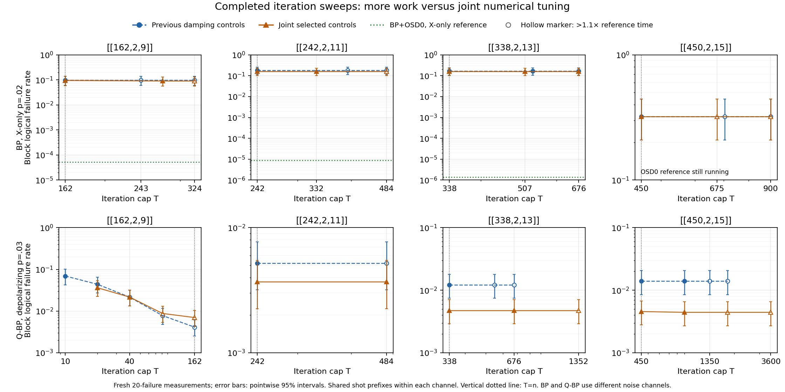

# Completed runtime-budget results: checked interpretation

All218 point workers and the final full-ledger collector completed with exit0:0. The independent check reconciles1,464 confirmation rows,249,888 decoder shots and29,280 logical failures. Every confirmation stopped at20 failures.163,668 coarse/finalist training measurements are separate and are never pooled into final LERs.

More iterations alone barely changed binary BP:107 points received larger caps, and only one had a lower observed LER. This fixed-control comparison uses nested shared physical prefixes, so the other caps retain the same stopping-prefix LER rather than introducing unrelated sampling noise. The finite measurements do not prove an asymptotic error floor.

Joint controls give mixed descriptive changes. At the original n-cap, BP has17 lower/82 equal/10 higher LER estimates; Q-BP has29 lower/64 equal/16 higher. The median joint/previous LER ratio is1.00 for both families at both n-cap and calibrated-cap comparisons. Dense high-noise paper rates dominate this grid; this median is not a threshold or a statement of equality at every rate. Different-control20-failure estimates are uncertain and do not establish simultaneous superiority.

At the same n-cap and unchanged observed LER, mean executed iterations decrease at10/82 BP strata and24/64 Q-BP strata. Median iteration ratios are still1.00, both overall and within those same-LER groups. Thus there are pointwise work reductions, without a broad median reduction across the grid.

The selected offset is zero in217/218 strata. All BP strata retain scaling magnitude1(65 paper-ramp,44 constant). Q-BP retains magnitude1 in108/109 strata(39 paper-ramp,69 constant). The one exception is length162/Q-BP at p_X=.01: d=0,constant alpha=.75,beta=.5. Selection on finite training data is not proof that other offsets/scales never help.

**Runtime qualification:** all218 selected calibration cases lie within10% of target. Fresh observed confirmation times do so at145/218 points;36 exceed1.1 times the reference, while37 are below.9. Thus the full collection is a calibrated-budget study, not218 exact observed equal-runtime comparisons. Actual ratios stay in every table/export. BP selected-ratio range.705–1.434; Q-BP range.794–1.559.

Q-BP already exceeds the budget at the original n-cap for most strata. Its previous-damping calibration cap is lower than n at100/109 points and higher at four. Higher-cap rows remain available as explicitly over-budget context. BP is X-only; Q-BP remains depolarizing at1.5p_X, so cross-family numerical LER differences do not isolate decoder choice.

| Family | Both actual times within10% | Joint lower / equal / higher LER | Median ratio in that subset |
| --- | ---: | --- | ---: |
| binary_css | 55 | 6 / 45 / 4 | 1 |
| bp4 | 68 | 27 / 32 / 9 | 1 |

At X-only p=.02, the selected BP rows remain far above the audited BP+OSD0 reference:

| Length | Selected BP cap | Selected BP LER | Actual time / OSD0 | BP+OSD0 LER |
| ---: | ---: | ---: | ---: | ---: |
| 162 | 273 | 0.090498 | 1.089 | 5.2799e-05 |
| 242 | 332 | 0.16129 | 1.094 | 8.8676e-06 |
| 338 | 507 | 0.16129 | 0.858 | 1.3766e-06 |
| 450 | 675 | 0.32258 | 1.317 | pending |

Length450 BP+OSD0 at this rate is still running. Its selected BP row is over budget and is not treated as a strict timing match. The same-channel OSD0 advantage at the other three strata is large relative to the pointwise interval widths.

The complete per-cap table remains in the main study RESULTS.md/iteration-results.csv. selected-point-results.csv here supplies one independently selected comparison per stratum, including controls, caps, confidence bounds and both calibration/actual timing. Full verification and all tuning data are losslessly archived in the study with raw-byte hashes. The local raw files and event ledgers are retained unchanged.

Separate background studies: MacKay inferred-budget damping confirmation is now complete40/40,112,619,245 shots/791 failures; the rare length274 Q-BP p=.015 point stopped at100M shots with11 failures(LER1.1e-7,95% interval[5.49e-8,1.97e-7]). OSD0/CS10 has212 fully audited/published points; four length450 points remain running. Two completed length338/p=.01 points await the final OSD campaign audit, so they are not silently promoted here.
