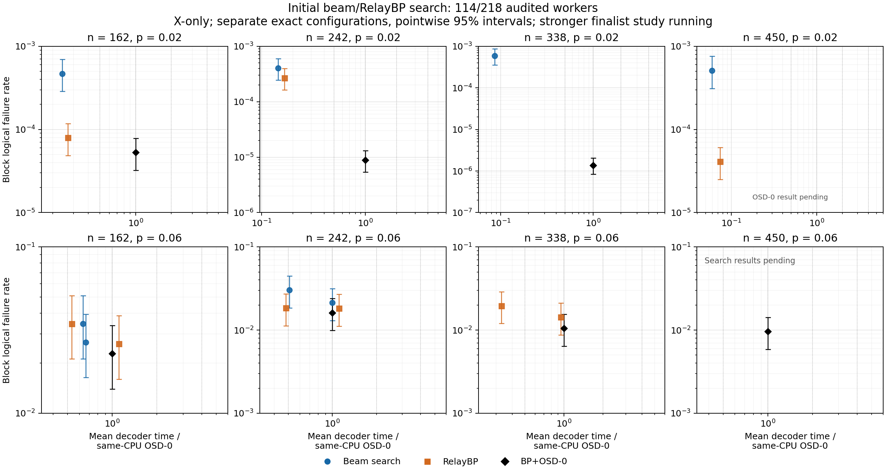

# Beam search and RelayBP: first audited results

114/218 completed method/rate workers audited in this snapshot; 277 fresh configurations, 3,297,851 shots and 5,540 logical failures. Training is separate.

The initial search substantially improves on the earlier tuned ordinary-BP results at the low-rate examples, while OSD-0 still has lower LER. These are X-only comparisons on the original Roffe code/rate grid. Actual latency ratios normalize to contemporaneous same-CPU OSD-0 references; raw timings across hosts are not directly comparable.

| Length | p | Method | LER | 95% interval | Mean time / OSD0 | OSD0 LER |
| ---: | ---: | --- | ---: | --- | ---: | ---: |
| 242 | 0.01 | beam | 4.6136e-05 | [2.8181e-05, 6.8444e-05] | 0.350 | 4e-08 |
| 242 | 0.02 | beam | 0.00040115 | [0.00024505, 0.00059507] | 0.145 | 8.8676e-06 |
| 242 | 0.02 | relay | 0.00026817 | [0.00016381, 0.00039782] | 0.166 | 8.8676e-06 |

The earlier runtime-budget selected BP estimate at length242/p=.02 was .16129 (see the previous quick-task findings). Initial beam/RelayBP LERs around4.0e-4/2.7e-4 are much lower, but remain above OSD0 at8.87e-6. Pointwise20-failure intervals limit fine rankings.

Several latency targets initially select the same fast configuration:512-shot coarse zero-failure ties sent only the fastest candidates to the larger finalist stage. This limits the explored accuracy/runtime frontier; it does not establish saturation or OSD-level performance.

A separately frozen follow-up preserves the original study and retains training-only candidates near each of0.5/1/2/4 times the reference budget, both one- and four-solution arms, and previous fast winners. It uses new finalist/confirmation seeds2026111562/2026111563. The adaptive design timing is explicit; parent confirmation outcomes are not read by its selector. Array61870314 follows corresponding parent workers; collector61870315 also requires the complete original audit61869372. Results remain pending.

Complete settings and every fresh point are in the main study RESULTS.md/results-table.csv. All raw event ledgers remain on the HPC filesystem; the independent receipt and tuning table are losslessly compressed. Exact-control catalog grouping preserves central multi-rate filtering.
