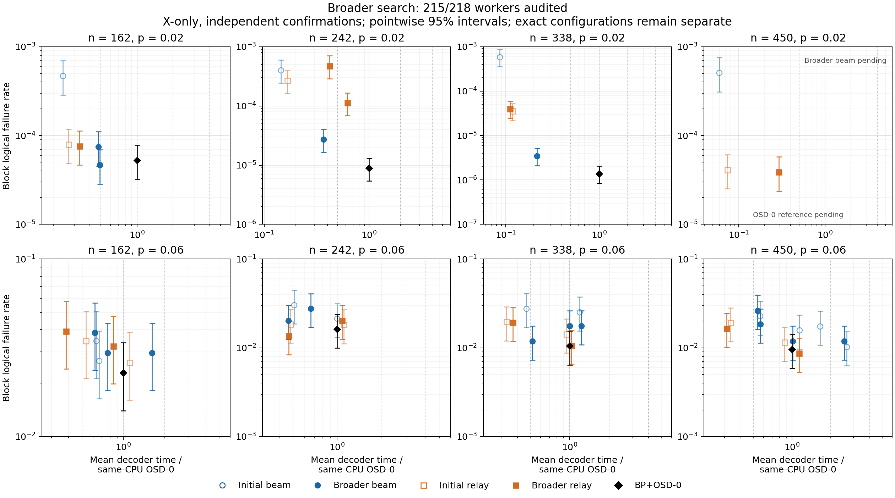

# Beam/RelayBP broader tuning: checked results

Initial study: all218 workers fully audited, 616 configurations and 11,477,871 shots. Broader study: 215/218 completed workers audited, 639 configurations and 27,243,865 fresh shots. Training remains separate.

The wider beam search gives a useful accuracy/latency tradeoff at p=.02. It is consistent with OSD-0 at the length162 point at current pointwise precision, and is still about3.0x/2.5x worse in LER at lengths242/338 while using less than0.4/0.22 of the same-CPU reference mean time. RelayBP remains less accurate at these examples. This is not a global equivalence or decoder-superiority claim.

The following configurations were selected on independent finalist training for the1x upper runtime budget. Actual confirmation timing is shown; consuming the entire budget is not assumed. The other budget selections and every exact control are in comparisons.csv and the study report.

| Length | Method | LER | 95% interval | Mean time / OSD0 | OSD0 LER | New / initial LER |
| ---: | --- | ---: | --- | ---: | ---: | ---: |
| 162 | beam | 4.65288e-05 | [2.84212e-05, 6.90268e-05] | 0.490 | 5.27991e-05 | 0.0993 |
| 162 | relay | 7.62457e-05 | [4.65734e-05, 0.000113112] | 0.331 | 5.27991e-05 | 0.96 |
| 242 | beam | 2.70315e-05 | [1.65116e-05, 4.01021e-05] | 0.366 | 8.86756e-06 | 0.0674 |
| 242 | relay | 0.000112376 | [6.86435e-05, 0.00016671] | 0.617 | 8.86756e-06 | 0.419 |
| 338 | beam | 3.46702e-06 | [2.11775e-06, 5.14347e-06] | 0.216 | 1.37663e-06 | 0.00593 |
| 338 | relay | 3.95631e-05 | [2.41664e-05, 5.86931e-05] | 0.111 | 1.37663e-06 | 1.12 |
| 450 | relay | 3.87523e-05 | [2.36711e-05, 5.74903e-05] | 0.292 | pending | 0.943 |

The1x selected configurations meet the actual110% mean-time ceiling at 93/106 beam and 92/109 Relay points. The remaining 30 are explicitly over budget; they cannot support a strict same-budget claim. Other target bands remain in assessment.json/comparisons.csv. Budget-role rows can refer to the same deduplicated measurement; totals count each fresh configuration once.

Twenty-failure estimates have broad intervals. Different point-specific controls can produce nonmonotonic estimates across rates; this finite search is not proof of a threshold or optimum. Pointwise interval overlap cannot establish statistical equivalence. Raw runtimes across hosts are not directly comparable; ratios use same-worker contemporaneous warmed OSD-0 references. The missing length450 beam confirmation and OSD-0 reference remain pending.

All settings retain all-path mean iterations, actual masked directed-edge updates, mean time and1%-bin p50/p95/p99 latency. Initial and broader confirmation seeds are independent and are never pooled. The broader proposal rule uses parent training only; its adaptive design timing is recorded in its frozen README.

The full broader-study RESULTS.md/results-table.csv preserves every fresh configuration; comparisons.csv here contains each preselected upper-budget role. Central display eligibility still requires multiple distinct measured error rates for each compatible concrete policy.

Three beam workers remain active; interim counts are progress only:

| Length | p | Retained shots | Failures so far |
| ---: | ---: | ---: | ---: |
| 242 | 0.01 | 36,216,832 | 6 |
| 450 | 0.01 | 41,138,176 | 0 |
| 450 | 0.02 | 24,745,984 | 11 |

Stopping remains20 logical failures or100 million shots. No simulations were rerun or submitted.

[All broader-study configurations](../../../data/reproductions/roffe-2005-07016-search-frontier/RESULTS.md) · [Budget comparisons](comparisons.csv) · [Standalone figure PDF](ler-latency.pdf)
