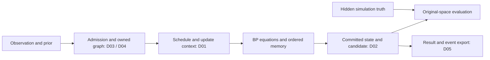

# Canonical kernel comprehension and completeness audit

**Verdict: PARTIAL — the tested flooding equations are strong, but the complete platform is not ready for an unconditional behavior freeze.** Five new contract findings are reproduced below. Production code and earlier audit evidence are unchanged. The intended freeze should apply to named, qualified versions; new policies and decoding regimes must extend those versions without silently altering historical behavior.

This audit continues the approved mathematical → upstream → policy → execution sequence as spikes 034–037. It adds a [capability map](036-completeness-policies/CAPABILITIES.md), an inventory of every production module, randomized independent inference, heterogeneous-prior native comparisons, a compiled-policy configuration grid, and alternate-construction/provenance probes. It also runs the full repository test suite. Existing scientific qualification is reused only where the production source hashes agree; it is not represented as newly executed research.

## What the canonical kernel actually comprises

The project has several **versioned execution contracts** within its two principal mathematical representations: binary parity variables and joint I/X/Y/Z variables. Scalar schedules supply rich update, memory and control hooks; compiled flooding supplies a closed, faster numerical-policy set. Circuit DEM decoding uses binary parity mathematics with per-fault priors and a separate legacy compiled loop. Its detector/observable meanings differ from CSS recovery evaluation.

Thus “one canonical kernel” must mean common declared equations, state transitions and evidence within compatible contracts, not that every entry point currently invokes one identical loop. Duplicated scalar/compiled/circuit dispatch is a maintenance risk unless equivalence and intentional version differences are continuously tested. The public research-manifest contract still excludes stable flooding policy v3. A generic “canonical BP” HTML label would hide material distinctions.

The failures sit at contract boundaries around the numerical core:

The decoder path must not receive hidden truth. Candidate validity, physical/logical success and provenance integrity are different properties; an internally consistent numerical sweep cannot establish all three.

## Acceptance standards and positive evidence

The mathematical basis is extrinsic factor-graph message passing and exact tree marginals, as in [Kschischang–Frey–Loeliger](https://web.stanford.edu/~montanar/TEACHING/Stat375/papers/sumprod.pdf). Converged loopy BP is not generally exact inference, and a componentwise marginal decision is not a guarantee of joint MAP or optimal stabilizer-coset decoding. Numerical, control-flow, evaluation and provenance correctness need separate acceptance tests.

- **034:** 192 randomized four-check Pauli-tree syndrome/prior cases agree with independent enumeration over 1,024 assignments per fixture, within 2e-12. Another 100 loopy graph relabeling comparisons pass at the same tolerance. Deterministic/zero-mass joint priors are explicitly rejected, documenting the current domain.
- **035:** 216 heterogeneous-prior circuit SPA/min-sum cases match installed native `ldpc` candidates, convergence and iteration counts. Inputs avoid active saturation and ties; nonzero syndromes align stopping. Native binary identity is retained, but its build commit remains unknown.
- **036:** 432 compiled family/configuration combinations cover SPA/NMS/OMS, six formats, three rounding scopes, two coefficient-resolution modes and two damping values. One/two-worker results match single-shot execution, with 2,592 retained event rows. This tests dispatch and backend parity, not independent equations for every combination.
- **037:** Independent DEM affine-parity checks preserve p=0/p=1 effects, separator-linked effects and undetected logical faults. Positive controls confirm the ordinary circuit factory rejects invalid settings, corrected flooding graph buffers resist write-flag changes, and unmodified batch evidence is consistent.

[Upstream comparison details](035-completeness-upstream/SOURCES.md) distinguish executed native alignment from API/source review. Sionna's callable node updates, ordered callbacks and returned-state interfaces are useful extension references; no Sionna execution or training equivalence is claimed. Pinned Relay and aSCED receipts from spike 033 cover their stated inner-function/source scopes, not whole published experiments.

## Confirmed findings

### D01 — iteration-dependent policies lose execution context

Affected paths: [standalone kernel](../../src/bp_registry/canonical/kernel.py), [local schedules](../../src/bp_registry/canonical/schedules.py); positive control: [atomic executor](../../src/bp_registry/canonical/execution.py).

**High; numerical behavior.** `BinarySpaKernel.run` calls the flooding sweep without advancing `source_iteration`. Layered, check-serial and variable-serial schedules similarly omit iteration context when invoking check updates. NMS/OMS assignments indexed by source iteration therefore keep using element zero.

Eight counterexamples cover both rules across four paths. Explicit flooding sweeps and `AtomicFloodingExecutor` are passing controls: the rule implementation and atomic flooding path support the right semantics. The existing test named `test_offset_min_sum_source_iteration_uses_schedule_iteration_not_local_step_count` exercises only the rule function, not an actual schedule; its success did not establish integration coverage.

**Acceptance:** supply canonical check/edge/source-iteration context at every admitted update call, including randomized and group traversals; reject unsupported assignment shapes before execution. Verify parameter sensitivity, out-of-range iteration rejection, complete versus partial traversals and budget denial. Do not substitute local-step count for source iteration or silently alter scalar assignments.

### D02 — serial posterior reports disagree with the executed candidate

Affected result construction: [node-serial executor](../../src/bp_registry/canonical/schedules.py).

**High for posterior consumers; state/evidence correctness.** Serial schedules compute candidates using `prior_llrs` and transformed beliefs, then reconstruct `ScheduledLocalStepResult.posterior` using the scalar base prior and no transform. One check-serial fixture chooses `[1,0]` from `[-8,8]` but reports approximately `[3.386,2.386]`; variable-serial exhibits the same defect. These reported values would choose `[0,0]`.

The current ordinary public local loop consumes the candidate rather than this posterior, so this audit does **not** claim that all existing public candidate outputs are wrong. Posterior-based extensions and direct callers nevertheless receive a contradictory state.

**Acceptance:** carry the actual committed posterior through the local-step result, alongside the candidate and message state. Test nonuniform prior, transformed field, combined prior/field, no-op control and denied-step cases. Never reconstruct transformed state from an incomplete base configuration.

### D03 — circuit compiled constructors bypass validation

Affected constructors: [DEM model](../../src/bp_registry/circuit/dem.py), [compiled Sinter decoder](../../src/bp_registry/circuit/sinter_adapter.py).

**High; native execution boundary.** The ordinary `CanonicalBpSinterDecoder` validates its fields. Its `CompiledCanonicalBpDecoder` and `DemBinaryModel` lack equivalent construction checks: dataclass replacement accepts negative iteration counts, unknown rule/tie names, NaN priors and malformed CSR pointers. Unknown rules can fall through to the min-sum branch. Malformed buffers were **not executed** in bounds-unchecked native code.

**Acceptance:** validate direct, factory and replacement construction using one shared circuit contract before shortcuts or native execution. Own normalized buffers; check dimensions, CSR ranges, variable indices, binary matrices/biases, finite priors, scalar types and supported numerical identities. Verify packed/detailed routes and the zero-detector/zero-observable cases. Preserve the current legacy circuit equations unless a new profile explicitly supersedes them.

### D04 — original problem and DEM state are not deeply immutable

Demonstrated surfaces: [binary original](../../src/bp_registry/canonical/problems.py), [Pauli code](../../src/bp_registry/quaternary/problems.py), [DEM state](../../src/bp_registry/circuit/dem.py).

**High; scientific identity/ownership.** Arrays in `OriginalProblem`, `PauliCode` and `DemBinaryModel` are owned writable allocations whose write flag is merely disabled. Ordinary NumPy `setflags(write=True)` re-enables mutation. The probe changes a DEM prior, changes its decoded observable from 0 to 1, and retains the same `dem_sha256`. Corrected compiled flooding graph buffers are a passing stronger-ownership control.

This is a reproducibility and extension-isolation defect, not a claim of a Python sandbox against hostile code. Audit the other frozen state/lineage holders for the same ownership pattern; the three demonstrated surfaces are not an exhaustive list.

**Acceptance:** use immutable storage or isolated defensive snapshots at scientific identity boundaries; ensure original graph, prior, logical map and evaluation identities remain bound to executed bytes. Test caller aliases, write-flag changes, direct/replacement construction and clone/fork ownership.

### D05 — CPU result mutation can produce false exported evidence

Affected storage/export: [CPU batch result](../../src/bp_registry/cpu_batch.py).

**Medium/high; provenance.** CPU result arrays also permit their write flags to be restored. After changing a successful candidate so it violates the stored syndrome, `write_ledger` still emits `candidate_valid: true` from the stale convergence array. The invalid event is retained separately from valid control evidence. This is ordinary post-return mutation, not a numerical decoding failure.

**Acceptance:** bind exported evidence to immutable result/input snapshots and validate result structure before writing. Independently replay candidate validity and work when verifying stored runs; a read-only flag or a hash of the original input alone does not bind the output. Preserve all-or-nothing behavior for genuine execution failures introduced by C01.

## Recommended dependency order

1. **D03:** close circuit construction before unsafe native execution can be reached.
2. **D04:** establish consistent original/model ownership and identity boundaries.
3. **D01:** propagate update context across admitted schedules and entry points.
4. **D02:** report the exact state committed by those schedules.
5. **D05:** bind CPU export to immutable, validated results and independent replay.
6. Consolidate the family × prior × rule/assignment × numerical version × schedule × memory × controller × backend capability contract, and derive HTML availability from it. Keep frozen defaults and stable-v3 public exposure an explicit versioned decision.

Corrections that change outputs of previously accepted configurations—especially D01—need an explicit execution-version/replay decision. Retain historical receipts and replay implementations; do not rewrite old evidence to make a corrected path appear to have always existed. Admission fixes should fail before state, work or candidate evidence is committed.

The full [capability map](036-completeness-policies/CAPABILITIES.md) separates existing policies, backend limits, artifact-gated methods and future extensions. No architecture can honestly promise every new policy without new qualification. The goal is to make additions require new contracts rather than silent behavioral reinterpretation.

## Coverage, gaps and receipts

The full repository suite completed with **2,109 passed, one existing skip and 25 warnings** in 1,400.71 seconds. The skip is the existing Phase 4 notebook evidence reconciliation item. All warnings concern `fork()` from a multithreaded process in campaign tests; no deadlock occurred in this run. This is an execution-portability follow-up, not an additional demonstrated decoding-equation defect.

The new audit has **32 grouped checks: 13 pass and 19 failed invariants identify five findings** (D01: 8, D02: 2, D03: 5, D04: 3, D05: 1). Counts deliberately separate independent cases, configuration-grid rows, diagnostic groups and regression tests.

The [verification receipt](COMPLETENESS-AUDIT-VERIFICATION.json) confirms all 113 production-source hashes, **201 unchanged tracked historical files** in spikes 008–033, 432 grid configurations, 2,592 independently checked grid event rows, and 216 matched native-comparison events. It reports `evidence_verified: true` and **`kernel_freeze_ready: false`**. The [verifier](verify_completeness_audit.py) reproduces these integrity checks; it does not turn known failed invariants into passing kernel behavior. Production and test sources are unchanged from `4cce08e`.

This audit is broader than the previous flooding audits but is not exhaustive formal verification. Remaining limits include arbitrary user callbacks, all higher-order controller/memory interactions, native multicore scaling beyond the available allocation, exact author artifacts, published-curve reproduction and full circuit-stage publication evidence. Optional OSD/LSD does not resolve these BP-internal concerns. All three decoding regimes remain in the journal scope.

New numerical probes and counterexamples: `034`–`037` `probe.py`; compiled matrix: `036/grid.py`; static inventory: `036/inventory.py`. Execute with `.venv/bin/python` and `NUMBA_NUM_THREADS=4`. Native comparisons require the installed `ldpc` binary. The regression command and artifact hashes are recorded in the verification receipt. Diagnostics deliberately retain failed invariant counts; an audit process exiting normally is not a pass verdict.
