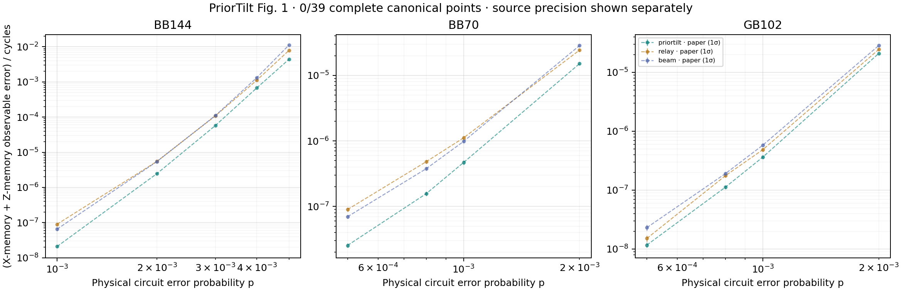

# PriorTilt Fig. 1 — canonical reproduction campaign

0/39 complete plotted points passed the fresh-process full-ledger audit. Each point uses one CPU for X/Z memories sequentially.

Source: [Ye and Delfosse, arXiv:2611.13373v1](https://arxiv.org/html/2611.13373v1), Fig. 1; exact released circuits, rates and full-precision three-phase schedules. This is a canonical float64 adaptation; native prefix/suffix arithmetic and RNG are separate references.

Local stopping is 20 observable errors or 100 million decoded shots **per memory basis**. The authors use larger counts. Qualification shots and unfinished points are excluded. Nonconvergence is recorded separately, not automatically counted as a logical error. Local bars are at-least-95% simultaneous X/Z bounds; source bars are published 1σ. Agreement is pointwise and limited by local precision.

The CSV retains both denominators, errors, nonconvergence, mean all-path BP sweeps, directed edge updates, random draws, biased-node updates and measured instrumented controller latency per basis. Latency includes trace/provenance and Python admission but excludes sampling, evaluation, audit and I/O; no native runtime comparison is claimed.

| Code | p | Decoder | X errors / shots | Z errors / shots | Local LER/cycle (95%) | Paper LER/cycle | Local/paper | Paper inside local interval |
|---|---:|---|---:|---:|---:|---:|---:|---|

No completed local measurements yet. The plot currently contains source measurements only.

The event ledgers remain under ignored `results/`; audit receipts and their hashes bind the published rows. `run.py --index N --audit` independently reevaluates all original DEM detector and logical equations, reconciles work/lineage and replays chunk endpoints before issuing a receipt. Publication rehashes bound chunks and shared samples.
