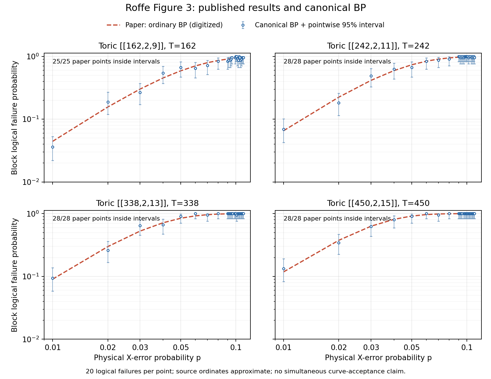

# Roffe Figure 3: completed source comparison

Snapshot: 2026-11-13T23:10:23+00:00. Collector61785160 completed0:0; all 218 points passed full-ledger/count/work/hash and endpoint replay audit. Totals:9,816 retained decoder shots /4,360 logical block failures.

**The 109 ordinary BP measurements are pointwise consistent with the paper at current precision:** all 109 digitized source values lie in their corresponding exact stopping-aware95% intervals. The largest absolute relative point-estimate deviation is22.3%. These are descriptive checks, not a prespecified simultaneous reproduction test. Most high-noise points are near failure probability1, and20 failures per point gives broad intervals.

Source: Roffe, White, Burton and Campbell (2020), [Decoding Across the Quantum LDPC Code Landscape](https://arxiv.org/abs/2005.07016v2), Figure3 dashed ordinary-BP curves. Both source and our binary experiment use X-only noise, min-sum with alpha_t=1-2^-t and T=n. Ordered author matrices/floating-point conventions and raw source counts remain unavailable; the result stays a canonical adaptation. OSD was not run.

At physical p=.01:

| Toric code | Paper LER≈ | Canonical BP | Pointwise95% interval | Measured source points inside intervals |
| --- | ---: | ---: | --- | --- |
| [[162,2,9]] | 0.044341 | 0.035971 | [0.022108, 0.052946] | 25/25 |
| [[242,2,11]] | 0.065533 | 0.069204 | [0.042781, 0.10111] | 28/28 |
| [[338,2,13]] | 0.090346 | 0.09434 | [0.058581, 0.13705] | 28/28 |
| [[450,2,15]] | 0.11819 | 0.13333 | [0.083384, 0.19195] | 28/28 |

The low-noise trend matches the paper: ordinary BP gets worse as toric distance grows. Source extraction retains all25/28/28/28 measured vertices and corresponding error-bar checks, including each code's own irregular grid. Source coordinates are approximate; no author uncertainty or samples are manufactured. Shared samples across code sizes mean the109 coverage indicators are not independent.

## Additional Q-BP results

The other 109 points are canonical joint Q-BP min-sum at the same T=n and alpha schedule on depolarizing p_dep=1.5*p_X. They are separate controlled measurements, not reproduction of the paper's X-only curve and not an isolated joint-versus-separate comparison under one channel.

| Code | X rate used to match marginals | Q-BP depolarizing p | Q-BP LER | Mean iterations |
| --- | ---: | ---: | ---: | ---: |
| toric9 | .01 | .015 | 0.016639 | 4.5241 |
| toric11 | .01 | .015 | 0.025126 | 8.0302 |
| toric13 | .01 | .015 | 0.04878 | 18.446 |
| toric15 | .01 | .015 | 0.072464 | 34.612 |

Full218-point values, intervals, iteration/edge work means, noise labels and ledger hashes: results-table.csv. Source/computation hashes and per-code descriptive statistics: assessment.json. Rebuild with report.py; it validates existing receipts and starts no simulations. Frozen scientific files and prior evidence remain unchanged.
