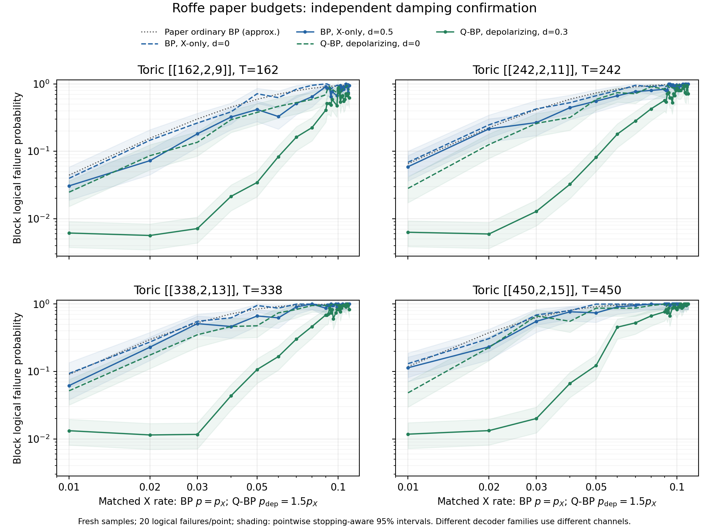

# Roffe: independent damping confirmation

All 1,526 fixed-cohort tuning points and 436 fresh confirmation points are audited. Training retained 1,562,624 decoder shots. Confirmation retained 47,473 shots and 8,720 logical block failures; every point stopped at 20 failures. No new simulations are run by this report.

Selection chose old-V2C weight d=0.5 for ordinary min-sum BP and d=0.3 for joint min-sum Q-BP on all four codes. Min-sum alpha_t=1-2^-t, fixed matched prior, float64 and paper T=n remain unchanged. Each source grid is preserved (25/28/28/28 rates).

Damping helps Q-BP much more strongly than ordinary BP in this confirmation. Compare each damped decoder to its own undamped control: binary BP uses X-only noise; Q-BP uses depolarizing p=1.5*p_X. These families do not share a noise channel. The undamped ordinary-BP curve and its digitized paper comparison remain separate original evidence.

At matched X rate p_X=0.02 (binary physical p=0.02; Q-BP depolarizing physical p=0.03):

| Code; paper T=n | BP LER d=0 → d=.5 | BP mean sweeps d=0 → d=.5 | Q-BP LER d=0 → d=.3 | Q-BP mean sweeps d=0 → d=.3 |
| --- | ---: | ---: | ---: | ---: |
| [[162,2,9]]; 162 | 0.14599 → 0.072727 | 25.4 → 18.7 | 0.086207 → 0.005637 | 16 → 5.36 |
| [[242,2,11]]; 242 | 0.24691 → 0.21505 | 61.3 → 58 | 0.12579 → 0.0059294 | 32.9 → 7.25 |
| [[338,2,13]]; 338 | 0.27397 → 0.22989 | 94.2 → 84.2 | 0.17544 → 0.011435 | 61.3 → 10.8 |
| [[450,2,15]]; 450 | 0.30769 → 0.23256 | 140 → 115 | 0.22727 → 0.013263 | 104 → 15.1 |

All source rates, equally weighted within each code (not pooled shots):

| Code | Decoder | Mean LER d=0 → selected | Relative LER reduction | Mean sweeps d=0 → selected |
| --- | --- | ---: | ---: | ---: |
| toric9 | binary_ms | 0.8049 → 0.6736 | 16.3% | 130.7 → 116.5 |
| toric9 | qbp_ms | 0.6697 → 0.4343 | 35.1% | 112 → 76.24 |
| toric11 | binary_ms | 0.8634 → 0.8012 | 7.2% | 209.4 → 198.3 |
| toric11 | qbp_ms | 0.7935 → 0.5614 | 29.2% | 193.9 → 142.2 |
| toric13 | binary_ms | 0.9044 → 0.849 | 6.1% | 306 → 289.7 |
| toric13 | qbp_ms | 0.8419 → 0.6363 | 24.4% | 286.7 → 222.6 |
| toric15 | binary_ms | 0.926 → 0.8941 | 3.4% | 416.9 → 404.8 |
| toric15 | qbp_ms | 0.8883 → 0.7036 | 20.8% | 400.8 → 322.9 |

Densely sampled high-noise rates near failure probability one dominate these equal-rate averages. They are descriptive summaries, not thresholds or evidence of uniform improvement at every rate. Twenty-failure intervals are broad; no simultaneous superiority criterion was prespecified.

The complete 436-row results-table.csv retains pointwise exact stopping-aware 95% intervals, both work means, actual physical channels, source ordinary-BP ordinates for context, and ledger/summary hashes. assessment.json links both frozen plans, selected settings and audit receipts. Training is not pooled into confirmation. No OSD was run; this remains a canonical controlled adaptation.

The automated final collector audited/normalized all results, then encountered duplicate paper metadata in the shared catalog. The catalog merger now permits identical paper records across studies and still rejects conflicting metadata. Revalidating the ledgers and refreshing the catalog from the completed audit repaired the display without rerunning simulations.

Paper BP-OSD reference: [all 108 Figure 3 BP+OSD-CS ordinates beside our confirmed results](../roffe-2005-07016-osd-comparison/RESULTS.md). The source table also preserves the unavailable length-450/p=.01 point, all four local arms, and separate OSD-0/CS threshold context.
