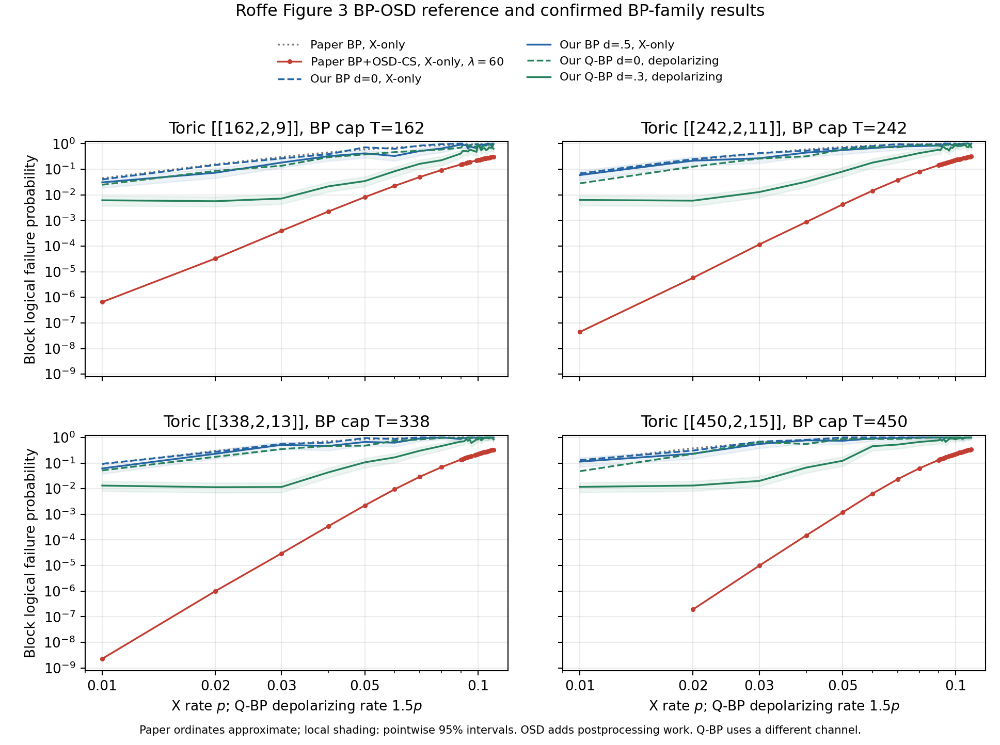

# Roffe Figure 3: BP-OSD and confirmed BP-family comparison

All 108 plotted BP+OSD-CS points for the four toric codes are included below, together with all 109 ordinary-BP source points and 436 independent confirmation measurements. Values marked paper are approximate ordinates extracted from the original vector source, not locally rerun BP-OSD experiments. Every extracted vertex matches a drawn vertical error bar; author sample counts, error-bar confidence convention and work means remain unavailable.

Source: [Roffe et al., arXiv:2005.07016v2](https://arxiv.org/abs/2005.07016v2), Figure 3, Section V/VI and Appendix C. BP+OSD-CS uses combination-sweep depth lambda=60 after nonconvergent min-sum BP, with BP capped at T=n. Lambda=60 is the search-depth parameter, not 60 OSD iterations. Elimination and candidate search add work beyond that BP cap; source work cannot be equated to our measured BP sweeps or directed edge updates.

Paper BP/BP+OSD-CS and our binary BP are X-only at physical p. Our Q-BP is joint-Pauli depolarizing at 1.5p, so it is contextual and not a same-channel decoder ranking. Our d=0 and selected-damping arms use fresh confirmation samples and 20 logical failures per point; confidence intervals and both mean work measures are in comparison-table.csv. No source/local evidence is pooled and no missing ordinate is interpolated.

At p=0.02 for X-only methods (Q-BP depolarizing p=0.03):

| Code | Paper BP+OSD-CS≈ | Our BP d=0 | Our BP d=.5 | Our Q-BP d=.3, depolarizing | BP d=.5 LER / paper BP-OSD LER |
| --- | ---: | ---: | ---: | ---: | ---: |
| [[162,2,9]] | $3.271\times10^{-5}$ | 0.146 | 0.07273 | 0.005637 | 2223 |
| [[242,2,11]] | $5.781\times10^{-6}$ | 0.2469 | 0.2151 | 0.005929 | $3.72\times10^{4}$ |
| [[338,2,13]] | $1.004\times10^{-6}$ | 0.274 | 0.2299 | 0.01144 | $2.289\times10^{5}$ |
| [[450,2,15]] | $1.946\times10^{-7}$ | 0.3077 | 0.2326 | 0.01326 | $1.195\times10^{6}$ |

The paper BP+OSD-CS LER at this rate is about 2,200 to 1.2 million times lower than our damped binary BP point estimates, with the largest gaps on larger codes. The OSD benefit is much larger than the damping benefit at low physical error rates. This compares logical performance, not equal total computational work. Even the smaller Q-BP point estimates remain well above the paper OSD curve here, but their different channel prevents attributing that numerical gap solely to decoder choice.

The length-450 code has no plotted BP-OSD value at p=0.01. It is explicitly unavailable below; we infer neither zero failures nor an upper bound.

Other paper summary results (Table III; percentages, different code families):

| Code family | BP threshold | BP+OSD-0 threshold | BP+OSD-CS threshold |
| --- | ---: | ---: | ---: |
| Toric | not observed | 9.2 ± 0.2% | 9.9 ± 0.2% |
| Semi-topological | not observed | 9.1 ± 0.2% | 9.7 ± 0.2% |
| Random | 6.5 ± 0.1% | 6.7 ± 0.1% | 7.1 ± 0.1% |

Those OSD-0 thresholds do not supply per-code OSD-0 LER curves. Figure 6 separately compares OSD-E lambda=12 with OSD-CS lambda=86 on distance15; its settings are distinct from the Figure3 lambda60 curves tabulated here. Figures4/5 concern other codes without current local comparison runs and are outside this four-code table.

All Figure3 rates and available source points follow. Each table is sorted by its original source grid. A single CSV contains these109 rows, source error-bar geometry (confidence unspecified), all436 local shot counts/95% intervals, both work means and summary hashes.

## [[162,2,9]], BP cap T=162

| X rate p | Paper BP≈ | Paper BP+OSD-CS≈ | BP d=0 | BP d=.5 | Q-BP d=0, dep. 1.5p | Q-BP d=.3, dep. 1.5p |
| ---: | ---: | ---: | ---: | ---: | ---: | ---: |
| 0.01 | 0.04434 | $6.547\times10^{-7}$ | 0.03968 | 0.03067 | 0.02475 | 0.006129 |
| 0.02 | 0.1563 | $3.271\times10^{-5}$ | 0.146 | 0.07273 | 0.08621 | 0.005637 |
| 0.03 | 0.3016 | $3.951\times10^{-4}$ | 0.2632 | 0.1818 | 0.1361 | 0.007138 |
| 0.04 | 0.4527 | 0.002243 | 0.3846 | 0.3226 | 0.2941 | 0.02144 |
| 0.05 | 0.5897 | 0.008172 | 0.7143 | 0.4167 | 0.3774 | 0.03448 |
| 0.06 | 0.7043 | 0.02234 | 0.625 | 0.3279 | 0.4651 | 0.08333 |
| 0.07 | 0.7945 | 0.04961 | 0.8333 | 0.5128 | 0.5263 | 0.1626 |
| 0.08 | 0.8602 | 0.09296 | 0.9524 | 0.6452 | 0.5882 | 0.2247 |
| 0.09 | 0.9075 | 0.1533 | 1 | 0.9091 | 0.6897 | 0.4082 |
| 0.091 | 0.9114 | 0.1596 | 1 | 0.8696 | 0.8 | 0.5128 |
| 0.093 | 0.9186 | 0.174 | 0.9524 | 0.8696 | 0.9091 | 0.5128 |
| 0.094 | 0.9223 | 0.1813 | 0.8333 | 0.6452 | 0.8 | 0.4878 |
| 0.095 | 0.9253 | 0.1881 | 0.8696 | 0.7692 | 0.8333 | 0.5882 |
| 0.099 | 0.9374 | 0.2189 | 0.9524 | 0.6667 | 0.7407 | 0.4762 |
| 0.1 | 0.9399 | 0.2264 | 0.9524 | 0.8 | 0.9524 | 0.8696 |
| 0.101 | 0.9425 | 0.2341 | 0.8333 | 0.8333 | 0.9091 | 0.7407 |
| 0.102 | 0.9451 | 0.2421 | 1 | 0.9524 | 0.6667 | 0.5405 |
| 0.103 | 0.9474 | 0.2507 | 0.9091 | 0.8 | 0.8 | 0.6452 |
| 0.104 | 0.9496 | 0.2582 | 0.9091 | 0.8696 | 0.8333 | 0.6667 |
| 0.105 | 0.9519 | 0.2662 | 0.9524 | 0.8333 | 0.8696 | 0.5556 |
| 0.106 | 0.9539 | 0.274 | 1 | 0.9091 | 0.8696 | 0.5882 |
| 0.107 | 0.9557 | 0.2826 | 1 | 1 | 0.9091 | 0.7143 |
| 0.108 | 0.9576 | 0.2909 | 1 | 0.9091 | 0.9524 | 0.6667 |
| 0.109 | 0.9596 | 0.2988 | 1 | 0.7407 | 0.9091 | 0.7143 |
| 0.11 | 0.9614 | 0.3072 | 1 | 0.9524 | 0.8 | 0.625 |

## [[242,2,11]], BP cap T=242

| X rate p | Paper BP≈ | Paper BP+OSD-CS≈ | BP d=0 | BP d=.5 | Q-BP d=0, dep. 1.5p | Q-BP d=.3, dep. 1.5p |
| ---: | ---: | ---: | ---: | ---: | ---: | ---: |
| 0.01 | 0.06553 | $4.46\times10^{-8}$ | 0.06873 | 0.059 | 0.02817 | 0.006295 |
| 0.02 | 0.2242 | $5.781\times10^{-6}$ | 0.2469 | 0.2151 | 0.1258 | 0.005929 |
| 0.03 | 0.4155 | $1.155\times10^{-4}$ | 0.4255 | 0.2667 | 0.2597 | 0.01284 |
| 0.04 | 0.5937 | $8.693\times10^{-4}$ | 0.5263 | 0.4444 | 0.3175 | 0.03247 |
| 0.05 | 0.7355 | 0.00421 | 0.6667 | 0.5556 | 0.5882 | 0.0813 |
| 0.06 | 0.8379 | 0.01444 | 0.8 | 0.6667 | 0.7407 | 0.1802 |
| 0.07 | 0.9057 | 0.03778 | 0.9524 | 0.7692 | 0.7143 | 0.2817 |
| 0.08 | 0.9475 | 0.07999 | 0.9091 | 0.8 | 0.9091 | 0.4255 |
| 0.09 | 0.9715 | 0.1438 | 0.9524 | 0.8333 | 0.8333 | 0.5714 |
| 0.091 | 0.9737 | 0.1516 | 0.9091 | 0.8 | 0.8696 | 0.5405 |
| 0.092 | 0.9749 | 0.1591 | 0.9524 | 0.8 | 0.9524 | 0.7143 |
| 0.093 | 0.9768 | 0.1665 | 1 | 1 | 0.9091 | 0.7407 |
| 0.094 | 0.9783 | 0.1751 | 1 | 1 | 0.8696 | 0.625 |
| 0.095 | 0.9795 | 0.1832 | 1 | 0.9524 | 0.9091 | 0.625 |
| 0.096 | 0.9808 | 0.1911 | 1 | 0.9524 | 0.8696 | 0.5263 |
| 0.097 | 0.9819 | 0.2002 | 1 | 0.9091 | 0.8696 | 0.7143 |
| 0.098 | 0.9832 | 0.2084 | 0.9524 | 0.8696 | 0.8696 | 0.6667 |
| 0.099 | 0.9841 | 0.2172 | 1 | 0.9524 | 0.9524 | 0.8 |
| 0.1 | 0.9851 | 0.2259 | 1 | 0.9524 | 0.9524 | 0.8696 |
| 0.101 | 0.9861 | 0.2353 | 0.9091 | 0.8696 | 0.9524 | 0.8 |
| 0.102 | 0.9869 | 0.2437 | 1 | 0.9524 | 0.9524 | 0.8 |
| 0.103 | 0.9879 | 0.2536 | 0.9524 | 0.9524 | 1 | 0.8 |
| 0.105 | 0.9894 | 0.2714 | 1 | 1 | 0.9524 | 0.8696 |
| 0.106 | 0.99 | 0.2812 | 1 | 0.9524 | 0.9524 | 0.9091 |
| 0.107 | 0.9907 | 0.2907 | 1 | 1 | 1 | 0.7407 |
| 0.108 | 0.9913 | 0.2997 | 1 | 1 | 1 | 0.7143 |
| 0.109 | 0.9919 | 0.3094 | 0.9524 | 0.9091 | 1 | 0.9524 |
| 0.11 | 0.9922 | 0.3187 | 1 | 1 | 0.8696 | 0.7143 |

## [[338,2,13]], BP cap T=338

| X rate p | Paper BP≈ | Paper BP+OSD-CS≈ | BP d=0 | BP d=.5 | Q-BP d=0, dep. 1.5p | Q-BP d=.3, dep. 1.5p |
| ---: | ---: | ---: | ---: | ---: | ---: | ---: |
| 0.01 | 0.09035 | $2.3\times10^{-9}$ | 0.09346 | 0.06173 | 0.05168 | 0.01322 |
| 0.02 | 0.2984 | $1.004\times10^{-6}$ | 0.274 | 0.2299 | 0.1754 | 0.01144 |
| 0.03 | 0.5276 | $2.994\times10^{-5}$ | 0.5556 | 0.5128 | 0.3509 | 0.01166 |
| 0.04 | 0.7153 | $3.457\times10^{-4}$ | 0.625 | 0.4651 | 0.4651 | 0.04357 |
| 0.05 | 0.8447 | 0.002233 | 0.9524 | 0.6667 | 0.4762 | 0.107 |
| 0.06 | 0.9216 | 0.009488 | 0.8696 | 0.625 | 0.7407 | 0.1667 |
| 0.07 | 0.9634 | 0.02912 | 1 | 0.9091 | 0.8333 | 0.303 |
| 0.08 | 0.9838 | 0.06952 | 1 | 1 | 0.9524 | 0.4651 |
| 0.09 | 0.9932 | 0.1366 | 0.9524 | 0.8696 | 0.9524 | 0.6897 |
| 0.091 | 0.9938 | 0.1444 | 1 | 0.9524 | 0.9524 | 0.6897 |
| 0.092 | 0.9944 | 0.1527 | 1 | 0.9524 | 0.9524 | 0.7143 |
| 0.093 | 0.9947 | 0.1613 | 1 | 0.9524 | 1 | 0.8696 |
| 0.094 | 0.9953 | 0.17 | 1 | 1 | 0.9524 | 0.7407 |
| 0.095 | 0.9957 | 0.1796 | 1 | 0.9524 | 1 | 0.8333 |
| 0.096 | 0.9961 | 0.1888 | 1 | 0.9524 | 0.9524 | 0.6061 |
| 0.098 | 0.9966 | 0.2071 | 1 | 1 | 1 | 0.7407 |
| 0.099 | 0.9971 | 0.2169 | 1 | 0.9091 | 0.9524 | 0.8333 |
| 0.1 | 0.9973 | 0.227 | 1 | 1 | 1 | 0.8333 |
| 0.101 | 0.9976 | 0.2369 | 1 | 0.9524 | 1 | 0.9524 |
| 0.102 | 0.9978 | 0.2474 | 1 | 0.9524 | 0.9091 | 0.7692 |
| 0.103 | 0.998 | 0.2578 | 1 | 0.9524 | 0.9524 | 0.8696 |
| 0.104 | 0.9982 | 0.2685 | 1 | 1 | 1 | 0.9524 |
| 0.105 | 0.9983 | 0.2775 | 1 | 0.9524 | 1 | 0.9524 |
| 0.106 | 0.9984 | 0.2882 | 1 | 0.9524 | 1 | 0.9524 |
| 0.107 | 0.9986 | 0.2991 | 1 | 1 | 1 | 0.9091 |
| 0.108 | 0.9987 | 0.3093 | 1 | 1 | 1 | 1 |
| 0.109 | 0.9988 | 0.3205 | 1 | 1 | 0.9524 | 0.9524 |
| 0.11 | 0.9989 | 0.3303 | 1 | 1 | 1 | 0.8333 |

## [[450,2,15]], BP cap T=450

| X rate p | Paper BP≈ | Paper BP+OSD-CS≈ | BP d=0 | BP d=.5 | Q-BP d=0, dep. 1.5p | Q-BP d=.3, dep. 1.5p |
| ---: | ---: | ---: | ---: | ---: | ---: | ---: |
| 0.01 | 0.1182 | not plotted | 0.1307 | 0.1136 | 0.04819 | 0.01175 |
| 0.02 | 0.3763 | $1.946\times10^{-7}$ | 0.3077 | 0.2326 | 0.2273 | 0.01326 |
| 0.03 | 0.6314 | $9.853\times10^{-6}$ | 0.6897 | 0.5556 | 0.6667 | 0.02006 |
| 0.04 | 0.812 | $1.498\times10^{-4}$ | 0.8 | 0.7692 | 0.5556 | 0.06667 |
| 0.05 | 0.916 | 0.001188 | 1 | 0.7407 | 0.8696 | 0.1227 |
| 0.06 | 0.9663 | 0.006369 | 1 | 0.9091 | 0.8696 | 0.4545 |
| 0.07 | 0.9878 | 0.02334 | 1 | 0.9524 | 0.8696 | 0.5263 |
| 0.08 | 0.996 | 0.06228 | 1 | 1 | 0.9524 | 0.6667 |
| 0.09 | 0.9988 | 0.1318 | 1 | 1 | 1 | 0.7692 |
| 0.091 | 0.9989 | 0.1405 | 1 | 1 | 0.9091 | 0.8333 |
| 0.092 | 0.9991 | 0.15 | 1 | 1 | 0.9524 | 0.7407 |
| 0.093 | 0.9991 | 0.1587 | 1 | 1 | 1 | 0.8696 |
| 0.094 | 0.9992 | 0.1685 | 1 | 0.9524 | 1 | 0.6667 |
| 0.096 | 0.9994 | 0.187 | 1 | 1 | 1 | 0.8696 |
| 0.097 | 0.9995 | 0.198 | 1 | 1 | 1 | 0.9091 |
| 0.098 | 0.9995 | 0.2079 | 1 | 1 | 1 | 0.9091 |
| 0.099 | 0.9996 | 0.2194 | 1 | 1 | 1 | 0.8696 |
| 0.1 | 0.9996 | 0.2302 | 1 | 1 | 1 | 0.8333 |
| 0.101 | 0.9997 | 0.241 | 1 | 1 | 1 | 0.9091 |
| 0.102 | 0.9997 | 0.2535 | 1 | 1 | 1 | 0.9091 |
| 0.103 | 0.9997 | 0.2636 | 1 | 0.9524 | 1 | 1 |
| 0.104 | 0.9998 | 0.2752 | 1 | 0.9524 | 1 | 0.8696 |
| 0.105 | 0.9998 | 0.2872 | 1 | 0.9524 | 0.9524 | 0.9091 |
| 0.106 | 0.9998 | 0.2991 | 1 | 0.9524 | 1 | 1 |
| 0.107 | 0.9998 | 0.3095 | 1 | 1 | 1 | 1 |
| 0.108 | 0.9999 | 0.3216 | 1 | 1 | 1 | 0.9524 |
| 0.109 | 0.9999 | 0.3332 | 1 | 1 | 1 | 1 |
| 0.11 | 0.9999 | 0.345 | 1 | 1 | 1 | 1 |

New local lower-cost methods: [canonical BP + OSD-0 / CS-10 results and separate work accounting](../roffe-2005-07016-osd-fast/RESULTS.md). Pending points remain explicitly unavailable until their audited runs finish.
