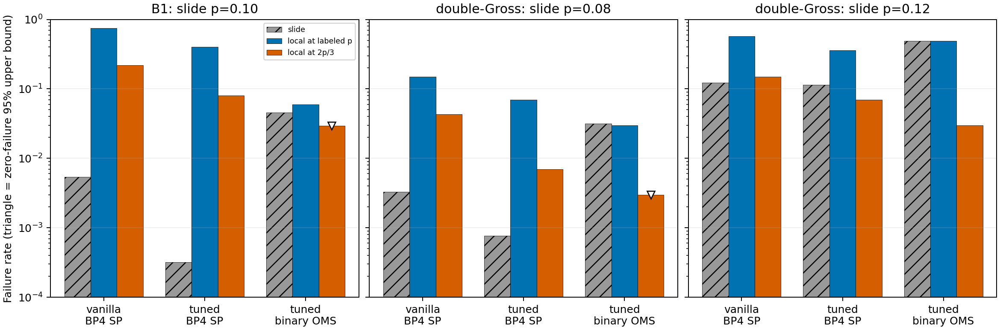
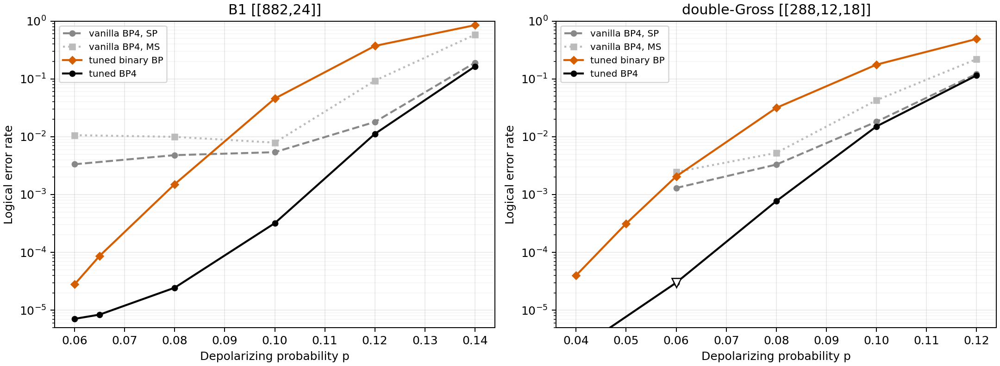
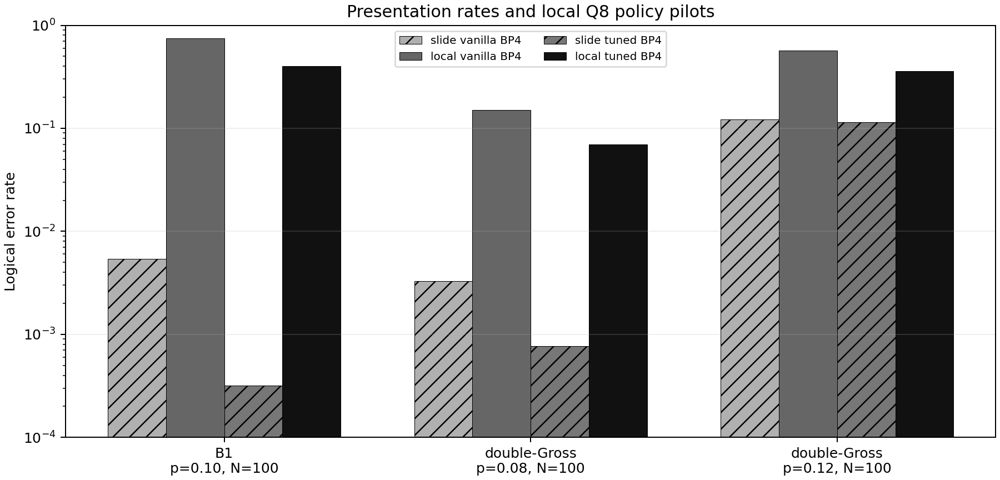

# BP decoder policies and presentation reproduction

This folder records the **user-supplied Dr. Pfister presentation excerpt**. The two source curves in `results/source_curves.csv` are transcription, not measurements made by this repository. The presentation's underlying TeX files and raw per-shot data were not supplied, so trial counts are unknown except the zero-failure upper bound at double-Gross `p=0.06` (100,000 trials inferred exactly from the displayed bound). The `p=0.04` double-Gross BP4 point lies below the displayed plot's y-axis lower limit, but is retained.

## Experiment contract from the slides

- Code-capacity depolarizing noise: each qubit has `P(I)=1-p` and `P(X)=P(Y)=P(Z)=p/3`; syndrome measurements are perfect.
- Policies are tuned at one `p` and frozen across the sweep. The tuning value, search grid, seeds, and raw selection results were not supplied. No tuning is claimed here.
- The four displayed arms are vanilla BP4 SP, vanilla BP4 MS, tuned binary OMS, and tuned BP4 SP. All use `T=1000` and signed Q8 messages. Their policy files are in `decoders/`.
- Logical failure means the residual Pauli is outside the stabilizer. A decoder that does not return a syndrome-matching correction is a failure.
- Same-error pairing supports rescue/loss counts. At zero failures, plot the exact one-sided 95% upper bound `1 - 0.05**(1/N)` as a downward triangle.
- Work is reported in equivalent joint BP4 iterations; one X-plus-Z binary iteration is approximately one BP4 iteration. The slide's exact message accounting and timing baseline are unavailable.

## Recorded slide conclusions

| Code | Comparison point | Reported conclusion | Check against transcribed rates |
|---|---|---|---|
| B1 `[[882,24]]` | `p=0.10` | `17×` fewer failures; mean work `28→12` BP4 iterations | `0.0054/0.00032=16.875` |
| B1 `[[882,24]]` | `p=0.06` | about `470×` lower LER | `0.00334/0.0000071≈470.42` |
| double-Gross `[[288,12,18]]` | `p=0.08` | `4.3×` fewer failures; mean work `12→6.7` BP4 iterations | `0.0033/0.00077≈4.29` |

The excerpt also states that Q8 scale 4 or 8 beat scale 16 in a 10,000-paired-trial undamped BP4 tuning screen, damping `d=0.2` reduced failures and at least halved p99 iterations, fixed-memory BP with `alpha_MBP=0.95` did neither, and raising `T` from 1,000 to 10,000 added 9–91% mean work with unchanged p99. **No numerical plot data for these latter two figures was supplied**, so they are recorded as slide claims rather than reconstructed data.

## Local status

`run_reproduction.py` performs a bounded, paired pilot with the project's code representation and an experimental Numba policy kernel. It is an **adaptation**, because the slide leaves Q8 rounding order, damping location, tie breaking, exact binary channel mapping, and check scheduling unspecified. It must not be used as evidence of source-faithful reproduction until those choices and independent kernel checks are resolved.

### Completed paired pilots

Each row below used 100 errors per code/rate, shared by all four decoders, `T=1000`, and a fresh seed. Counts and exact 95% intervals are in `results/pilot_summary.csv`; per-shot work and outcomes are in the matching event ledgers.

| Code, p | Slide vanilla BP4 SP | Local vanilla BP4 SP | Slide tuned BP4 SP | Local tuned BP4 SP | Local tuned binary OMS |
|---|---:|---:|---:|---:|---:|
| B1, 0.10 | 0.0054 | 75/100 | 0.00032 | 40/100 | 6/100 (slide 0.04571) |
| double-Gross, 0.08 | 0.0033 | 15/100 | 0.00077 | 7/100 | 3/100 (slide 0.03153) |
| double-Gross, 0.12 | 0.12195 | 57/100 | 0.11455 | 36/100 | 49/100 (slide 0.4898) |

Tuned versus vanilla BP4 paired rescues/losses were 36/1 (B1 p=0.10), 10/2 (double-Gross p=0.08), and 22/1 (double-Gross p=0.12). The local tuned BP4 reduces failures relative to local vanilla BP4 but does **not** reproduce the slide curves. The current float64 BP4 backend also failed 15/20 B1 errors at p=0.10 and 45/100 double-Gross errors at p=0.12; those independent diagnostics point beyond Q8 rounding alone. A variable-serial Q8 diagnostic on the same 100 double-Gross p=0.08 errors reduced failures to 11 vanilla and 5 tuned, still far above the slide's 0.0033 and 0.00077 rates. The precise source BP4 recurrence/schedule and full figure data are needed before claiming source-faithful reproduction.

The local binary rates happen to be close to the slide at the tested points. At N=100 they are only pilot evidence, and they do not validate the assumed marginal prior or numerical policy.

The BP4 X/Z check-update algebra was audited against the Pauli commutation table and the log-domain BP4 equations. An independent four-state enumeration agreed with 192 compiled check messages, and the pilot graph's X/Z row labels and syndromes matched the canonical CSS graph. See `.planning/debug/resolved/bp4-css-check-update-audit.md`. This establishes the check parity interpretation; it does not identify the remaining slide-versus-pilot performance discrepancy.

### Does a missing 2/3 conversion explain the curves?

For each slide point, `analyze_p_axis_shift.py` compares the source LER with the paired local pilots at both the labeled `p` and `p_local=2p_slide/3`. The shifted double-Gross `p_local=0.053333...` run used 1,000 shots; the shifted B1 `p_local=0.066666...` run used 100 shots. The original double-Gross `p_local=0.08` pilot supplies the shifted comparison for slide `p=0.12`. All runs use the same physical depolarizing convention `P(X)=P(Y)=P(Z)=p_local/3` and all four decoders see the same errors within a run.

| Slide point | Decoder | Slide LER | Local at `2p_slide/3` |
|---|---|---:|---:|
| B1 `p=0.10` | vanilla BP4 SP | 0.0054 | 22/100 = 0.22 |
| B1 `p=0.10` | tuned BP4 SP | 0.00032 | 8/100 = 0.08 |
| B1 `p=0.10` | tuned binary OMS | 0.04571 | 0/100 |
| double-Gross `p=0.08` | vanilla BP4 SP | 0.0033 | 43/1000 = 0.043 |
| double-Gross `p=0.08` | tuned BP4 SP | 0.00077 | 7/1000 = 0.007 |
| double-Gross `p=0.08` | tuned binary OMS | 0.03153 | 0/1000 |
| double-Gross `p=0.12` | vanilla BP4 SP | 0.12195 | 15/100 = 0.15 |
| double-Gross `p=0.12` | tuned BP4 SP | 0.11455 | 7/100 = 0.07 |
| double-Gross `p=0.12` | tuned binary OMS | 0.4898 | 3/100 = 0.03 |

The `2/3` shift does **not** reconcile all four decoder arms. It brings double-Gross BP4 at slide `p=0.12` into the range of this small pilot, yet moves its binary rate far from the slide. For double-Gross slide `p=0.08`, both shifted BP4 rates are still 9–13 times the reported rates, while 0/1000 binary failures has a one-sided 95% upper bound of about 0.003, well below the reported 0.03153. The opposite shift, `p_local=3p_slide/2`, is available for the double-Gross slide `p=0.08` point in the comparison table and fits worse. These are tests of a **uniform x-axis reinterpretation**, not of possible decoder-specific prior or kernel errors. Exact binomial comparison p-values in the CSV condition on the slide rates as if known exactly; source uncertainty and policy differences limit that interpretation.

The full counts, denominators, confidence bounds, and ledger hashes are in `results/p_axis_shift_comparison.csv`; reproduce the table and figure with `.venv/bin/python from_dr_pfister_presentetations/analyze_p_axis_shift.py`.

Run `.venv/bin/python from_dr_pfister_presentetations/plot_results.py` to rebuild the plots and `PYTHONPATH=src:from_dr_pfister_presentetations .venv/bin/python from_dr_pfister_presentetations/verify_spike.py` for structural/ledger checks. A new local pilot can be run with `PYTHONPATH=src .venv/bin/python from_dr_pfister_presentetations/run_reproduction.py --code double_gross --p 0.08 --shots 100 --seed 20261027`.

Primary construction reference for double-Gross: [Bravyi et al., arXiv:2308.07915](https://arxiv.org/abs/2308.07915), table of bivariate bicycle codes. The `(12,12)` polynomial pair is corroborated in [the follow-up construction table](https://arxiv.org/pdf/2407.16336). B1 uses the project's existing frozen Panteleev–Kalachev Appendix-B construction in `src/bp_registry/code_constructions.py`.
