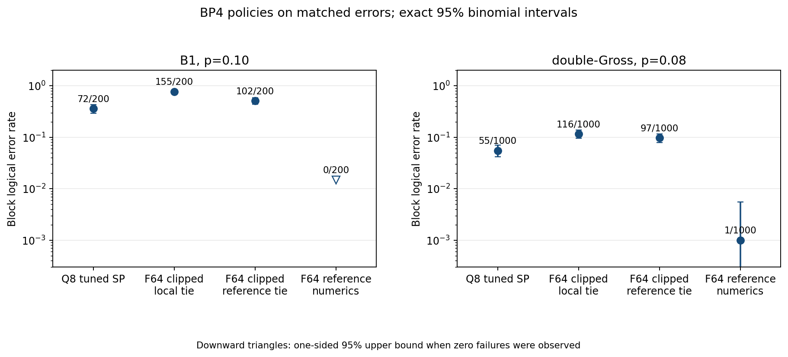

# BP4 implementation comparison with the supplied four-weight reference

**Status:** Controlled local diagnosis, 2026-10-26. The standalone reference
package was not available in this HPC workspace. “Reference-style” below
means a new implementation of the algorithm described in the user's reference
text. It is not a direct execution of that package or a source-faithful replay
of the presentation. Every new arm used `T=1000`, flooding, physical
depolarizing `p`, decoder `p₀=p`, and the same sampled errors within each code.

## Main finding

The project's global float64 LLR clipping is a **confirmed numerical-policy
difference** and a large cause of the observed local nonconvergence. The
canonical profile clips at `±25` after the prior conversion, commutation
projection, check reduction, posterior, and extrinsic V2C. The supplied
reference only caps the check calculation through `tanh(r/2)` at arguments
outside `[-20,20]` and clamps an exact-magnitude-one product to
`±(1-10⁻¹⁰)`, yielding maximum C2V magnitude 23.718998. It does not globally
clip V2C or posterior weights. In the canonical kernel, the posterior is
clipped **before** subtracting the destination check's contribution, which
changes the extrinsic message whenever clipping occurs.

On the matched errors, an unclipped, reference-style float64 diagnostic failed
0/200 B1 and 1/1000 double-Gross shots. The canonical compiled float64 kernel
failed 155/200 and 116/1000. Keeping the direct reference check formula and
strict reference tie ladder while applying the project's global clipping
raised failures to 105/200 and 94/1000. Thus the gap is not explained by an
X/Z label swap, a `p` versus `2p/3` prior mix-up, or the check's factor of
two. The ablation identifies a causal effect **in these matched runs**; it
does not prove which policy the presentation authors used.

## Matched outcomes

| Kernel/policy | B1 `p=.10`, failures/200 | double-Gross `p=.08`, failures/1000 |
|---|---:|---:|
| Q8 tuned SP (`s=4,d=.1`, local tie) | 72 | 55 |
| Q8 tuned SP, reference tie only | 72 | 53 |
| Canonical float64, `±25`, local tie | 155 | 116 |
| Canonical float64, `±25`, reference tie only | 102 | 97 |
| Reference check product, `±25` projection/posterior/V2C, reference tie | 105 | 94 |
| Reference check product, projection clipped only at `±25` | — | 120 |
| Reference check product, posterior/V2C clipped only at `±25` | — | 100 |
| Unclipped box-plus left fold, reference tie | 0 | 2 |
| Reference-style direct tanh product, no global clip, reference tie | 0 | 1 |

The check-reduction ablation (last two rows) changes only 0 versus 0 B1 and
2 versus 1 double-Gross failures. The clipping-only variants on double-Gross
show that both projection clipping and posterior/V2C clipping can harm this
code; their effects interact, so the combined result is not the sum of the
individual effects. The fully reference-style diagnostic rescues 155 B1 and
115 double-Gross canonical float64 failures, with no losses on these samples.
All arm-level exact 95% intervals, denominators, and paired rescue/loss counts
are in [`reference_gap_rates.csv`](reference_gap_rates.csv) and
[`reference_gap_paired.csv`](reference_gap_paired.csv). At 0/200, the exact
one-sided 95% upper bound is 0.01487; those B1 shots cannot resolve a rate
near the presentation's 0.00032. At 1/1000, the double-Gross exact two-sided
95% interval is about 0.000025–0.00556, which includes the presentation's
0.00077. This is compatibility at one small point, not curve reproduction.

## Input, graph, and prior audit

| Item | Local implementation | Finding |
|---|---|---|
| Pauli labels | `I=0,X=1,Y=2,Z=3` throughout graph, samples, syndrome, decoder, and evaluator | Different from reference `I,X,Z,Y`; explicit 2↔3 translation works in the four-weight oracle. No local internal mismatch found. |
| CSS check order | X rows first, Z rows second | Correct syndrome order `[H_X z,H_Z x]`. B1 has 441+441 degree-six rows; double-Gross has 144+144 degree-six rows. No degree-one or isolated nodes in these local graphs. |
| Physical `p` and prior `p₀` | Separate runner parameters; tested here with `p₀=p` | Correct depolarizing law `P(I)=1-p`, `P(X)=P(Y)=P(Z)=p/3`. Source tuned `p₀` remains unspecified. |
| Initial LLR | Three identity-referenced values `log[3(1-p₀)/p₀]` | Commutation projection is separately `log[(1-2p₀/3)/(2p₀/3)]`. At `.08`: 3.540959 vs 2.876386; at `.10`: 3.295837 vs 2.639057. Direct kernel checks match the latter. |
| Prior validation | Requires strictly positive values and row sums within `1e-12`; no renormalization | Reference allows exact zeros and tolerance of eight machine epsilons. This difference cannot explain these positive depolarizing-prior runs. |
| Graph validation | `PauliCode` rejects identity-only rows and noncommuting stabilizers; the low-memory CSS graph path omits general graph validation | The tested graphs were independently verified; source matrix identity and row basis are still unverified against presentation files. |

## Iteration and numerical audit

The canonical Python and compiled float64 kernels, and the Q8 flooding
adapter, project four-Pauli beliefs to one commute/anticommute scalar per
edge. The check uses the syndrome sign and excludes the destination edge.
Three identity-referenced LLRs and four log weights are equivalent coordinates
before clipping; comparisons use their differences or normalized marginals,
not absolute offsets. Global clipping breaks exact coordinate equivalence.
The compiled and Q8 flooding loops finish all checks, then all variable
beliefs, then the correction and syndrome test. They use distinct old/new V2C
buffers; there is no accidental partially serial update in these arms. The
variable belief starts from the original prior each sweep, adds C2V to
anticommuting-state identity LLRs, and subtracts the destination C2V for the
extrinsic next message. That is algebraically equivalent to adding C2V to
commuting four-state log weights. The 192-case independent check parity
oracle and a new four-weight diagnostic check support the sign and factor-of-two
interpretation. The four-weight oracle produced the same final corrections on
one B1 and three double-Gross shots; B1 shot 0 stopped at iteration 27 in the
four-weight code versus 26 in the LLR diagnostic. Arithmetic order remains a
measured numerical difference, not a validated bit-for-bit equivalence.

The canonical float check uses a stable pairwise **box-plus left fold** with
`±25` saturation. The reference directly multiplies excluded-neighbor tanh
factors and clamps products that reach magnitude one. Both handle zero factors
without division. Degree-one checks differ: the local box-plus convention
returns `±25`, whereas the reference product clamp yields `±23.718998`.
Neither B1 nor double-Gross has degree-one checks. No `fastmath=True`, JIT
parallel option, or GPU dispatch is requested by these Numba kernels.
The Python canonical primitive raises on nonfinite arithmetic; the compiled
and experimental Q8 decode loops have fewer internal finite-state guards.
That is a confirmed validation difference, but the matched-shot clipping
ablation already explains a large gap without invoking nonfinite behavior.

The experimental Q8 adapter is separate from the canonical float kernel. It
stores **float64 arrays containing quantized values**, not int8 arrays.
Prior V2C, projected commute LLR, C2V, proposed V2C, and damped V2C are
rounded to the nearest `1/s` with `np.rint` (ties to even) and clipped at
`±127/s`. The projection primitive also clips its input components and each
commute/anticommute log-sum-exp before taking their difference. Box-plus
clips each pairwise intermediate. Variable accumulation uses float64 and its
posterior beliefs are not globally Q8-clipped. It damps **V2C**
as `d·old+(1-d)·proposal`; the presentation does not identify its damping
target or rounding sequence. No integer overflow occurs in the selected Q8
runs because values are stored as float64. Scale 16 means step 0.0625 and
range `±7.9375`; scale 4 means step 0.25 and range `±31.75`. The Q8 check is
sum-product for the poor-performance arms; the later min-sum runs are
explicitly separate.

## Hard-decision ablation

The reference's strict `I → X → Z → else Y` ladder is not the local
`I`-if-strictly-best, otherwise minimum identity-LLR with X/Y/Z tie order.
The example `P(I),P(X),P(Z),P(Y)=(.1,.4,.4,.1)` selects local X and reference
Y after translating labels. We changed **only** the hard-decision rule on a
shared message trajectory, retaining first-valid stopping separately for each
rule:

| Kernel, code | Shots with at least one different qubit decision | Different first-valid iteration | Reference rescues/losses | Failure count local→reference |
|---|---:|---:|---:|---:|
| Q8 tuned, B1 | 159/200 | 1/200 | 0/0 | 72→72 |
| Q8 tuned, double-Gross | 188/1000 | 7/1000 | 2/0 | 55→53 |
| Float64 clipped, B1 | 193/200 | 76/200 | 53/0 | 155→102 |
| Float64 clipped, double-Gross | 314/1000 | 157/1000 | 20/1 | 116→97 |

The tie-frequency counts cover each shared trajectory until both policies
converge or reach 1000 iterations; they can include iterations after one policy
has already stopped. The outcome and first-valid comparisons are per shot.
Tie handling materially affects clipped float64 BP4, but does not by itself
close the gap. It is a policy ablation, not a correction silently applied to
the project's existing default.

## Stopping, budgets, and outcome semantics

The local Q8 and compiled float64 entry points start from an all-I correction
and may return at iteration 0 if its syndrome matches. The canonical Python
session starts from its prior hard decision and also may stop at 0. The
reference always finishes at least one iteration. No zero-syndrome shot
occurred among the selected 200 B1 or 1000 double-Gross errors, so this
difference did not affect these comparisons. All tested arms return the first
completed syndrome-valid candidate, otherwise the last candidate at `T=1000`;
none restarts, selects a minimum-weight candidate, or stops mid-sweep. The
canonical session can reserve work before a sweep if a work budget is supplied,
but these compiled/Q8 experiments had no work cap. A reference trace-memory
budget is a different resource limit.

The evaluator sees the hidden sampled error only **after** decoding. It first
checks the original syndrome. A mismatch is Type I (flagged) failure. A
syndrome-consistent nontrivial logical residual is Type II (unflagged)
failure. Exact and stabilizer-equivalent corrections are both successes.
The outcome is a block rate, not a per-logical-qubit rate. Every new arm has
zero Type II failures; Type I equals the failure count in the table. For the
reference-style float64 diagnostic, B1 has 102 exact and 98 stabilizer-equivalent
successes; double-Gross has 908 exact, 91 stabilizer-equivalent successes,
and one Type I failure. No shots were aborted or removed from the denominators.
The independent row-space checks in `verify_spike.py` confirm that a stabilizer
residual succeeds and a logical residual fails.

## Remaining hypotheses and scope

- The presentation's exact B1/double-Gross matrices, row basis, Q8 rounding
  order, damping target, hard-decision rule, and tuned decoder prior are not
  available here. Their effect on source-curve reproduction is unresolved.
- The actual standalone Python reference package was described but not
  executable in this workspace. The new diagnostic implements its stated
  equations in identity-referenced coordinates; it is validated by a small
  independently coded four-weight oracle, not by a full package replay.
- Exact-zero prior support, degree-one behavior, and the iteration-zero
  shortcut are confirmed interface differences but are irrelevant to the
  positive-prior, degree-six, nonzero-syndrome shots reported above.
- On an independent toric code, the existing canonical clipped float64 kernel
  matched authors' native C++ BP4 on 10,000 outcomes. That establishes an
  executable cross-check for **that** kernel and code; it does not establish
  that its saturation policy suits these two presentation codes.

## Reproduce and inspect

The diagnostic source is [`../../diagnose_bp4_reference_gap.py`](../../diagnose_bp4_reference_gap.py),
the independent four-weight oracle is
[`../../verify_reference_diagnostic.py`](../../verify_reference_diagnostic.py),
and the ledger auditor is [`../../analyze_reference_gap.py`](../../analyze_reference_gap.py).
The 12 run directories named in [`reference_gap_rates.csv`](reference_gap_rates.csv)
each contain `summary.json` and an SHA-256-pinned `events.jsonl`. All run
configurations, error hashes, exact/stabilizer outcomes, and stop iterations
are retained there. Rebuild the audit and plot with
`PYTHONPATH=src:from_dr_pfister_presentetations .venv/bin/python from_dr_pfister_presentetations/analyze_reference_gap.py`.
